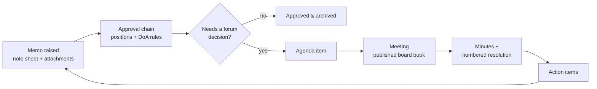
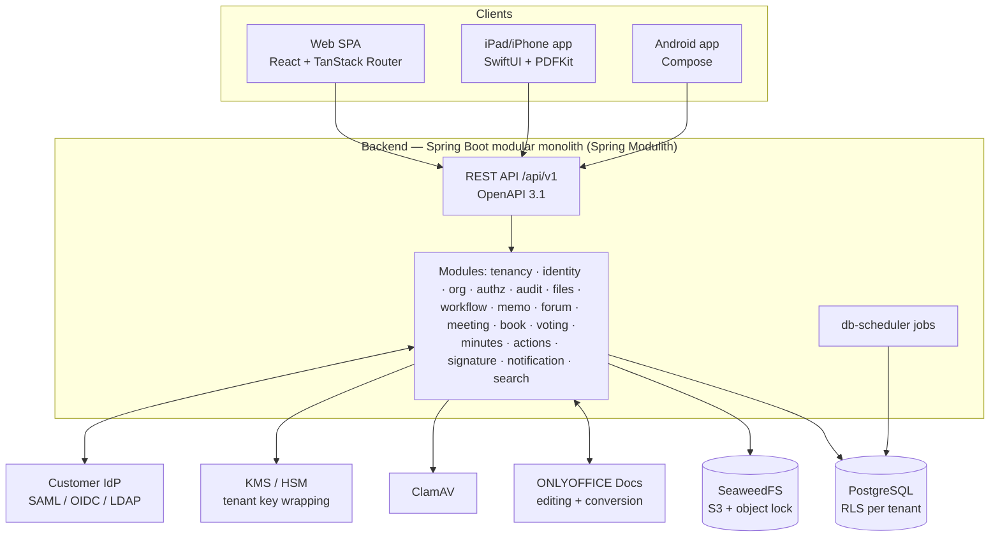
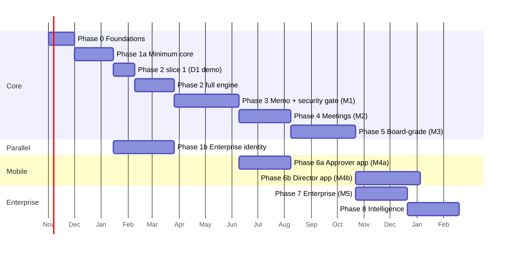

# Master Plan — Memo & Meeting Management Platform

> **For the coding agent.** This is the high-level, phase-by-phase plan. Read `AGENTS.md` first: it holds the locked decisions, non-negotiable rules, the session protocol and the **mandatory low-level planning protocol** you must follow at the start of every phase. Testing obligations are in `docs/plan/TESTING_STRATEGY.md`; current progress is in `docs/plan/STATUS.md`. This document says *what* each phase must achieve and *what to research*; the low-level plan you write says *how*.
>
> Baseline research date: **October 2026**. Every version, license and status below must be re-verified at the start of the phase that uses it.

---

## 1. Product vision

One platform that carries an organization's decisions from the first memo to the board resolution and back:

### Product principles
1. **One pipeline, many forums.** A department meeting, a management committee, board committees and the board are the same engine with different policies.
2. **Configuration, not customization.** Every organizational difference (memo types, numbering, routing, quorum, templates, terminology) is tenant data.
3. **The record is sacred.** Append-only note sheets, immutable published versions, hash-chained audit, object-locked storage.
4. **Familiar documents.** Users keep working in Word/Excel-style documents (ONLYOFFICE in the browser), not a new editor.
5. **Two experiences.** Power tools for administrators and company secretaries; a near-zero-learning reading, voting and signing experience for directors and approvers.
6. **Deploy anywhere.** The same artifacts run as multi-tenant SaaS, dedicated single-tenant, or on-premise with no third-party SaaS dependencies.

---

## 2. Market reference — what industry leaders do and where we will be better

Use this as the benchmark. During each phase's research step, go deeper on the features that phase covers (vendor help centers, release notes, reviews).

### 2.1 Board portals (Diligent, Nasdaq Boardvantage, OnBoard, Azeus Convene, iBabs, Admincontrol)

| Pattern observed in the market | Reference | Our phase |
|---|---|---|
| Agenda builder → board book assembly → single published version; late edits flagged and re-synced to every device | OnBoard, Aprio | 4, 5 |
| Permissions down to individual documents within an agenda item | Convene (user reviews) | 4, 5 |
| Resolution numbering rules configured once in meeting templates (e.g. `RES-2026-005-BOARD`) | Diligent | 4 |
| Approvals/voting on written consents, budgets, minutes, resolutions; e-signing of minutes and resolutions | Nasdaq Boardvantage | 5 |
| Circulating (between-meeting) resolutions | Diligent guidance | 5 |
| Decision register filterable by date, agenda type and approved/rejected status; action items with red/amber/green status | iBabs | 4 |
| Annotation of board materials from any device; offline access | Diligent, iBabs, Admincontrol | 5, 6b |
| SSO/MFA, biometric login, watermark on every page, print disabled, remote wipe, access tracking aligned to retention and legal hold | OnBoard | 1a, 1b, 5, 6a |
| Device registration, encrypted on-device storage, remote wipe | Directors Desk, Admincontrol | 6a |
| SOC 2 audit and ISO 27001 certification as table stakes | Nasdaq Boardvantage | 7 |
| AI: agenda from a prompt, minutes drafted from transcripts, book summaries, Q&A scoped to the official record, no training on customer data | OnBoard, Nasdaq, Convene | 8 |
| Bank use case: loan committee review rooms with automatic notification on sign-off | Convene | 4, 5 |
| Board evaluations, D&O questionnaires, skills matrix, entity management | Diligent, Nasdaq, OnBoard | 9 |

### 2.2 E-office / memo systems (government eFile systems, memo workflow products)

| Pattern | Reference | Our phase |
|---|---|---|
| A *file* is a container of receipts, notes, correspondence and drafts | eOffice manuals | 3 |
| The note sheet is append-only; notes cannot be deleted or replaced | eOffice manuals | 3 |
| Inbox / sent / drafts; always visible who currently holds a file; forward with remarks; close | eOffice manuals | 2, 3 |
| Routing follows the organization's authority structure; staff transfers automatically reflected in routing | Memo workflow case study (insurer) | 1b, 2 |
| Final memo PDF generated with approval history merged with attachments | Memo workflow case study | 3 |

### 2.3 Known weaknesses of incumbents (our openings)
- **Rigid minutes and template formats** → tenant-editable Word templates (Phase 3/4).
- **Steep learning curve for non-technical directors** → dedicated simplified director mode on web and mobile (Phases 5/6).
- **Offline edit/sync mismatches** → append-only annotation operations with deterministic merge (Phase 6b).
- **Gaps in e-signature and access-rights management** → first-class ABAC and built-in PAdES signing (Phases 1/5).
- **Board-only scope; weak operational layer** → the memo-to-resolution pipeline is our core differentiator (Phases 2–4).

---

## 3. Domain glossary (shared language for code, docs and UI)

| Term | Meaning |
|---|---|
| Tenant | A customer organization (isolation boundary). |
| Legal entity | A company within a tenant's group (subsidiaries). |
| Unit | Department/branch/division; hierarchical. |
| Position | A seat in the org (e.g. "Head of Credit Risk"), independent of who holds it. Routing binds to positions. |
| Assignment | A person holding a position for a period (primary, additional, acting). |
| Delegation | Time-boxed transfer of a position's authority to another person; actions record "acting for". |
| Classification | Confidentiality level (e.g. Public / Internal / Confidential / Strictly Confidential), tenant-defined. |
| Memo (file) | Container: structured metadata + main document (.docx) + attachments + note sheet + references. |
| Note sheet entry | Append-only remark/decision on a memo by a person in a step. |
| Memo type | Tenant-defined type with metadata schema, template, numbering scheme and default workflow. |
| Workflow definition | Versioned, data-defined template for routing any item (memo, agenda submission, minutes approval, circular resolution, action closure). |
| Workflow instance / task | A running definition pinned to its version; tasks assigned to people via resolver rules. |
| Route | The ordered list of steps/approvers for one workflow instance. Either derived from an admin-defined definition, or **built by the initiator** at submission (stored as a generated definition, so both use the same engine). |
| Round | One pass of a route. A returned and resubmitted item continues the **same instance** as round N+1; earlier rounds stay in history but their approvals do not count. |
| Return vs Reject | **Return** sends the item back to the initiator (or, later, a previous step) for revision; the item stays alive. **Reject** is final; the item closes as rejected. Tenants may rename both labels. |
| Document version | Immutable version of a memo's main document with a content hash. Every approval records the version and hash it applied to. |
| Delegation of Authority (DoA) rule | Tenant rule mapping (item type, amount, unit, other attributes) → required approver positions/forums. |
| Forum type / Forum | Policy template (quorum, voting, minutes rules, classification) / a concrete committee or board with members and terms. |
| Meeting | An occurrence of a forum with agenda, attendees, book, minutes. |
| Agenda item | Item on a meeting agenda, often sourced from an escalated memo. |
| Book version | Immutable published compilation of a meeting's materials. |
| Annotation | A user's private (or explicitly shared) mark-up on a book version. |
| Vote / Approval | A recorded decision by a member on a question, in or between meetings. |
| Resolution | Numbered formal decision of a forum. |
| Minutes | The approved record of a meeting. |
| Action item | Follow-up task with owner, due date, status; may spawn a memo. |
| Decision register | Searchable list of all resolutions/decisions across forums. |
| Audit event | Immutable, hash-chained record of a state change or sensitive read. |

---

## 4. Architecture overview

**Deployment topologies (same artifacts):**
- **SaaS multi-tenant:** shared database with RLS; shared storage with per-tenant key wrapping.
- **Dedicated:** one tenant per deployment (customer's cloud account or ours).
- **On-premise:** Helm (Kubernetes) or Docker Compose profile; customer-provided PostgreSQL and S3-compatible storage allowed.

**Authentication model:**
- **Web:** server-side session in an `HttpOnly`, `Secure`, `SameSite` cookie, stored in PostgreSQL (Spring Session JDBC); CSRF protection on; **no tokens in browser storage**.
- **Mobile:** OAuth 2.1 authorization code + PKCE against a token issuer running inside the backend (Spring Authorization Server), which federates to the tenant's IdP; short-lived access tokens, rotating refresh tokens bound to a registered device.
- **Step-up:** sensitive actions (approve, sign, vote, change security settings) can require a fresh MFA within a configurable window.

**File delivery:** documents are envelope-encrypted by the application, so **downloads always stream through the backend** (decrypt + HTTP range support for page-by-page PDF loading). Object storage is never exposed to clients and presigned URLs are never handed to browsers or apps. ONLYOFFICE fetches files only via short-lived, single-purpose signed URLs to a backend endpoint.

**Caching and multi-node coordination (no Redis):** in-process caches (Caffeine) invalidated across nodes through PostgreSQL `LISTEN/NOTIFY`; app nodes are stateless; db-scheduler guarantees single execution across the cluster.

**Real-time:** live meeting state (current agenda item, live votes, attendance) over WebSocket/SSE from the backend, fanned out across nodes via PostgreSQL `LISTEN/NOTIFY` — choose transport by ADR in Phase 5.

---

## 5. Technology baseline (as researched, October 2026 — re-verify per phase)

| Component | Status at research time | Notes |
|---|---|---|
| Spring Boot | 4.1 released June 2026; Kotlin 2.3 baseline; 4.2 expected November 2026 | 4.0 OSS support ends end of 2026 — start on the latest 4.x minor |
| Spring Modulith | 2.x (built on Boot 4 / Framework 7), Apache-2.0 | Module verification, per-module Flyway migrations, event publication registry |
| Spring Security | 7.x | OIDC, SAML 2.0 service provider, LDAP |
| Spring Session JDBC / Spring Authorization Server | Part of the Spring portfolio, Apache-2.0 | Web sessions in PostgreSQL; in-house OAuth token issuer for mobile — verify current versions |
| Caffeine / Bucket4j | Apache-2.0 | Local caching; rate limiting backed by PostgreSQL — verify JDBC backend support |
| Kotlin | 2.3.x | Supports Java 25 |
| jOOQ | 3.20 (requires Java 21) | Verify open-source edition terms for PostgreSQL |
| db-scheduler | Active, Apache-2.0 | PostgreSQL-backed, cluster-safe single execution |
| Apache PDFBox | 3.0.8 (July 2026), Apache-2.0 | CVE-2026-23907 affected ≤ 3.0.6 — never pin below a patched version |
| EU DSS | 6.x (6.5 RC July 2026), LGPL-2.1 | PAdES/XAdES/CAdES/ASiC, timestamps, validation |
| ONLYOFFICE Docs | 9.4 (May 2026), AGPL-3.0 + additional terms | 20-connection limit removed from Community Edition; integrator provides document manager + storage; legal review of AGPL terms before on-prem distribution |
| SeaweedFS | 4.48 (September 2026), Apache-2.0 | Object lock must be enabled at bucket creation; versioning required |
| TanStack Router / Query / Table / Form / Virtual | Stable | TanStack Start is still RC — not used |
| @hey-api/openapi-ts | 0.9x (pre-1.0) | TanStack Query plugin; pin exact version |
| Kotlin Multiplatform | Stable; Swift export experimental | Use Obj-C export + SKIE |
| Encrypted local DB (KMP) | Several options; some SQLCipher drivers are very new (0.1.x, July 2026) | ADR required; prefer mature paths |
| OWASP ASVS | 5.0.0 (May 2025), 17 chapters, L1–L3 | Target L2 overall, L3 for auth/authz/crypto/audit |
| OWASP MASVS / MASTG / MASWE | MASTG 2.0 (June 2026), MASWE 1.0 (August 2026) | Mobile verification baseline |
| MinIO | **Do not use** — community edition abandoned and archived in 2026 | SeaweedFS instead |

---

## 6. Cross-cutting requirements (apply to every phase)

| Area | Requirement |
|---|---|
| Tenancy | RLS enabled + forced on all tenant tables; `SET LOCAL` tenant context inside a transaction for **every** database access (reads included); tenant context explicitly carried into background jobs, async event listeners and scheduled tasks; cross-tenant tests per module |
| Authorization | Deny-by-default ABAC: role, forum membership, unit scope, classification, recusal, delegation; step-up MFA for sensitive actions |
| Audit | Hash-chained **per tenant**, append-only, exportable; written in the **same transaction** as the business change (transactional outbox / Spring Modulith event publication registry); sensitive reads audited at document-open granularity (not per page) |
| Operator access | Platform staff have **no standing access** to tenant data. Break-glass access requires customer approval, is time-boxed, fully audited and visible to the customer |
| Security | ASVS 5.0 L2 baseline; MFA; secure headers + CSP; file scanning; secrets management; per-tenant envelope encryption; rate limiting on login, OTP, upload, search and export |
| Untrusted files | Hard limits on size, page count, decompression ratio and processing time in Tika, PDFBox (file-backed memory mode) and conversion; conversion services run without outbound network access and with CPU/memory limits |
| Testing | Per `docs/plan/TESTING_STRATEGY.md`: every phase plans and passes its required test layers |
| UX | Every phase produces wireframes for its main journeys, validates them with pilot users before build, and runs a usability check before exit |
| Dependencies | All versions pinned (Gradle version catalog, pnpm lockfile); automated update PRs (Renovate or Dependabot) go through all CI gates |
| Privacy | Data minimization in logs; per-tenant data export; retention policies; legal hold |
| i18n | ICU messages; multi-language; RTL-ready; locale-aware dates/numbers; tenant-configurable terminology |
| Accessibility | WCAG 2.2 AA |
| Performance (proposed — confirm in Phase 0) | p95 < 300 ms for common reads; first page of a book visible < 2 s; 500-page book compile < 60 s; 1,000 concurrent users per mid-size tenant |
| Availability (proposed) | SaaS 99.9%; RPO ≤ 15 min; RTO ≤ 4 h; backups encrypted and restore-tested quarterly |
| Observability | OpenTelemetry traces/metrics/logs with tenant and correlation ids; no document content in logs |
| Supply chain | SBOM, dependency + image scanning, signed images, license register |

---

## 7. Phases

Each phase below lists: **Goal**, **Scope**, **Research questions** (answer them in the phase `research.md`), and **Exit criteria**. Follow the planning protocol in `AGENTS.md §5` before coding.

Milestones:
- **D1 — Pilot demo: simple sequential memo approval** (end of Phase 2's first slice; demo only, not production)
- **M1 — Pilot memo go-live** (end of Phase 3; **includes an external pen test and ASVS L2 verification of Phases 0–3**)
- **M2 — Committee meetings live** (end of Phase 4)
- **M3 — Board-grade web** (end of Phase 5)
- **M4a — Mobile approver app** (end of Phase 6a)
- **M4b — Mobile director app** (end of Phase 6b)
- **M5 — Enterprise-ready / certification evidence** (end of Phase 7)

Sequencing rules:
- Phase 1 is split: **1a (minimum core)** must finish before Phase 2 starts; **1b (enterprise identity & org)** runs in parallel with Phase 2 and must finish before Phase 3 exits.
- Phase 6a (mobile approver) starts once Phase 3's memo APIs are stable; Phase 6b (mobile director) starts once Phase 5's book, annotation and voting APIs are stable.
- Phase 7 work needed for the M1 pilot (packaging, backups, monitoring, security verification) is pulled forward into Phases 0–3 in minimal form; Phase 7 repeats verification for the whole product.

---

### Phase 0 — Foundations and engineering baseline

**Goal:** A repository, toolchain and pipeline where a trivial vertical slice (login-less health page → API → DB → web) builds, tests, scans and deploys to a dev environment in one command.

**Scope**
- Monorepo layout per `AGENTS.md §4`; Gradle (Kotlin DSL) for backend + KMP; pnpm workspace for web.
- Spring Boot app skeleton with Spring Modulith and empty modules; `ApplicationModules.verify()` test.
- PostgreSQL with Flyway; migration role vs app role; RLS helper conventions and a reference tenant table with cross-tenant test.
- Local dev stack via Docker Compose: PostgreSQL, SeaweedFS, ONLYOFFICE Docs, ClamAV, a local mail catcher.
- Web skeleton: Vite, React, TanStack Router (file-based routes), Query, generated API client, shadcn/ui shell, i18n setup, design tokens, light/dark themes, axe checks.
- CI pipeline with all gates listed in `AGENTS.md §4` (build, tests, lint, type-check, OpenAPI drift, license scan, SBOM, container scan, secret scan).
- Environments: dev, staging; infrastructure-as-code for the SaaS environment; first Helm chart skeleton.
- ADR template, dependency register, threat-model template, `docs/plan/STATUS.md` session tracker, `CLAUDE.md` pointer to `AGENTS.md`.
- **Test infrastructure per `docs/plan/TESTING_STRATEGY.md`:** test pyramid wiring for backend, web and (stub) mobile; Testcontainers base classes; seeded **demo tenant** fixture and test-data builders; Playwright with an authenticated-session fixture; axe; OpenAPI drift check; OWASP ZAP baseline scan against the dev deployment; Gatling skeleton; CI stages (PR / nightly / release).
- Gradle version catalog and pnpm lockfile with all versions pinned; Renovate or Dependabot configured.
- Confirm non-functional targets (performance, availability, RPO/RTO) with the product owner.

**Research questions**
- Exact current versions of Spring Boot 4.x, Kotlin, Java LTS, Spring Modulith, jOOQ (+ license edition for PostgreSQL), Flyway, Testcontainers.
- jOOQ code generation strategy with Flyway + Testcontainers in CI.
- ESLint + Prettier vs Biome; Vitest/Playwright setup with TanStack Router.
- @hey-api/openapi-ts configuration for TanStack Query `queryOptions` style output.
- SeaweedFS deployment topology for dev vs production; object-lock bucket bootstrap.
- Container base images (minimal, regularly patched) and image signing.

**Exit criteria**
- `make dev` (or equivalent) starts the full local stack; the sample slice works end to end.
- CI green with all gates; SBOM and license report produced.
- Cross-tenant RLS test passes on the reference table and fails if RLS is disabled (proved by a negative test).
- ADRs written for every decision taken in this phase.

---

### Phase 1a — Platform minimum core

**Goal:** The smallest platform the Phase 2 first slice needs, built to production quality: tenants, users who can log in securely, an org directory, permissions, an unbreakable audit trail, secure files and notifications.

**Scope**
- **Tenancy:** create, configure and suspend tenants; per-tenant settings; platform admin console on a separate, audited path. **No standing operator access to tenant data** (break-glass arrives in 1b).
- **Tenant context plumbing:** request filter + transaction interceptor that sets `app.tenant_id` with `SET LOCAL` in every transaction; a `TenantContext` that is explicitly propagated into db-scheduler jobs, async Modulith event listeners and executors; a build-time or test-time guard that fails if a tenant table is accessed without context.
- **Identity (local):** local accounts, invitation, password policy (length-based, breached-password check against an offline list), account lockout, MFA with TOTP, recovery codes, session management (idle/absolute timeouts, list and revoke sessions). Web sessions via Spring Session JDBC with CSRF protection.
- **Step-up authentication** service (fresh-MFA window) used by later sensitive actions.
- **Rate limiting** on login, OTP verification, password reset, upload and search.
- **Org directory:** legal entities, units (tree), positions, users assigned to positions (primary only), reporting lines, manual editing with change history.
- **Authorization:** central policy service (RBAC + ABAC skeleton): roles, unit scope, classification clearance; checks in the service layer; permission-filtered queries pushed into SQL.
- **Audit:** per-tenant hash-chained audit store written in the same transaction as the change (outbox via Spring Modulith event publication registry); tamper-verification job; basic audit viewer and export; anchoring of chain heads into an object-locked bucket.
- **Files service:** upload with content detection, ClamAV scan **before** encryption, per-tenant envelope encryption (pluggable key provider; a local/software KEK provider is acceptable in 1a with the KMS/HSM provider in 1b), versioning, object-locked record buckets, **streamed downloads through the backend with HTTP range support** (never presigned URLs to clients), hard limits against decompression and PDF bombs.
- **Notifications:** in-app notification center and email (tenant-configurable SMTP relay, templates); content-free push payload design (sending arrives in Phase 6a).
- **Tenant admin console (basic):** users, org directory, roles, classification levels, terminology, branding.
- **i18n & terminology:** language packs; tenant-level term overrides (e.g. "Memo" vs "Note" vs "Proposal").

**Research questions**
- Spring Security 7 local login + TOTP MFA + step-up patterns; Spring Session JDBC configuration and cleanup.
- Tenant context propagation patterns for Spring transactions, Kotlin coroutines (if used), executors, db-scheduler and Modulith async listeners.
- Audit hash-chain design under concurrent writes (per-tenant chain, sequence allocation, locking); anchoring frequency; verification performance at scale.
- Envelope encryption library and key-provider abstraction; streaming decryption with range requests.
- ABAC implementation approach (in-code policy service vs policy engine); performance of permission-filtered list queries.
- Bucket4j with a PostgreSQL backend vs alternatives for rate limiting without Redis.

**Exit criteria**
- A tenant can be created; users log in with password + TOTP; sessions can be listed and revoked; step-up works.
- Org directory manageable via UI.
- Every state change produces an audit event in the same transaction; tamper verification detects an altered row in a test.
- Files are scanned, encrypted with tenant keys, versioned and streamed with range support; record buckets are object-locked; malicious-file corpus tests pass.
- A test proves background jobs and async listeners run with the correct tenant context and fail closed without it.
- Cross-tenant and permission tests pass for all endpoints.

---

### Phase 1b — Enterprise identity and organization (runs in parallel with Phase 2)

**Goal:** Everything a bank's IT and security teams require from identity and organization management before go-live.

**Scope**
- **Federated identity:** per-tenant OIDC, SAML 2.0 and LDAP configuration (dynamic relying-party registrations from the database); group-to-role mapping; just-in-time provisioning; WebAuthn/passkeys.
- **Mobile token issuer:** Spring Authorization Server inside the backend (authorization code + PKCE, device-bound rotating refresh tokens), federating to the tenant's IdP. Needed by Phase 6a.
- **Organization (full):** additional and acting assignments with dates, delegation (time-boxed, scoped, recorded as "acting for"), bulk import from CSV/Excel, and **scheduled org synchronization from HR systems** (file drop or API, with a dry-run diff and approval before applying).
- **Keys:** KMS/HSM key provider (self-hosted option such as OpenBao, cloud KMS, or PKCS#11 HSM — decide by ADR), key rotation, crypto-shredding on tenant offboarding.
- **Tenant lifecycle completion:** export and offboarding.
- **Break-glass operator access:** customer-approved, time-boxed, fully audited support access, visible to the tenant's admins.
- **Admin console completion:** IdP configuration, notification templates, delegation management.

**Research questions**
- Spring Security 7 multi-tenant SAML/OIDC registration from the database; LDAP bind and group mapping; WebAuthn support level.
- Spring Authorization Server: federation to external IdPs, device binding, token lifetimes for mobile.
- KMS/HSM options for self-hosted and cloud; key rotation without re-encrypting all documents (re-wrap data keys only).
- HR-system integration patterns (file formats, delta vs full sync, handling transfers and terminations safely).
- Industry: how board portals and e-office systems model delegation/acting roles and administrator separation of duties.

**Exit criteria**
- SSO tested against at least Microsoft Entra ID, ADFS and one generic OIDC provider, plus an LDAP directory.
- Org graph with assignments and delegation fully manageable via UI, import and scheduled sync.
- Key rotation and crypto-shredding proven by tests.
- Break-glass access flow works end to end and appears in the tenant's audit log.
- ASVS L2 checklist for V6–V9, V11, V14, V16 reviewed and recorded for Phase 1a + 1b.

---

### Phase 2 — Workflow engine

**Goal:** A general, data-driven routing engine used for memos and, later, agenda submissions, minutes approval, circular resolutions and action closure.

**First slice — "simple sequential memo approval" (build this before anything else in the phase)**

The most common real-world case must work end to end, with no admin setup, before the advanced engine features are added. It ships as a built-in default template and is built on the same tables and runtime the full engine uses, so later features extend it rather than replace it.

1. A user creates a **draft memo** (minimal form: subject, memo type, classification) and **uploads a .docx** → document version 1 with content hash.
2. The initiator **builds the route**: an ordered list of approvers picked from the org directory. Validation: at least one approver, no duplicates, not the initiator, only active users, and **every approver has clearance for the memo's classification** (re-checked when a task is assigned, so a later clearance change cannot leave a memo stuck unseen). Whether initiators may build routes is a per-memo-type setting (`initiator-defined | fixed | both`).
3. **Submit** → round 1 starts; the first approver gets a task in their inbox (in-app + email notification).
4. Approver actions: **Approve** (moves to the next approver), **Return** (back to the initiator; remark mandatory), **Reject** (final; remark mandatory). Initiator may **Withdraw** until final approval.
5. On **Return**, the memo is unlocked for the initiator. They upload (or later, edit in ONLYOFFICE) a new document version, may edit the route, write a response remark, and **resubmit** → the **same workflow instance continues as round 2, restarting from the first approver**.
6. When the **last approver of the current round approves**, the memo status becomes **Approved**.
7. Every action writes an append-only note sheet entry and an audit event, and records the document version + hash it applied to. The document is read-only while in review.
8. A tenant admin can **reassign a pending task** (approver on leave or deactivated) — the minimal safety valve until delegation and escalation arrive.

Minimal memo screens (create, inbox, memo view with history grouped by round) are built here and reused/extended by Phase 3. In-browser ONLYOFFICE editing is the last task of this slice; upload/replace of .docx comes first.

**Scope (full engine, built on top of the first slice)**
- **Definition model** (versioned JSON, validated by schema): step types (review, approve, sign, notify, parallel all/any/n-of-m, conditional branch, escalate-to-forum, sub-workflow), allowed actions per step (approve, reject, return to originator, return to a previous step, forward with remark, seek clarification, delegate), SLA per step with reminder and escalation policies.
- **Rounds and resubmission policy:** a returned item resubmits into the same instance as a new round. Per-definition policy: `restart from first step` (default, and the only policy in the first slice), `resume from the returning step`, or `restart but skip steps whose approvers saw an unchanged document version`. Approvals from earlier rounds remain in history but never count toward the current round.
- **Initiator-defined routes (extended):** parallel groups, positions instead of named people, restriction to an allowed approver list, and automatic validation against DoA rules (e.g. a required approver must be in the route before submission is allowed).
- **Assignee resolvers:** position; relative (initiator's supervisor, N levels up, unit head); role within unit; DoA rule lookup (attribute-based thresholds); forum (secretariat queue); explicit person chosen by the initiator (governed by memo-type policy).
- **Condition language:** safe, sandboxed expressions over item attributes (no arbitrary code).
- **Lifecycle governance:** draft → review (maker-checker) → published; instances pinned to the version they started on; migration tool for in-flight instances only by explicit admin action.
- **Runtime:** task creation, inbox, claim/release for queues, action handling with mandatory remarks where configured, history timeline, "who holds it now" tracking, recall by initiator (before first action), cancellation with reason.
- **Ad-hoc routing mode:** free forwarding within constraints (allowed units/levels), mixed with fixed skeleton steps.
- **Scheduling:** SLA timers, reminders and escalations via db-scheduler; business calendars (tenant working days, holidays, time zones).
- **DoA rules management:** UI to maintain the delegation-of-authority matrix; simulator ("for this memo type, amount and unit, who approves?").
- **Visual builder:** React Flow based editor with validation, preview and simulation; diff between versions.
- **Events:** published for other modules (task created, step completed, instance completed/rejected, escalated).

**Research questions**
- Condition expression language: options such as CEL (Java implementation), SpEL in a restricted context, or a small custom DSL — security, auditability, admin usability.
- Engine approach: own state machine on PostgreSQL vs embedding an engine (e.g. Flowable/Camunda 7 community) — evaluate licenses, complexity for on-prem, fit with data-driven definitions and audit needs. Default expectation: own engine unless research shows clear advantage.
- Concurrency and idempotency for parallel steps and simultaneous actions.
- How e-office systems handle "return", "seek clarification" and "park"; how memo products handle staff transfer mid-workflow.
- How e-office and memo products label and display returned/resubmitted rounds, and what auditors expect to see in the history.
- Preventing double actions under concurrency (row locks vs optimistic version checks + idempotency keys).
- UX benchmarks for visual approval builders.

**Exit criteria**
- **First slice:** a user creates a memo with a .docx, chooses approvers in order, submits; an approver returns it; the initiator uploads version 2 and resubmits; round 2 restarts from the first approver; the last approval marks it Approved. Proven by an end-to-end test, with: one approval per double-click, round-1 approvals not counted in round 2, document locked during review, cross-tenant isolation, and an audit event per action.
- A tenant admin can build, simulate, get approval for, and publish a multi-step workflow with conditions, parallel branches, SLAs and escalation — without developer involvement.
- In-flight instances survive definition changes (version pinning proven by test).
- Load test: 10,000 active instances with timers per tenant without degraded inbox latency (target confirmed in Phase 0).
- Full audit of every action, including delegated "acting for" actions.

---

### Phase 3 — Memo and e-file management → **Milestone M1: pilot go-live**

**Goal:** The day-to-day memo system the pilot bank can run its approvals on.

**Scope**
- **Memo types:** per-type metadata schema (form builder: text, number, amount + currency, date, unit, person, choice, attachments required), default template, numbering scheme, default workflow, default classification, retention policy.
- **Numbering service:** configurable formats (prefix, entity/unit codes, year, sequence with padding, reset rules); **gapless** (a locked counter row per tenant + scheme + period inside the business transaction — not a PostgreSQL sequence, which can skip values); numbers assigned at the configured moment (on submit or on final approval); voids recorded, never reused.
- **Memo lifecycle** (extends the Phase 2 first slice): draft → in review (round N) → approved / rejected / withdrawn, with **returned** as a loop back to the initiator → closed/archived; references and links between memos; "related files".
- **Document versioning:** each memo keeps an immutable chain of document versions (v1, v2, …) with content hashes; the document is editable only in Draft or Returned; every approval is bound to the version + hash it approved; version comparison view (side-by-side text diff of extracted content).
- **Main document editing:** ONLYOFFICE integration — open/edit .docx and .xlsx in browser; JWT-signed editor configs; callback handler for save/force-save; document key per version; co-editing during drafting; read-only once submitted (a new version can only be created while the memo is Draft or Returned); conversion to PDF.
- **ONLYOFFICE hardening:** JWT required on editor configs, browser requests and callbacks; callback endpoint reachable only from the ONLYOFFICE network; document URLs are short-lived, single-purpose signed links to the backend; macros and plugins disabled; no outbound internet from ONLYOFFICE; encrypted cache volume with cleanup of cached files after sessions; CPU/memory limits; all of this behind an adapter interface so the editor can be swapped.
- **Convert on upload:** every uploaded or saved document is converted to PDF and text-extracted asynchronously at upload time, so previews, search and later book compilation never wait on conversion.
- **Desktop Word option (research-gated):** "Edit in desktop Word" via WebDAV + Office URI scheme if research confirms secure token handling.
- **Templates:** tenants upload their existing .docx letterheads/templates with placeholders; server-side fill of metadata (reference number, dates, names, approval blocks).
- **Note sheet:** append-only entries per step and action, with rich-text remarks (simple editor), attachments, and mentions; corrections as linked entries.
- **Attachments:** any file type; preview via conversion; per-attachment classification override (stricter only).
- **Access:** classification + unit scope + workflow participation + explicit share; "copy to" distribution with read receipts.
- **Electronic signature v1:** approval actions recorded with authentication context (MFA freshness, IP, device, document hash) and rendered as approval stamps; **step-up MFA before approval** configurable per memo type.
- **Final rendition:** on approval, generate an archival PDF (PDF/A) combining the memo document, note sheet history, approval stamps and attachments, with bookmarks; store in an object-locked bucket; checksum recorded in the audit log.
- **Inbox & tracking:** my tasks, sent, drafts, watching, team view for unit heads; overdue indicators; bulk actions where allowed; mobile-friendly web views.
- **Search:** PostgreSQL full-text search over metadata, note sheet and extracted document text (Tika), using generated `tsvector` columns with GIN indexes and a text-search configuration per language; permission-filtered results; saved searches. Extracted text is as confidential as the document: database storage encryption is mandatory in every deployment.
- **Migration & import:** bulk import of legacy memos (files + metadata spreadsheet), preserving original documents as source of truth with generated PDF renditions and extracted text; import report.
- **Dashboards:** pending by person/unit, average approval time per type, overdue, throughput.
- **Pilot readiness (pulled forward from Phase 7):** deployment to the pilot's chosen environment, backups with restore drill, monitoring and alerting, runbooks, support process, user training material.
- **Pre-go-live security gate:** external penetration test and ASVS 5.0 L2 verification covering everything built in Phases 0–3; all critical/high findings fixed and retested before M1.

**Research questions**
- **Complex-script rendering:** PDFBox does not perform OpenType text shaping, so Indic scripts (e.g. Bengali) and Arabic render incorrectly in generated pages (note sheet, approval stamps, watermarks, cover pages). Evaluate generating those pages through ONLYOFFICE Document Builder or an HTML-to-PDF engine with proper shaping, then merging with PDFBox. Validate with the pilot's real languages and documents **early in the phase**.
- ONLYOFFICE Docs API: callback statuses, force-save, document key/versioning rules, JWT configuration, conversion API, cache behaviour and cleanup, scaling and HA for production; AGPL + additional-terms obligations for SaaS and on-prem distribution (prepare a legal review brief).
- Server-side .docx templating library (e.g. poi-tl, docx4j, or ONLYOFFICE Document Builder): fidelity with real bank templates, license, maintenance.
- PDF/A generation and validation (PDFBox + veraPDF) for merged renditions.
- Permission-filtered full-text search performance in PostgreSQL; when to introduce OpenSearch.
- Secure desktop-Office round-trip (WebDAV + `ms-word:` URI) — token scoping, expiry, audit; Windows/macOS behaviour.
- Industry: memo numbering, "copy to" and file movement conventions in e-office systems; pilot bank's current memo practice (from onboarding workshops).

**Exit criteria**
- The pilot bank's top memo types (collected via the onboarding checklist, §9) run end to end with their real templates, numbering and DoA rules, configured by admins without code.
- Final PDF renditions validate as PDF/A and match the approved content; object-lock verified.
- Legacy import of a sample of pilot data succeeds with a reconciliation report.
- Generated pages render the pilot's languages correctly (golden-file tests with real names and remarks).
- External pen test and ASVS L2 verification complete; no open critical/high findings.
- UAT sign-off by the pilot; production deployment live with monitoring, backups (restore tested) and runbooks.

---

### Phase 4 — Forums, meetings, minutes, resolutions, actions → **Milestone M2**

**Goal:** Management committees and board committees run their meetings on the platform, fed by escalated memos.

**Scope**
- **Forum types & forums:** policy templates (quorum rules, voting rules, who may submit items, minutes approval workflow, classification, retention); forums with members, roles (chair, secretary, member, invitee, observer), terms of office, alternates.
- **Agenda submissions:** memos escalated by workflow, or direct submissions through a submission workflow; secretary triage; deadline rules.
- **Meetings:** scheduling (physical/virtual/hybrid; video link as plain field), iCalendar invites and updates (RFC 5545), RSVP, attendance capture, quorum check (live and recorded).
- **Agenda builder:** sections, items, presenters, time allocations, consent agenda, drag-and-drop (dnd-kit), item-level and document-level permissions, cloning from previous meetings and templates.
- **Conflict of interest:** declarations per item; recusal automatically hides restricted materials from the conflicted member and excludes them from voting/quorum on that item.
- **Minutes:** tenant templates (.docx via ONLYOFFICE) pre-filled from the agenda; secretary drafting; approval workflow (chair review, member confirmation); locked once approved.
- **Resolutions:** configurable numbering per forum and year; resolution text linked to agenda item and minutes; resolution register.
- **Decision register:** cross-forum search and filters (date, forum, type, outcome), exportable for auditors.
- **Action items:** owner, due date, status with red/amber/green, reminders and escalations (workflow engine), progress updates, closure verification, spawning follow-up memos, carry-forward to next meeting's "matters arising".
- **Basic meeting analytics:** attendance rates, actions overdue, time from submission to decision.

**Research questions**
- How leaders model consent agendas, multi-tier agendas and late additions (and which UX they are criticized for).
- iCalendar libraries for the JVM (e.g. ical4j) and invite update/cancel semantics across Outlook/Gmail clients without third-party APIs.
- Quorum rule expressions across sectors (majority of members, specific roles required, independent directors).
- Minutes template patterns and minutes approval practices in banks and listed companies.

**Exit criteria**
- An escalated memo becomes an agenda item, then a resolution with a number, then action items, then a follow-up memo — all linked and auditable.
- Recusal is enforced server-side (proved by authorization tests), including in search and notifications.
- Pilot runs at least one real committee cycle on the platform.

---

### Phase 5 — Board-grade governance → **Milestone M3**

**Goal:** Feature and security parity with leading board portals on the web, plus our pipeline advantage.

**Scope**
- **Board book compiler:** merge item documents (already converted to PDF at upload time) into one book with cover, table of contents, bookmarks, page numbering, section dividers, per-section permissions (personalized books per member where items are restricted). Compilation runs as a background job with progress reporting; PDFBox uses file-backed memory; late changes recompile incrementally where possible.
- **Publishing:** immutable book versions; late changes create a new version with change flags and a "what changed" summary; members notified; older versions retained. **At publish time, each member's personalized, watermarked copy (name + version) is generated in the background and stored**, then reused for web viewing and mobile offline download — never stamped per view.
- **Secure viewer (web):** PDF.js based, using linearized PDFs streamed with HTTP range requests so the first page appears quickly in very large books; PDF.js worker; virtualized page rendering; download/print governed by policy (documented honestly as deterrence plus audit, not absolute prevention); session and idle timeouts; sensitive-read audit at document-open granularity.
- **Annotations:** highlights, notes, ink; private by default; explicit sharing to specific members or the secretary; tied to book version with carry-forward to new versions where the page is unchanged.
- **Voting & approvals:** in-meeting votes, between-meeting approvals, written consents, circular resolutions with deadlines and pass rules (majority, unanimity, n-of-m); abstain/recuse; optional secret ballot; results locked and audited.
- **Digital signatures:** PAdES signing of minutes and resolutions using EU DSS; internal CA per tenant (step-ca or EJBCA) with certificate lifecycle; RFC 3161 timestamps from a self-hosted TSA; long-term validation; signature verification view. Design for later support of customer-held certificates on hardware tokens (licensed CA) via a local signing helper.
- **Live meeting mode:** presenter-controlled current item, live attendance and votes, secretary notes; real-time transport chosen by ADR.
- **Director mode (web):** stripped-down UI: upcoming meetings, book, annotate, vote, sign, my actions.
- **Review rooms:** time-boxed restricted spaces for committee review of documents outside meetings (e.g. credit/loan committee), with sign-off tracking.

**Research questions**
- PDF compilation performance and memory for 500–1,500 page books; incremental recompilation on late changes.
- Annotation storage model portable between PDF.js (web) and PDFKit/Android (mobile); coordinate systems; export into PDF annotations.
- EU DSS deployment (embedded library vs internal REST service), PAdES baseline levels (B-T, B-LT, B-LTA), internal CA choice, TSA options, long-term validation storage.
- Watermarking approach: server-side rasterization vs vector stamping trade-offs (fidelity, performance, removability).
- Real-time transport (WebSocket/STOMP vs SSE) behind corporate proxies typical of banks; multi-node fan-out via PostgreSQL `LISTEN/NOTIFY` and its limits.
- Storage and generation cost of per-member watermarked copies; linearization (fast web view) of compiled books.
- Industry: secure messaging expectations, voting UX, director onboarding practices.

**Exit criteria**
- A full board cycle (book compile → publish → late change → annotate → vote → minutes → PAdES-signed resolution) completed by pilot users.
- Signed PDFs validate in standard PDF readers and with DSS validation.
- Independent security review of viewer, voting and signature flows; findings fixed.

---

### Phase 6a — Mobile approver app → **Milestone M4a** (starts when Phase 3 memo APIs are stable)

**Goal:** Native iPad/iPhone (first) and Android apps that let executives and approvers act on memos securely, including on the move.

**Scope**
- **Shared KMP core (foundation for 6b too):** API client (Ktor), OAuth 2.1 + PKCE login against the backend's token issuer (Phase 1b), device registration, encrypted offline store, sync engine with idempotency keys, crypto abstraction, domain rules shared with the backend where useful.
- **Security:** encrypted local database and document cache with per-device keys in Secure Enclave/Keychain and Android Keystore; biometric unlock; step-up MFA for approvals; remote wipe via server-side key revocation and wipe command; jailbreak/root signals; screenshot/screen-recording protections where the platform allows; certificate pinning (with rotation plan); MDM-friendly configuration (managed app config).
- **Features:** memo inbox, memo view (document, attachments, note sheet history by round), approve / return / reject with remarks, initiator withdraw and resubmit status, notifications.
- **Push:** APNs/FCM with content-free payloads; open-app-to-fetch.
- **Distribution:** public stores and enterprise/MDM distribution for banks.

**Research questions**
- Encrypted local DB for KMP (SQLDelight vs Room-KMP with SQLCipher; maturity of drivers on iOS) — choose the most mature, audited path.
- SKIE + Obj-C export ergonomics vs current state of Swift export.
- Offline model for approvals: queue-and-confirm with idempotency keys vs online-only for approvals; how to present pending/confirmed states.
- OWASP MASVS v2 controls and MASTG v2 tests applicable to our threat model; app attestation options without third-party SaaS dependency.

**Exit criteria**
- An approver completes the Phase 2 first-slice scenario (approve, return, resubmitted round) fully on mobile.
- MASVS-aligned security test report (MASTG tests) with no open high findings.
- Remote wipe proven on a lost-device scenario test.

---

### Phase 6b — Mobile director app → **Milestone M4b** (starts when Phase 5 book, annotation and voting APIs are stable)

**Goal:** Board-portal-grade mobile experience for directors, secure offline.

**Scope**
- **iPad reader:** PDFKit + PencilKit; annotations synced as append-only operations with deterministic merge; book version awareness; per-member watermarked copies downloaded for offline use with delta sync and resumable chunked downloads.
- **Features:** upcoming meetings, books (download for offline), annotations, votes, signing (electronic and digital per Phase 5 design), action items, director mode UX.
- **Android:** Compose UI, PDF rendering via a maintained PDFium-based component with our annotation layer (choose by ADR).

**Research questions**
- Offline sync conflict model for annotations and votes (votes must be online-confirmed or signed-and-queued — decide).
- Annotation coordinate model shared with PDF.js (web) and PDFKit/Android.
- Android PDF rendering/annotation libraries: maturity and licenses.

**Exit criteria**
- Directors complete a full meeting cycle offline-then-sync without data loss or conflict errors in testing.
- MASVS-aligned security test report updated for the new features; no open high findings.

---

### Phase 7 — Enterprise readiness, deployment and certification evidence → **Milestone M5**

**Goal:** Any large organization can buy, install, operate and audit the product. (Security is built from Phase 1; this phase verifies, packages and documents it.)

**Scope**
- **Packaging:** hardened Helm chart; Docker Compose profile for small on-prem; air-gapped install bundle; version upgrade path with zero-downtime migrations; configuration reference.
- **Operations:** backup/restore tooling and drills; DR runbooks; HA guidance for PostgreSQL, SeaweedFS and ONLYOFFICE; capacity planning guide; observability dashboards and alerts.
- **Identity at scale:** SCIM 2.0 provisioning (RFC 7643/7644), extending the Phase 1b group mapping and HR sync.
- **Keys:** BYOK / customer HSM via PKCS#11; key rotation runbooks; crypto-shredding on offboarding.
- **Records management:** retention schedules, legal hold, disposition with approvals, eDiscovery export (with chain-of-custody manifest).
- **Data residency:** region-pinned SaaS deployments.
- **Verification (whole product; repeats the M1 gate at full scope):** external penetration test; ASVS 5.0 L2 (L3 for core security modules) verification report; MASVS report; performance, soak and resilience tests; accessibility audit (WCAG 2.2 AA).
- **Compliance evidence:** ISO/IEC 27001 and SOC 2 readiness pack (policies, control mappings, evidence collection), customer security questionnaire library.

**Research questions**
- Air-gapped Kubernetes install patterns; image mirroring; license key/feature flag handling offline.
- PostgreSQL HA options suitable for on-prem customers; SeaweedFS replication/erasure coding guidance.
- Evidence automation for ISO 27001 / SOC 2 without third-party SaaS.

**Exit criteria**
- Clean install and upgrade on a fresh air-gapped cluster following only the documentation.
- External pen test with no open critical/high findings.
- Restore drill meets RPO/RTO targets.

---

### Phase 8 — Intelligence (opt-in, self-hosted)

**Goal:** Reduce secretariat and director workload with AI that never leaves the customer's trust boundary.

**Scope**
- Per-tenant enablement and policy (which forums, which classifications).
- Meeting transcription from recordings (self-hosted speech-to-text, multilingual).
- Draft minutes from transcript + agenda; draft action items; human review mandatory before anything enters the record.
- Book and memo summaries; "what changed" summaries between book versions.
- Q&A over the governance record with retrieval strictly filtered by the asking user's permissions; answers cite source documents.
- Agenda drafting from a prompt or forwarded text.
- Evaluation harness (quality, hallucination checks, permission-leak tests); model and prompt versioning in audit events; no training on customer data.

**Research questions**
- Self-hosted model serving options and hardware sizing for on-prem; multilingual quality for customers' languages.
- Retrieval architecture with permission filtering (PostgreSQL vector extension vs dedicated store).
- Industry: how leaders scope AI to the official record and position it for regulated customers.

**Exit criteria**
- Pilot secretariat measures time saved on minutes; zero permission-leak findings in adversarial tests.

---

### Phase 9 — Extended governance (backlog, prioritize with customers)

Board evaluations and questionnaires (including D&O questionnaires), skills matrix and succession planning, entity management (subsidiary registers, officers, filings), secure messaging, advanced analytics, public-sector meeting portals (public agendas/minutes), integrations marketplace (optional connectors: calendar sync, document management systems).

---

## 8. Phase sequencing and parallel work

Durations are placeholders for planning conversations, not commitments; the agent refines them in each phase's `tasks.md`. Phase 1b must finish before Phase 3 exits. Phase 6b can start on the shared KMP core built in 6a.

---

## 9. Pilot onboarding checklist (collect before Phase 3 design)

- Org chart: legal entities, units, positions, current holders, acting arrangements.
- Delegation-of-authority matrix (approval limits by type, amount, unit).
- Top 10 memo types with current Word templates, sample memos, numbering formats, and their approval chains (including exceptions actually used).
- Current note sheet practice: who writes remarks, how returns/clarifications work, what is printed and signed today.
- Committees and board: membership, quorum rules, minutes templates, resolution numbering, signing requirements.
- Identity provider details (Entra ID/ADFS/LDAP), MFA policy, device policy (MDM).
- Hosting preference (SaaS region, dedicated, on-prem), network constraints (proxies, air-gap), backup and DR expectations.
- Retention schedules, legal hold practice, regulatory reporting needs.
- **Signature requirements:** which documents need legally recognized digital signatures and from which certificate authority.
- Security questionnaire and any regulator-mandated controls.
- Languages and terminology used in memos and meetings.
- Legacy data to migrate: volume, formats, metadata available.

---

## 10. Risks and mitigations

| Risk | Mitigation |
|---|---|
| Kotlin/Swift skills gap in a JS-strong team | Hire senior Kotlin (backend + KMP) and iOS engineers early; JS team owns web; pair programming and code review rules |
| Workflow configurability becomes unmanageable | Strong validation, simulator, maker-checker, versioning; curated starter templates per sector |
| ONLYOFFICE licensing / operational complexity | Legal review before on-prem distribution; Enterprise Edition as fallback; isolate behind an adapter interface |
| Cross-tenant data leak | RLS forced + app-level checks + automated cross-tenant tests in every module + pen tests |
| Bank-specific requests leaking into code | Configuration-first rule; ADR + review for any new configuration dimension |
| Offline sync data loss | Append-only operations, idempotency keys, conflict tests, staged rollout |
| Dependency abandonment (as happened with MinIO) | License/maintenance register; S3-API-only abstraction; adapters around every external component |
| Signature legal validity varies by jurisdiction | Electronic signature by default; PKI layer designed for customer/licensed CAs; pilot compliance sign-off |
| Complex scripts (Indic, Arabic) render incorrectly in generated PDFs | Phase 3 research spike with real pilot documents; shaping-capable page generation; golden-file tests |
| Pilot cannot go live without security assurance | Pen test + ASVS L2 verification is part of the M1 gate, not deferred to Phase 7 |
| Tenant context lost in background work | Explicit `TenantContext` propagation; fail-closed guard; dedicated tests |
| Operator access concerns from regulated customers | No standing access; customer-approved break-glass with full audit |

---

## 11. Sources (accessed October 2026)

Industry leaders
- Diligent board software — https://diligent.com/en-au/lp/board-software
- Diligent: resolution numbering in meeting templates — https://www.diligent.com/resources/blog/diligent-ai-innovations-resolutions
- Diligent: board resolutions guide (circulating resolutions) — https://www.diligent.com/fr/resources/blog/sample-board-resolution
- Nasdaq Boardvantage approvals & signatures — https://www.nasdaq.com/solutions/governance/boardvantage/features/approvals-signatures
- Nasdaq Boardvantage fact sheet (SOC 2, ISO 27001) — https://www.nasdaq.com/docs/nasdaq-boardvantage-fact-sheet
- OnBoard security — https://www.onboardmeetings.com/board-portal/security/
- OnBoard AI info — https://www.onboardmeetings.com/ai-info/
- OnBoard on GetApp — https://www.getapp.com.au/software/105973/onboard-board-portal
- Azeus Convene (CB Insights) — https://www.cbinsights.com/company/convene-malaysia
- Convene reviews (Capterra) — https://www.capterra.com/p/133609/Convene/reviews/?page=5
- Convene reviews (SoftwareReviews) — https://www.softwarereviews.com/products/azeus-convene?c_id=239
- iBabs Meet — https://www.ibabs.com/en/meet/
- iBabs board portal — https://info.ibabs.com/try-ibabs
- Admincontrol iOS app — https://admincontrol.com/solutions/board-portal/features/iosapp/
- Directors Desk app — https://apps.microsoft.com/detail/9wzdncrddg86?hl=en-US
- Aprio: what is a board portal — https://aprioboardportal.com/resources-what-is-a-board-portal/
- eOffice key features — https://aasc.assam.gov.in/sites/default/files/swf_utility_folder/departments/aasc_webcomindia_org_oid_4/portlet/level_2/e-office.pdf
- e-Office user manual — https://www.deendayalport.gov.in/wp-content/uploads/2022/11/19Feb2021051839PM.pdf
- Memo workflow case study (Joget Mo-N-Flow) — https://joget.com/wp-content/uploads/2023/11/B-Circle-Mo-N-Flow.pdf

Technology
- Spring Boot 4.1 (InfoQ) — https://infoq.com/news/2026/06/spring-boot-4-1
- Spring Boot versions and support dates (HeroDevs) — https://www.herodevs.com/blog-posts/spring-boot-versions-eol-dates-and-latest-releases-april-2026
- Spring Modulith 2.0 GA — https://spring.io/blog/2025/11/21/spring-modulith-2-0-ga-1-4-5-and-1-3-11-released/
- db-scheduler — https://github.com/kagkarlsson/db-scheduler
- Apache PDFBox 3.0.8 — https://release-catalog.apache.org/pdfbox/3.0.8/index.html
- Apache PDFBox CVE-2026-23907 context — https://idp-software.com/vendors/apache-pdfbox/
- EU DSS — https://ec.europa.eu/digital-building-blocks/sites/spaces/DIGITAL/pages/467109107/Digital+Signature+Service+-+DSS
- EU DSS 6.5 RC1 — https://ec.europa.eu/digital-building-blocks/sites/x/9AcNOg
- ONLYOFFICE Docs API: how it works — https://api.onlyoffice.com/docs/docs-api/get-started/how-it-works/
- ONLYOFFICE Docs 9.4 (connection limit removed, license update) — https://www.it-connect.tech/onlyoffice-docs-9-4-drops-the-20-connection-limit-and-updates-its-open-source-license/
- SeaweedFS object lock — https://gitea.mediatoday.ru/viaprog/seaweedfs/wiki/S3-Object-Lock-and-Retention
- Self-hosted S3 alternatives 2026 — https://glukhov.org/data-infrastructure/object-storage/self-hosted-s3-alternatives/
- MinIO end of community edition — https://www.youngju.dev/blog/2026-07-17-minio-archived-garage-seaweedfs-ceph-rgw.en
- TanStack Start (RC status) — https://tanstack.com/start/latest
- TanStack ecosystem maturity — https://blog.openreplay.com/tanstack-ecosystem-guide/
- @hey-api/openapi-ts — https://github.com/hey-api/openapi-ts
- Kotlin Swift export (experimental) — https://kotlinlang.org/docs/native-swift-export.html
- SKIE — https://skie.touchlab.co/
- SQLCipher driver for SQLDelight (new, 0.1.0) — https://github.com/yet300/SQLCipher/wiki

Standards
- OWASP ASVS 5.0 overview — https://quality.arc42.org/standards/owasp-asvs
- OWASP MASTG releases (v2.0) — https://github.com/OWASP/mastg/releases
- OWASP MASWE 1.0 — https://www.nowsecure.com/?p=34192
- PostgreSQL RLS multi-tenancy pitfalls (FORCE, SET LOCAL) — https://dev.to/geekyfox90/postgresql-row-level-security-a-complete-guide-2l4
