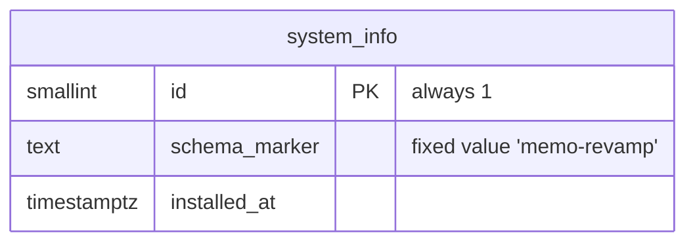

# E01 Walking skeleton — design

> Step 3 of `AGENTS.md §5`. This epic has no business domain. It covers the repository skeleton, the module skeleton and one platform slice: the public health check.

## 1. Repository layout

```
/backend            Spring Boot app (package root com.memorevamp), one package per Modulith module
/build-logic        Gradle convention plugins (ADR-0004)
/shared             KMP module (JVM target only until Phase 6a; Q4)
/web                Vite + React + TanStack Router SPA
/mobile/{ios,android}  README placeholders (Q4)
/contracts          openapi.json, generated by the backend and committed
/deploy/compose     Compose local stack (profiles core/full) + storage-init script
/scripts            dev.mjs and other cross-platform scripts (ADR-0003)
/docs               plan, adr, security, threat-models, dependencies.md
```

The base package `com.memorevamp` follows the repository name. If the product gets a final name, we rename the package before Phase 1a (assumption A1, see STATUS).

## 2. Modules (Spring Modulith)

These packages are created under `com.memorevamp`, each with a `package-info.java` that carries `@ApplicationModule(displayName=…)`. The modules are `tenancy`, `identity`, `org`, `authz`, `audit`, `files`, `workflow`, `memo`, `forum`, `meeting`, `book`, `voting`, `minutes`, `actions`, `signature`, `notification` and `search`. One more module, **`system`**, owns platform health and other non-tenant operational data.

Module rules for this epic:
- `system` exposes no API to other modules. It publishes no events and consumes none.
- Shared infrastructure (web error handling, security config) goes in `com.memorevamp.common`, which is declared an open module (`Type.OPEN`).
- `ApplicationModules.of(MemoApplication::class.java).verify()` runs in the PR stage.

## 3. Data model

There is one non-tenant table, owned by `system`. It is created by the Flyway migration `V1__system_info.sql` under `db/migration/system`. E02 introduces per-module locations and the role split.



- This is a **platform table**: no `tenant_id` and no RLS. Platform tables are allowed by `AGENTS.md §3.2`. The RLS meta-test (E02) only inspects tables that have a `tenant_id` column.
- Invariant: exactly one row (`CHECK (id = 1)`).

## 4. API contract

`GET /api/v1/health`. It is public (no authentication), safe and idempotent.

```json
200 OK
{
  "status": "UP | DEGRADED | DOWN",
  "checkedAt": "2026-10-14T10:00:00Z",
  "components": [
    { "name": "database",      "status": "UP" },
    { "name": "objectStorage", "status": "UP" },
    { "name": "documentServer","status": "DISABLED" },
    { "name": "malwareScanner","status": "DOWN" },
    { "name": "mail",          "status": "UP" }
  ]
}
```
- Component status is one of `UP | DOWN | DISABLED`. `DISABLED` means the service is not configured, for example in the `core` profile.
- Overall status:
  - `DOWN` if `database` is DOWN;
  - otherwise `DEGRADED` if any enabled component is DOWN;
  - otherwise `UP`.
- HTTP status is **200** for UP and DEGRADED and **503** for DOWN. The body has the same shape in every case.
- **No versions, hosts, ports, exception messages or timings** in the body.
- Results are cached for 5 s, so the public endpoint cannot be used to amplify load on downstream services. Each check has a 2 s timeout, and the checks run in parallel on virtual threads.
- Errors anywhere in the API are RFC 9457 Problem Details (`application/problem+json`). Unknown routes under `/api` return a 404 problem.

| Component | How it is checked |
|---|---|
| `database` | jOOQ `select schema_marker from system_info where id = 1` |
| `objectStorage` | AWS SDK `HeadBucket(records)` with the `app` identity |
| `documentServer` | `GET {onlyoffice}/healthcheck` returns `true` |
| `malwareScanner` | clamd TCP `zPING\0` returns `PONG` |
| `mail` | SMTP connect and read a `220` banner, then `QUIT` |

## 5. Authorization matrix

| Endpoint | Anonymous | Any authenticated user (from Phase 1a) |
|---|---|---|
| `GET /api/v1/health` | allow | allow |
| `GET /v3/api-docs` | allow only when `memo.api-docs.enabled=true` (dev/test). It is off by default; the committed contract is the source of truth. | same |
| anything else | **deny (401)** | deny until a module grants it |

Spring Security is present from E01 so that deny-by-default is real from the first commit. In the stateless API, CSRF protection is on for every non-GET route (Phase 1a adds sessions).

## 6. Security headers (backend responses)

- `Content-Security-Policy: default-src 'none'; frame-ancestors 'none'` for API responses. The SPA's own CSP is set by the web server in E03/E04.
- `X-Content-Type-Options: nosniff`
- `Referrer-Policy: no-referrer`
- `Cache-Control: no-store` on `/api/**`
- HSTS is added by the TLS terminator (E05).

## 7. Audit events
None. Health is a read of non-sensitive data, and there are no state changes in this epic.

## 8. Tenancy and RLS
No tenant tables in this epic (see E02).

## 9. Migrations
`V1__system_info.sql` is additive only.

## 10. Performance budget
| Endpoint | Budget | Notes |
|---|---|---|
| `GET /api/v1/health` (cached) | p95 < 20 ms | served from the in-memory snapshot |
| `GET /api/v1/health` (cold) | < 2.2 s worst case | parallel checks with a 2 s timeout |

## 11. Background work
None.

## 12. Web

- **Routes** (file-based):
  - `/`: the health page;
  - `__root`: the shell placeholder (E03 replaces it with the shadcn/ui shell).
- **Data:** the health page uses the generated `getHealthOptions()` with `useQuery`. There are no hand-written fetch calls.
- **UX:** a heading, the overall status as a text badge (not color only), and a list of components with their status. States: loading, error, data.
- Strings go through a minimal message catalog in E01. E03 swaps it for the i18n library.

### UX review
This is a single developer-facing status page, so there are no user journeys to validate. The owner gets a walkthrough at the end of E03 (`ux-review.md`).

## 13. Contract pipeline

1. `./gradlew :backend:updateContract` runs `OpenApiContractTest` in update mode, which writes `/contracts/openapi.json` (OpenAPI **3.1**).
2. In normal mode the same test **fails if the generated spec differs** from the committed file. This is the drift check; E04 makes it a gate.
3. `pnpm --filter web generate:api` runs `@hey-api/openapi-ts` (pinned) and writes `web/src/api/generated` (committed). `pnpm typecheck` compiles it.
