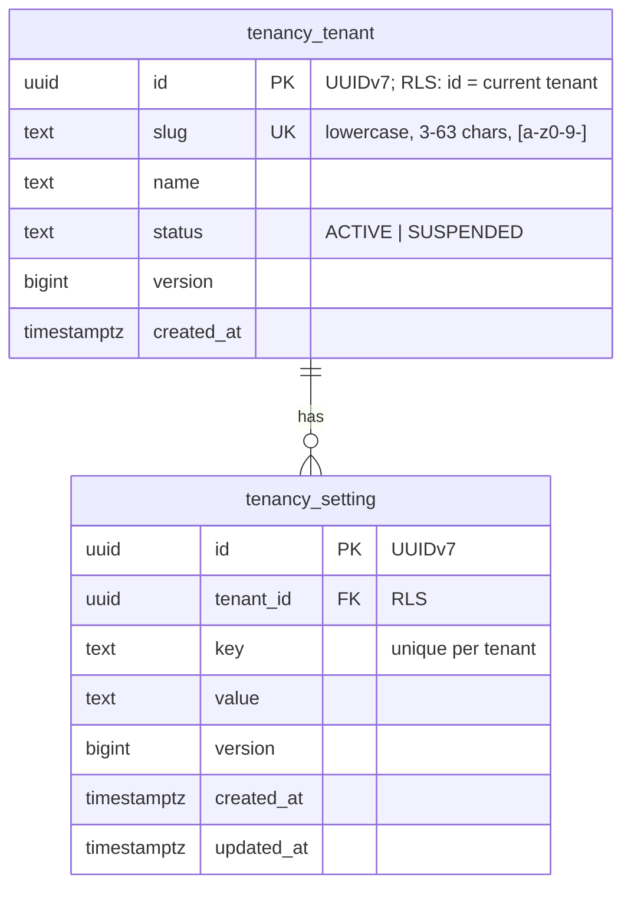

# E02 Data and tenancy foundation — design

Conventions: [ADR-0006](../../../adr/0006-database-roles-and-rls-conventions.md), [ADR-0007](../../../adr/0007-jooq-codegen-and-flyway-layout.md), [ADR-0008](../../../adr/0008-backend-test-libraries.md).

## 1. Domain model (tenancy module)

- **`tenancy_tenant`** is the tenant registry. In Phase 0 it has only the fields every later phase needs.
  - Invariants: `slug` is unique globally (by constraint); `status ∈ {ACTIVE, SUSPENDED}`.
  - Lifecycle: `ACTIVE ⇄ SUSPENDED`. Suspension is used from Phase 1a; no API exists yet.
- **`tenancy_setting`** is the **reference tenant table** required by the master plan. It is real configuration storage (key → value per tenant, e.g. `default.locale`, `default.timezone`) and is used by the cross-tenant suite.
  - Invariants: `(tenant_id, key)` is unique; `key` matches `^[a-z][a-z0-9.]{1,99}$`.
  - Optimistic locking: `version`.
- **View `tenancy_setting_view`** (`security_invoker = true`) joins tenant name and setting. It exists to prove RLS through views.
- **Function `tenancy_setting_count()`** (`SECURITY INVOKER`, `STABLE`) exists to prove RLS through functions.

Indexes:
- `tenancy_setting (tenant_id, key)`: unique; it also serves the FK index on `tenant_id`.
- Composite FK `tenancy_setting (tenant_id) → tenancy_tenant (id)`. The tenant table is the root, so a plain FK on `tenant_id` suffices; deeper tenant tables use composite `(tenant_id, x_id)` FKs.

## 2. Modules and APIs

| Module | Public API (package root) | Internal |
|---|---|---|
| `common` (open) | `common.id.IdGenerator`, `common.tenant.TenantId`, `common.tenant.TenantTransactions`, `common.tenant.TenantDsl`, `common.tenant.MissingTenantContextException` | — |
| `tenancy` | `tenancy.TenantRegistry` (create, find by id/slug), `tenancy.TenantSettings` (get, put, list, delete) | `tenancy.internal.*` jOOQ repositories |
| `demo` (**new** module) | — (runs on startup when `memo.demo.seed=true`, and on `--seed-demo`) | `DemoTenant` definition and seeder |

No events in Phase 0. Tenant creation events (`TenantCreated`) arrive with audit in Phase 1a.

## 3. Tenant-context helper semantics (seed of Phase 1a `TenantContext`)

| Situation | Behaviour |
|---|---|
| `inTenant(A) { … }` with no transaction | New transaction; `set_config('app.tenant_id', A, true)`; the value is bound to the transaction |
| Nested `inTenant(A)` inside `inTenant(A)` | Joins; no second `set_config` |
| Nested `inTenant(B)` inside `inTenant(A)` | `IllegalStateException` (cross-tenant nesting is a bug) |
| `TenantDsl.current()` outside `inTenant` | `MissingTenantContextException` (fail closed) |
| Raw SQL on `memo_app` with no tenant set | RLS: zero rows; inserts rejected |
| Transaction ends (commit or rollback) | Setting reverts automatically (transaction-local) |

## 4. API contract
No new endpoints in E02. The tenant admin API comes in Phase 1a.

## 5. Authorization matrix
None: no endpoints. Database-level authorization is the role matrix in ADR-0006 and is verified by `RlsMetaTest` and `SystemInfoRepositoryIT`.

## 6. Audit events
None yet. Audit arrives in Phase 1a. `TenantRegistry.create` will then emit `tenant.created` in the same transaction.

## 7. Tenancy and RLS policies (new tables)

| Table | RLS | Policy |
|---|---|---|
| `tenancy_tenant` | ENABLE + FORCE | `tenant_self`: `id = (select nullif(current_setting('app.tenant_id', true), '')::uuid)`, for USING and WITH CHECK |
| `tenancy_setting` | ENABLE + FORCE | `tenant_isolation` (ADR-0006 form) |
| `tenancy_setting_view` | security_invoker | inherits |

Creating a tenant runs **inside the new tenant's own context**: the platform path sets `app.tenant_id` to the new id before inserting. No role can insert rows for a tenant it is not currently scoped to.

## 8. Migrations
- `system`: E01's `V1__system_info.sql` moves from `db/migration/system` (shared history) to the Modulith layout (`flyway_schema_history_system`). Nothing has been deployed yet, so no compatibility shim is needed.
- `tenancy`: `V1__tenant_and_settings.sql`. Additive only.

## 9. Performance budget
- Settings lookup by `(tenant_id, key)`: index-only path, p95 < 5 ms in the DB. No list endpoint exists yet.
- Policy predicate overhead: InitPlan evaluation, verified with `EXPLAIN` in `CrossTenantIsolationIT` (the plan contains `InitPlan`, not a per-row `current_setting` call).

## 10. Background work
None. Propagation into jobs and listeners is Phase 1a.

## 11. Demo tenant (defined as code)
- `DemoTenant`: fixed id `01900000-0000-7000-8000-000000000001`, slug `demo`, name "Demo Organization".
- Settings: `default.locale=en`, `default.timezone=UTC`, `org.placeholder=Head Office` (the org placeholder until Phase 1b).
- **Idempotent:** the seeder upserts by fixed ids and keys.
- Run by tests (`DemoTenantSeedIT`), local dev (`pnpm dev` sets `MEMO_DEMO_SEED=true`) and the dev environment (E05).
- The seeder refuses to run when the `prod` profile is active, unless `memo.demo.allow-in-prod=true` is set explicitly (not used).

## 12. Test-data builders
In `testsupport`:
- `aTenant()` creates a **fresh random tenant per test class** (via `TenantRegistry`);
- `aSetting(tenant)`.

No JSON fixtures.

## 13. Architecture rules (ArchUnit + source scan)
1. Classes annotated `@RestController` do not depend on `org.jooq..`.
2. Main code outside `common.time` does not call `Instant.now()`, `LocalDateTime.now()`, `ZonedDateTime.now()`, `OffsetDateTime.now()`, `LocalDate.now()` or `System.currentTimeMillis()`. Use the injected `Clock`.
3. Source scan: no session-level `SET app.`, `SET SESSION`, or `set_config(…, false)` in main sources or migrations.
4. jOOQ generated tables of module X are used only from module X. Enforced by Modulith, because generated classes live in `com.memorevamp.<module>.internal.db` packages.
