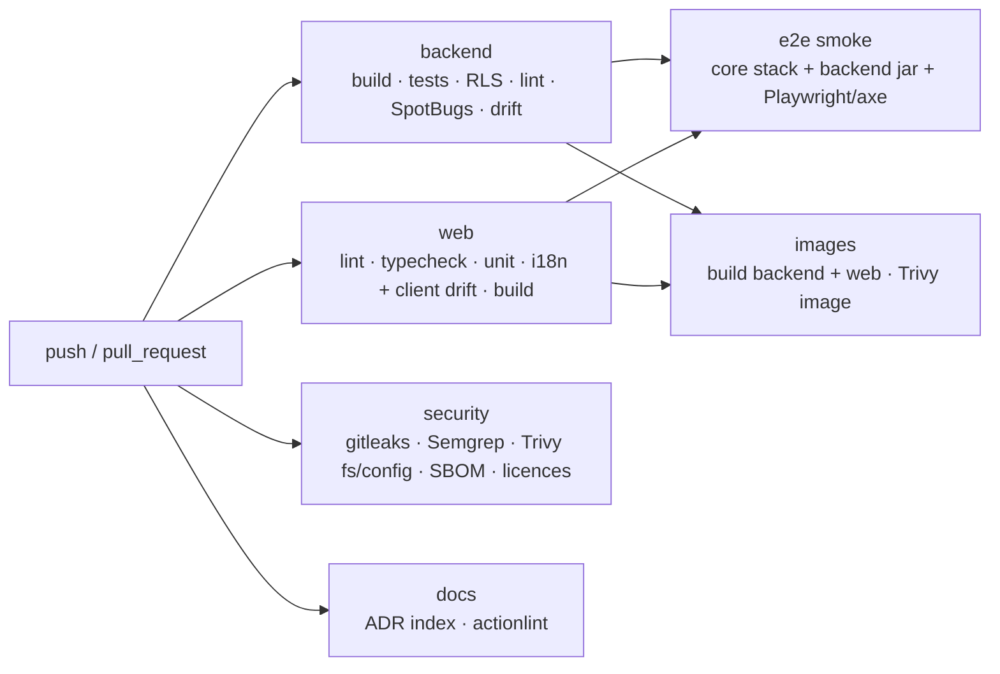

# E04 CI pipeline and supply chain — design

Decisions: ADR-0011 (CI and stages), ADR-0012 (images and signing), ADR-0013 (scanning), ADR-0014 (Renovate).

## 1. Pipeline (PR stage, target ≤ 15 min wall clock)



- Gradle and pnpm caches are used; the Gradle build cache is read-only on PRs.
- Test reports, the SBOMs, `licenses.md` and the Playwright report are uploaded as artefacts.

## 2. Repository layout added

```
.github/workflows/{ci,nightly,release}.yml
ci/                      scripts used by workflows and locally
  license-check.mjs      SBOM licence allow-list + licenses.md report
  license-exceptions.json
  check-adr-index.mjs
  e2e-stack.sh           start core stack + backend jar for CI e2e
  README.md              how to run every gate locally; self-hosted/air-gapped notes
.semgrep/rules.yml       custom rules (ADR-0013)
.gitleaks.toml           gitleaks config (default rules + allow-list for generated/test paths)
.trivyignore             time-boxed exceptions (empty)
lefthook.yml             pre-commit hooks
renovate.json
backend/Dockerfile, web/Dockerfile, web/nginx/default.conf.template, .dockerignore
deploy/cosign.pub        (added by the owner with the key pair)
```

## 3. Images
- **Backend:** CI builds `bootJar`; the Dockerfile extracts the layers in a builder stage (`eclipse-temurin:25-jre`, pinned by digest) and copies them onto distroless.
  - Entrypoint: `java -jar app.jar`, using the extracted launcher layout.
  - Health check: none in the image. Kubernetes probes come in E05.
- **Web:** CI builds `dist/`; nginx serves it with SPA fallback, `Cache-Control` immutable for hashed assets and `no-store` for `index.html`. The headers come from `security-headers.json` (rendered to `security-headers.conf` at build). `/api/` is proxied to `${BACKEND_URL}` (nginx envsubst template).
- **Labels:** `org.opencontainers.image.{source,revision,version,licenses,title}`.

## 4. Pinning
- Gradle dependency locking for all configurations (`gradle.lockfile` per project, `settings-gradle.lockfile`, `build-logic/gradle.lockfile`). `./gradlew resolveAll --write-locks` refreshes them; Renovate maintains them.
- Base images are pinned by digest in the Dockerfiles; actions by SHA.

## 5. Security of the pipeline itself
- `permissions: contents: read` by default. `release.yml` adds `packages: write` and `id-token: none`.
- No secrets on `pull_request` from forks; the release workflow uses environment protection (`release` environment, owner approval).
- `actionlint` checks the workflows; Trivy `config` checks Dockerfiles.

## 6. What is not in E04
- The deploy job (E05).
- ZAP and Gatling content (E05; placeholders in nightly).
- Mutation testing and Schemathesis content (placeholders; they start with the modules that need them).
