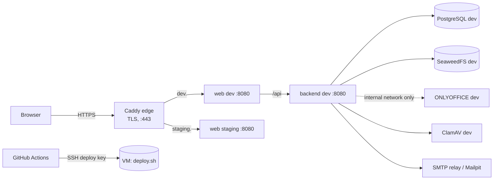

# E05 Environments, deployment and operability — design

Decisions: [ADR-0015](../../../adr/0015-environments-iac-and-deployment.md), [ADR-0016](../../../adr/0016-operability-baseline.md).

## 1. Topology on the owner's VM

- Each environment is a separate Compose project (`memo-dev`, `memo-staging`) using `deploy/compose/onprem/compose.yaml` with its own `.env` in `/opt/memo/<env>/`.
- The edge proxy is shared (`deploy/compose/edge/compose.yaml`) and joins each environment's `web` through an external Docker network.

## 2. On-prem Compose profile (`deploy/compose/onprem/`)
- Services:
  - `postgres` (role script on first start);
  - `seaweedfs` + `storage-init`;
  - `migrate` (backend image, `memo.mode=migrate`, one-shot);
  - `backend` (depends on `migrate` completing successfully);
  - `web`;
  - optional: `onlyoffice` (internal network only), `clamav`, `mailpit` (profile `devtools`, not for production).
- Hardening on every container: `read_only: true`, `tmpfs: /tmp`, `cap_drop: [ALL]`, `security_opt: [no-new-privileges:true]`, non-root users, resource limits.
- Images are pinned by digest through `.env` (`MEMO_BACKEND_IMAGE=ghcr.io/…@sha256:…`).
- `.env.example` lists every variable with comments and **no values**. Generate local values with `deploy/scripts/gen-secrets.sh`.

## 3. Helm chart (`deploy/helm/memo/`)
- Templates:
  - `backend-deployment.yaml`, `backend-service.yaml`;
  - `web-deployment.yaml`, `web-service.yaml`;
  - `migrate-job.yaml` (Helm hook `pre-install,pre-upgrade`, `hook-delete-policy: before-hook-creation`);
  - `networkpolicies.yaml`;
  - `ingress.yaml` (optional).
- Secrets come from `existingSecret` names: DB app, DB migrator, S3 app, ONLYOFFICE JWT. Values never contain secrets, and `values.schema.json` enforces it (no `password` keys).
- Probes: liveness `/actuator/health/liveness:8081`, readiness `/actuator/health/readiness:8081`.

## 4. Backend changes
- `CorrelationIdFilter` (common.web).
- `memo.mode=migrate` runner (system).
- Actuator on port 8081 with probe groups.
- Structured ECS JSON logs, switched on by the deployment manifests (`LOGGING_STRUCTURED_FORMAT_CONSOLE=ecs`).
- OpenTelemetry starter with export disabled by default.

## 5. CI/CD additions
- `ci.yml`, job `helm`: `helm lint` + `helm template | kubeconform -strict -summary`.
- `nightly.yml`:
  - `helm-kind`: build images, load them into kind, install the chart with Postgres, wait for readiness, health check;
  - `zap-baseline` against `DEV_URL` (skipped when unset);
  - `gatling-smoke` against `DEV_URL` (skipped when unset).
- `deploy-dev.yml`: on a successful `ci` run on `master`, build and push dev images (digest), SSH to the VM, run `deploy.sh dev <digests>`. It needs the `dev` environment secrets `DEPLOY_SSH_KEY` and `DEPLOY_HOST`, plus `DEV_URL`, and is **skipped when they are unset**.

## 6. Performance (`perf/` Gradle project)
- Gatling Kotlin simulation `HealthSmokeSimulation`: 20 users ramped over 30 s, assertions p95 < 300 ms and error rate < 1 %.
- `SyntheticVolumes`: interface plus a Phase 0 implementation that creates N tenants with settings. Volumes per TESTING_STRATEGY §7 are filled in by later phases.

## 7. NFRs
`docs/plan/nfr.md` holds the proposed targets. Status: **awaiting product owner confirmation (Q6)**.
