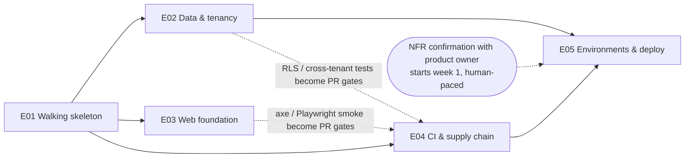

# Phase 0 — Foundations and engineering baseline: overview

> Level-1 plan (see `AGENTS.md §5`). It splits the phase into epics, fixes their order and dependencies, lists the phase-level research and ADRs, and maps the exit criteria to epics. Each epic gets its own detailed plan (`epic-<NN>-<slug>/`: research, ADRs, design, threat model, tasks, test plan) just before it starts.
>
> **Status:** approved 2026-10-14 (see §10). Written 2026-10-13.

---

## 1. Phase goal (from `MASTER_PLAN.md`)

A repository, toolchain and pipeline where a trivial vertical slice (login-less health page → API → DB → web) builds, tests, scans and deploys to a dev environment in one command.

### What Phase 0 deliberately does *not* do
These belong to Phase 1a. Phase 0 only lays the ground for them:
- **Full tenant-context plumbing.** That means the request filter, the transaction interceptor and propagation into jobs, listeners and executors. Phase 0 builds only the database side: roles, RLS conventions, a reference table, and a minimal transaction-scoped `set_config('app.tenant_id', …, true)` helper that the tests use.
- **Authentication of any kind.** The health slice has no login. The Playwright session fixture is built as a structure only (see open question Q5).
- **Audit, files, encryption, notifications.** The services they need (SeaweedFS, ClamAV, ONLYOFFICE, mail catcher) run in the local stack, but no application code uses them yet. The one exception is a reachability check in the health endpoint.

---

## 2. Epics

Five epics. Durations are estimates for one small team. They get refined in each epic's `tasks.md`.

| # | Epic | Purpose | Est. | Depends on |
|---|---|---|---|---|
| E01 | **Walking skeleton** | Monorepo, toolchains, backend/web/shared skeletons, local stack, the health slice running end to end through one command | 3 wks | — |
| E02 | **Data and tenancy foundation** | DB roles, Flyway/jOOQ pipeline, RLS conventions + reference table, RLS meta-test, negative test, cross-tenant test, Testcontainers base, demo tenant and builders | 2–3 wks | E01 |
| E03 | **Web foundation** | App shell (shadcn/ui), design tokens, light/dark, i18n (ICU, RTL, pseudo-locale), generated client patterns, Vitest + MSW, Playwright + axe, session fixture structure | 2 wks | E01 |
| E04 | **CI pipeline and supply chain** | PR / nightly / release stages with every gate, SBOM, license report, scanning, image build and signing, update bot | 2–3 wks | E01 (and it gains gates as E02/E03 land) |
| E05 | **Environments, deployment and operability** | IaC, dev + staging, Helm chart skeleton, Compose on-prem profile, one-command deploy to dev, ZAP baseline, Gatling skeleton, NFR confirmation recorded | 2–3 wks | E04 (deploy pipeline), E02 (seeded demo tenant in dev) |

### Order and parallelism

- **Critical path:** E01 → E04 → E05, about 7–9 weeks.
- **Parallel work:** E02, E03 and E04 can run at the same time once E01 is merged. The overlap depends on team size.
- **Basic CI from the start:** E01 sets up a minimal CI job (compile + unit tests), so every PR is gated from day one. E04 then hardens it into the full staged pipeline.
- **Schedule conflict:** the master plan Gantt gives Phase 0 30 days, which is a placeholder. The estimate here is **7–9 weeks with parallel work**, and longer with a single developer. See risk R1 and open question Q3.

---

## 3. Epic scope

### E01 — Walking skeleton
- Monorepo layout per `AGENTS.md §4`: `/backend`, `/shared`, `/web`, `/mobile/{ios,android}` (placeholders), `/contracts`, `/deploy`, `/docs`.
- Gradle (Kotlin DSL) with convention plugins and `gradle/libs.versions.toml`, all versions pinned. pnpm workspace with a committed lockfile.
- Spring Boot app with Spring Modulith:
  - empty packages for the modules in `AGENTS.md §4`;
  - the `ApplicationModules.of(...).verify()` test;
  - ktlint and detekt.
- `/shared` KMP module with one trivial shared type and `commonTest` running on JVM. Mobile targets depend on Q4.
- PostgreSQL and Flyway wired. A `system` health table, read through jOOQ.
- `GET /api/v1/health`. It reports app, database, SeaweedFS, ClamAV, ONLYOFFICE and mail-catcher reachability, without exposing secrets or versions publicly. Errors use RFC 9457 Problem Details.
- springdoc generates OpenAPI 3.1 into `/contracts`. `@hey-api/openapi-ts` (pinned) generates the TanStack Query client.
- Web: Vite + React + TS strict + TanStack Router (file-based) + Query. A single health page uses the generated `queryOptions`.
- Docker Compose local stack: PostgreSQL, SeaweedFS (S3, with one object-locked bucket created at bootstrap), ONLYOFFICE Docs (no outbound network), ClamAV, mail catcher.
- One cross-platform command (`make dev` or equivalent, see ADR-T) starts the stack plus app and web.
- Minimal CI job: build + unit tests.
- Docs scaffolding:
  - ADR template (MADR) and ADR-0001;
  - `docs/dependencies.md` with every dependency added in this epic;
  - threat-model template;
  - `docs/security/asvs-checklist.md` skeleton;
  - phase `log.md`.

### E02 — Data and tenancy foundation
- Database roles:
  - a migration/owner role;
  - an application role that is not the owner and has no `BYPASSRLS`;
  - a read-only role for ops, if justified by ADR.
- Flyway layout per Modulith module.
- The jOOQ codegen pipeline: Flyway → Testcontainers → generated sources. It must be reproducible in CI and locally.
- RLS conventions, published as a migration snippet plus a lint/meta-check:
  - `tenant_id uuid not null`;
  - `ENABLE` + `FORCE`;
  - a policy of the form `USING (tenant_id = (select current_setting('app.tenant_id', true))::uuid)` with a matching `WITH CHECK`;
  - `tenant_id` as the first column of every composite index;
  - an index on every foreign key;
  - UUIDv7 primary keys generated by the application.
- A minimal transaction-scoped tenant helper:
  - `SET LOCAL` / `set_config(…, true)` only;
  - it fails closed when there is no tenant;
  - it is the seed of Phase 1a's `TenantContext`.
- A **reference tenant table**, with:
  - a cross-tenant test (read, list, update, delete, plus a join and a view);
  - the **RLS meta-test** (catalog scan: tables with `tenant_id` and no ENABLE + FORCE + policy, app role owning tables or holding `BYPASSRLS`);
  - the **deliberate negative test** (with RLS disabled the cross-tenant test must fail).
- Testcontainers base classes for PostgreSQL (connecting as the app role) and SeaweedFS.
- A test-data builder pattern. The **demo tenant defined as code**: in Phase 0 a skeleton with a tenant, an org placeholder and rows in the reference table, grown in later phases. A seeding command is used by tests, local dev and the dev environment.
- An ArchUnit starter rule set: no session-level `SET`, no `Instant.now()` in domain packages, controllers do not use jOOQ directly. An injected `Clock`.

### E03 — Web foundation
- shadcn/ui on Radix: app shell, layout and navigation scaffold.
- Design tokens; light and dark themes; RTL-ready layout using logical CSS properties.
- i18n:
  - ICU message format with the library chosen by ADR;
  - an externalized-strings lint;
  - an ICU syntax lint;
  - a pseudo-localization build (accented, 30–40% longer);
  - one RTL locale wired for screenshots.
- Lint and format toolchain (ESLint + Prettier vs Biome, by ADR).
- Vitest + Testing Library + MSW. MSW handlers are typed from the generated API types.
- Playwright:
  - runs against the Compose stack;
  - an axe check on every page visit;
  - a smoke spec for the health journey;
  - the storage-state session fixture structure per role (see Q5);
  - a pipeline for visual-regression screenshots (light/dark, LTR/RTL).
- A strict CSP-compatible build (no inline scripts) and a test that asserts the security headers.
- Lighthouse CI configuration with initial budgets.

### E04 — CI pipeline and supply chain
- CI platform per ADR (Q1).
- Stages defined in `TESTING_STRATEGY.md §9`:
  - **pre-commit:** format, lint, gitleaks;
  - **PR:** at most 15 minutes, parallelized;
  - **nightly** and **release:** contain every Phase 0-relevant job, as runnable placeholders where the content arrives later (for example mutation testing and Schemathesis).
- Gates:
  - build; tests; Modulith verify;
  - lint and type-check;
  - **OpenAPI drift check** (regenerate and diff `/contracts`, then compile the TS client);
  - migrations applied to an empty DB;
  - dependency and license scan against the license allow-list (Gradle and pnpm);
  - **CycloneDX SBOM**;
  - container image scan; IaC scan; secret scan;
  - SAST (Semgrep CE with the first custom rules, SpotBugs + FindSecBugs, eslint security rules).
- Container images for the backend and the web static server: minimal base (ADR), non-root, read-only root filesystem, **signed** (ADR), and the SBOM attached.
- Renovate or Dependabot (ADR), configured so update PRs go through every gate. Grouping and schedule are defined.
- Artifacts published per run: the SBOM and a human-readable license report.

### E05 — Environments, deployment and operability
- Infrastructure-as-code for the SaaS environment (tool and target per ADR, Q2). Dev and staging environments.
- Helm chart skeleton: backend, web, migrations job, configuration and secret references (no secrets in values), probes, resource limits, network policies, including no-egress for conversion services.
- A Compose **on-prem profile**, distinct from the local dev profile.
- A **one-command deploy to dev** from CI on merge to `master`. Migrations run as a separate job with the migration role.
- Demo tenant seeded in dev.
- **OWASP ZAP baseline scan** running nightly against dev.
- **Gatling skeleton**: one simulation against `/api/v1/health`, plus the structure for the synthetic-volume generator that later phases fill in.
- Minimal operability. Proposed; confirm in Q7:
  - structured JSON logs with correlation id;
  - an OpenTelemetry SDK wired with export disabled by default;
  - readiness and liveness endpoints.
- **Non-functional targets confirmed with the product owner** and recorded in `docs/plan/nfr.md`. They cover latency, availability, RPO/RTO and the synthetic data volumes from `TESTING_STRATEGY.md §7`. The conversation starts in week 1; recording it closes in E05.

---

## 4. Scope coverage (master plan scope → epic)

| Master plan Phase 0 scope item | Epic |
|---|---|
| Monorepo layout; Gradle (Kotlin DSL) for backend + KMP; pnpm workspace | E01 |
| Spring Boot skeleton with Modulith, empty modules, `verify()` test | E01 |
| PostgreSQL + Flyway; migration vs app role; RLS conventions; reference table + cross-tenant test | E01 (wiring), **E02** |
| Docker Compose local stack (PostgreSQL, SeaweedFS, ONLYOFFICE, ClamAV, mail catcher) | E01 |
| Web skeleton: Vite, React, TanStack Router, Query, generated client | E01 |
| Web: shadcn/ui shell, i18n, design tokens, light/dark, axe | E03 |
| CI pipeline with all gates | E01 (minimal), **E04** |
| Environments dev + staging; IaC; Helm skeleton | E05 |
| ADR template, dependency register, threat-model template, STATUS, CLAUDE.md pointer | E01 (STATUS and CLAUDE.md already exist) |
| Test pyramid wiring for backend, web, mobile stub | E01, E02, E03, E04 |
| Testcontainers base classes; demo tenant; test-data builders | E02 |
| Playwright + authenticated-session fixture; axe | E03 |
| OpenAPI drift check | E01 (generation), E04 (gate) |
| ZAP baseline against dev; Gatling skeleton | E05 |
| CI stages (PR / nightly / release) | E04 |
| Version catalog + lockfile pinned | E01 |
| Renovate or Dependabot | E04 |
| Confirm non-functional targets | E05 (started week 1) |

## 5. Exit criteria → epics

| Exit criterion (`MASTER_PLAN.md`) | Delivered by | Evidence |
|---|---|---|
| `make dev` (or equivalent) starts the full local stack; the sample slice works end to end | E01 | Playwright smoke spec on the health page, green in CI |
| *(goal)* deploys to a dev environment in one command | E05 | CI deploy job log; health page reachable in dev |
| CI green with all gates; SBOM and license report produced | E04 (gates from E02, E03, E05) | Green PR, nightly and release runs; SBOM and license-report artifacts |
| Cross-tenant RLS test passes on the reference table and fails if RLS is disabled (negative test) | E02 | RLS meta-test, cross-tenant test and negative test in the PR stage |
| ADRs for every decision taken in this phase | All | ADR index in `docs/adr/` matches the list in §7 (or explains the differences) |

**Phase-0 special tests** (`TESTING_STRATEGY.md §12`):

| Special test | Epic |
|---|---|
| RLS meta-test + deliberate negative test | E02 |
| CI stages wired | E04 |
| Demo tenant seeding | E02 (used in E05 dev) |
| ZAP baseline running | E05 |

**Generic phase-exit items** (`AGENTS.md §5`):

| Item | Where |
|---|---|
| Demo script (`demo.md`) | Written in E05 |
| `retrospective.md` | Written at phase close |
| STATUS updated | Every session |
| Usability check | Light for Phase 0: walk the product owner through the shell, themes and RTL; findings in `ux-review.md` |

---

## 6. Phase-level research list

Each item is answered in the `research.md` of the epic shown, with sources and access dates. Versions are **not** taken from the master plan or memory. Every one is re-verified from official sources.

| # | Question | Epic |
|---|---|---|
| R1 | Current stable versions, licenses and maintenance status: Java LTS, Kotlin, Gradle, Spring Boot 4.x (4.1 vs the 4.2 expected in November 2026, given our start date), Spring Modulith, springdoc, Flyway (open-source edition terms for PostgreSQL), jOOQ (open-source edition terms for PostgreSQL), Testcontainers, KMP plugin, Node LTS, pnpm, Vite, React, TanStack libs, shadcn/ui, `@hey-api/openapi-ts` | E01 (backend + web), rechecked per epic |
| R2 | Gradle structure for one build with Spring Boot + KMP: convention plugins in `build-logic`, composite builds, configuration cache | E01 |
| R3 | Cross-platform one-command dev entry point that works on Windows, macOS and Linux (make vs Task vs just vs Gradle/pnpm scripts) | E01 |
| R4 | SeaweedFS topology for dev vs production; object-lock bucket bootstrap (versioning + lock at creation); health checking | E01 (dev), E05 (prod topology) |
| R5 | ONLYOFFICE and ClamAV in the local stack: resource footprint on developer machines (Windows/WSL2 included), disabling outbound network | E01 |
| R6 | jOOQ code generation with Flyway + Testcontainers in CI (plugin options vs custom task); caching; reproducibility | E02 |
| R7 | Spring Modulith per-module Flyway migrations; how module boundaries map to schemas or tables | E02 |
| R8 | RLS details: policy form, `WITH CHECK`, views (`security_invoker`), functions (`SECURITY DEFINER` risks), catalog queries for the meta-test, cost of `current_setting` in policies | E02 |
| R9 | Assertion and property libraries: AssertJ vs Kotest assertions; jqwik vs Kotest property testing | E02 |
| R10 | ESLint + Prettier vs Biome; Vitest + Playwright setup with TanStack Router file-based routes | E03 |
| R11 | `@hey-api/openapi-ts` configuration for TanStack Query `queryOptions` output; typed MSW handlers from the same spec | E03 |
| R12 | React i18n with ICU: FormatJS/react-intl vs i18next + ICU vs Lingui (ICU completeness, extraction, pseudo-locale, RTL, bundle size) | E03 |
| R13 | CI platform options (depends on Q1); runner model for an on-prem-capable product; macOS runners if iOS stubs are in scope | E04 |
| R14 | Container base images (distroless, Chainguard/Wolfi, UBI-micro, Temurin JRE): patch cadence, size, non-root; image signing (cosign key-based vs keyless) **without a runtime dependency on public infrastructure**, so on-prem and air-gapped customers can verify | E04 |
| R15 | Dependency, vulnerability and license tooling: Trivy vs OWASP Dependency-Check; Gradle + pnpm license checkers; CycloneDX plugins for both ecosystems | E04 |
| R16 | Renovate vs Dependabot (support for Gradle version catalogs and pnpm; self-hostable) | E04 |
| R17 | IaC tool (OpenTofu vs Terraform license; Pulumi) and SaaS hosting target (depends on Q2) | E05 |
| R18 | Helm chart conventions for a multi-component app that must also run on customer Kubernetes (values schema, network policies, migrations as a Job) | E05 |
| R19 | Industry benchmark for the phase: SLSA build levels and OpenSSF Scorecard as the bar for our supply chain; what we can claim at the end of Phase 0 | E04 |

## 7. Planned ADRs

Numbers are assigned when written. Each one uses MADR.

| ADR | Decision | Epic |
|---|---|---|
| ADR-0001 | Record architecture decisions with MADR | E01 |
| ADR-B | Toolchain baseline: Java LTS, Kotlin, Gradle, Spring Boot minor, Node LTS, pnpm | E01 |
| ADR-G | Gradle build structure (convention plugins; backend + KMP in one build) | E01 |
| ADR-T | Cross-platform developer entry point (`make dev` equivalent) | E01 |
| ADR-S3 | SeaweedFS topology and object-lock bucket bootstrap (dev and prod) | E01 / E05 |
| ADR-DB | Database roles, RLS policy conventions, tenant helper semantics | E02 |
| ADR-J | jOOQ edition and code-generation pipeline; Flyway layout per module | E02 |
| ADR-TL | Backend test libraries (assertions, property-based) | E02 |
| ADR-WL | Web lint/format: ESLint + Prettier vs Biome (required by `AGENTS.md §4`) | E03 |
| ADR-I18N | Web i18n library and message pipeline | E03 |
| ADR-CI | CI platform and runner model | E04 |
| ADR-IMG | Container base images and image signing | E04 |
| ADR-SC | Supply-chain scanning stack (vulnerabilities, licenses, SBOM, SAST) | E04 |
| ADR-UPD | Dependency update bot | E04 |
| ADR-IAC | IaC tool and SaaS hosting target | E05 |

The confirmed NFRs are recorded in `docs/plan/nfr.md`, not in an ADR. A deviation found later gets an ADR.

---

## 8. Risks

| # | Risk | Mitigation |
|---|---|---|
| R1 | Phase 0 takes about 2× the 30-day placeholder | Run E02/E03/E04 in parallel; agree on the duration up front (Q3); do not cut gates, cut placeholder content in nightly/release instead |
| R2 | CI platform or hosting is undecided, blocking E04/E05 | Raise Q1/Q2 now. E01–E03 are not blocked. |
| R3 | The local stack is too heavy for laptops (ONLYOFFICE + ClamAV), especially on Windows | Compose profiles (`core` vs `full`); measure in R5; document minimum specs |
| R4 | Pre-1.0 `@hey-api/openapi-ts` breaks on update | Pin the exact version; drift check compiles the client; updates go through Renovate/Dependabot with every gate |
| R5 | Spring Boot 4.2 releases mid-phase | Decide in ADR-B. The default is to start on the latest GA and take the minor upgrade as a normal update PR. |
| R6 | Signing or scanning tools assume public SaaS (Sigstore, vulnerability DB downloads) | Choose tools that work with private keys and mirrored databases (R14/R15); record what is build-time only |
| R7 | Gates slow the PR stage past 15 minutes | Parallelize from the start; measure stage time in E04; move heavy jobs to nightly per `TESTING_STRATEGY.md` |

## 9. Open questions for the human

1. **Q1 — Code hosting and CI platform.** The repo has no remote yet. GitHub (Actions), GitLab (CI), or something self-hosted? Are there constraints from the pilot bank, such as needing to self-host source code?
2. **Q2 — SaaS hosting target.** Which cloud provider and region (for dev, staging and later SaaS)? Who owns the accounts? Is there a preferred IaC tool?
3. **Q3 — Team and timeline.** Who works on Phase 0 (agent only, or developers too)? Is a 7–9 week Phase 0 acceptable, or should scope move to Phase 1a?
4. **Q4 — Mobile stub depth.** Proposal: only the `/shared` KMP module, with `commonTest` on JVM, plus empty `/mobile/ios` and `/mobile/android` folders with READMEs. Real app shells and macOS CI runners wait until Phase 6a. OK?
5. **Q5 — Authenticated-session fixture before auth exists.** Proposal: build the per-role storage-state fixture structure and use it with an anonymous role only. Real logins come in Phase 1a. There will be **no test-only auth bypass in the app**. OK?
6. **Q6 — Product owner for NFRs.** Who confirms the performance, availability and RPO/RTO targets and the synthetic data volumes, and when can we schedule that?
7. **Q7 — Minimal operability in Phase 0.** This means structured JSON logs with correlation id, the OTel SDK wired with export off, and probes. It is not in the master plan's Phase 0 scope, but deploying to dev without it is impractical. Add it to E05?

---

## 10. Approval

| Item | By | Date | Notes |
|---|---|---|---|
| Phase 0 overview | Product owner (aradnazihar) | 2026-10-14 | Approved by the instruction "implement phase 0". The owner **delegated the per-epic review gate**: the agent writes each epic plan in full, then implements it without waiting. It stops only for decisions that need the owner. |

### Phase exit
| Item | By | Date | Notes |
|---|---|---|---|
| Phase 0 exit | Product owner (aradnazihar) | 2026-10-15 | Exit criteria met (`retrospective.md`): local stack, CI green on GitHub, RLS tests, ADRs, NFRs confirmed, usability check done. **Carried into Phase 1a:** the first dev deploy (waiting for the VM) and the app-layout epic from the UX walkthrough. |

### Answers to open questions (2026-10-14)
| Q | Answer |
|---|---|
| Q1 | **GitHub Actions** (remote `github.com/nazihar/memo-revamp`). Pipeline logic lives in scripts so it can move to a self-hosted runner later. |
| Q2 | **The owner's own server/VM.** Dev and staging are deployed over SSH from CI. The host details and credentials are still to come. |
| Q3 | **Agent only, no deadline** (2026-10-15). The agent builds, and the owner reviews and decides. Phases are planned by scope, and the quality gates set the pace. |
| Q4 | Accepted: `/shared` KMP module with a JVM target and `commonTest`; `/mobile/*` contains only READMEs. |
| Q5 | Accepted: per-role storage-state fixture, used with the anonymous role only; no auth bypass. |
| Q6 | **The product owner confirms the NFRs.** Confirmed as proposed on 2026-10-15 (`docs/plan/nfr.md`). |
| Q7 | Accepted: added to E05. |
