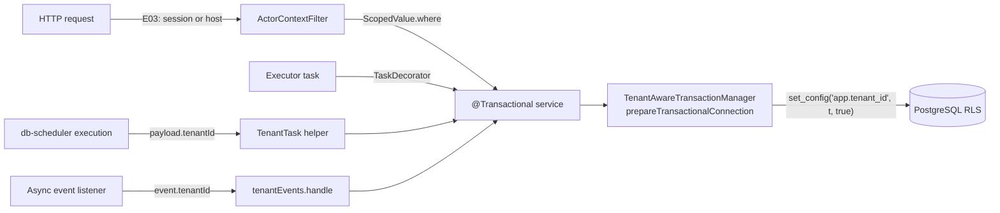
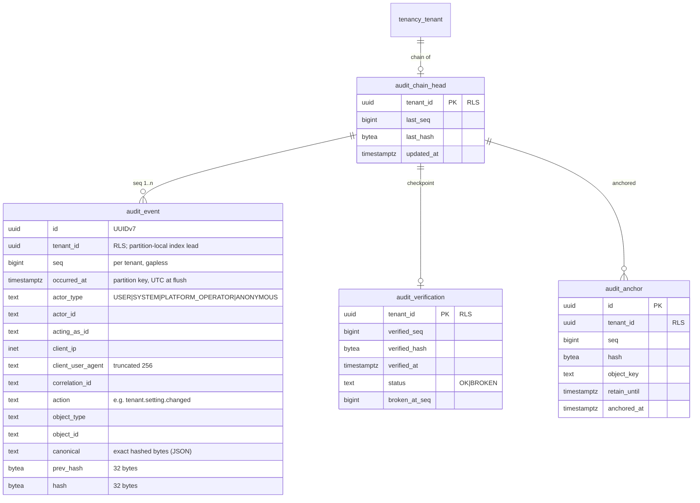

# E02 Platform kernel — design

Decisions: [ADR-0017](../../../adr/0017-tenant-context-propagation.md) (tenant context), [ADR-0018](../../../adr/0018-background-jobs-db-scheduler.md) (jobs), [ADR-0019](../../../adr/0019-audit-store.md) (audit), [ADR-0020](../../../adr/0020-cache-invalidation-listen-notify.md) (caches). Builds on ADR-0006 (roles, RLS) and ADR-0007 (jOOQ, Flyway layout).

E02 is backend-only and ships **no REST endpoint**. Its consumers in this epic are the existing tenancy services (tenant creation and settings become audited and cached) and the kernel's own jobs.

## 1. Context model



| Element | Kind | Behaviour |
|---|---|---|
| `TenantContext` | `ScopedValue<TenantId>` in `common.tenant` | `current()` throws `MissingTenantContextException`; `currentOrNull()`; `run(tenant) { }`; rebinding to a **different** tenant inside a scope throws |
| `ActorContext` | `ScopedValue<Actor>` in `common.context` | `Actor` = `User(userId, actingAs?)` (E03) \| `System(name)` \| `PlatformOperator(operatorId)` (E07) \| `Anonymous`; plus `ClientInfo(ip, userAgent)` and the correlation id (MDC) |
| `TenantAwareTransactionManager` | `JdbcTransactionManager` subclass | On begin: tenant in scope → `set_config` + bind; platform scope → `set_config('app.scope','platform',true)`; neither → tenant-less transaction |
| `TenantTransactions` | existing API, kept | `inTenant(t) { }` = bind scope + transaction. Existing callers keep working |
| `PlatformTransactions` | new | `inPlatformScope { }`; read-only; refuses if a tenant is in scope |
| `TenantDsl` | existing | Throws unless the current transaction is bound to the scoped tenant |
| `TenantEvents` | new | `handle(event: TenantScopedEvent) { }` binds scope + actor `System("event:<listener>")` and opens a transaction |
| `ContextTaskDecorator` | `TaskDecorator` bean | Captures tenant, actor and MDC; re-binds them in the worker |
| `ActorContextFilter` | servlet filter (order after correlation id) | E02: binds `ActorContext(Anonymous, ClientInfo)` only; **E03 adds tenant resolution** |

Nesting rules:

| Situation | Result |
|---|---|
| Tenant A in scope, `@Transactional` method | Transaction bound to A |
| No tenant in scope, `@Transactional` method, then `TenantDsl.current()` | `MissingTenantContextException` |
| Transaction bound to A, code rebinds scope to B and joins | `IllegalStateException` |
| Platform scope, then `TenantContext.run(A)` | `IllegalStateException` (no mixing) |
| Tenant scope A, then `inPlatformScope` | `IllegalStateException` |
| `REQUIRES_NEW` inside A | New transaction, also bound to A (scope still bound) |

## 2. Data model



- **`audit_event`**: `PARTITION BY RANGE (occurred_at)`, monthly partitions `audit_event_yYYYYmMM` plus `audit_event_default`. Primary key `(id, occurred_at)`. Indexes (local): `(tenant_id, seq)`, `(tenant_id, occurred_at)`, `(tenant_id, object_type, object_id, occurred_at)`, `(tenant_id, actor_id, occurred_at)`. Before/after values live only inside `canonical`; columns hold what queries filter on.
- **Grants:** `memo_app` has `SELECT, INSERT` on `audit_event` and partitions; `UPDATE, DELETE, TRUNCATE` revoked. Trigger `audit_event_immutable` (`BEFORE UPDATE OR DELETE … FOR EACH ROW`) raises for any role.
- **`audit_chain_head`**: one row per chain, created by the first flush (`INSERT … ON CONFLICT DO NOTHING`, then `SELECT … FOR UPDATE`).
- **`audit_anchor`**: the database's record of what was written to the bucket (the bucket is the authority; this table lets verification find anchors without listing the bucket).
- **Platform chain:** `tenant_id = 00000000-0000-0000-0000-000000000000` (`PlatformChain.ID`), written only in platform scope. The RLS policies of the audit tables accept rows of the platform chain id **only** when `app.scope = 'platform'`; a tenant can never see them.
- **Outbox tables:** `event_publication`, `event_publication_archive` (upstream DDL, Spring Modulith 2.1). **Scheduler table:** `system_scheduled_task` (upstream DDL, renamed). All three are **platform tables**: no `tenant_id`, allow-listed in the RLS meta-test, ids-only payloads.
- **`tenancy_tenant` policy change:** a second policy `platform_read FOR SELECT USING ((select current_setting('app.scope', true)) = 'platform')`. The existing `tenant_self` stays.

### Canonical entry (hashed bytes)
```json
{"v":1,"tenant":"…","seq":42,"at":"2026-10-18T09:15:02.123456Z",
 "actor":{"type":"USER","id":"…","actingAs":null},"client":{"ip":"203.0.113.7","ua":"…"},
 "corr":"…","action":"tenant.setting.changed","object":{"type":"tenant.setting","id":"…"},
 "before":{"value":"en"},"after":{"value":"ar"}}
```
Keys sorted, no whitespace, UTF-8, timestamps with microseconds in UTC, `null` written explicitly. `hash = SHA-256(prev_hash ‖ canonical_bytes)`.

## 3. Modules and events

| Module | Public API | Internal | Publishes | Consumes |
|---|---|---|---|---|
| `common` (open) | `TenantContext`, `ActorContext`, `TenantTransactions`, `PlatformTransactions`, `TenantDsl`, `TenantScopedEvent`, `PlatformEvent`, `TenantEvents`, `CacheInvalidation`, `TenantCaches`, job helpers (`TenantTask`, `PlatformTask`) | transaction manager, decorator, listener connection | — | — |
| `audit` | `AuditLog.record(...)`, `AuditChainVerifier` (pure), `AuditVerificationResult` | flush synchronization, repositories, anchoring, partition callback, jobs | `AuditChainBroken` (platform event, ids only) | — |
| `tenancy` | unchanged APIs; now audited and cached | `TenantSettingsCache` | `TenantCreated`, `TenantSettingChanged` (tenant-scoped, ids only) | — |
| `system` | — | `system_scheduled_task` migration, outbox migration, outbox resubmission and archive jobs | — | — |

`ApplicationModules.verify()` must stay green: `audit` depends on `common` only; `tenancy` depends on `audit` (API package) and `common`.

## 4. Audit flow

```mermaid
sequenceDiagram
  participant S as Service (tenant A scope)
  participant A as AuditLog
  participant TX as Transaction
  participant DB as PostgreSQL
  S->>DB: business UPDATE (tenant A)
  S->>A: record(action, object, before, after)
  A->>TX: buffer entry; register beforeCommit once
  S-->>TX: commit
  TX->>A: beforeCommit
  A->>DB: INSERT head ON CONFLICT DO NOTHING
  A->>DB: SELECT head FOR UPDATE
  A->>A: seq, canonical, hash per buffered entry
  A->>DB: INSERT audit_event rows; UPDATE head
  TX->>DB: COMMIT (lock released)
```

Rules:
- `record()` requires an active **read-write** transaction with a tenant (or platform scope); otherwise `AuditContextException`.
- Before/after accept a typed map; values are redacted by a `@Sensitive` marker (secrets, passwords, document text never enter audit).
- A flush exception propagates out of `commit()`, so the business change rolls back.
- No audit entries for audit maintenance itself (anchoring, verification success); failures go to the platform chain.

## 5. Background work (ADR-0018)

| Job | Kind | Schedule | Scope | Idempotency / retry |
|---|---|---|---|---|
| `audit-anchor-sweep` | Platform recurring | 15 min | platform → schedules `audit-anchor` per tenant whose head moved since its last anchor | Instance id `tenantId:seq`; duplicates collapse |
| `audit-anchor` | Tenant one-off | on demand | tenant | Object key includes `seq`; re-put of the same key with the same body is a no-op; retry 5× with backoff |
| `audit-verify-incremental` | Platform recurring → tenant one-offs | hourly | tenant | From checkpoint; checkpoint advanced in the same transaction as the result |
| `audit-verify-full` | Platform recurring → tenant one-offs | weekly, Sunday 02:00 UTC | tenant | Throttled (rows per second configurable); restartable from the last page |
| `audit-partition-check` | Platform recurring | daily | platform | Alert (log ERROR + metric) when fewer than 3 future partitions exist |
| `outbox-resubmit` | Platform recurring | 5 min | platform | Resubmits publications older than `staleness.processing` (5 min) via `IncompleteEventPublications` |
| `outbox-archive-cleanup` | Platform recurring | daily | platform | Deletes archived publications older than 30 days (configurable) |

Tenant context: every tenant one-off carries `tenantId` in its payload; `PlatformTask` never touches tenant tables (platform scope sees only `tenancy_tenant`).

## 6. Caches (ADR-0020)
- `TenantCaches.register(name, ttl, maxSize)` returns a `TenantCache<K, V>` keyed `(tenantId, K)`; `get` requires a bound tenant.
- First cache: tenant settings (`tenancy.settings`, TTL 10 min, 10,000 entries). `TenantSettings.put/delete` call `CacheInvalidation.invalidate("tenancy.settings", tenant, key)`.
- Listener: `PgNotificationListener` on a dedicated connection (`memo.db.listen-url`, defaults to the datasource URL), virtual thread, reconnect with backoff 1 s → 30 s, full flush on every (re)connect, metric `memo.cache.listener.connected`.

## 7. Configuration (new)

| Property | Default | Notes |
|---|---|---|
| `db-scheduler.table-name` | `system_scheduled_task` | |
| `db-scheduler.polling-strategy` | `fetch` | Avoids issue #933 |
| `db-scheduler.threads` | 10 | |
| `spring.modulith.events.jdbc.schema-initialization.enabled` | `false` | Tables come from Flyway |
| `spring.modulith.events.completion-mode` | `archive` | |
| `spring.modulith.events.republish-outstanding-events-on-restart` | `false` | Resubmission job instead |
| `memo.audit.anchor-interval` | `PT15M` | |
| `memo.audit.anchor-retention` | `P10Y` (prod), `P1D` (dev/test) | |
| `memo.audit.anchor-retention-mode` | `COMPLIANCE` (prod), `GOVERNANCE` (dev/test) | |
| `memo.audit.partitions-ahead` | `12` | Migrator callback |
| `memo.db.listen-url` | datasource URL | Direct connection for `LISTEN` |

## 8. Tenancy and RLS (new tables)

| Table | RLS | Policy |
|---|---|---|
| `audit_event` (parent and every partition) | ENABLE + FORCE | `tenant_isolation` (ADR-0006 form); plus `platform_chain`: `tenant_id = '0…0' AND app.scope = 'platform'` |
| `audit_chain_head` | ENABLE + FORCE | same two policies |
| `audit_verification` | ENABLE + FORCE | same two policies |
| `audit_anchor` | ENABLE + FORCE | same two policies |
| `tenancy_tenant` | unchanged + `platform_read` (SELECT only) | |
| `system_scheduled_task`, `event_publication`, `event_publication_archive` | none (platform tables) | Allow-listed with reasons; ids-only payloads |

The RLS meta-test is extended: partitions are checked like tables; the platform-chain policy must reference both the zero id and `app.scope`; `app.scope` may appear only in `platform_*` policies.

## 9. Migrations
- `audit/V1__audit_store.sql`: parent table, head, verification, anchor, grants, trigger, RLS, default partition, function `audit_ensure_partitions(months int)` (owned by the migrator, `SECURITY INVOKER`; callable only by the migrator: `EXECUTE` revoked from `memo_app`).
- `AuditPartitionCallback` (Flyway `afterMigrate` Java callback in the `audit` module) calls `audit_ensure_partitions(memo.audit.partitions-ahead)` on the migrator connection. It runs in local dev (Flyway at startup) and in the deploy-time migrate job.
- `system/V3__scheduler_and_outbox.sql`: `system_scheduled_task`, `event_publication`, `event_publication_archive` with upstream columns and indexes.
- `tenancy/V2__platform_read_policy.sql`: the `platform_read` policy.
- All additive (expand only). Existing tenants get a chain on their next audited change; `tenant.created` is recorded for tenants created from now on (the demo tenant is re-created in fresh dev databases).

## 10. Performance budget

| Operation | Budget | How met / verified |
|---|---|---|
| Audit flush (1–5 entries) | p95 < 5 ms added to commit at 32 concurrent writers per tenant | Single-row lock held flush → commit; `AuditConcurrencyIT` records timings |
| Verification throughput | ≥ 20,000 events/s per job thread on the dev VM class of hardware | Keyset pages of 5,000 by `(tenant_id, seq)`; measured on the V5 generator |
| `set_config` per transaction | < 0.2 ms | One extra statement; measured in `TenantContextPropagationIT` |
| Settings read | cache hit: no DB round trip | `TenantSettingsCacheIT` |
| `LISTEN` propagation | < 1 s from commit to remote eviction | `CacheInvalidationIT` |

Synthetic volume **V5** (10 years of audit events): `SyntheticVolumes.auditEvents(tenant, years, perDay)` builds a valid chain with batched inserts (as the migrator, bypassing the flush path for speed, but with real hashes). Used by a nightly verification-throughput run, not by the PR stage.

## 11. Audit events emitted in E02

| Action | Object | When | Before/after |
|---|---|---|---|
| `tenant.created` | `tenant` | `TenantRegistry.create` / `ensure` (first time) | after: slug, name, status |
| `tenant.setting.created` / `.changed` / `.deleted` | `tenant.setting` (key) | `TenantSettings.put/delete` | value (settings are non-secret by contract; secret settings arrive with encryption in E05/E06) |
| `audit.chain.verification_failed` | `audit.chain` (tenant id) | verifier failure | broken seq, reason (platform chain) |

## 12. Architecture rules (new)
1. Event-listener method parameters implement `TenantScopedEvent` or `PlatformEvent`.
2. No `kotlinx.coroutines` in main code.
3. `app.scope` is set only in `PlatformTransactions` (source scan); `set_config('app.tenant_id'` only in the transaction manager (source scan, replacing today's `TenantTransactions` location).
4. Only the `audit` module writes to `audit_*` tables (Modulith: generated tables in `audit.internal.db`).
5. `@Scheduled` is forbidden (all scheduling goes through db-scheduler).

## 13. Test support
- `TestContexts.asTenant(t) { }`, `asSystem(name) { }`.
- `assertAudited(tenant, action, objectId, actor?)` and `auditEntries(tenant)` helpers (shared by every later epic's API tests).
- `AuditTamper` helper (owner connection) for tamper tests.
- A second Spring context helper for two-node tests (scheduler single execution, cache invalidation).
