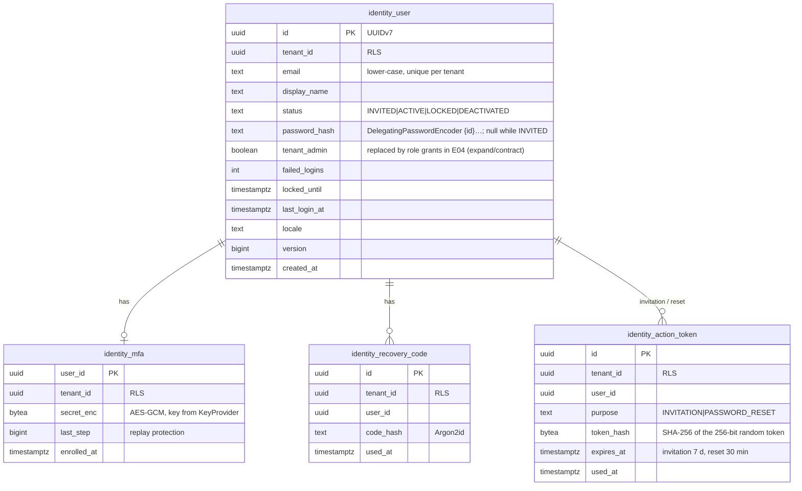
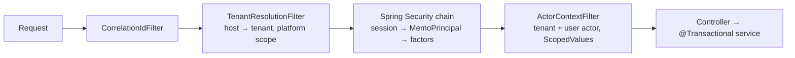

# E03 Identity, sessions and step-up — design

Decisions: [ADR-0022](../../../adr/0022-tenant-resolution-and-accounts.md) (tenant from host, accounts per tenant), [ADR-0023](../../../adr/0023-local-authentication-and-sessions.md) (login, sessions, passwords), [ADR-0024](../../../adr/0024-totp-mfa-and-step-up.md) (TOTP, recovery codes, step-up), [ADR-0025](../../../adr/0025-rate-limiting.md) (rate limits). Builds on E02 (tenant context, audit, jobs, outbox) and E01 (frame, templates).

## 1. Domain model (`identity` module)

State machine of `identity_user.status`:

| From → To | Trigger | Who |
|---|---|---|
| — → INVITED | invite | tenant admin (or the demo/bootstrap seeder) |
| INVITED → ACTIVE | accept invitation (set password; enrol MFA if required) | invitee with a valid token |
| ACTIVE → LOCKED | 20 consecutive failed logins | system |
| LOCKED → ACTIVE | lock expires (`locked_until`) or admin unlock | system / tenant admin |
| ACTIVE/LOCKED/INVITED → DEACTIVATED | deactivate (all sessions revoked) | tenant admin (not self) |
| DEACTIVATED → ACTIVE | reactivate | tenant admin |

Forbidden: INVITED → LOCKED; any transition out of DEACTIVATED except reactivate; an admin deactivating themselves or the last active tenant admin. Every transition is a guarded update (`WHERE id = ? AND status = ? AND version = ?`) and is audited.

Platform tables (no `tenant_id`, allow-listed in the RLS meta-test, ids only): `identity_http_session`, `identity_http_session_attributes` (Spring Session JDBC), `identity_rate_limit_bucket` (Bucket4j). `notification_mail_outbox` is a tenant table (below).

## 2. Request pipeline

- `TenantResolutionFilter` (before Spring Security) resolves the tenant (ADR-0022) and binds `TenantContext` for the rest of the request. Unknown host → 404.
- The `MemoSecurityContextRepository` reads `memo.principal` from the session, checks that its `tenantId` equals the resolved tenant (else the session is invalidated), enforces idle/absolute timeouts, and rebuilds the `Authentication` with one `FactorGrantedAuthority` per factor.
- `ActorContextFilter` (now after security) binds `Actor.User(userId)` or `Anonymous`.
- Status page: `/api/v1/health` stays public and tenant-independent (management/ops), served on any host.

## 3. API contract (`/api/v1`)

| Method & path | Purpose | Auth | Notes |
|---|---|---|---|
| `GET /auth/csrf` | CSRF token cookie | none | Called at start and after login/logout |
| `GET /auth/session` | Current state: `ANONYMOUS`, `MFA_REQUIRED`, `MFA_ENROLMENT_REQUIRED`, `AUTHENTICATED`; user summary; tenant branding name | none | Never 401 |
| `POST /auth/login` | `{email, password}` → next step | none | Rate-limited per IP and per tenant+email; uniform failure (`401 invalid-credentials`) |
| `POST /auth/mfa` | `{code}` TOTP or recovery code → adds `FACTOR_TOTP` | password factor | Rate-limited per user |
| `POST /auth/mfa/enrolment` | Start enrolment → `{otpauthUri, qrSvg}` | password factor (+ enrolment required) or full session (re-enrol) | Secret held unconfirmed |
| `POST /auth/mfa/enrolment/confirm` | `{code}` → activates MFA, returns recovery codes once | same | |
| `POST /auth/step-up` | `{code}` → refreshes `FACTOR_TOTP.issuedAt` | full session | |
| `POST /auth/logout` | Invalidate session | full or partial session | |
| `POST /auth/password-reset` | `{email}` → always 202 | none | Rate-limited; email only if the account exists and is ACTIVE |
| `POST /auth/password-reset/complete` | `{token, newPassword}` | token | Revokes all sessions of the user |
| `GET /auth/invitations/{token}` | Invitation details (tenant, email masked) | token | 404 when invalid/expired/used |
| `POST /auth/invitations/{token}/accept` | `{displayName, password}` → partial session, then MFA enrolment | token | Rate-limited per IP |
| `GET /me` | Profile | full | |
| `PUT /me/password` | `{currentPassword, newPassword}` | full + step-up | Revokes other sessions |
| `POST /me/recovery-codes` | Regenerate (old ones invalid) | full + step-up | |
| `GET /me/sessions` | List own sessions | full | Current one marked |
| `DELETE /me/sessions/{id}` | Revoke one | full | |
| `GET /admin/users?cursor&status&q` | List users (keyset by `(lower(display_name), id)`) | tenant admin | |
| `POST /admin/users` | Invite `{email, displayName, tenantAdmin}` | tenant admin + step-up | Idempotency-Key header |
| `POST /admin/users/{id}/deactivate`, `/reactivate`, `/unlock`, `/mfa-reset`, `/sessions/revoke` | Lifecycle actions | tenant admin + step-up | If-Match (version) |

Errors: RFC 9457 with `type` URIs `…/invalid-credentials`, `…/mfa-required`, `…/step-up-required`, `…/rate-limited` (+ `Retry-After`), `…/validation` (with `errors[]` per field, the contract E01 already consumes), `…/conflict`.

## 4. Authorization (E03 slice; E04 generalises)

| Endpoint group | Anonymous | Password factor only | Full session (user) | Full session (tenant admin) |
|---|---|---|---|---|
| `/auth/csrf`, `/auth/session`, `/auth/login`, password reset, invitation | ✅ | ✅ | ✅ | ✅ |
| `/auth/mfa`, `/auth/mfa/enrolment*` | ❌ | ✅ | ✅ (re-enrol) | ✅ |
| `/auth/step-up`, `/auth/logout`, `/me/**` | ❌ | ❌ (`logout` ✅) | ✅ | ✅ |
| `/admin/users/**` | ❌ | ❌ | ❌ 403 | ✅ (+ step-up on mutations) |
| everything else | ❌ 401 | ❌ 401 `mfa-required` | per later epics | per later epics |

Attribute cases tested: deactivated user's session (rejected), locked user (login refused), session on another tenant's host (rejected), stale step-up (401 `step-up-required`), MFA not required by tenant policy for a non-admin (password factor suffices), admin always requires MFA. The matrix is stored as `identity-authz.yaml` next to the tests and generates the parameterised cases (TESTING_STRATEGY §3.4); E04 adds the endpoint-coverage meta-test over all epics.

## 5. Audit events

`identity.user.invited`, `.activated`, `.deactivated`, `.reactivated`, `.unlocked`, `.locked` (system), `.mfa_enrolled`, `.mfa_reset`, `.recovery_codes_regenerated`, `.password_changed`, `.password_reset_requested` (only when an account exists; recorded in the tenant chain, no email in the record), `.password_reset_completed`, `identity.session.created` (login success, factors), `.revoked`, `.expired` (no: expiry is not an action), `identity.login.failed` (reason category only: `bad_credentials`, `locked`, `inactive`; no email if the account does not exist; then the event records the hashed email key only), `identity.step_up.succeeded`, `.failed`. Actor: the user, the admin, or `System`. Before/after: status, admin flag; never passwords, secrets, tokens or codes (redaction also catches them).

## 6. Email (minimal; E06 extends)
- `notification` module: `MailService.enqueue(tenant, template, toUserId, params)` writes `notification_mail_outbox` (tenant table, RLS) in the business transaction; a tenant task (db-scheduler, ADR-0018) renders and sends via Spring Mail over the platform SMTP relay (`memo.mail.*`), retries with backoff, marks sent.
- Templates (localised, plain text + simple HTML): invitation, password reset, MFA reset, new sign-in alert, password changed. Subjects carry no sensitive content (AGENTS §3.4); links use the tenant host.
- Tokens: 256-bit random, URL-safe; only the SHA-256 hash is stored; single use; expiry 7 days (invitation) / 30 minutes (reset).
- When no SMTP relay is configured (dev today), mail stays queued and an admin sees "not sent"; the dev environment gets a mail catcher (see open item in `log.md`).

## 7. Tenancy and RLS (new tables)
`identity_user`, `identity_mfa`, `identity_recovery_code`, `identity_action_token`, `notification_mail_outbox`: `tenant_id` first, RLS ENABLE + FORCE, standard policy, composite FKs `(tenant_id, user_id)`. Unique `(tenant_id, lower(email))`. `identity_action_token.token_hash` unique (lookup by hash happens in tenant scope after host resolution).

## 8. Migrations
`identity/V1__users_mfa_tokens.sql`, `identity/V2__http_session.sql` (Spring Session schema, renamed), `identity/V3__rate_limit.sql`, `notification/V1__mail_outbox.sql`. Additive. The demo tenant seeder creates demo users (`admin@demo.example`, `user@demo.example`) with password and TOTP secret from `MEMO_DEMO_PASSWORD` / `MEMO_DEMO_TOTP_SECRET` (generated into the git-ignored `.env` by `scripts/dev.mjs` and `deploy/scripts/gen-secrets.sh`; never in code); refuses under `prod`.

## 9. Performance budget
- Login: Argon2id verify ~50–100 ms by design (the slow part); total p95 < 400 ms. Rate-limit check adds one short transaction.
- `GET /auth/session` and every authenticated request: session lookup (indexed by session id) + principal rebuild, no extra query; p95 overhead < 5 ms.
- `GET /admin/users`: keyset pagination on `(tenant_id, lower(display_name), id)`, p95 < 100 ms at 5,000 users (V3 volume).

## 10. Background work
- `mail-send` (tenant task per message, retry 8× with backoff, idempotent by outbox id).
- `session-cleanup` (platform, every 5 min): `JdbcIndexedSessionRepository.cleanUpExpiredSessions()`.
- `rate-limit-cleanup` (platform, daily): deletes expired buckets.
- `lock-expiry` is evaluated lazily on login (no job).

## 11. Web
- Routes: `/login` (two steps: password, then code; links to reset and "use a recovery code"), `/login/enrol-mfa` (QR, manual key, confirm, recovery codes with "I saved them"), `/reset-password`, `/reset-password/$token`, `/invitation/$token`, `/` (home after sign-in), `/status` (platform status, moved from `/`), `/me/security` (password, MFA, recovery codes, sessions), `/admin/users` (list template + invite dialog + row actions).
- Unauthenticated layout (centered card, Direction A sign-in canvas); authenticated routes behind a guard that reads `/auth/session` (TanStack Query) and redirects to `/login?next=…`.
- Account menu in the top bar (name, "My security", "Sign out"); the Administration group appears for tenant admins.
- Step-up: the API client intercepts `step-up-required`, opens a code dialog (E01 `Dialog`), calls `/auth/step-up`, and retries the original request once.
- CSRF: the generated client sends `X-XSRF-TOKEN` from the `XSRF-TOKEN` cookie on mutating requests.

## 12. Test infrastructure
- Playwright global setup logs in each role through the API (password + TOTP computed from `MEMO_DEMO_TOTP_SECRET`) and stores per-role storage state (replacing the anonymous fixture, Phase 0 Q5). Roles in 1a: `tenantAdmin`, `user`.
- Mailpit (already in the local stack and CI core stack) receives emails; tests read them through its API.
- ZAP: authenticated context for the weekly active scan (script logs in the same way).
