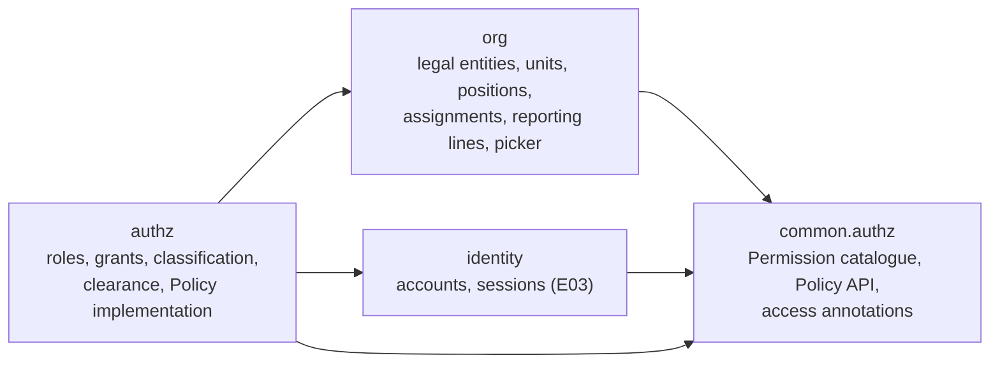
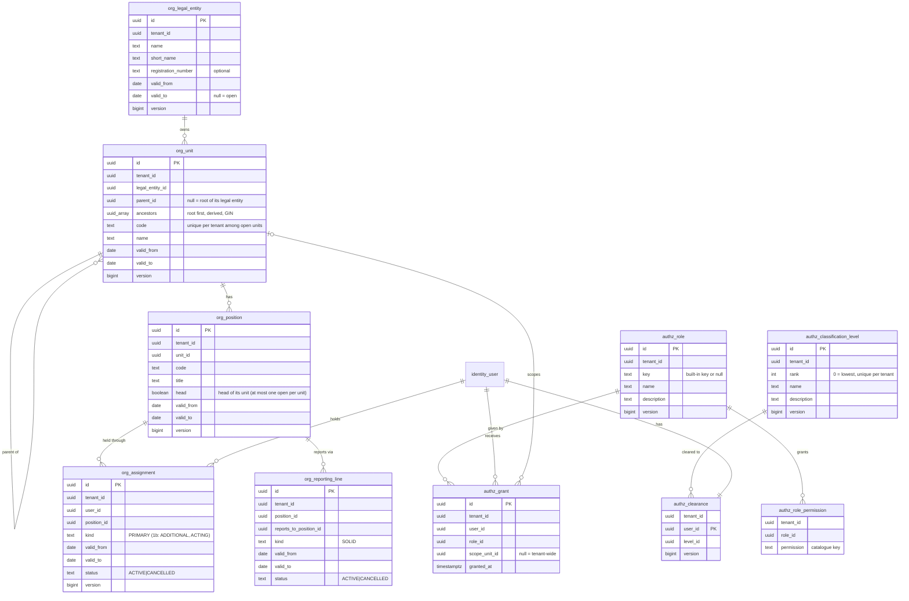

# E04 Org directory and authorisation — design

Decisions: [ADR-0026](../../../adr/0026-org-model.md) (units tree, positions, effective dating), [ADR-0027](../../../adr/0027-authorisation-model.md) (permission catalogue, roles, policy service). Builds on E02 (tenant context, audit, caches with `LISTEN/NOTIFY`), E03 (accounts, sessions, step-up, rate limits, Idempotency-Key, If-Match) and E01 (list, detail, form templates; tree view).

## 1. Module boundaries



- `common.authz` (shared kernel): `Permission` (catalogue), `BuiltInRole`, `Policy`, `Resource`, `ForbiddenException`, `AccessAdministration` (built-in grants and the last-admin lock for `identity`), the annotations `@PublicEndpoint`, `@AuthenticationFlow` (sign-in steps, partial sessions), `@SignedIn`, `@RequiresPermission`, and the `OrgTree` read model interface that `org` implements and `authz` consumes (no cycle).
- `org` publishes `OrgChanged(tenantId, kind, id)` (cache eviction and, in Phase 2, routing caches). `authz` publishes `GrantsChanged(tenantId, userId)`. Both carry `tenantId` (ADR-0017).
- `identity` asks `Policy.isPrivileged(userId)` at sign-in (MFA policy `admins`, ADR-0024) instead of reading `tenant_admin`.

## 2. Domain model



### Invariants
- **Tree:** a unit's parent is open and in the same legal entity; no cycles; `ancestors` equals the chain of `parent_id`s. A unit can be closed only when it has no open children and no open positions. Moving a unit rewrites the ancestors of its subtree in one statement.
- **Dates:** ranges are half-open `[valid_from, valid_to)`, `valid_to > valid_from`, calendar dates in the tenant time zone (new tenant setting `locale.time.zone`, IANA id, default `UTC`). An assignment's or reporting line's range lies within its position's range; a position's within its unit's.
- **Assignments:** at any date, at most one active PRIMARY assignment per position and per user. Only ACTIVE users can be assigned (assignments of a later-deactivated user stay as history; deactivation ends open assignments on the deactivation date). Corrections: dates of an assignment can be edited (audited before/after); a mistaken one is CANCELLED, never deleted.
- **Reporting lines:** at most one active SOLID line per position at any date; no cycles at any date in the overlap; a position cannot report to itself.
- **Roles:** built-in roles (`key` set) cannot be renamed, edited or deleted; custom roles can be deleted only when no grant uses them. A role grant scoped to a unit is allowed only if every permission of the role is scopable. At least one ACTIVE user keeps a tenant-wide `tenant_admin` grant (checked under a lock on the `tenant_admin` role row, also when deactivating a user in `identity`).
- **Classification:** ranks are dense `0..n-1`, unique per tenant; names unique per tenant. A level can be removed only when no clearance (and, later, no object) uses it. Reordering is a single operation that rewrites ranks, step-up protected and audited. Seeded with Public (0), Internal (1), Confidential (2), Strictly Confidential (3); new users are cleared to the lowest level.

### State
- Units, positions, legal entities: `open` while `valid_to` is null or in the future; `closed` after. No other states.
- Assignment / reporting line status:

| From → To | Trigger | Who |
|---|---|---|
| — → ACTIVE | create | `org.manage` (scope covers the position's unit) |
| ACTIVE → ACTIVE (dates changed) | end or correct dates | same |
| ACTIVE → CANCELLED | cancel (recorded in error) | same |

Forbidden: any transition out of CANCELLED; editing a CANCELLED row.

## 3. Permission catalogue (code, 1a)

| Key | Meaning | Scopable | Privileged | Built-in roles |
|---|---|---|---|---|
| `directory.read` | View the org directory and use the people picker | no | no | user, org_admin, auditor, tenant_admin |
| `org.manage` | Create, edit, move, close units and positions; assignments; reporting lines | yes | yes | org_admin, tenant_admin |
| `org.legal_entities.manage` | Create and edit legal entities | no | yes | tenant_admin |
| `identity.users.manage` | Invite, deactivate, reactivate, unlock, reset MFA, revoke sessions (E03 endpoints) | no | yes | tenant_admin |
| `authz.roles.manage` | Create and edit custom roles; grant and revoke roles | no | yes | tenant_admin |
| `authz.classifications.manage` | Edit classification levels; set user clearances | no | yes | tenant_admin |
| `audit.read` | Read the audit history of org and authz objects (E07: the full audit viewer) | no | yes | auditor, tenant_admin |

Later epics add permissions (files, notifications, tenant settings); the catalogue lists the epic that introduced each key. Unit-scoped `org.manage` lets a branch administrator manage only their branch's subtree; the subtree root itself can be edited but not moved or closed by a scoped holder.

## 4. Policy service

```kotlin
interface Policy {
    fun allows(permission: Permission, resource: Resource = Resource.Tenant): Boolean
    fun require(permission: Permission, resource: Resource = Resource.Tenant)  // throws ForbiddenException → 403
    fun condition(permission: Permission, unit: Field<UUID?>? = null, rank: Field<Int?>? = null): Condition
    fun holdsAnywhere(permission: Permission): Boolean   // gate of scoped endpoints
    fun grants(): List<ScopedPermission>
    fun clearanceRank(): Int
    fun isPrivileged(user: UUID): Boolean
}
sealed interface Resource { object Tenant; data class Unit(val id: UUID); data class Classified(val unit: UUID?, val rank: Int) }
```

Evaluation for the current actor (`Actor.User`):
1. Tenant state is ACTIVE (E07 adds suspension; suspended → deny).
2. Account is ACTIVE (the session already ensures this; re-checked through the cached grant set, which is empty for non-active users).
3. Effective grants = implicit `user` role + explicit grants. A permission is allowed for a target if some grant holds it and its scope is tenant-wide or an ancestor-or-self of the target unit.
4. For `Classified`, clearance rank ≥ object rank.

`condition(...)` builds `unit = any(:allowedSubtreeUnits)` from the cached tree (or `true` when a tenant-wide grant exists) and `rank <= :clearance`. A property test asserts that `condition` selects exactly the rows `check` allows.

Caches (ADR-0020): `authz.grants` (key user id → effective permission scopes), `authz.roles` (role permissions), `org.tree` (units with ancestors and open/closed), evicted by `GrantsChanged` / `OrgChanged` at commit on every node.

## 5. Request pipeline changes
- `AccessInterceptor` (in `authz`, registered for `/api/**`): resolves the handler's access annotation (method first, then class; exactly one); none → 403 at runtime (deny by default) and a build failure through the meta-test. `@RequiresPermission(P)` calls `Policy.require(P)` for tenant-wide checks; scoped checks happen in the service with the loaded object's unit.
- Spring Security keeps authentication (session, factors); URL rules shrink to "auth endpoints public, everything else needs a complete session". `ROLE_TENANT_ADMIN` and the `tenantAdmin` principal field are replaced by policy checks (expand/contract below).
- Admin MFA rule (ADR-0024 `admins`): "admin" now means privileged (holds any privileged permission). When a grant change makes a user privileged and they have no MFA, their sessions are revoked so the next sign-in requires enrolment.

## 6. API contract (`/api/v1`)

All mutations: CSRF, `If-Match` on updates of versioned rows, `Idempotency-Key` on creates, step-up on authorisation changes (roles, grants, clearances, classification levels).

| Method & path | Purpose | Access |
|---|---|---|
| `GET /org/legal-entities` | List | `directory.read` |
| `POST /org/legal-entities`, `PUT /org/legal-entities/{id}` | Create, edit, close | `org.legal_entities.manage` |
| `GET /org/units?asOf=D` | Whole tree (flat list with parent ids; the client builds the tree) | `directory.read` |
| `GET /org/units/{id}` | Unit detail: positions with current holders, head | `directory.read` |
| `POST /org/units` | Create `{legalEntityId, parentId, code, name, validFrom}` | `org.manage` on the parent |
| `PUT /org/units/{id}` | Rename, recode | `org.manage` on the unit |
| `POST /org/units/{id}/move` | `{parentId}` | `org.manage` on the unit's parent and the new parent (not the scope root) |
| `POST /org/units/{id}/close` | `{validTo}` | `org.manage` on the parent |
| `POST /org/positions`, `PUT /org/positions/{id}`, `POST /org/positions/{id}/close` | Position lifecycle | `org.manage` on the unit |
| `GET /org/positions/{id}` | Detail: holder history, reporting line history | `directory.read` |
| `POST /org/positions/{id}/assignments` | `{userId, validFrom, validTo?}` | `org.manage` on the unit |
| `PUT /org/assignments/{id}` | Change dates | `org.manage` |
| `POST /org/assignments/{id}/cancel` | Cancel | `org.manage` |
| `POST /org/positions/{id}/reporting-lines`, `PUT /org/reporting-lines/{id}`, `POST …/{id}/cancel` | Reporting lines | `org.manage` on the position's unit |
| `GET /org/positions/{id}/holder?date=D` | Who held it on D | `directory.read` |
| `GET /org/users/{id}/assignments` | A user's positions over time | `directory.read` |
| `GET /directory/search?q&kind=user,position&limit` | People picker (≤ 20 results; active users, open positions with current holder) | `directory.read`, rate-limited 60/min per user |
| `GET /org/history/{type}/{id}` | Change history of a unit or position from the audit trail (keyset) | `audit.read` or `org.manage` on the object |
| `GET /authz/permissions` | The catalogue (keys, scopable, privileged) | `authz.roles.manage` |
| `GET /authz/roles`, `POST /authz/roles`, `PUT /authz/roles/{id}`, `DELETE /authz/roles/{id}` | Roles | `authz.roles.manage` (+ step-up on mutations) |
| `GET /authz/users/{id}/grants`, `POST /authz/users/{id}/grants`, `DELETE /authz/grants/{id}` | Grants | `authz.roles.manage` (+ step-up) |
| `GET /authz/classification-levels`, `POST`, `PUT /{id}`, `POST /authz/classification-levels/order`, `DELETE /{id}` | Levels | read: signed in; write: `authz.classifications.manage` (+ step-up) |
| `PUT /authz/users/{id}/clearance` | `{levelId}` | `authz.classifications.manage` (+ step-up) |
| `GET /me/access` | My permissions (with scopes) and clearance, for the web navigation | signed in |

Errors (RFC 9457): `403 urn:memo:problem:forbidden`; `404` when the object does not exist **or** lies in another tenant (RLS makes them indistinguishable); `409 urn:memo:problem:conflict` with `reason` (`OVERLAP`, `CYCLE`, `NOT_EMPTY`, `IN_USE`, `BUILT_IN`, `LAST_ADMIN`, `SCOPE_ROOT`, `NOT_SCOPABLE`); `412`/`428` as in E03; `422 validation` with field errors.

E03 changes: `/admin/users/**` → `identity.users.manage` (same paths); the invite payload's `tenantAdmin` flag becomes an optional `roles` list (the flag is still accepted for one release and maps to the `tenant_admin` role); `GET /auth/session` and `GET /me` return `permissions` instead of `tenantAdmin` (both fields for one release).

## 7. Authorisation matrix

Subjects: anonymous; partial session (password only); `user`; `orgAdmin` (tenant-wide); `branchAdmin` (`org_admin` scoped to one subtree); `auditor`; `tenantAdmin`; `tenantAdmin` with stale step-up; deactivated user's old session; other tenant's admin.

| Action | anon | partial | user | branchAdmin (inside / outside scope) | orgAdmin | auditor | tenantAdmin |
|---|---|---|---|---|---|---|---|
| Read org tree, unit, position, picker | 401 | 401 | ✅ | ✅ | ✅ | ✅ | ✅ |
| Create/edit/close unit or position, assignments, reporting lines | 401 | 401 | 403 | ✅ / 403 | ✅ | 403 | ✅ |
| Move a unit | 401 | 401 | 403 | ✅ inside (not the scope root) / 403 | ✅ | 403 | ✅ |
| Legal entities (write) | 401 | 401 | 403 | 403 | 403 | 403 | ✅ |
| Org history | 401 | 401 | 403 | ✅ / 403 | ✅ | ✅ | ✅ |
| Roles, grants, classification, clearance (write) | 401 | 401 | 403 | 403 | 403 | 403 | ✅ (401 `step-up-required` when stale) |
| Classification levels (read), `/me/access` | 401 | 401 | ✅ | ✅ | ✅ | ✅ | ✅ |
| `/admin/users/**` (E03) | 401 | 401 | 403 | 403 | 403 | 403 | ✅ |

Attribute cases: other tenant's ids → 404; deactivated user's session → 401; scope root moved or closed by its scoped admin → 403 `SCOPE_ROOT`; classified target above clearance → 403 (exercised through a test-only target in E04; files in E05 are the first real classified objects). The matrix is stored per epic as `backend/src/test/resources/authz/<epic>.yaml`; E03's endpoints are backfilled into `e03-identity.yaml`.

## 8. Audit events
`org.legal_entity.created|updated|closed`, `org.unit.created|updated|moved|closed`, `org.position.created|updated|closed`, `org.assignment.created|updated|cancelled|ended` (ended by user deactivation: actor `System`), `org.reporting_line.created|updated|cancelled`, `authz.role.created|updated|deleted`, `authz.grant.created|revoked`, `authz.classification.created|updated|reordered|deleted`, `authz.clearance.changed`. Before/after hold ids, names, codes, dates, permission keys; never personal data beyond ids and display names.

## 9. Tenancy and RLS
Every new table has `tenant_id` first, RLS ENABLE + FORCE with the standard policy, composite FKs `(tenant_id, …)`, and a `(tenant_id, …)` index for every FK. Indexes:
- `org_unit (tenant_id, parent_id)`, GIN `(ancestors)`, unique `(tenant_id, lower(code)) where valid_to is null`;
- `org_position (tenant_id, unit_id)`; `org_assignment (tenant_id, position_id, valid_from)`, `(tenant_id, user_id, valid_from)`;
- `org_reporting_line (tenant_id, position_id, valid_from)`, `(tenant_id, reports_to_position_id)`;
- `authz_grant (tenant_id, user_id)`, `(tenant_id, role_id)`; unique `authz_classification_level (tenant_id, rank)` deferrable (reorder in one statement);
- picker: `identity_user (tenant_id, lower(display_name) text_pattern_ops)`, `org_position (tenant_id, lower(title) text_pattern_ops)`.

No FKs across modules (`org_assignment.user_id` → `identity_user`, `authz_grant.user_id`, `authz_grant.scope_unit_id` → `org_unit`): module migrations run in no guaranteed order (found in T1: authz migrated before identity), as E03 already noted for `tenant_id`. The writing services check those references, and the cross-tenant and consistency tests cover them.

## 10. Migrations and compatibility (expand → migrate → contract)
- `org/V1__directory.sql`, `authz/V1__roles_grants_classification.sql` (schema only).
- Built-in roles, the seeded classification levels, `tenant_admin` grants for users with `identity_user.tenant_admin = true`, and lowest-level clearances are created by an idempotent **tenant bootstrap** (`authz` listens to `TenantCreated` and runs a one-time platform task over existing tenants at start-up), not by SQL, so the data rules live in one place.
- `identity_user.tenant_admin` stays for one release: written in step with the grant, no longer read. A later release drops it (contract).
- Session principals issued by E03 carry `tenantAdmin`; new code ignores the field, so sessions survive the deploy.
- Module migration order: Spring Modulith runs each module's Flyway location in dependency order, so `authz` (depends on `org`, `identity`) migrates after them; verified by the migrate-mode test.

## 11. Performance budget (V3 volume: 1,500 units, 2,000 positions, 5,000 users)
| Endpoint / screen | Target p95 | How |
|---|---|---|
| `Policy.check` / `condition` | < 1 ms, no query | Cached grants and tree |
| `GET /org/units` | < 150 ms | One query, flat list, ~200 KB JSON at 1,500 units (gzip) |
| `GET /org/units/{id}`, `/positions/{id}` | < 100 ms | Indexed by unit / position, holders joined as of today |
| `GET /directory/search` | < 100 ms | Prefix index + bounded scan, limit 20 |
| Unit move | < 300 ms | One `UPDATE` over the subtree's rows |
| Org tree screen render | < 500 ms at 1,500 units | Virtualised tree; children expanded lazily from the flat list |

`EXPLAIN` of each list query recorded in the log against the V3 volume.

## 12. Background work
- `authz-bootstrap` (platform task, once per deploy, idempotent): built-in roles, levels, grants and clearances for every tenant lacking them; per-tenant work in tenant scope (ADR-0017).
- Ending assignments on user deactivation runs in the deactivation transaction (no job).
- No other jobs; caches are evicted at commit.

## 13. Web (UX flows; E01 templates and tree view)
- **Navigation:** the Administration group shows only what `/me/access` allows: Users, Organisation, Roles, Classification.
- **`/admin/org` — org tree editor:** split view. Left: legal entity switcher and the unit tree (keyboard tree view, search box filtering by name/code, "Show closed" toggle, "as of" date picker). Right: the selected unit's detail (name, code, parent, valid from; positions table with title, head mark, current holder, from date; actions Add unit, Add position, Rename, Move (unit picker dialog), Close (date dialog)). History tab from `/org/history`.
- **`/admin/org/positions/$id` — position detail:** title, unit, reports to; holder history table (user, from, to, status) with Assign (people picker + dates), End, Correct dates, Cancel; reporting line history with Change.
- **`/admin/users/$id` — user detail:** profile and status (E03 actions), current and past positions, roles (grant dialog: role + optional unit scope; revoke), clearance (select). Authorisation changes trigger the step-up dialog.
- **`/admin/roles`:** list of roles (built-in marked, not editable); create/edit form with permissions grouped by module, scopable and privileged marked.
- **`/admin/classifications`:** ordered list with move up/down, add, rename, remove (disabled when in use).
- **People picker component:** combobox (ARIA 1.2 pattern), debounced 250 ms, results grouped Users / Positions, shows unit path; used by assignment and later by Phase 2 routing.
- Validation: these screens reuse the E01 list/detail/form templates and tree view approved in the E01 UX review; the owner sees the screens at the epic demo (gate delegated, overview Q1).

## 14. Demo tenant
A realistic bank: one legal entity "Demo Bank", about 30 units (board office, CEO office, divisions such as Credit, Operations, Finance, HR, IT, Risk, Compliance, Treasury; departments under them; regional branches), about 80 positions with heads and reporting lines, demo users `admin@`, `orgadmin@`, `branchadmin@` (scoped to a region), `auditor@`, `user@` plus about 40 named staff (no password: `INVITED`, for the picker and the tree). Defined as code in `demo/` and used by tests, e2e and local development.
