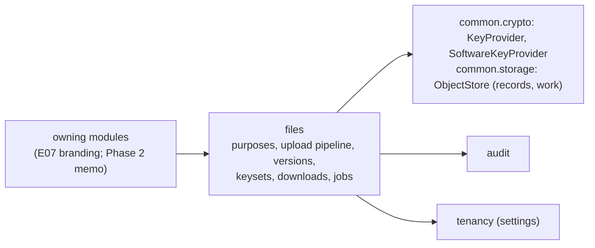
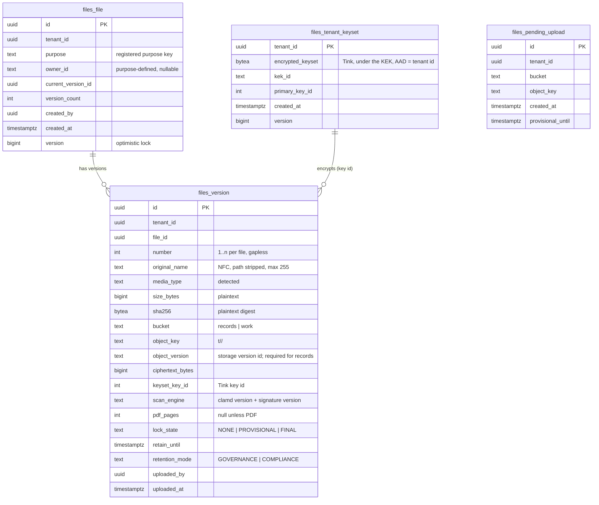
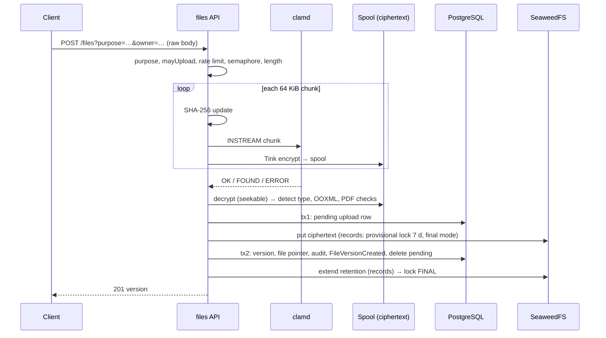

# E05 Files service — design

Decisions: [ADR-0028](../../../adr/0028-envelope-encryption.md) (Tink streaming AEAD, per-tenant keysets, key provider), [ADR-0029](../../../adr/0029-upload-pipeline-and-downloads.md) (upload pipeline, limits, range downloads). Builds on E02 (tenant context, jobs, audit, caches), E03 (sessions, rate limits, Idempotency-Key, If-Match), E04 (policy service, access annotations, authorisation matrix) and ADR-0005 (buckets and S3 identities).

## 1. Module boundaries

- **`files` public API** (`com.memo.files`):
  - `FilePurpose` (interface, registered as Spring beans by the owning module): `key`, `allowedTypes`, `maxBytes`, `maxPdfPages`, `storage` (`RECORD` | `ORDINARY`), `retention` (record purposes), `auditReads`, `inlineTypes`, `mayUpload(ownerId)`, `mayRead(file)`.
  - `FileVersionCreated(tenantId, purpose, ownerId, fileId, versionId)`, published **synchronously in the business transaction**, so the owner can store its pointer (for example the tenant logo) or veto by throwing.
  - `Files` service for owners: `info(fileId)`, `versions(fileId)`, `currentVersion(fileId)`. Upload and download stay inside `files` (one implementation of the HTTP details).
- **`common.storage.ObjectStore`** replaces `RecordStore` (same S3 client set-up): streamed `put` from a file to either bucket (one PUT with the Content-MD5 object-lock PUTs need; multipart only if the ceiling ever passes 5 GiB), `extendRetention`, `readRange` and a range-reading channel, `deleteAllVersions`. The audit anchors (ADR-0019) move to it unchanged.
- **`common.crypto.KeyProvider`**: `currentKekId()`, `kek(id): Aead`. `SoftwareKeyProvider` (id `software-v1`) derives the KEK from `MEMO_DATA_KEY` (ADR-0028). `DataKeys` (TOTP secrets) stays as it is.
- No foreign keys across modules (E04 lesson): `owner_id` is text, interpreted by the purpose.

## 2. Domain model

### Invariants
- **Versions are immutable** (append-only): no `UPDATE` other than `lock_state` (`PROVISIONAL → FINAL`), no `DELETE`. A trigger rejects any other change, like the audit table.
- `number` is gapless per file: the next number comes from `files_file.version_count`, incremented in the same guarded update that moves `current_version_id` (`… WHERE id = ? AND version = ?`).
- A version exists only after its object is stored and scanned clean; `sha256` is of the plaintext and is part of the strong `ETag`.
- `object_key` is random (128 bits, base32), never derived from names or ids; the original name is metadata only.
- Record versions (`bucket = records`) always have `retain_until` and `retention_mode`; `lock_state` is `PROVISIONAL` until retention is extended, then `FINAL`. Ordinary versions have `lock_state = NONE`.
- The tenant keyset row is created once per tenant (`INSERT … ON CONFLICT DO NOTHING`, then re-read), so two nodes cannot create two keysets.

### States
| Object | States | Transitions |
|---|---|---|
| Upload (in flight, not stored) | RECEIVING → SCANNED → INSPECTED → STORED → COMMITTED, or REJECTED | Rejection from any state before STORED; failure after STORED leaves a pending row for the sweep |
| Version lock | NONE; PROVISIONAL → FINAL | Only forward; `FINAL` is set after `PutObjectRetention` succeeds |
| File | ACTIVE | 1a has no delete or archive (retention and disposal policies arrive with records management) |

## 3. Purposes in 1a
| Key | Owner | Types | Max | Storage | Audited reads | Inline |
|---|---|---|---|---|---|---|
| `tenant.logo` | E07 branding | PNG, JPEG, WebP | 1 MiB | ORDINARY | no | yes |
| `test.document` *(tests only)* | test config | PDF, DOCX, XLSX, PPTX, ODT, ODS, ODP, PNG, JPEG, plain text, ZIP | 50 MiB | RECORD | yes | PDF, images |
| `test.image` *(tests only)* | test config | PNG, JPEG | 2 MiB | ORDINARY | no | yes |

SVG is never allowed (script in images). E07 registers `tenant.logo`; E05 delivers the mechanism and the test purposes.

## 4. Upload pipeline (ADR-0029)

- **Before reading the body:** purpose exists; `mayUpload(owner)`; `Content-Length` (if sent) ≤ the limit; rate limit `UPLOAD_PER_USER` (30/min); node semaphore (8 permits, `503` + `Retry-After: 5` when full). The tenant's keyset is loaded (created on first use).
- **Effective limit** = min(purpose `maxBytes`, tenant setting `files.upload.max-bytes`, platform ceiling `memo.files.max-upload-bytes`, default 100 MiB). clamd's `StreamMaxLength` is set to the platform ceiling.
- **Spool directory:** `memo.files.spool-dir` (default `${java.io.tmpdir}/memo-spool`), created `0700`, files `0600`, cleaned at start. Spools are ciphertext under the tenant keyset with the version's AAD (the ids are assigned before streaming), so the same bytes are uploaded unchanged.
- **Scanner:** our `ClamdClient` (socket, connect timeout 2 s, read timeout 120 s, chunks of 64 KiB). Reply parsing is strict; anything other than `stream: OK` or `stream: <name> FOUND` is an error (fail closed). The verdict and the engine version (`VERSION` command, cached for 5 minutes) are stored with the version.
- **Detection** (`ContentInspector`): Tika `MimeTypes` magic on the first 64 KiB (no parsers, no zip-container detector); `ZipInspector` (Commons Compress `ZipFile` over the decrypting channel, entry count checked from the trailer first) for OOXML (`[Content_Types].xml`, macro and VBA parts) and ODF (Basic macros); a zip trailer behind a non-zip type is refused as a polyglot; `PdfInspector` (PDFBox, memory-only stream cache capped at 64 MiB, page count, encryption). Runs on the `files-inspect` executor (4 threads per node), timeout 20 s.
- **Name check:** the extension of the declared name must map to the detected type (`TYPE_MISMATCH` otherwise). The name is NFC-normalised, stripped of path parts and control characters, and limited to 255 characters; an empty name becomes `file.<ext>`.
- **Rejections** answer `422` (`SCAN_UNAVAILABLE`: `503`) with Problem Details `reason` ∈ {`TOO_LARGE`, `MALWARE`, `TYPE_NOT_ALLOWED`, `TYPE_MISMATCH`, `MALFORMED`, `ENCRYPTED`, `LIMIT_EXCEEDED`, `SCAN_UNAVAILABLE`}. The audit entry holds reason, purpose, declared name, detected type, size read and (malware) signature name; it is written in its own transaction because no business change happens.
- **Idempotency:** `Idempotency-Key` is required on uploads (mobile and offline clients in later phases). It is claimed inside tx2 with the request hash = purpose + owner + SHA-256; a replay after success returns the stored `201` body, and the duplicate object is left to the pending sweep.

## 5. Downloads
- `GET /api/v1/files/{fileId}/content` (current version) and `GET /api/v1/files/{fileId}/versions/{versionId}/content`; `HEAD` for both.
- Short transaction: load file and version under RLS (absent → `404`), `mayRead` (denied → `403`), audit `file.opened` if the purpose audits reads and the session has no marker for this version from the last 30 minutes. The transaction ends before streaming.
- Streaming: `RangeReadChannel` (a `SeekableByteChannel` over ranged `GetObject` of the **recorded storage version**, 128 KiB per request, i.e. two ciphertext segments) → Tink seekable decrypting channel → response output stream, 64 KiB buffer. No database connection is held while streaming.
- Headers: see ADR-0029. `Content-Disposition` uses `filename*=UTF-8''` with the stored name; `inline` only when the purpose lists the type in `inlineTypes`.
- **Integrity:** Tink authenticates every segment it returns; a tampered object fails mid-stream, the connection is aborted (not completed with a short body), and `file.integrity.failed` is logged at ERROR and audited.

## 6. API contract
| Method and path | Purpose | Access | Notes |
|---|---|---|---|
| `POST /api/v1/files?purpose=&owner=` | upload a new file | `@SignedIn` + `purpose.mayUpload(owner)` | raw body, `Content-Disposition`, `Idempotency-Key`; `201` with `FileVersionView`, `Location` |
| `POST /api/v1/files/{fileId}/versions` | upload a new version | `@SignedIn` + `mayUpload(file.owner)` | `If-Match` on the file; `412` if stale |
| `GET /api/v1/files/{fileId}` | file metadata and versions | `@SignedIn` + `mayRead` | versions newest first; at most 100 per page (cursor) |
| `GET`, `HEAD /api/v1/files/{fileId}/content` | current content | `@SignedIn` + `mayRead` | range, `ETag`, `If-Range`, `If-None-Match` |
| `GET`, `HEAD /api/v1/files/{fileId}/versions/{versionId}/content` | content of one version | `@SignedIn` + `mayRead` | as above |

`FileVersionView`: `fileId`, `versionId`, `number`, `name`, `mediaType`, `sizeBytes`, `sha256` (hex), `uploadedAt`, `uploadedBy` (id and display name), `retainUntil` (records). Errors are RFC 9457 Problem Details. A public (anonymous) read path for the tenant logo is E07's decision, served by the branding module through `Files`.

## 7. Authorisation matrix
`e05-files.yaml` lists every endpoint for the E04 subjects. The `test.document` purpose (test sources only, so no test permission enters the catalogue) allows uploads to holders of `org.manage`, and reads to every signed-in user of the tenant, so both allowed and denied cells exist:

| Subject | `POST /files` (`test.document`) | `POST /files/{id}/versions` | `GET /files/{id}`, content |
|---|---|---|---|
| anonymous | 401 | 401 | 401 |
| partial session (MFA pending) | 403 | 403 | 403 |
| deactivated session | 401 | 401 | 401 |
| user | 403 | 403 | 200 |
| orgAdmin | 201 | 201 | 200 |
| other-tenant admin | 403 | 404 | 404 |

File ids are loaded under RLS first, so another tenant's file is `404` whatever the subject's permissions. An unknown purpose is `400 UNKNOWN_PURPOSE` for every signed-in subject. Production permissions come with each owning module (E07: `tenant.branding.manage`).

## 8. Audit events
| Action | Object | Before / after |
|---|---|---|
| `file.version.created` | `file`, id | after: version id, number, purpose, owner, media type, size, sha256, bucket, retain until |
| `file.upload.rejected` | `file.upload`, null | after: reason, purpose, owner, declared name, detected type, bytes read, signature (malware) |
| `file.opened` | `file.version`, id | after: purpose, range start of the first request |
| `file.retention.finalised` | `file.version`, id | after: retain until, mode (actor `System`) |
| `file.integrity.failed` | `file.version`, id | after: segment offset (actor `System`) |
| `files.keyset.created` | `files.keyset`, tenant id | after: kek id, primary key id (never key material) |

## 9. Tenancy and RLS
All four tables are tenant-owned: `tenant_id` first in every index, RLS `ENABLE` + `FORCE` with the standard policy (ADR-0006). The RLS meta-test picks them up. Jobs carry `tenantId` (ADR-0017): the retention-finaliser and the pending sweep are recurring platform tasks that iterate active tenants and run `inTenant` for each. The `app` S3 identity already has object read/write and `PutObjectRetention` on `records`, and no bucket administration or bypass right (ADR-0005), so the application cannot shorten or remove a lock.

## 10. Settings
| Key | Scope | Default | Notes |
|---|---|---|---|
| `memo.files.max-upload-bytes` | install | 104857600 | ceiling; also clamd `StreamMaxLength` |
| `memo.files.spool-dir` | install | `${java.io.tmpdir}/memo-spool` | ciphertext only |
| `memo.files.concurrent-uploads` | install | 8 | per node |
| `files.upload.max-bytes` | tenant | ceiling | may only lower the ceiling |
| `files.records.retention-mode` | tenant | `GOVERNANCE` | `COMPLIANCE` is irreversible per object; changing it needs step-up (E07 screen) |
| `files.records.retention-years` | tenant | 10 | purposes may set their own |

## 11. Performance budget
| Operation | Budget (dev VM, seeded) | How |
|---|---|---|
| Upload of a 10 MiB PDF, end to end | ≤ 1.5 s | single pass; clamd is the bottleneck |
| Upload heap per request | ≤ 2 MiB | 64 KiB buffers; measured with a 100 MiB upload |
| `GET /files/{id}` | p95 ≤ 100 ms | two indexed queries |
| First byte of a download | p95 ≤ 200 ms | one metadata transaction + first segment |
| 64 KiB range anywhere in a 100 MiB file | p95 ≤ 150 ms | at most two segments read |
| Versions list | keyset pagination on `(tenant_id, file_id, number desc)` | |

Indexes: `files_version (tenant_id, file_id, number desc)`, `files_file (tenant_id, purpose, owner_id)`, `files_pending_upload (tenant_id, created_at)`, `files_version (tenant_id, lock_state) where lock_state = 'PROVISIONAL'`.

## 12. Background work
| Job | Kind | Schedule | Idempotency |
|---|---|---|---|
| `files-retention-finalise` | platform recurring, per tenant | every 5 min | `PutObjectRetention` to the stored date is idempotent; only rows still `PROVISIONAL` older than 2 min |
| `files-pending-sweep` | platform recurring, per tenant | hourly | pending rows older than 1 h: delete the object from `work`; for `records`, wait until `provisional_until` passes, then delete the object version and the row. Object lock expires by the storage server's clock: if the app's clock runs ahead, storage refuses the delete and the next run retries |
| spool sweep | start-up runner | at start | removes every file in the spool directory |

A metric `memo.files.provisional.oldest.seconds` and a health detail warn when a provisional lock is older than 1 hour.

## 13. Deployment
- **ClamAV config:** `deploy/clamav/clamd.env` (ADR-0029 heuristics and limits as `CLAMD_CONF_<Option>` variables, which the official image writes into its `clamd.conf` at start), used by Compose (`env_file`), Helm and the tests, so every install and the test scanner share one source. `freshclam` uses the image default. On-prem air-gapped installs point `freshclam` at a private mirror (runbook).
- **Dev VM:** the `antivirus` profile is turned on for the dev environment (memory measured: 6.3 GiB available before ClamAV). Container limit 3 GiB.
- **Helm:** an optional ClamAV Deployment (`malwareScanner.deploy: true`) with its own NetworkPolicy (ingress from the backend only; egress only to DNS and the signature mirror), or an external `malwareScanner.host`.
- **nginx (web image):** `location /api/v1/files` with `client_max_body_size` at the ceiling, `proxy_request_buffering off`, `proxy_read_timeout 300s`; other routes keep 1 MB.
- **Caddy (edge):** the same path allows the ceiling in `request_body` and is excluded from `encode`.
- **Spool disk:** document the space (ceiling × concurrent uploads) in the on-prem runbook; the backend container's temp directory is a writable volume, not the read-only root.

## 14. UX
No screens in E05. The upload component (progress, cancel, rejection messages per `reason`) is built with its first user, E07's branding page; the rejection reasons and their messages are fixed here so the component can map them. No `ux-review.md` for this epic.
