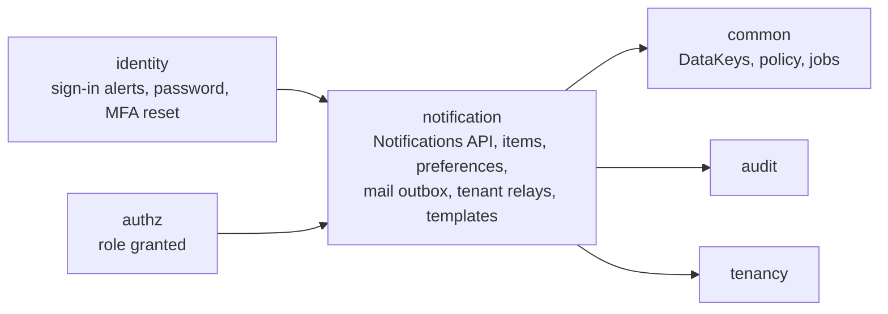
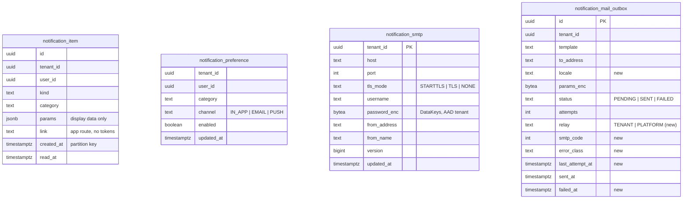

# E06 Notifications — design

Decision: [ADR-0030](../../../adr/0030-notifications-and-email-delivery.md). Builds on E03 (mail outbox, delivery job, security mails), E02 (jobs, audit, partition callback pattern), E04 (policy, matrix) and E01 (top bar slot, list and form templates).

## 1. Module boundaries

- **Public API** (`com.memo.notification`):
  - `NotificationKind` (enum): category, email template, in-app message key. 1a kinds: `SIGN_IN_ALERT`, `PASSWORD_CHANGED`, `MFA_RESET` (category `SECURITY`, mandatory) and `ROLE_GRANTED` (category `ADMINISTRATION`).
  - `Recipient(userId, email, displayName, locale)`.
  - `Notifications.notify(recipient, kind, params, link)`: in the caller's tenant transaction. Writes the in-app item and queues the email as preferences allow.
  - `Mail.enqueue(...)` stays for mails to people who are not yet users (invitation) or that must not appear in-app (password reset link).
- `notification` depends on `common`, `audit`, `tenancy` only. Producers build the `Recipient`, so there is no cycle with `identity`.

## 2. Domain model

### Invariants
- `notification_item` is partitioned by month on `created_at`; primary key `(id, created_at)`. Rows change only from unread to read (`read_at` set once); the app role has no `DELETE`. Partitions are created 3 months ahead and dropped after `memo.notification.retention-months` (13) by the migrator's `afterMigrate` callback.
- A user reads and marks only their own items: every query filters on the actor's user id, on top of tenant RLS.
- Preferences: a missing row means enabled. `SECURITY` cannot be disabled (409 `MANDATORY`).
- Relay: `NONE` is refused unless `memo.mail.allow-insecure` is true. The password is write-only.
- Outbox: `params_enc` is cleared when the mail is sent or fails permanently.

## 3. Delivery
- `Notifications.notify`: for each channel, enabled if the category is mandatory or the preference allows. `IN_APP` inserts an item. `EMAIL` calls `Mail.enqueue(kind.template, recipient.email, params, recipient.locale)`.
- `MailDelivery.send` (E03 job, extended): pick the tenant relay if configured, else the platform relay (else stay PENDING as today); render subject and body for the outbox locale; send; record `relay`, `attempts`, `last_attempt_at`. SMTP 5xx (`SMTPSendFailedException`/`SMTPAddressFailedException` with return code ≥ 500) → `FAILED`, permanent job failure, no retry; other failures → retry (8 attempts); after the last, `FAILED`.
- Senders are built per relay settings (cached per tenant, evicted on change); STARTTLS required or implicit TLS, server identity checked, 10 s timeouts.

## 4. Templates
- `notification/messages_en.properties` and `_ar.properties`: `mail.<template>.subject`, `mail.<template>.body` with `{name}` placeholders; plus the layout strings (footer). The locale chain is the user's locale, then the tenant default (setting `locale.default`), then `en`.
- HTML: one layout, `<html lang dir>`, escaped text, links rendered as buttons, inline styles. A test asserts that no subject has a placeholder and every template exists in every bundle.

## 5. API
| Method and path | Purpose | Access |
|---|---|---|
| `GET /api/v1/me/notifications?cursor=&limit=` | own items, newest first (keyset) | `@SignedIn` |
| `GET /api/v1/me/notifications/unread-count` | badge | `@SignedIn` |
| `POST /api/v1/me/notifications/{id}/read` | mark one read | `@SignedIn` (own item, else 404) |
| `POST /api/v1/me/notifications/read-all` | mark all read | `@SignedIn` |
| `GET /api/v1/me/notification-preferences` | category × channel matrix with `mandatory` flags | `@SignedIn` |
| `PUT /api/v1/me/notification-preferences` | change toggles | `@SignedIn` |
| `GET /api/v1/admin/mail-settings` | tenant relay (no password; `passwordSet`) or `null` | `notification.settings.manage` |
| `PUT /api/v1/admin/mail-settings` | set relay (`If-Match`; password optional, kept if absent) | same + step-up |
| `DELETE /api/v1/admin/mail-settings` | back to the platform relay | same + step-up |
| `POST /api/v1/admin/mail-settings/test` | send a test mail to the actor's own address now; returns `ok` or the error class | same + step-up; 5 per hour per tenant |
| `GET /api/v1/admin/mail-log?cursor=` | delivery log, newest first | `notification.settings.manage` |

New catalogue permission `notification.settings.manage` (privileged, not scopable); tenant admins hold it.

## 6. Audit events
| Action | Object | Data |
|---|---|---|
| `notification.smtp.changed` | `notification.smtp`, tenant | before/after without the password; `passwordChanged: true/false` |
| `notification.smtp.removed` | `notification.smtp`, tenant | before without the password |
| `notification.smtp.tested` | `notification.smtp`, tenant | result class |
| `notification.preferences.changed` | `notification.preferences`, user | changed toggles |
Reading notifications and marking them read are not audited (not business records).

## 7. Tenancy, RLS, performance
- All tables tenant-owned, `tenant_id` first in indexes, RLS `ENABLE` + `FORCE`; partitions get the same policy from the partition function (the audit pattern).
- Indexes: `notification_item (tenant_id, user_id, created_at desc, id)`, partial `(tenant_id, user_id) where read_at is null`.
- Budgets: unread count p95 ≤ 20 ms and first page p95 ≤ 50 ms at 1,000 items per user (seeded); `notify` adds ≤ 5 ms to the producer's transaction.

## 8. Web
- **Top bar:** a bell link (E01 slot) to `/notifications` with an unread badge ("9+" above nine) and the accessible name "Notifications, 3 unread". The count is polled every 60 s while the tab is visible. A link rather than a popover: large target, no hidden panel, works the same by keyboard and screen reader.
- **`/notifications`:** the E01 list template; each item's text comes from the web message catalogue by kind (`notification.kind.<kind>`, ICU with the item's params); unread items are marked visually and for screen readers; activating an item marks it read and follows its link; "Mark all as read".
- **My account → Notifications:** the preference matrix (rows: categories; columns: In app, Email); security toggles are on and disabled with an explanation.
- **Admin → Email:** relay form (E01 form template), password field write-only ("leave empty to keep"), step-up on save, "Send test email", and the delivery log table.
- Every string in English and Arabic; screens reuse the E01 templates approved in its UX review; the owner sees them at the epic demo.

## 9. Push payload (design note)
`{"aps": {"badge": n, "alert": {"title": "memo", "body": "You have n new items"}}}` and the FCM equivalent: no ids, names or content; the app fetches details over the authenticated API. The `PUSH` channel exists in preferences from 1a, disabled until Phase 6a.
