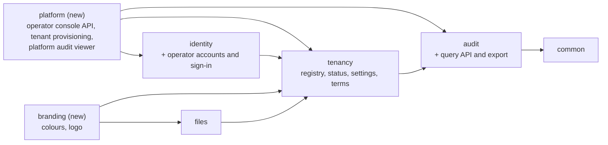
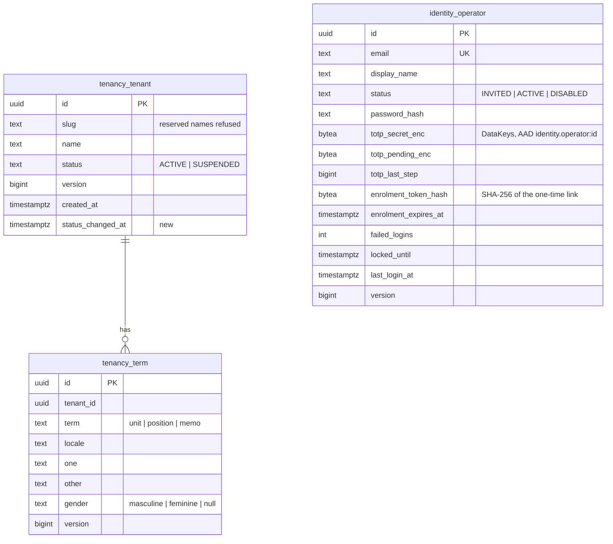

# E07 Tenant lifecycle and administration — design

Decisions: [ADR-0031](../../../adr/0031-platform-operator-path.md) (operator path), [ADR-0032](../../../adr/0032-terminology-overrides.md) (terminology), [ADR-0033](../../../adr/0033-audit-viewer-and-export.md) (audit viewer and export). Builds on E02 (platform scope, audit chain, settings), E03 (accounts, sessions, invitations, step-up), E04 (policy, matrix, admin screens), E05 (files for the logo), E06 (mail settings).

## 1. Module boundaries



- **`platform` (new module):** `PlatformTenantsController` (`/api/v1/platform/tenants`), `TenantProvisioning` (the only class here that opens a tenant transaction), `PlatformAuditController`. Depends on the public APIs of `identity` (operator principal, `Invitations`), `tenancy` (`TenantRegistry`, `TenantLifecycle`), `audit`.
- **`identity`:** new `identity.operator` package: `OperatorAccounts`, `OperatorSignIn`, `OperatorAuthController` (`/api/v1/platform/auth/**`), `OperatorPrincipal`, the operator filter chain, the `operator-invite` command. Reuses the encoder, TOTP, rate limiter and session store.
- **`tenancy`:** `TenantLifecycle` (suspend, resume, rename; platform scope), resolver with status, reserved slugs, `Terminology`, `TenantPreferences` (typed access to language and time-zone defaults).
- **`branding` (new module):** `Branding` (colours, logo), its controllers and the `tenant.logo` file purpose. Separate from `tenancy` because `files` already depends on `tenancy`.
- **`identity` security settings:** `SecuritySettingsController` (`/api/v1/admin/security-settings`) over the existing `security.*` keys plus lockout keys.
- **`audit`:** `AuditQuery` and `AuditExport` (tenant chain), `AuditQueryController`; platform chain query used by `platform`.
- Tenant admin console: no backend module of its own; the web assembles screens.

## 2. Data model



- `identity_operator` (owned by `identity`, so the module prefix rule holds): a platform table (no `tenant_id`), RLS `ENABLE` + `FORCE` with the policy `platform_operator` that admits only `app.scope = platform`. One pending enrolment link per operator, stored as its hash on the row. Lockout: 5 wrong passwords in a row lock for 30 minutes (the per-account rate limit allows 10 per 15 minutes, so the lock is reached first).
- `tenancy_tenant`: new policies `platform_insert` (`INSERT … WITH CHECK app.scope = platform`) and `platform_update` (`UPDATE` in platform scope). Slug check gains the reserved list.
- Branding lives in settings (`branding.color.light`, `branding.color.dark`, `branding.logo.file`): small, non-secret, already audited and cached.
- Settings keys used by the console (all existing unless marked new):

| Key | Values | Default |
|---|---|---|
| `security.mfa.required` | `all`, `admins` | `all` |
| `security.session.idle.minutes` | 5–480 | 30 |
| `security.session.absolute.hours` | 1–24 | 12 |
| `security.stepup.minutes` | 1–30 | 5 |
| `security.password.min.length` | 12–128 | 12 |
| `security.lockout.throttle.after` (new) | 3–10 | 5 |
| `security.lockout.lock.after` (new) | 5–50 | 20 |
| `security.lockout.lock.minutes` (new) | 5–1440 | 30 |
| `locale.default` | `en`, `ar` | `en` |
| `default.timezone` | IANA zone id | `UTC` |

  The demo tenant's `default.locale` key is renamed to `locale.default` (the key E06 reads).

## 3. Flows

### Create a tenant and invite the first admin
```mermaid
sequenceDiagram
  actor O as Operator (admin host)
  participant P as platform API
  participant R as TenantRegistry (platform scope)
  participant TP as TenantProvisioning (tenant scope)
  participant I as Invitations (E03)
  O->>P: POST /platform/tenants {slug, name, locale, timeZone, adminEmail, adminName}
  P->>R: insert registry row (platform scope), platform audit
  P->>TP: provision(tenantId, defaults, admin)
  TP->>TP: settings (locale, time zone); refuse if an active tenant admin exists
  TP->>I: invite(adminEmail, adminName, tenantAdmin = true, inviter = "memo platform")
  TP-->>P: invited (no tenant data returned)
  P-->>O: 201 tenant summary
```
- Steps run in two transactions (platform, then tenant). If the second fails, the tenant exists without an admin; the console shows "No administrator yet" and offers **Invite first administrator** (same `provision` path, step-up). The operator never sees the address afterwards.
- Slug: validated (pattern, reserved names, uniqueness: 409 `slug-taken`).

### Suspend and resume
- `POST /platform/tenants/{id}/suspend` (step-up, `If-Match`): platform-scope update of status and `status_changed_at`; delete the tenant's sessions (principal index prefix `<tenantId>:`); invalidate resolver caches on every node (`tenancy.resolver` channel); audit in both chains. Resume is symmetric without session changes.
- Resolution filter: suspended tenant → 403 `https://memo.dev/problems/tenant-suspended` on every `/api/**` path except health. The SPA shows a full-page "This organisation is suspended. Contact your administrator." on that problem type.
- Jobs: `Jobs.tenantTask` checks `ActiveTenants.isActive(tenant)`; for a known but suspended tenant it reschedules the instance one hour later through a completion handler that does not touch the failure count.

### Operator sign-in
`POST /platform/auth/login` → partial session → `POST /platform/auth/mfa` (or enrolment `POST /platform/auth/mfa/enrol` + `…/confirm` on first sign-in) → complete session. Same timing-safe rejection and lockout as users (fixed thresholds); every outcome audited in the platform chain.

## 4. API

| Method and path | Purpose | Access |
|---|---|---|
| `GET /api/v1/platform/auth/csrf`, `GET …/auth/session` | CSRF token; session state | public (operator host) |
| `POST /api/v1/platform/auth/login` | password step | public; rate limited per IP and per account |
| `POST …/auth/mfa`, `POST …/auth/mfa/enrol`, `POST …/auth/mfa/enrol/confirm` | second factor, first-time enrolment | partial operator session |
| `POST …/auth/step-up`, `POST …/auth/logout` | fresh TOTP; sign out | operator session |
| `GET …/auth/enrolment/lookup`, `POST …/auth/enrolment/accept` | bootstrap link: set password | public; token |
| `GET /api/v1/platform/tenants?cursor=&q=` | registry list | operator |
| `POST /api/v1/platform/tenants` | create and invite first admin | operator + step-up |
| `GET /api/v1/platform/tenants/{id}` | registry row (+ `hasAdmin` flag) | operator |
| `PATCH /api/v1/platform/tenants/{id}` | rename (`If-Match`) | operator |
| `POST /api/v1/platform/tenants/{id}/suspend`, `…/resume` | status (`If-Match`) | operator + step-up |
| `POST /api/v1/platform/tenants/{id}/first-admin` | (re-)invite the first admin; 409 if an active admin exists | operator + step-up |
| `GET /api/v1/platform/audit?cursor=&from=&to=&action=` | platform chain | operator |
| `GET /api/v1/branding` | name, colours, logo version (login page) | public (tenant host) |
| `GET /api/v1/branding/logo` | logo bytes, `ETag`, cache 1 h | public (tenant host) |
| `GET`, `PUT /api/v1/admin/branding` | colours (validated contrast), logo file id | `tenant.settings.manage` (new) |
| `GET`, `PUT /api/v1/admin/security-settings` | §2 keys | `tenant.settings.manage` + step-up on PUT |
| `GET`, `PUT /api/v1/admin/preferences` | language and time-zone defaults | `tenant.settings.manage` |
| `GET /api/v1/terms?locale=` | resolved terms | public (tenant host) |
| `GET`, `PUT /api/v1/admin/terms` | overrides per locale (`If-Match`) | `tenant.settings.manage` |
| `GET /api/v1/admin/audit?…` | audit query (ADR-0033) | `audit.read` |
| `POST /api/v1/admin/audit/export` | ZIP export | `audit.read` + step-up; 5/h per tenant |

New catalogue permission `tenant.settings.manage` (privileged, not scopable); tenant admins hold it. The `tenant.logo` file purpose's read policy is public within the tenant (the public endpoint streams it as system).

## 5. Audit events

| Action | Chains | Data |
|---|---|---|
| `tenant.created` | platform, tenant | slug, name, status |
| `tenant.renamed` | platform, tenant | before/after name |
| `tenant.suspended`, `tenant.resumed` | platform, tenant | status before/after; sessions ended (count) |
| `tenant.first_admin.invited` | platform, tenant | invited user id (tenant chain only); platform chain: tenant id only |
| `platform.operator.invited`, `.activated`, `.signed_in`, `.sign_in_failed`, `.locked`, `.mfa_enrolled`, `.step_up` | platform | operator id; no email in failures |
| `tenant.setting.*` (existing) | tenant | security, language, branding settings |
| `tenant.term.changed` | tenant | term, locale, before/after forms |
| `audit.exported` | tenant | filters, range, count, continuous |

## 6. Branding
- Colours: hex `#rrggbb`. Light colour: contrast ≥ 4.5 with `#ffffff` and ≥ 3 with `#f6f7f9`; dark colour (optional): ≥ 4.5 with `#0d1726` and ≥ 3 with `#10151d`. Server validates (400 with the measured ratio); the form shows the ratio as you type.
- Logo: purpose `tenant.logo`, PNG/JPEG/WebP, ≤ 512 KiB, scanned and encrypted like every file; displayed at most 160 × 40 CSS px with `alt` = tenant name. SVG refused.
- The web reads `/branding` at start-up and sets `--primary` (and `--ring`) through `document.documentElement.style.setProperty` for the active theme; CSP stays strict.

## 7. Web

### Operator console (`/platform/*`, rendered when the host is the operator host)
- Own shell: product name and "Platform administration", no tenant navigation; sign-in, enrolment, TOTP pages reuse the E03 auth templates.
- **Tenants:** list (name, slug, status badge, created); **New tenant** form (name, slug with live format check, language, time zone, first admin's name and email); tenant page (status, **Suspend**/**Resume** with confirmation dialog naming the effects, rename, **Invite first administrator** when `hasAdmin` is false).
- **Platform audit:** list template, filters by date and action.
- The SPA learns which console to render from `GET /api/v1/platform/auth/session`: on a tenant host it answers 404, on the operator host 200. The root route redirects to `/platform` on the operator host; `/platform/*` on a tenant host shows "Not found".

### Tenant admin console (`/admin`)
- **Overview page** `/admin`: cards linking to Users, Organisation, Roles, Classification, Security, Email, Branding, Language and terms, Audit; each card shown only with the permission.
- **Security** (`/admin/security`): MFA policy (radio: everyone / administrators only), session idle and absolute timeouts, step-up window, password minimum length, lockout thresholds; ranges shown as hints; step-up on save.
- **Branding** (`/admin/branding`): logo upload (new shared `FileUpload` component: drag-and-drop and button, progress, scanning state, rejection reasons from E05), colour pickers with hex input and live contrast ratio and pass/fail text, preview of a button and a link.
- **Language and terms** (`/admin/language`): default language and time zone; terms table per locale (term, singular, plural, gender where the language has it), "Reset to default".
- **Audit** (`/admin/audit`): filter bar (dates, action, person, object), table with expandable before/after, keyset "Load more", **Export** (step-up, downloads the ZIP).
- **Suspended page:** shown on `tenant-suspended` from any request.
- Every string English + Arabic; screens reuse E01 templates (list, form, detail).

### Terms
`useTerms()` gives `{unit, units, Unit, Units, unitGender, position, …}` from `/terms` (cached per locale, refreshed on change). Org screens' messages that name units or positions take these arguments.

## 8. Deployment
- Dev and on-prem Compose: Caddy's on-demand TLS `ask` endpoint (`tenanthost`) also approves `memo.platform.host`. Helm: the ingress gets the admin host.
- `MEMO_PLATFORM_HOST` in `.env` templates; dev: `admin.dev.memo-revamp.naziharitsolution.com` (covered by the wildcard record).
- E2E: the stack runs with base domain `localhost`; tenant hosts `<slug>.localhost` and `admin.localhost` resolve to loopback in Chromium and Firefox. WebKit (nightly) gets `--host-resolver-rules` equivalent through `/etc/hosts` entries in the CI job.
- Command mode: `operator-invite` documented in the runbook `docs/runbooks/platform-operators.md`.

## 9. Performance
- Resolver: one cached lookup per request (status included); no extra query.
- Audit query p95 ≤ 100 ms for a 7-day page at 1 M events per tenant (index `(tenant_id, seq)` and `(tenant_id, occurred_at)` exist); export streams ≥ 20,000 events/s.
- Platform tenant list: keyset by name, p95 ≤ 50 ms at 10,000 tenants.

## 10. Language packs
Per-locale chunks stay (research R22); `i18n:verify` fails when a catalogue passes 15 KB gzip.
