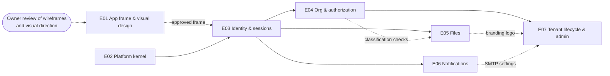

# Phase 1a — Platform minimum core: overview

> Level-1 plan (see `AGENTS.md §5`). It splits the phase into epics, fixes their order and dependencies, lists the phase-level research and ADRs, and maps the exit criteria to epics. Each epic gets its own detailed plan (`epic-<NN>-<slug>/`: research, ADRs, design, threat model, tasks, test plan) just before it starts.
>
> **Status:** waiting for owner approval (see §10). Written 2026-10-18.

---

## 1. Phase goal (from `MASTER_PLAN.md`)

The smallest platform the Phase 2 first slice needs, built to production quality: tenants, users who can log in securely, an org directory, permissions, an unbreakable audit trail, secure files and notifications.

### What Phase 0 left us
- **Tenancy (database side):** the app role is not the owner and has no `BYPASSRLS`; RLS conventions (ADR-0006) with the meta-test, the negative test and the cross-tenant suite; `TenantTransactions` / `TenantDsl` set `app.tenant_id` with `set_config(…, true)` and fail closed.
- **Tables:** `tenancy_tenant` (RLS `tenant_self`) and the reference table `tenancy_setting`.
- **Security skeleton:** deny-by-default `SecurityConfig`, stateless, no authentication mechanism; CSRF on; Problem Details for 401/403.
- **Web:** a one-page shell with react-intl (en, ar, pseudo-locales), light/dark themes, axe in every e2e visit, a strict CSP and an anonymous-role Playwright fixture.
- **Pipeline and environments:** every CI gate, signed images, the on-prem Compose profile, a live dev environment.
- **Empty module packages** for every bounded context, including `identity`, `org`, `authz`, `audit`, `files`, `notification`.

### What Phase 1a deliberately does *not* do
These belong to Phase 1b or later. Phase 1a designs for them so they plug in without rework:
- **Federated identity** (OIDC, SAML, LDAP, passkeys) and the **mobile token issuer**. Phase 1a builds local accounts behind an authentication abstraction that 1b extends.
- **Additional and acting assignments, delegation, bulk import and HR sync.** Phase 1a has primary assignments only, but the assignment table carries a type and effective dates from the start.
- **KMS/HSM key provider, key rotation and crypto-shredding.** Phase 1a ships a software KEK provider behind the key-provider interface that 1b implements again.
- **Break-glass operator access, tenant export and offboarding.**
- **Tenant-editable notification templates, IdP configuration and delegation screens** (1b admin console completion).
- **Push sending** (Phase 6a). Phase 1a only designs the content-free payload.
- **ONLYOFFICE.** No 1a feature edits documents. It stays out of the dev environment until Phase 2.

---

## 2. Epics

Seven epics. Durations are estimates in team-weeks, to size scope. Phase 0 ran much faster than its estimate with the agent working alone (Q3: agent only, no deadline), so the quality gates set the pace, not these numbers. Each epic's `tasks.md` refines them.

| # | Epic | Purpose | Est. | Depends on |
|---|---|---|---|---|
| E01 | **App frame and visual design** | Wireframes of the app frame and the standard page types, a visual direction, the layout and component kit every later screen uses. Owner approval before feature screens. | 2–3 wks (+ owner review) | — |
| E02 | **Platform kernel** | Tenant context end to end (requests, jobs, async listeners, executors), db-scheduler, the transactional outbox, cross-node cache invalidation, and the hash-chained audit store with tamper verification and anchoring | 3–4 wks | — |
| E03 | **Identity, sessions and step-up** | Local accounts, invitations, password policy, lockout, TOTP MFA, recovery codes, server-side sessions with CSRF, session list/revoke, step-up, rate limiting, minimal email delivery, real Playwright logins | 4–5 wks | E02 (E01 for screens) |
| E04 | **Org directory and authorization** | Legal entities, units, positions, primary assignments, reporting lines with change history; roles, classification levels and clearances; the central policy service with SQL-pushed filters; the authorization matrix and its endpoint-coverage meta-test | 3–4 wks | E03 |
| E05 | **Files service** | Upload with content detection and ClamAV scan before encryption, per-tenant envelope encryption, versioning, object-locked record buckets, streamed range downloads, hostile-file limits and corpus | 3–4 wks | E02, E03 (E04 for access checks) |
| E06 | **Notifications** | In-app notification centre, email through a tenant-configurable SMTP relay with localised templates, notification events from other modules, the content-free push payload design | 2 wks | E03 |
| E07 | **Tenant lifecycle and administration** | Platform console on a separate, audited path (create, configure, suspend tenants; first-admin invitation); tenant admin console assembly (users, org, roles, classifications, terminology, branding, security settings); tenant term overrides in the UI | 3 wks | E03, E04 (E05 for the logo, E06 for SMTP) |

### Order and parallelism

- **Start:** E01 and E02 start together. E01 waits on the owner twice (inputs, then approval of the wireframes); E02 is backend-only and fills those waits.
- **Critical path:** E02 → E03 → E04 → E07, about 13–16 team-weeks.
- **Parallel work:** E05 and E06 can run beside E04 once E03 is merged.
- **Every epic uses the kernel.** From E02 on, every state change is audited in its own transaction, and every new endpoint enters the authorization matrix once E04 has built it. E03's endpoints are added to the matrix retroactively in E04.
- **Gantt conflict:** the master plan gives Phase 1a 45 days, which is a placeholder. This plan sizes 20–25 team-weeks of scope (13–16 on the critical path). That is acceptable under Q3 (agent only, no deadline), but the master plan Gantt should not be read as a commitment.

---

## 3. Epic scope

### E01 — App frame and visual design
Carried from the Phase 0 UX walkthrough ("layout very simple").
- **Inputs from the owner:** brand assets (logo, colours, fonts) and 2–3 reference apps (STATUS, "Waiting for human"). Without them, E01 proposes two neutral directions to choose from.
- **Wireframes**, recorded in `ux-review.md` and validated with the owner before build:
  - the app frame: navigation, user menu, tenant identity (name and logo), notification entry point, language and theme;
  - the standard page types: list (filter, sort, cursor pagination, bulk select), detail, form (create/edit, validation, dirty-state guard), settings page, empty, loading and error states;
  - the unauthenticated pages: login, MFA challenge, MFA enrolment, password reset, invitation acceptance;
  - the admin area layout that E04 and E07 fill.
- **Visual direction:** colour, typography (with scripts for every language we ship; see Q8), density, iconography. Design tokens v2 in light and dark, contrast checked to WCAG 2.2 AA.
- **Component kit** on shadcn/ui and Radix:
  - TanStack Table list template with cursor pagination;
  - TanStack Form form template with server-side Problem Details mapped to fields;
  - dialog, sheet, toast, confirm, breadcrumbs, tabs, tree view (for the org tree);
  - page header and action bar.
- **CSP for overlays:** an ADR on how dialogs, popovers and toasts work under our strict CSP (style nonce vs no inline styles at all). Phase 0 retro: decide before the first modal dialog.
- **Static JSX a11y lint**, revisited (Phase 0 retro).
- **Visual baselines and pseudo-locale coverage** for every template, LTR and RTL.

### E02 — Platform kernel
Backend foundations that every later epic writes through.
- **Tenant context:**
  - a `TenantContext` resolved per request (from the session in E03; from the host for unauthenticated requests, per ADR in E03);
  - a transaction layer that sets `app.tenant_id` with `set_config(…, true)` in every transaction, built on `TenantTransactions`, so reads are covered too;
  - explicit propagation into db-scheduler tasks (every task payload carries `tenantId`), Spring Modulith async listeners (every event carries `tenantId`), and executors (a task decorator);
  - fail closed everywhere: no context means an exception, never "all tenants";
  - guards: ArchUnit rules (no direct `DSLContext` in repositories outside `TenantDsl`, no `@Async` without the decorator) plus the existing runtime guard.
- **Background jobs:** db-scheduler wired with tenant-aware task types, cluster-safe single execution, and a two-instance test.
- **Transactional outbox:** the Spring Modulith event publication registry on JDBC. Incomplete publications are retried on restart, and completed ones are archived and cleaned up.
- **Cross-node cache invalidation:** Caffeine caches invalidated through PostgreSQL `LISTEN/NOTIFY`, with a reconnect strategy and a full flush after reconnect. The first consumers are tenant settings and, in E04, the org tree and permissions.
- **Audit module:**
  - an append-only audit table, partitioned by time, with `tenant_id`, actor (user, acting-as, client, IP, device), action, object type and id, before/after where relevant, server UTC time and correlation id;
  - hash chain per tenant over a canonical serialization;
  - written in the **same transaction** as the business change, through a single `AuditLog` API that module services call;
  - a tamper-verification job (db-scheduler) with an incremental checkpoint;
  - periodic **anchoring** of chain heads into an object-locked bucket;
  - a query API with keyset pagination and export (CSV and JSON, with a signed manifest). The viewer UI is in E07.
  - Platform operations (E07) get their own chain.
- **Synthetic volume V5** (10 years of audit events for a large tenant) for verification and viewer performance.
- **Spring Boot 4.2:** decide whether to move before E03 (expected November 2026; Phase 0 retro).

### E03 — Identity, sessions and step-up
- **Tenant resolution and account model** by ADR (Q2, Q3). Recommendation: one account per tenant; tenant resolved from the host name, with a single-tenant mode for dedicated and on-prem installs.
- **Accounts:**
  - local accounts with lifecycle states (invited, active, locked, deactivated);
  - invitation by a tenant admin, with an expiring single-use link;
  - password reset by email, with an expiring single-use link and no account enumeration.
- **Passwords:** a length-based policy (no composition rules); a breached-password check against an offline list shipped with the product; password hashing by ADR.
- **Lockout:** throttling per account plus temporary lockout after repeated failures, designed so an attacker cannot lock out a known user indefinitely.
- **MFA:** TOTP enrolment (QR code and manual key), verification with replay protection, recovery codes (hashed, single use), MFA reset by a tenant admin (audited). MFA required by default (tenant setting; Q5).
- **Sessions:**
  - Spring Session JDBC with an `HttpOnly`, `Secure`, `SameSite` cookie; CSRF for the SPA;
  - idle and absolute timeouts as tenant settings;
  - list and revoke my sessions; an admin revokes a user's sessions;
  - session id rotation on login and on MFA completion;
  - expired-session cleanup job.
- **Step-up service:** "fresh MFA within N minutes" as an API that later sensitive actions call, returning a structured Problem Details that the web client answers with an MFA prompt.
- **Rate limiting:** Bucket4j with a PostgreSQL-backed store (verify), on login, OTP verification, password reset and invitation acceptance. Upload and search limits use the same mechanism in E05 and E04.
- **Email delivery (minimal):** a `notification` module mail sender over the platform SMTP relay, sent by a db-scheduler job from the outbox, with localised plain templates for invitation, reset and security alerts (new sign-in, MFA changed). E06 extends it.
- **Screens:** login, MFA challenge and enrolment, recovery code, password reset, invitation acceptance, "my security" (password, MFA, sessions), and a basic tenant user list (invite, deactivate, unlock, reset MFA).
- **Test infrastructure:**
  - demo tenant users in every role with test-only TOTP seeds, used only by the test and dev seeders, never in production config;
  - real per-role Playwright storage-state logins, replacing the anonymous fixture (Phase 0 Q5);
  - an authenticated ZAP context for the weekly active scan.
- **Audit:** every identity event (login success and failure, lockout, MFA changes, session revocation, step-up) emits an audit event.

### E04 — Org directory and authorization
- **Org model:** legal entities; units as a tree; positions belonging to units; **primary** assignments of users to positions with effective dates (type column ready for 1b's additional and acting assignments); reporting lines between positions.
- **Change history:** every edit is audited, and the directory can answer "who held this position on date D" (effective dating plus history).
- **Classification levels:** an ordered, tenant-defined list (seeded with Public / Internal / Confidential / Strictly Confidential); user clearance.
- **Roles:** tenant-defined roles as named permission sets over a fixed, code-defined permission catalogue; built-in roles (tenant admin, org admin, auditor, user) seeded per tenant; role grants optionally scoped to a unit subtree.
- **Policy service (RBAC + ABAC skeleton):**
  - one entry point for "can actor A do action X on object O";
  - attributes: role permissions, unit scope, classification vs clearance, account state, tenant state;
  - a jOOQ `Condition` builder so list endpoints filter in SQL, not after fetching;
  - permissions and the org tree cached in Caffeine with E02 invalidation.
- **Authorization matrix:** a machine-readable file per epic with generated allow/deny tests, plus the **endpoint-coverage meta-test** (an endpoint without a rule fails the build). E03's endpoints are backfilled here.
- **People picker:** a search endpoint over users and positions (rate-limited, permission-filtered). Phase 2's route builder needs it.
- **Screens:** org tree editor, unit and position detail, assignment editing, user detail (positions, roles, clearance), roles and classification levels.
- **Demo tenant:** a realistic org tree (legal entity, about 30 units, positions, users in each role).

### E05 — Files service
- **Upload:**
  - streamed, with size limits per tenant setting;
  - content type detected by content (Tika), not by extension or client header;
  - allow-list of types per use;
  - **ClamAV scan before encryption** (clamd); infected or unscannable files are rejected and audited;
  - random object keys.
- **Envelope encryption:**
  - per-tenant data keys wrapped by a KEK through a `KeyProvider` interface; the software KEK provider in 1a, the KMS/HSM provider in 1b;
  - authenticated, segmented encryption so a byte range can be decrypted without reading the whole object.
- **Storage:**
  - files and immutable file versions with content hashes (SHA-256 of the plaintext);
  - record buckets with object lock (versioning plus retention), ordinary buckets for non-record content (for example the tenant logo).
- **Download:** streamed through the backend with decryption, `Range` / `206` / `If-Range`, `Content-Disposition`, `nosniff` and a sandboxing CSP; never presigned URLs. Document opens are audited at open granularity, not per range request.
- **Hostile-file limits** at every parse: maximum size, decompression ratio, nesting depth and processing time in Tika. PDFBox limits (page count, file-backed memory) are set up now for later use.
- **Hostile-file corpus:** EICAR, zip bomb, nested archive, polyglot, wrong extension, oversized, malformed PDF, macro document. Plus a nightly Jazzer fuzz target on the upload path.
- **Rate limiting** on upload.
- **Access checks:** the owning module decides who may read a file through a policy callback (E04's policy service). In 1a the only owner is tenant branding (E07).
- **Dev environment:** ClamAV runs in dev from this epic (Q7).

### E06 — Notifications
- **In-app notification centre:** per-user notifications with read state, unread count, list with keyset pagination, mark read / all read. Polling through TanStack Query in 1a; the real-time transport is decided in Phase 5.
- **Email:**
  - per-tenant SMTP relay settings (host, port, TLS mode, credentials encrypted with the tenant's key), with the platform relay as fallback;
  - a test-send action;
  - localised HTML and text templates (system-defined in 1a, tenant-editable in 1b);
  - email subjects never carry sensitive content.
- **Delivery:** db-scheduler jobs with retry, backoff and idempotency; a delivery log per message.
- **Producers:** a notification API that other modules call from their event listeners, with the tenant carried in the event. The first producers are E03's security alerts and E07's tenant events.
- **Preferences:** per-user channel preferences for non-mandatory notifications. Security notifications are mandatory.
- **Push payload design:** a design note only ("you have N pending items", no content); sending arrives in Phase 6a.

### E07 — Tenant lifecycle and administration
- **Platform console**, on a separate, audited path (by ADR, see Q6):
  - separate operator accounts with mandatory MFA;
  - create, configure and suspend tenants; invite the first tenant admin;
  - operators see tenant metadata only (name, slug, status, settings), **never tenant data**; this is enforced at the database layer, not only in the UI;
  - platform audit chain.
- **Suspension:** a suspended tenant cannot log in; existing sessions end; jobs for that tenant pause. Suspended-tenant cases enter the authorization matrix.
- **Tenant admin console:** the admin area from E01, collecting:
  - users from E03; org, roles and classifications from E04;
  - security settings (MFA policy, session timeouts, password length, lockout thresholds);
  - SMTP settings from E06;
  - branding (logo through E05, accent colour within accessible contrast limits);
  - language defaults;
  - the audit viewer and export from E02.
- **Terminology overrides:** tenant-level term overrides (for example "Memo" vs "Note" vs "Proposal") applied to UI messages and emails, by ADR (R15).
- **Language packs:** the packs for 1a (Q8), loaded per route to keep the bundle budget.

---

## 4. Scope coverage (master plan scope → epic)

| Master plan Phase 1a scope item | Epic |
|---|---|
| Tenancy: create, configure, suspend tenants; per-tenant settings | E02 (typed settings), **E07** |
| Platform admin console on a separate, audited path; no standing operator access | **E07** (platform chain from E02) |
| Tenant context plumbing: request filter, transaction layer, propagation into jobs, listeners, executors; guard | **E02** |
| Identity (local): accounts, invitation, password policy, breached list, lockout, TOTP, recovery codes, sessions, Spring Session JDBC, CSRF | **E03** |
| Step-up authentication service | **E03** |
| Rate limiting on login, OTP, password reset, upload and search | E03 (mechanism + auth), E05 (upload), E04 (search) |
| Org directory: legal entities, units, positions, primary assignments, reporting lines, change history | **E04** |
| Authorization: central policy service, roles, unit scope, classification clearance, SQL-pushed filters | **E04** |
| Audit: hash chain, same-transaction outbox, tamper verification, viewer and export, anchoring | **E02** (store, verification, anchoring, API), E07 (viewer) |
| Files service | **E05** |
| Notifications: in-app centre, email with tenant SMTP and templates, push payload design | E03 (minimal email), **E06** |
| Tenant admin console (basic): users, org, roles, classification levels, terminology, branding | E03, E04 (screens), **E07** (assembly, terminology, branding) |
| i18n and terminology: language packs, tenant term overrides | E01 (scripts and fonts), **E07** |
| *(carried from Phase 0)* App layout and visual design | **E01** |
| *(carried from Phase 0)* CSP nonce strategy before the first modal dialog; JSX a11y lint | E01 |
| *(carried from Phase 0)* Spring Boot 4.2 re-check; TypeScript 7 ecosystem check | E02; E01 |

## 5. Exit criteria → epics

| Exit criterion (`MASTER_PLAN.md`) | Delivered by | Evidence |
|---|---|---|
| A tenant can be created; users log in with password + TOTP; sessions can be listed and revoked; step-up works | E07 (create), E03 | Playwright journey: operator creates a tenant → first admin accepts the invitation, enrols TOTP, logs in → lists and revokes a session → a step-up-protected action prompts for MFA |
| Org directory manageable via UI | E04 | Playwright journey on the org tree, positions and assignments; history shown |
| Every state change produces an audit event in the same transaction; tamper verification detects an altered row in a test | E02 (+ every epic) | Rollback test (no change and no audit); tamper property test; `assertAudited` on every mutating endpoint, enforced by a coverage meta-test |
| Files are scanned, encrypted with tenant keys, versioned and streamed with range support; record buckets are object-locked; malicious-file corpus tests pass | E05 | Integration tests against SeaweedFS and ClamAV Testcontainers; object-lock delete/overwrite refused; corpus suite |
| A test proves background jobs and async listeners run with the correct tenant context and fail closed without it | E02 | Tenant-context propagation tests (job, async listener, executor) with fail-closed counterparts |
| Cross-tenant and permission tests pass for all endpoints | E04 (matrix + coverage meta-test), all epics | Generated matrix tests; endpoint-coverage meta-test; cross-tenant suite per module |

**Phase-1a special tests** (`TESTING_STRATEGY.md §12`):

| Special test | Epic |
|---|---|
| Tenant-context propagation (jobs, async listeners) with fail-closed proof | E02 |
| Audit-chain tamper detection | E02 |
| Same-transaction audit (rollback leaves no audit and no change) | E02 |
| Hostile-file corpus | E05 |
| Streamed download with range requests | E05 |
| MFA, lockout, session revocation, step-up | E03 |
| Rate limits | E03 (E04, E05 for search and upload) |

**Generic phase-exit items** (`AGENTS.md §5`):

| Item | Where |
|---|---|
| Demo script (`demo.md`) | Written in E07 |
| `retrospective.md` | Written at phase close |
| STATUS updated | Every session |
| Usability check | E01 wireframe review with the owner; at phase end, a moderated walkthrough of login + MFA, org editing and tenant administration (`ux-review.md` per epic) |
| ASVS checklist | Updated per epic: V6, V7 (E03), V8 (E02, E04, E07), V11 (E05), V16 (E02). L3 for authentication, authorization, cryptography and audit |
| Manual accessibility check | Keyboard and screen-reader pass over login, MFA, org tree and admin console |

---

## 6. Phase-level research list

Each item is answered in the `research.md` of the epic shown, with sources and access dates. Versions are **not** taken from the master plan or memory. Every one is re-verified from official sources.

| # | Question | Epic |
|---|---|---|
| R1 | Current stable versions, licenses and maintenance status of every library the epic adds: Spring Boot (4.2 timing), Spring Security 7, Spring Session JDBC, Spring Modulith, db-scheduler, Bucket4j, Caffeine, Apache Tika, the envelope-encryption library, a ClamAV client, Spring Mail, TanStack Table/Form, shadcn/ui components, a TOTP/QR library if used | Every epic |
| R2 | Visual direction: navigation patterns and density in admin-heavy enterprise apps and in board portals (Diligent, OnBoard, Convene) and e-office systems; the owner's reference apps; fonts with good coverage for Latin, Arabic and the pilot's script | E01 |
| R3 | Radix overlays (dialog, popover, toast) under a strict CSP: style nonces vs `style-src-attr` vs a no-inline-style approach; how the nonce reaches a static SPA served by nginx | E01 |
| R4 | Tenant context propagation: transaction-manager decorator vs AOP vs `TransactionTemplate`-only; db-scheduler task data and listeners; Modulith `@ApplicationModuleListener` (new transaction, async) and how to carry the tenant; `TaskDecorator`; whether we allow Kotlin coroutines on the backend at all | E02 |
| R5 | Audit hash chain under concurrent writes: chain-head row `FOR UPDATE` vs advisory lock vs asynchronous sealing in commit order; contention at our NFR load; canonical serialization (for example RFC 8785 JCS); keyed vs plain hashes; anchoring frequency and format; verification time at 10 years of events; partitioning and retention | E02 |
| R6 | Spring Modulith event publication registry as the outbox: delivery guarantees, restart behaviour, completion modes (delete, archive), cleanup, observability | E02 |
| R7 | `LISTEN/NOTIFY` from the JVM: a dedicated connection outside the pool, reconnect and missed-notification handling, behaviour behind PgBouncer in transaction mode (customer on-prem setups) | E02 |
| R8 | Spring Security 7 for an SPA: JSON login, CSRF for SPAs, the built-in MFA support (verify maturity) vs a custom factor flow, step-up patterns; Spring Session JDBC indexing by principal for list/revoke, timeouts and cleanup | E03 |
| R9 | Password hashing (Argon2id vs bcrypt vs PBKDF2, including FIPS expectations of banks); offline breached-password list (source, license, size; Bloom filter vs sorted hash prefixes); lockout vs throttling per NIST SP 800-63B | E03 |
| R10 | Tenant resolution (host name vs organisation code vs global email lookup) and the user account model, for SaaS, dedicated and on-prem; what leaders do | E03 |
| R11 | Bucket4j with a PostgreSQL backend (lock strategy, cost per request) vs alternatives without Redis; key design (per IP, per account, per tenant); behaviour behind the reverse proxy (trusted `X-Forwarded-For`) | E03 |
| R12 | Org model storage: units tree (`ltree` vs closure table vs adjacency list with recursive CTEs); effective-dated assignments and "as of date D" queries; history tables vs audit-only history; how HR and e-office systems model positions | E04 |
| R13 | Authorization approach: in-code policy service vs a policy engine (for example jCasbin or Cedar), given SQL pushdown, auditability, on-prem simplicity and performance of permission-filtered lists | E04 |
| R14 | Envelope encryption: Google Tink streaming AEAD (seekable decryption) vs a Bouncy Castle segmented AES-GCM format vs the AWS Encryption SDK with a raw keyring; key-provider interface shaped for 1b's KMS/HSM; mapping HTTP ranges to encrypted segments | E05 |
| R15 | Upload pipeline: scan before encryption without storing plaintext at rest (stream to clamd and to encrypted staging at once, promote on clean?); Tika detection-only footprint and limits; clamd client options; SeaweedFS object lock modes (governance vs compliance) and default retention | E05 |
| R16 | Email: templating engine for localised HTML and text emails, Jakarta Mail via Spring Mail, storing tenant SMTP credentials encrypted, delivery retries and bounce handling without third-party services | E06 |
| R17 | Terminology overrides with ICU messages: term arguments vs per-tenant message overlays; grammatical agreement in languages with gender and case (Arabic, the pilot's language) | E07 |
| R18 | Platform operator separation: separate host or port, separate filter chain and cookie, separate account store; a database role that can read the tenant registry but no tenant data; how leaders describe operator access to regulated customers | E07 |

## 7. Planned ADRs

Numbers are assigned when written, starting at ADR-0017. Each one uses MADR.

| ADR | Decision | Epic |
|---|---|---|
| ADR-CSP | Overlays and inline styles under the strict CSP (nonce strategy or none) | E01 |
| ADR-CTX | Tenant context propagation (requests, transactions, jobs, listeners, executors); coroutines policy | E02 |
| ADR-JOB | db-scheduler integration and tenant-aware task conventions | E02 |
| ADR-AUD | Audit store: hash-chain design, concurrency, canonical form, outbox, anchoring, partitioning | E02 |
| ADR-CACHE | Caffeine caches with `LISTEN/NOTIFY` invalidation | E02 |
| ADR-TEN | Tenant resolution and user account model | E03 |
| ADR-AUTH | Local authentication and sessions: SPA login, Spring Session JDBC, CSRF, password hashing, breached list, lockout | E03 |
| ADR-MFA | TOTP MFA, recovery codes and step-up | E03 |
| ADR-RATE | Rate limiting store and key design | E03 |
| ADR-ORG | Org model: units tree, effective dating, history | E04 |
| ADR-AUTHZ | Authorization model: permission catalogue, roles, policy service, SQL pushdown | E04 |
| ADR-ENC | Envelope encryption format and key-provider interface | E05 |
| ADR-UPL | Upload pipeline (detection, scanning, limits) and streamed range downloads | E05 |
| ADR-MAIL | Email and notification delivery | E06 |
| ADR-TERM | Tenant terminology overrides | E07 |
| ADR-OPS | Platform operator path and database access for platform operations (extends ADR-0006) | E07 |

## 8. Risks

| # | Risk | Mitigation |
|---|---|---|
| R1 | Phase 1a is about 3× larger than Phase 0 and far beyond the 45-day Gantt placeholder | Q3 (no deadline); strict epic order; each epic is merged and deployed to dev before the next starts |
| R2 | The per-tenant audit chain becomes a write bottleneck (all audited changes of a tenant serialize) | R5 measures contention at the NFR load before the design is fixed; asynchronous sealing is the fallback |
| R3 | Spring Security 7's MFA support is new and may not fit our flows (TOTP, recovery codes, step-up) | R8 evaluates it early in E03; a custom factor filter behind the same interface is the fallback |
| R4 | Crypto design errors in segmented encryption with range reads | Use a vetted library (R14) rather than our own format; test vectors; L3 review; tamper and truncation tests |
| R5 | Wireframe approval is slow and blocks the E03 screens | E02 is backend-only and runs during the review; E03 builds the backend first |
| R6 | `LISTEN/NOTIFY` is unreliable behind connection poolers some customers run | Dedicated direct connection; full cache flush on reconnect; short TTLs as a safety net; documented requirement |
| R7 | The dev VM (7.8 GB) cannot also run ClamAV once E05 needs it | ONLYOFFICE stays off in dev during 1a; measure; ask for 16 GB if needed (Q7) |
| R8 | The offline breached-password list is large (the full public corpus is tens of GB) | Ship a filtered subset as a compact Bloom filter or prefix file (R9); document the false-positive rate |
| R9 | Platform operators can reach tenant data through the shared app role | A separate DB role or table design that cannot read tenant tables (R18), proved by a test |
| R10 | Spring Boot 4.2 lands mid-phase | Decide in E02 (R1); take it as a normal Renovate PR through every gate |

## 9. Open questions for the human

1. **Q1 — Approval and gate delegation.** Do you approve this overview? In Phase 0 you delegated the per-epic review gate (the agent writes each epic plan, then implements it without waiting). Does that still apply in Phase 1a, or do you want to review each epic plan first? Recommendation: keep the delegation, except E01's wireframes and visual direction, which need your approval anyway.
2. **Q2 — How users reach their organisation.** Recommendation: one host name per tenant (for example `acme.memo.example`), plus a single-tenant mode for dedicated and on-prem installs. For dev this needs a wildcard DNS record and certificate (`*.dev.memo-revamp.naziharitsolution.com`). The alternative is an organisation code on the login page, which needs no DNS changes. Which do you prefer, and can you add the wildcard record?
3. **Q3 — Accounts across tenants.** Recommendation: an account belongs to one tenant. The same email address in two tenants means two separate accounts, and there is no tenant switcher. The alternative (one global person with access to several tenants) weakens isolation and is rarely needed. OK?
4. **Q4 — Brand and references.** Still open from Phase 0: logo, colours, fonts, and 2–3 apps you like. Without them, E01 proposes two neutral directions for you to choose from.
5. **Q5 — MFA default.** Recommendation: MFA required for every user by default, as a tenant setting a tenant admin can relax only for non-admin users. OK for the bank pilot?
6. **Q6 — Platform operators.** Recommendation: a separate host name (for example `admin.<domain>`), separate operator accounts with mandatory MFA, and no access to tenant data. Who are the operators in 1a, just you?
7. **Q7 — Dev VM memory.** E05 needs ClamAV in dev (about 1.5 GB). It should fit in 7.8 GB with ONLYOFFICE off. Staging with ONLYOFFICE later needs 16 GB (STATUS). OK to proceed on the current VM?
8. **Q8 — Languages.** Phase 0 ships English and Arabic (to prove RTL). Which language does the pilot bank use (Bengali?), and should E01 choose fonts and E07 ship a language pack for it in 1a?

---

## 10. Approval

| Item | By | Date | Notes |
|---|---|---|---|
| Phase 1a overview | — | — | Waiting for owner approval and answers to Q1–Q8 |
