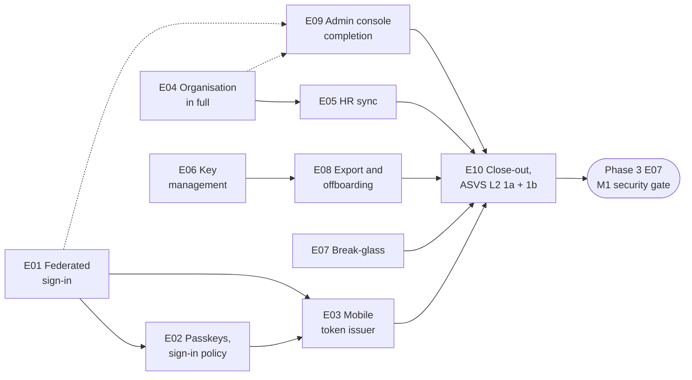

# Phase 1b — Enterprise identity and organisation: overview

> Level-1 plan (see `AGENTS.md §5`). It splits the phase into epics, fixes their order and dependencies, lists the phase-level research and ADRs, and maps the exit criteria to epics. Each epic gets its own detailed plan (`epic-<NN>-<slug>/`: research, ADRs, design, threat model, tasks, test plan) just before it starts.
>
> **Status:** written 2026-11-17; waiting for the owner's approval (§10).
>
> **Where 1b sits:** after Phase 3 E06 and before Phase 3 E07 (Phase 3 Q4, 2026-11-14), so the M1 pen test and ASVS verification in Phase 3 E07 cover everything built here. The master plan's heading still says 1b "runs in parallel with Phase 2"; the binding rule is that 1b finishes before Phase 3 exits (`MASTER_PLAN.md §7`, sequencing rules).

---

## 1. Phase goal (from `MASTER_PLAN.md`)

Everything a bank's IT and security teams require from identity and organisation management before go-live: sign-in through the customer's own identity provider, passkeys, a token issuer for the mobile apps, the full organisation graph with delegation and HR synchronisation, keys held in a KMS or HSM with rotation and crypto-shredding, tenant export and offboarding, and customer-approved break-glass support access.

### What Phases 1a, 2 and 3 left us
- **Sign-in (local only):** one account per tenant, the tenant taken from the host name (ADR-0022); Argon2id passwords, the offline breached-password list, lockout, Spring Session JDBC with a JSON principal that lists each factor and when it was issued (ADR-0023); TOTP with recovery codes, MFA required by default (`security.mfa.required`), and step-up with a general window (5 minutes) and an approval window (30 minutes) (ADR-0024, ADR-0036, `identity/SecuritySettings.kt`). ADR-0023 already expects SSO to "add factors from IdPs into the same principal". There is no SSO, no passkey, no token issuer, and no OpenSAML, LDAP or Spring Authorization Server dependency (`gradle/libs.versions.toml`, Spring Boot 4.1.1).
- **Operators:** their own host, account table, cookie and filter chain; operator requests run in platform scope, where every tenant table returns no rows (ADR-0031, `identity/V5__operators.sql`). Operators cannot reach tenant data at all today, so break-glass is the first sanctioned path into a tenant and must be designed as a controlled exception to ADR-0031.
- **Tenant lifecycle:** create, rename, suspend and resume; status is `ACTIVE` or `SUSPENDED` only (`tenancy/V1__tenant_and_settings.sql`, `tenancy/TenantLifecycle.kt`). No export, offboarding or deletion.
- **Organisation:** legal entities, a unit tree, positions, effective-dated reporting lines and **primary assignments only**: `org_assignment.kind` is checked to `'PRIMARY'` (`org/V1__directory.sql`; ADR-0026 names `ADDITIONAL` and `ACTING` for 1b). Manual editing on the Organisation screens (`org.tsx`). No bulk import or synchronisation. A memo's origin unit comes from the initiator's primary assignment; ADR-0044 leaves the choice between assignments to 1b.
- **Authorisation:** permission catalogue in code, tenant-defined roles, unit-scoped grants, clearances, one policy service with SQL pushdown, and the authorisation matrix with its endpoint-coverage meta-test (ADR-0027). Group-to-role mapping will write ordinary grants.
- **"Acting for" (workflow side, Phase 2 E04):** dated substitutions in `workflow_substitution` (`workflow/V8__substitutions.sql`), created by administrators through `/api/v1/admin/workflow/substitutions` under `workflow.tasks.reassign` and on Administration → Substitutions; while one is in force, new tasks go to the substitute and decisions record `acting_for_id` from the task (ADR-0040; SOD-3). Phase 2 met its acting-for exit item with substitutions (`SubstitutionIT`, retrospective); Phase 2 Q3 asks for it to be checked again in full once 1b adds delegation. ADR-0040 lets 1b take substitutions into its delegation model.
- **Keys:** a `KeyProvider` interface with one `SoftwareKeyProvider` (`software-v1`) derived from `MEMO_DATA_KEY` (`common/crypto/KeyProvider.kt`); a Tink streaming keyset per tenant, wrapped by the KEK and stored with the KEK id in `files_tenant_keyset` (ADR-0028, `files/internal/TenantKeysets.kt`). `DataKeys` derives a second key from the same secret for TOTP secrets and tenant SMTP passwords (`common/crypto/DataKeys.kt`). No rotation endpoints. Because the KEK is one per installation, a tenant cannot be crypto-shredded today: deleting its keyset row does not reach the copies in backups. ADR-0028 plans "PKCS#11 and OpenBao Transit providers" for 1b.
- **Audit:** per-tenant and platform hash chains, anchoring into an object-locked bucket, and an export ZIP with a manifest (ADR-0019, ADR-0033). Anchors and manifests are not signed; both ADRs wait for 1b's key provider to hold a signing key.
- **Notifications:** system-defined templates in `notification/messages*.properties` (English and Arabic); ADR-0030 makes them tenant data, with a sandboxed engine, in 1b.
- **Patterns to reuse from Phase 3:** the maker-checker states and rules (`common/review/Review.kt`, ADR-0043); the legacy import's bounded XLSX and CSV readers (`imports/internal/sheet/`), its read-only dry run with a problem list, the start with a step-up, the row-idempotent background job and the report kept as a record (ADR-0055). The org import and HR sync follow the same shape.
- **Admin console today:** users, roles, classifications, security settings, email relay, branding, language, audit, memo types and numbering, workflows, DoA, queues, calendar, substitutions, distribution lists and imports. Missing for 1b: identity providers, notification templates, delegation, org import and sync, break-glass approval, export and offboarding.

### What Phase 1b deliberately does *not* do
- **SCIM 2.0 provisioning** is Phase 7. 1b's group mapping and HR sync are what SCIM later extends.
- **Customer-managed keys on the customer's own HSM (BYOK)** and key-rotation runbooks for operations at scale are Phase 7. 1b builds the PKCS#11 provider and proves it against SoftHSM2.
- **Cloud KMS connectors** (AWS KMS, Azure Key Vault, Google Cloud KMS) are not built. AGENTS §3.1 allows a hosted service only as an optional, tenant-enabled connector; one is added when a customer asks.
- **Connectors to named HR systems** (Workday, SAP SuccessFactors, Oracle HCM). 1b defines one canonical snapshot format (§9 Q3).
- **Records disposition, legal hold and eDiscovery export** are Phase 7. 1b's tenant export is the complete hand-back of a tenant's data when it leaves.
- **Device registration screens, remote wipe and push** are Phase 6a. 1b's token issuer binds refresh tokens to a device key and can revoke them; the app and its device management come with 6a.
- **Operator recovery codes, a second operator and a separate operator database role** stay in Phase 7 (ADR-0031).
- **New languages.** English only, with Arabic kept as the right-to-left proof (Phase 1a Q8, Phase 3 Q3).

---

## 2. Epics

Ten epics. Estimates are in team-weeks and size the scope; Phases 0–3 ran faster than their estimates with the agent working alone, so the quality gates set the pace, not these numbers. Each epic builds its own screens; E09 covers what no other epic owns and the console as a whole.

| # | Epic | Purpose | Est. | Depends on |
|---|---|---|---|---|
| E01 | **Federated sign-in** | Per-tenant OIDC, SAML 2.0 and LDAP configuration stored in the database; sign-in through the tenant's IdP from the tenant host; account linking by the IdP's immutable identifier; just-in-time provisioning; group-to-role mapping into ordinary grants; IdP admin screens with a connection test; test IdPs (Keycloak, an LDAP directory) in CI and a demo IdP on dev | 5–6 wks | — |
| E02 | **Passkeys and the sign-in policy** | WebAuthn passkeys as a phishing-resistant factor for sign-in, MFA and step-up (one touch for an approval); the tenant sign-in policy (which methods, whether IdP MFA is trusted, local emergency access for administrators when the IdP is down) | 2–3 wks | E01 |
| E03 | **Mobile token issuer** | Spring Authorization Server inside the backend, one issuer per tenant host: authorization code + PKCE for native apps, sign-in through the same web sign-in (local, SSO, passkey), short-lived access tokens, rotating refresh tokens bound to a device key, revocation; the API accepts bearer tokens beside sessions; step-up with tokens. Proven with a test client; the app is Phase 6a | 3–4 wks | E01, E02 |
| E04 | **Organisation in full** | Additional and acting assignments with dates; delegation (time-boxed, scoped, recorded as "acting for") that takes over Phase 2's substitutions; self-service out-of-office; origin unit chosen between assignments; bulk import from CSV or Excel with the import's dry run → apply; synthetic volume V3 (5,000 users per tenant) | 4–5 wks | — |
| E05 | **HR synchronisation** | Scheduled synchronisation from a full HR snapshot (upload, push API or drop location): diff as a dry run, approval by an administrator, apply as a job; transfers re-route open tasks through the existing staff-change handling; leavers end-dated and deactivated, never deleted; safety thresholds halt a run that would change too much | 3–4 wks | E04 |
| E06 | **Key management** | OpenBao Transit and PKCS#11 key providers behind the existing interface; a KEK per tenant; KEK rotation by re-wrapping and keyset rotation for new files; small secrets (`DataKeys`) moved under the provider; the crypto-shredding primitive; a signing key for audit anchors and export manifests; OpenBao in Compose, Helm and on dev | 4–5 wks | — |
| E07 | **Break-glass support access** | An operator requests time-boxed, scoped access to one tenant with a reason; a tenant administrator approves; the operator works in that tenant under a distinct support actor, visible to the tenant in a banner and in its audit log; automatic expiry and revocation | 2–3 wks | — |
| E08 | **Tenant export and offboarding** | A complete, verifiable export of a tenant (records, documents, final records, audit chain) with a signed manifest; the offboarding lifecycle (notice, export, grace period, crypto-shredding and purge, a tombstone and a deletion certificate) | 3–4 wks | E06 |
| E09 | **Admin console completion** | Tenant-editable notification templates with a sandboxed engine and maker-checker; per-tenant platform settings (ADR-0031 follow-up); one pass over the administration area so identity, organisation, keys, support access and lifecycle sit in a coherent console | 2–3 wks | E01, E04 |
| E10 | **Close-out and the ASVS L2 review of 1a + 1b** | Journeys, the evidence against real IdPs (§9 Q2), Phase 2's acting-for exit item checked again with delegation, the ASVS 5.0 L2 review of V6–V11, V14 and V16 for Phases 1a and 1b, threat models reviewed, demo script, runbooks, retrospective | 2–3 wks | E01–E09 |

### Order and parallelism

- **Three independent tracks:** identity (E01 → E02 → E03), organisation (E04 → E05) and keys and tenant lifecycle (E06 → E08, with E07 beside them). E09 and E10 join them.
- **Critical path:** E01 → E02 → E03 → E10, about 12–16 team-weeks. The whole phase is about 30–40 team-weeks; with the agent working alone, the sum sets the calendar, not the critical path.
- **Working order:** the numbering. E01 goes first because it carries the most unknowns and because the real-IdP evidence (§9 Q2) has lead time on the owner's side. If that evidence is late, nothing waits: it is gathered in E10, and E04–E08 do not depend on it.
- **Nothing replaces existing tables.** Local sign-in stays for tenants without SSO and for emergency access; `workflow_substitution` moves into the delegation model by expand → migrate → contract; `org_assignment` gains kinds; keysets are re-wrapped in place.

---

## 3. Epic scope

### E01 — Federated sign-in
- **IdP registrations as tenant data:** per tenant, any number of OIDC, SAML 2.0 and LDAP connections, stored in the database and loaded per tenant host through Spring Security's repository interfaces (`ClientRegistrationRepository`, `RelyingPartyRegistrationRepository`), cached with `LISTEN/NOTIFY` eviction (ADR-0020). Client secrets, SP private keys and LDAP bind passwords encrypted under the key provider (E06 later moves them to per-tenant keys). Every change is audited and needs a step-up; enabling a connection needs a successful connection test.
- **OIDC:** authorization code with PKCE from the tenant host; discovery, JWKS rotation, `nonce`, `state`; claims mapping (subject, email, name, groups) with presets for Entra ID (`oid`, `tid`, group object ids, group overage) and a generic provider.
- **SAML 2.0:** one SP per tenant host (entity id, ACS, metadata endpoint), signed requests, signed assertions required, encrypted assertions supported, metadata by URL with refresh or by upload; claim presets for ADFS (its claim URIs, UPN) and Entra ID; IdP-initiated sign-in off by default.
- **LDAP:** bind authentication against the customer's directory (Active Directory or OpenLDAP) over LDAPS or StartTLS only; user search, group membership (including AD nested groups); memo's own MFA still applies, since LDAP proves only a password.
- **Accounts:** an external identity is linked to one per-tenant account (ADR-0022) by the IdP's immutable identifier, never by email alone. First sign-in either links to an existing account (by an administrator, or by email only where the connection is marked as asserting verified email) or creates one just in time, with the clearance and roles the mapping gives. Deactivated accounts stay deactivated whatever the IdP says.
- **Group-to-role mapping:** IdP groups mapped to roles, optionally scoped to a unit, written as ordinary grants (ADR-0027) and reconciled at each sign-in; mapped grants are marked as managed by the connection so administrators see where they came from; the last-tenant-admin guard still holds. Clearance can be mapped the same way.
- **Session:** an SSO sign-in produces the same session principal, with the IdP factor recorded (ADR-0023); single logout where the IdP supports it; the idle and absolute timeouts stay memo's.
- **Screens:** Administration → Sign-in: connections, mapping, test, enable; the sign-in page offers the tenant's methods.
- **Test IdPs:** Keycloak in the backend test containers and in the e2e stack (one OIDC client, one SAML client with ADFS-style claims, one Entra-style OIDC client), an LDAP directory (OpenLDAP, and an AD-shaped directory if R12 finds a usable image); a demo IdP on dev so the owner can see SSO (§9 Q2 for Entra ID and ADFS).

### E02 — Passkeys and the sign-in policy
- **Passkeys (WebAuthn):** enrol, name, list and remove passkeys under My security; a passkey is a phishing-resistant factor that satisfies MFA and step-up (the approval window becomes one touch, as promised in Phase 2 Q5); optional passwordless sign-in for local accounts; attestation policy and synced-passkey policy per R4.
- **Sign-in policy (tenant settings):** which methods are allowed (local password, passkey, each IdP connection), per user group where needed; whether the IdP's MFA is trusted for sign-in (from `amr` / `acr` or the SAML authentication context); how step-up works for SSO users (memo's passkey or TOTP by default; a forced re-authentication at the IdP where the tenant prefers it; §9 assumption A3).
- **Emergency access:** at least one tenant administrator keeps a local password plus passkey or TOTP so the tenant is never locked out by a misconfigured or unavailable IdP; refused if it would remove the last one.
- **Operators:** passkeys for operator accounts too (ADR-0031 host, same code).

### E03 — Mobile token issuer
- **Issuer:** Spring Authorization Server inside the backend (`AGENTS.md §2`), one issuer per tenant host; public native clients registered per tenant (RFC 8252: system browser, PKCE required, claimed redirect URIs).
- **Sign-in:** the authorization endpoint uses the web sign-in, so local, SSO and passkey sign-in all work for the app without further federation code.
- **Tokens:** short-lived access tokens; refresh tokens rotated on every use with reuse detection, bound to a device key (DPoP, RFC 9449, if R5 confirms support), with an absolute lifetime; revocation per device and per user, and on deactivation, MFA reset and tenant suspension.
- **API:** `/api/v1/**` accepts a bearer token or a session, never both; CSRF stays for the cookie path; idempotency keys already exist on every action (Phase 2). Step-up with tokens: a fresh factor recorded against the token (for example a short-lived step-up grant), so the approval rules work the same on mobile.
- **Proof without an app:** a test client in the integration tests and a contract test the KMP core in 6a will reuse; device management screens and remote wipe are 6a.

### E04 — Organisation in full
- **Assignments:** `ADDITIONAL` (a second position held at the same time) and `ACTING` (holding a position's authority for a period, e.g. acting head of credit) with dates, beside `PRIMARY`; the rules per kind (one primary per person and one primary holder per position stay; acting holders resolve as holders of the position, ADR-0040); unit scope and role-in-unit resolution see every active assignment.
- **Delegation:** a person delegates to another, for dates and a scope (all work, or chosen memo types, units or amount limits; R7), recorded as "acting for" on every action. Out-of-office substitution becomes one kind of delegation; `workflow_substitution` moves into it (expand → migrate → contract) and the workflow keeps resolving through one port. SOD-3 and recusal still apply to the delegate.
- **Self-service out-of-office:** a user names their substitute and dates on My profile; administrators can set it for others; the substitute and the principal are notified; open tasks can move on request (the existing step-up rule).
- **Origin unit:** a user with several assignments chooses the memo's origin unit at create (ADR-0044).
- **Bulk import:** CSV or Excel (units, positions, people, assignments, reporting lines) in a documented template, through the import pattern of ADR-0055: intake → read-only dry run with problems → apply with a step-up as a job → report. The bounded sheet readers move from `imports/internal/sheet` to a shared place.
- **Screens:** assignments of every kind on the person and position pages; delegation management for administrators; My out-of-office; org import.
- **Volume:** V3 (5,000 users per tenant, `nfr.md`) in the synthetic generator, also giving Phase 2's builder simulation its 500-person organisation (`epic-06-visual-builder/design.md`).

### E05 — HR synchronisation
- **Source:** a full snapshot in the E04 template (or its JSON twin), delivered by upload, by a push API with a tenant service credential, or by a drop location polled on a schedule (§9 Q3).
- **Diff as a dry run:** joiners, leavers, transfers, title and unit changes, reporting-line changes, matched on a stable HR key; nothing is written until approved.
- **Approval and apply:** an administrator other than the one who configured the sync approves each run (maker-checker, `common/review`); a tenant setting may allow automatic apply for runs within the thresholds. Apply runs as a background job, idempotent per change, with a report kept as a record.
- **Safety:** thresholds (for example more than 5 % leavers) halt a run for review; leavers are end-dated and deactivated, never deleted; a transfer fires `OrgChanged`, so open tasks re-resolve to the new holder (ADR-0040 staff changes); a run cannot remove the last tenant admin.
- **Screens:** sync configuration, run history, the diff review and the report.

### E06 — Key management
- **Providers:** OpenBao Transit (self-hosted, the default for production) and PKCS#11 (any HSM; tested with SoftHSM2), behind `KeyProvider`; the software provider stays for development, tests and evaluation installs (§9 assumption A1).
- **A KEK per tenant:** each tenant's keyset is wrapped by its own KEK in the provider, so destroying that KEK makes the tenant's keysets unreadable everywhere, backups included.
- **Rotation:** KEK rotation re-wraps the tenant's keyset (one row, files untouched, ADR-0028); keyset rotation adds a new primary key for new files; scheduled and on demand; both audited and step-up protected; a verification job confirms every keyset unwraps.
- **Small secrets:** `DataKeys` (TOTP secrets, SMTP passwords, E01's IdP secrets) moves to per-tenant keys under the provider, with a background re-encryption that is resumable.
- **Signing:** a signing key under the provider signs audit anchors (ADR-0019) and audit export manifests (ADR-0033), and later E08's export manifest; verification instructions updated.
- **Crypto-shredding primitive:** destroy a tenant's KEK and keyset, proven by tests to leave its files and secrets unrecoverable; E08 uses it.
- **Operations:** OpenBao in the Compose profile and the Helm chart, on dev through Ansible; unsealing, backup and HA documented in a runbook; health checks and caching so a short provider outage does not stop reads.

### E07 — Break-glass support access
- **Request:** an operator asks for access to one tenant with a reason, a scope and a duration (§9 Q4) from the operator console.
- **Approval:** a tenant administrator approves or refuses in the tenant's console (with a step-up); every tenant administrator is notified of the request and the outcome.
- **Access:** while a grant is active, the operator signs in to the tenant host with their operator credentials under a distinct `SUPPORT_OPERATOR` actor, with only the approved scope (read-only by default), never as a tenant user. A banner on every page of the tenant's console shows that support access is active and lets an administrator end it.
- **Audit:** request, approval, every action and the end are recorded in the tenant's chain and in the platform chain; sensitive reads at document-open granularity like any other user.
- **Expiry:** grants end automatically; sessions are revoked at expiry or revocation.
- **ADR-0031 amended** for this one sanctioned path; the platform scope stays as it is.

### E08 — Tenant export and offboarding
- **Export:** a background job builds a complete export of a tenant: structured data as documented JSON or CSV, documents and attachments decrypted, final records, the audit chain export, a manifest with checksums signed by E06's key; the manifest follows the reconciliation pattern of the Phase 3 import report; downloaded by a tenant administrator through the backend with a step-up (streamed, never a presigned URL).
- **Offboarding lifecycle:** `ACTIVE` → `OFFBOARDING` (notice; export available) → `SUSPENDED` grace period → deletion → tombstone, per §9 Q5. Deletion crypto-shreds the tenant's keys (E06), purges its rows, leaves object-locked files unreadable until their retention ends and the lifecycle removes them, and issues a deletion certificate; the platform chain keeps the record and the tenant's final chain head.
- **Two parties:** offboarding is requested by the tenant (an administrator, with a step-up) and executed by an operator; both steps are recorded.

### E09 — Admin console completion
- **Notification templates:** tenant-editable subjects and bodies per locale through a sandboxed, logic-less engine (R11), with a preview, defaults to fall back on and maker-checker for publication; the existing localised layout stays (ADR-0030 amended).
- **Per-tenant platform settings:** the settings an operator manages per tenant beyond the registry (ADR-0031 follow-up), for example limits and enabled features, without any tenant data.
- **Console pass:** navigation and an overview page across identity, organisation, keys, support access and lifecycle; a check that every 1b screen meets WCAG 2.2 AA and works in Arabic.

### E10 — Close-out and the ASVS L2 review of 1a + 1b
- Journeys: SSO sign-in with mapped roles, passkey step-up on an approval, delegation with the delegate acting for the principal, HR sync review and apply, break-glass request to expiry, export download.
- The real-IdP evidence of §9 Q2, recorded with the audit entries it produced.
- Phase 2's exit item "full audit of every action, including delegated acting-for actions", checked again with acting assignments and delegation (Phase 2 Q3).
- The ASVS 5.0 L2 review of V6–V11, V14 and V16 for Phases 1a and 1b in `docs/security/asvs-checklist.md` (§5), and the threat models of both phases reviewed together.
- Demo script `demo.md`, runbooks, `retrospective.md`; the scope handed to Phase 3 E07's pen test.

---

## 4. Scope coverage (master plan scope → epic)

| Master plan Phase 1b scope item | Epic |
|---|---|
| Per-tenant OIDC, SAML 2.0 and LDAP configuration from the database | **E01** |
| Group-to-role mapping; just-in-time provisioning | **E01** |
| WebAuthn / passkeys | **E02** |
| Mobile token issuer (authorization code + PKCE, device-bound rotating refresh tokens, federating to the tenant IdP) | **E03** |
| Additional and acting assignments with dates | **E04** |
| Delegation (time-boxed, scoped, recorded as "acting for") | Phase 2 E04 (workflow side), **E04** |
| Self-service out-of-office substitution | Phase 2 E04 (workflow side), **E04** |
| Bulk import from CSV or Excel | **E04** |
| Scheduled HR synchronisation with a dry-run diff and approval | **E05** |
| KMS/HSM key provider, key rotation | **E06** |
| Crypto-shredding on tenant offboarding | **E06** (primitive), **E08** (offboarding) |
| Tenant export and offboarding | **E08** |
| Break-glass operator access | **E07** |
| Admin console: IdP configuration | **E01** |
| Admin console: notification templates | **E09** |
| Admin console: delegation management | **E04** |

Items earlier phases left to 1b, not listed in the master plan's 1b scope:

| Item | Source | Epic |
|---|---|---|
| Signed audit anchors and export manifests | ADR-0019, ADR-0033 | E06 |
| Small secrets (TOTP, SMTP) under the KMS/HSM provider | ADR-0024, `DataKeys` | E06 |
| Origin unit chosen between assignments | ADR-0044 | E04 |
| Per-tenant platform settings beyond the registry | ADR-0031 | E09 |
| Synthetic volume V3 (5,000 users per tenant); the builder's 500-person test organisation | `nfr.md`, Phase 2 `epic-06-visual-builder/design.md` | E04 |
| Acting-for exit item checked again with delegation | Phase 2 Q3 | E04, E10 |

## 5. Exit criteria → epics

| Exit criterion (`MASTER_PLAN.md`) | Delivered by | Evidence |
|---|---|---|
| SSO tested against at least Microsoft Entra ID, ADFS and one generic OIDC provider, plus an LDAP directory | **E01**, E10 | **In CI:** Keycloak as the generic OIDC provider and as a SAML IdP; a Keycloak SAML client emitting ADFS's claim profile and an OIDC client emitting Entra ID's claim shape (both labelled as emulations); an LDAP directory container (OpenLDAP, plus an AD-shaped directory if R12 finds one); Playwright SSO journeys against Keycloak in the e2e stack. **Needs the owner (§9 Q2):** a real Entra ID tenant (OIDC and SAML sign-in, group mapping) and a real ADFS, each verified once on dev with the run recorded in E10. Group overage and large directories are tested with fixtures only |
| Org graph with assignments and delegation fully manageable via UI, import and scheduled sync | **E04**, **E05** | Playwright journeys (assignments, delegation, out-of-office, import, sync review and apply); `OrgImportIT` and `HrSyncIT` with the dry-run diff; V3 performance of the diff and apply |
| Key rotation and crypto-shredding proven by tests | **E06**, E08 | Integration tests against OpenBao and SoftHSM2 containers: KEK rotation re-wraps without touching files, keyset rotation, a destroyed tenant KEK leaves files and secrets unreadable (including from a database copy taken before), other tenants unaffected; offboarding end to end in E08 |
| Break-glass access flow works end to end and appears in the tenant's audit log | **E07** | Playwright journey across both hosts (request, approve, banner, access, expiry); audit assertions in the tenant and platform chains; matrix cells proving the support actor is limited to the approved scope |
| ASVS L2 checklist for V6–V9, V11, V14, V16 reviewed and recorded for Phase 1a + 1b | **E10** | `docs/security/asvs-checklist.md`, rows per epic plus the close-out review. **V10 (OAuth and OIDC) is added**: the master plan's list predates ASVS 5.0's numbering, and SSO and the token issuer are V10 work |

**Phase-1b special tests** (`TESTING_STRATEGY.md §12`):

| Special test | Epic |
|---|---|
| SSO against Entra ID, ADFS, a generic OIDC test IdP and LDAP (containerised test IdPs where possible) | E01 (containers), E10 (real Entra ID and ADFS, §9 Q2) |
| Token issuer flows (PKCE, refresh rotation, device binding) | E03 |
| Key rotation and crypto-shredding | E06, E08 |
| HR sync dry-run diff | E05 (E04 for the import's dry run) |
| Break-glass audit visibility | E07 |

Also from `TESTING_STRATEGY.md`: Jazzer fuzzing nightly on the SAML response and metadata parsing, the org import and the HR snapshot parsers; the authorisation matrix and endpoint-coverage meta-test for every new endpoint, on both hosts; cross-tenant tests for every new table (IdP registrations, passkeys, delegations, sync runs, support grants); the authenticated ZAP scan extended to the SSO and token endpoints.

**Generic phase-exit items** (`AGENTS.md §5`):

| Item | Where |
|---|---|
| Demo script | `demo.md` in E10 |
| `retrospective.md` | At phase close |
| STATUS | Every session |
| Usability check | Screen flows reviewed with the owner before build (§9 Q1): sign-in with SSO and passkeys (E01, E02), delegation and out-of-office (E04), the HR sync review (E05), break-glass approval (E07) |
| ASVS | Rows per epic; the 1a + 1b review in E10 |
| Manual accessibility | Keyboard and screen-reader pass over the sign-in page, passkey enrolment, out-of-office, the sync review and the break-glass banner and approval |

---

## 6. Phase-level research list

Each item is answered in the `research.md` of the epic shown, with sources and access dates. Versions are re-verified from official sources, never taken from this plan or from memory.

| # | Question | Epic |
|---|---|---|
| R1 | Current stable versions, licences and maintenance of everything 1b adds: Spring Security 7 with Spring Boot 4.1 (and whether Spring Authorization Server now ships inside Spring Security), OpenSAML (and the repository it is published to), the LDAP client, WebAuthn4J or what Spring Security's passkey support uses, OpenBao, the PKCS#11 path on Java 25, SoftHSM2, Keycloak, the template engine (R11) | Every epic |
| R2 | **Multi-tenant SSO in Spring Security 7:** OIDC and SAML registrations loaded from the database per host; SP keys and metadata per tenant; metadata refresh; single logout; how leaders configure SSO per customer (board portals, e-office products) | E01 |
| R3 | **Accounts and groups:** linking by immutable identifier vs email; just-in-time provisioning and deprovisioning; group-to-role mapping, Entra ID group object ids and overage, ADFS claim rules, AD nested groups; how leaders avoid account takeover through IdP email claims | E01 |
| R4 | **MFA with SSO and passkeys:** trusting IdP MFA (`amr`, `acr`, SAML authentication context); step-up by forced re-authentication vs local factors; WebAuthn Level 3 support in Spring Security, attestation, synced passkeys, recovery; what banks expect | E02 |
| R5 | **Token issuer:** Spring Authorization Server per-tenant issuers, native clients (RFC 8252), DPoP (RFC 9449) for device binding, refresh rotation and reuse detection, token lifetimes for mobile, a step-up claim in tokens, the OAuth 2.1 draft's status | E03 |
| R6 | **Key management:** OpenBao Transit vs PKCS#11 HSMs vs cloud KMS; a KEK per tenant; rotation by re-wrapping; unsealing, HA and backup for small on-prem installs; signing keys; crypto-shredding with backups and object-locked buckets | E06 |
| R7 | **Organisation and delegation in industry:** how HR systems, e-office products and board portals model additional and acting positions, delegation scopes and out-of-office; administrator separation of duties (the master plan's industry question) | E04 |
| R8 | **HR integration:** snapshot formats exported by common HR systems, full vs delta, matching keys, handling transfers, rehires and terminations safely, thresholds, transport for a drop location on-prem | E05 |
| R9 | **Tenant export and offboarding:** export formats and completeness, chain-of-custody manifests, deletion under object lock and in backups, deletion certificates, what regulated customers expect from a SaaS exit | E08 |
| R10 | **Break-glass in industry:** customer-approved support access in cloud and SaaS products (approval, scope, duration, transparency logs); what a bank's security team will ask | E07 |
| R11 | **Tenant-editable email templates:** logic-less engines (Mustache, Handlebars ports) vs sandboxed ones (Pebble, Thymeleaf restricted); escaping, HTML sanitising, no content in subjects (AGENTS §3.4) | E09 |
| R12 | **Test IdPs:** Keycloak for OIDC and SAML in Testcontainers and in the e2e stack; an LDAP image that is maintained (OpenLDAP, an AD-shaped directory such as Samba); emulating ADFS's and Entra ID's claim profiles; what a free Entra ID test tenant and an ADFS evaluation install need today | E01 |

## 7. Planned ADRs

Numbers are assigned when written, starting at ADR-0056. Each one uses MADR.

| ADR | Decision | Epic |
|---|---|---|
| ADR-SSO | Federated sign-in: per-tenant registrations in the database, OIDC, SAML and LDAP, account linking, just-in-time provisioning, group mapping into grants (amends ADR-0022, ADR-0023, ADR-0027) | E01 |
| ADR-PASSKEY | Passkeys and the sign-in policy: WebAuthn as a factor, trusting IdP MFA, step-up for SSO users, emergency access (amends ADR-0024) | E02 |
| ADR-TOKEN | Mobile token issuer: issuers per tenant, PKCE, device binding, refresh rotation, bearer tokens beside sessions, step-up with tokens | E03 |
| ADR-ORG-FULL | Assignment kinds, delegation and out-of-office, taking over substitutions, origin unit choice (amends ADR-0026, ADR-0040, ADR-0044) | E04 |
| ADR-ORG-SYNC | Org import and HR sync: snapshot format, matching keys, diff, approval, apply, thresholds (written in E04, extended in E05) | E04, E05 |
| ADR-KMS | Key providers, a KEK per tenant, rotation, small secrets, signing, crypto-shredding (amends ADR-0028, ADR-0024, ADR-0019, ADR-0033) | E06 |
| ADR-BREAKGLASS | Break-glass support access (amends ADR-0031) | E07 |
| ADR-OFFBOARD | Tenant export format and the offboarding lifecycle | E08 |
| ADR-MAILTPL | Tenant-editable notification templates (amends ADR-0030) | E09 |

## 8. Risks

| # | Risk | Mitigation |
|---|---|---|
| R1 | No real Entra ID or ADFS to test against (§9 Q2); emulations in Keycloak miss a real IdP's quirks | Claim profiles taken from Microsoft's documentation and real metadata; recorded runs on dev when the owner provides tenants; otherwise carried to the first customer, like Phase 3's UAT |
| R2 | Account takeover through SSO: a new IdP connection or an email claim links to an existing administrator | Link by immutable identifier; email linking only on connections marked as asserting verified email; enabling a connection needs a step-up and is audited; tests for each linking path |
| R3 | A misconfigured or unavailable IdP locks a tenant out | Connection test before enabling; emergency local access for administrators kept by rule (E02); LDAP and OIDC timeouts; runbook |
| R4 | Multi-tenant SAML is the least travelled path in Spring Security; OpenSAML may come from outside Maven Central | R2 spike early in E01; dependency pinned with checksum verification; Jazzer on the parsing |
| R5 | A bad HR file deactivates many people or moves approvals | Dry-run diff, approval, thresholds that halt a run, end-dating instead of deletion, the last-admin guard, everything reversible by a later run |
| R6 | The key provider becomes a single point of failure for files and sign-in (TOTP secrets) | Cached unwrapped keysets (10 minutes, ADR-0028), health checks and alerts, HA guidance in the runbook, a tested restore; the software provider stays available for dev and evaluation |
| R7 | Crypto-shredding is irreversible and could hit the wrong tenant | Two parties (tenant request, operator execution), grace period, step-up, the tenant's id and name typed to confirm, audit in both chains, tests that other tenants are unaffected |
| R8 | Break-glass drifts into standing access | Customer approval per grant, short maximum duration, automatic expiry, read-only default, banner and notifications, matrix tests for the support actor |
| R9 | The token issuer is unused until Phase 6a and may drift | Contract tests the KMP core reuses; the M1 pen test covers it; 6a re-verifies before building on it (§9 assumption A2) |
| R10 | The M1 pen test (Phase 3 E07) grows: SSO, the token issuer and break-glass are new attack surface | Scope handed over from E10; ASVS rows kept current per epic; Phase 3 Q5 (pen tester) still open, so booking should name the larger scope |
| R11 | The dev VM (16 GB) also has to run OpenBao and a demo IdP | Measure in E01 and E06; the demo IdP can run only when needed |
| R12 | 1b is large (30–40 team-weeks) against the master plan's 70-day placeholder | Three independent tracks; each epic merged and on dev before the next; the Gantt is a placeholder (`MASTER_PLAN.md §8`) |

## 9. Open questions for the human

**Assumptions** (safe defaults; say so if any is wrong):
- **A1 — Key providers.** ADR-0028 already chose OpenBao Transit and PKCS#11 for 1b; cloud KMS stays an optional connector for later (AGENTS §3.1). Production installs need OpenBao or an HSM; the software provider stays for development, tests and evaluation installs. Dev gets OpenBao through Ansible.
- **A2 — The token issuer is built now**, as the master plan says, although the app comes in Phase 6a, so the M1 pen test covers it once.
- **A3 — Step-up for SSO users** uses memo's own passkey or TOTP by default; a tenant can choose forced re-authentication at its IdP instead (ADR-PASSKEY).
- **A4 — English only**, Arabic kept as the right-to-left proof, as in Phases 1a–3.
- **A5 — Dev gets a demo IdP** (Keycloak) so SSO can be shown on dev without a customer.

1. **Q1 — Approval and gate delegation.** Do you approve this overview? In Phases 0, 1a, 2 and 3 you delegated the per-epic review gate (the agent writes each epic plan, then implements it without waiting) and asked to be asked again for each new phase. Recommendation: keep the delegation, except these screen flows, which go to you before build: the sign-in page with SSO and passkeys (E01, E02), delegation and out-of-office (E04), the HR sync review (E05), and the break-glass request and approval (E07).
2. **Q2 — Real IdPs for the exit criterion.** The exit criterion names Entra ID and ADFS. CI can only emulate them (Keycloak with their claim profiles). Options: (a) you provide an Entra ID test tenant (an account that can register an app, two test users and two groups) **and** a Windows Server evaluation VM with AD DS and AD FS reachable from dev, for one recorded verification run each; (b) you provide the Entra ID tenant; ADFS is emulated in CI and verified for real with the first customer that runs it, carried like Phase 3's UAT; (c) neither: both are emulated and both checks are carried. Recommendation: **(b)**. An Entra ID tenant is cheap and is the most likely customer IdP; an ADFS server takes a Windows Server install and its own domain, and ADFS shops will bring one.
3. **Q3 — The HR sync's first source.** Options: (a) one canonical full snapshot (the E04 import template as CSV or XLSX, or its JSON twin) delivered by upload, a push API or a drop location polled on a schedule; (b) a connector for one named HR system (Workday, SAP SuccessFactors, Oracle HCM); (c) the customer's directory (LDAP or Entra ID) as the source of people and units. Recommendation: **(a)**. It works with any HR system that can export a file, needs no customer to design against, and a named connector can be added on top when a customer asks; (c) is Phase 7's SCIM territory.
4. **Q4 — Break-glass: who approves, and what may the operator see.** Options for the approver: (a) any one tenant administrator; (b) two tenant administrators; (c) a dedicated approver permission, given to the tenant admin role by default, with a tenant setting to require two approvers. Options for the scope: read-only configuration and metadata only, with document content only when the approver ticks it; or everything the tenant admin role can see. Recommendation: **(c)**, read-only by default, document content only when ticked, at most 4 hours per grant (extendable by a new approval). On single-tenant and on-prem installs the operator may be the customer's own IT; the same flow applies.
5. **Q5 — What offboarding deletes.** This is irreversible and customer-visible. Options: (a) after the tenant asks, the export stays available during a grace period (30 days by default, set per contract) with the tenant suspended; then the operator deletes: keys crypto-shredded, all tenant rows purged, a tombstone and a deletion certificate kept, the platform chain keeps the record; (b) never delete: suspend and keep everything; (c) crypto-shred the files only and keep the database rows. Recommendation: **(a)**. Note that database rows remain in backups until the backup retention expires (A2–A4 in `nfr.md`), and object-locked files stay in storage, unreadable, until their retention ends; the deletion certificate says so.

---

## 10. Approval

| Item | By | Date | Notes |
|---|---|---|---|
| Phase 1b overview | | | |

### Answers to open questions
| Q | Date | Answer |
|---|---|---|
| Q1 | | |
| Q2 | | |
| Q3 | | |
| Q4 | | |
| Q5 | | |
