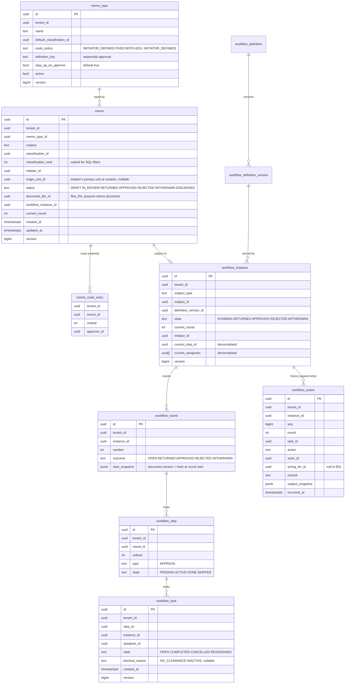

# E01 First slice: sequential memo approval — design

Decisions: [ADR-0034](../../../adr/0034-own-workflow-engine.md) (own engine, subject-agnostic), [ADR-0035](../../../adr/0035-workflow-data-model-and-concurrency.md) (data model, guarded transitions, idempotency), [ADR-0036](../../../adr/0036-memo-documents-binding-and-approval-step-up.md) (document binding, review lock, step-up on approve). Builds on the Phase 1a kernel: tenant context (ADR-0017), audit (ADR-0019), authorisation (ADR-0027), files (ADR-0028, ADR-0029), notifications (ADR-0030), step-up (ADR-0024), `system.Idempotency`.

## 1. Module boundaries

```mermaid
flowchart LR
  memo["memo<br/>memos, memo types, route,<br/>document purpose, inbox views"]
  workflow["workflow<br/>definitions, instances, rounds,<br/>steps, tasks, actions"]
  engine["workflow.engine<br/>pure transition function<br/>(no Spring, no jOOQ)"]
  files["files"]
  notification["notification"]
  identity["identity (step-up, users)"]
  authz["authz (policy, clearances)"]
  audit["audit"]
  memo --> workflow
  memo --> files
  memo --> notification
  memo --> identity
  workflow --> engine
  workflow --> audit
  memo --> audit
  memo --> authz
  workflow --> authz
```

- **`workflow` public API** (`com.memo.workflow`):
  - `Workflows` service: `start(subject, definitionKey, route, actor)`, `act(taskId, action, remark, expectedVersion)`, `resubmit(instanceId, route, remark)`, `withdraw(instanceId, remark)`, `reassign(taskId, newAssignee, reason)`, `history(instanceId)`, `myTasks(cursor, limit)`, `openTasks(filter, cursor)` (admin), `holders(instanceIds)`.
  - `WorkflowSubject` (interface; one Spring bean per subject type, registered by the owning module): `type`, `mayView(subjectId, user): Boolean` (clearance and participation), `snapshot(subjectId): JsonNode` (bound to each action), `beforeAction(subjectId, action)` (veto by throwing; runs in the action transaction), `summaries(subjectIds): Map<id, SubjectSummary>` (title, reference, classification label, for inboxes; one query per page).
  - Events (Spring Modulith, every one carries `tenantId`): `WorkflowTaskCreated`, `WorkflowTaskCompleted`, `WorkflowTaskReassigned`, `WorkflowTaskBlocked`, `WorkflowRoundEnded`, `WorkflowInstanceEnded`. Synchronous listeners in the same transaction (the memo's status, notifications); none are async in E01.
- **`workflow.engine`** (package-private logic, public only to `workflow`): `Transition.apply(state: InstanceState, command: Command): Outcome` where `Outcome` is the new state plus effects (`CreateTask`, `CompleteTask`, `EndRound`, `EndInstance`). No I/O. ArchUnit rule: no Spring, jOOQ or `java.time.Clock.systemUTC` in this package.
- **`memo`** owns: memo types, memos, the route (`memo_route_entry`), the `memo.document` file purpose, the inbox, drafts and sent views, and the memo's `WorkflowSubject`. It never reads `workflow_*` tables; it calls `Workflows`.
- **New public API in `common.authz`**: `Clearances.rankOf(users: Collection<UUID>): Map<UUID, Int>` (implemented by `authz`, cached with the grants) and `ClassificationLevels.rankOf(levelId)`; the route validation needs the clearance of people other than the actor.
- **`StepUpCheck.require(window: Duration? = null)`**: null keeps today's window; the approve action passes the approval window (ADR-0036).
- **Note sheet:** in E01 the note sheet is rendered from `workflow_action` rows (actor, acting-for, action, remark, round, document version and hash from the snapshot). There is no separate note table yet; Phase 3 adds `memo_note` for free-standing notes (comments, corrections, attachments), and the view merges both. Draft-time events (created, document uploaded, discarded) come from the memo's own fields and the audit log.

## 2. Domain model

### Invariants
1. A memo has at most one workflow instance; it is created at the first submit and continues through every round.
2. An instance has exactly one round with outcome `OPEN` while `RUNNING`, and none otherwise.
3. In a sequential round exactly one step is `ACTIVE` while the round is open; it has exactly one `OPEN` task (E01).
4. Only the assignee of an `OPEN` task may approve, return or reject it (acting-for in E04).
5. The instance becomes `APPROVED` only when the last step of the **current** round is completed by an `APPROVE`. Actions of earlier rounds never count.
6. `APPROVED`, `REJECTED`, `WITHDRAWN` (instance) and `APPROVED`, `REJECTED`, `WITHDRAWN`, `DISCARDED` (memo) are terminal.
7. `workflow_action` rows are never updated or deleted; `seq` is gapless per instance (locked instance row).
8. `current_step_id` and `current_assignees` always equal what the open tasks say.
9. A memo's document can get a new version only in `DRAFT` or `RETURNED`, and only by the initiator.
10. Every action row carries the document version id and SHA-256 current at that moment; every approval in a round carries the round's start version.
11. Route: at least one approver, at most 20 (tenant setting `memo.route.max`), no duplicates, not the initiator, every approver `ACTIVE` with clearance rank ≥ the memo's classification rank (checked at submit and resubmit; checked again when each task is created, invariant 12).
12. When a task is created for an approver who is no longer active or cleared, the task is created with `blocked_reason`; it cannot be acted on until a tenant admin reassigns it; the initiator and the reassign admins are notified.

## 3. State machines

### Memo

```mermaid
stateDiagram-v2
  [*] --> DRAFT: create
  DRAFT --> DRAFT: edit fields / upload version / edit route
  DRAFT --> DISCARDED: discard (initiator)
  DRAFT --> IN_REVIEW: submit (initiator; document + valid route)
  IN_REVIEW --> IN_REVIEW: approve (not last) / reassign
  IN_REVIEW --> APPROVED: approve (last approver of current round)
  IN_REVIEW --> RETURNED: return (current approver, remark)
  IN_REVIEW --> REJECTED: reject (current approver, remark)
  IN_REVIEW --> WITHDRAWN: withdraw (initiator)
  RETURNED --> RETURNED: upload version / edit route
  RETURNED --> IN_REVIEW: resubmit (initiator) = round N+1 from first approver
  RETURNED --> WITHDRAWN: withdraw (initiator)
  APPROVED --> [*]
  REJECTED --> [*]
  WITHDRAWN --> [*]
  DISCARDED --> [*]
```

### Task

```mermaid
stateDiagram-v2
  [*] --> OPEN: step activated (blocked_reason set if assignee inactive or not cleared)
  OPEN --> COMPLETED: approve / return / reject (assignee; not blocked)
  OPEN --> REASSIGNED: reassign (admin) → new OPEN task for the new assignee
  OPEN --> CANCELLED: withdraw (initiator) / instance ended
  COMPLETED --> [*]
  REASSIGNED --> [*]
  CANCELLED --> [*]
```

Forbidden transitions get a test each (test plan §State machines): for example approve on a `COMPLETED` task, return by a non-assignee, resubmit while `IN_REVIEW`, withdraw after `APPROVED`, upload in `IN_REVIEW`, discard after submit, reassign a `COMPLETED` task, act on a blocked task.

## 4. Engine core
- `InstanceState` (instance, open round, its steps and open tasks) is loaded in one query after `SELECT … FOR UPDATE` on the instance row.
- Commands: `Start(route)`, `Approve(task, actor)`, `Return(task, actor, remark)`, `Reject(task, actor, remark)`, `Withdraw(actor, remark?)`, `Resubmit(route, actor, remark?)`, `Reassign(task, admin, newAssignee, reason)`.
- The function validates the command against the state (who, which task, which state) and returns effects or a typed refusal (`NotAssignee`, `TaskNotOpen`, `TaskBlocked`, `WrongState`, `RemarkRequired`). The service maps refusals to Problem Details (`403 not-assignee`, `409 conflict`, `422 remark-required`).
- The service writes the effects with guarded updates, appends the action row with the next `seq`, calls `WorkflowSubject.beforeAction` and records the audit entry, then publishes the events, all in one transaction inside `Idempotency.once`.

## 5. API sketch

All under `/api/v1`, Problem Details for errors, cursor pagination, `ETag`/`If-Match` on memo edits, **`Idempotency-Key` required on every POST** (400 without).

| Method and path | Purpose | Access | Notes |
|---|---|---|---|
| `GET /memo-types` | Active types for the create form | `@SignedIn` | |
| `GET /admin/memo-types`, `POST`, `PATCH /admin/memo-types/{id}` | Minimal type admin: name, default classification, step-up flag, active | `memo.types.manage` | Route policy fixed to initiator-defined in E01 |
| `POST /memos` | Create a draft | `memo.create` | Body: subject (1–300 chars), type, classification (≥ type default is allowed, lower refused) |
| `GET /memos/{id}` | Memo view: fields, status, document (current version), route, round, holders, allowed actions for me | participant + clearance | `404` when not visible (no existence leak) |
| `PATCH /memos/{id}` | Edit subject, type, classification | initiator, `DRAFT` / `RETURNED` (classification only in `DRAFT`) | `If-Match` |
| `PUT /memos/{id}/route` | Replace the ordered approver list | initiator, `DRAFT` / `RETURNED` | `If-Match`; validation errors per entry (`approver-inactive`, `approver-not-cleared`, `duplicate`, `self`) |
| `POST /files?purpose=memo.document&owner={memoId}`, `POST /files/{fileId}/versions` | Upload v1, new versions | `FilePurpose.mayUpload`: initiator, `DRAFT` / `RETURNED` | Existing files endpoints; `FileVersionCreated` listener stores `document_file_id` on v1 |
| `GET /files/{fileId}/versions/{versionId}/content` | Download a version | `FilePurpose.mayRead`: memo visible to the actor | Existing endpoint; `file.opened` audited |
| `POST /memos/{id}/submit` | Round 1 | initiator, `DRAFT` | Needs a document version and a valid route |
| `POST /memos/{id}/resubmit` | Round N+1 | initiator, `RETURNED` | Optional response remark |
| `POST /memos/{id}/withdraw` | Withdraw | initiator, `IN_REVIEW` / `RETURNED` | Optional remark |
| `POST /memos/{id}/discard` | Discard a draft | initiator, `DRAFT` | Soft state; never deleted |
| `POST /tasks/{taskId}/approve` | Approve | task assignee, task `OPEN`, not blocked | Step-up per type (approval window); optional remark |
| `POST /tasks/{taskId}/return`, `/reject` | Return, reject | task assignee | Remark required (1–4,000 chars) |
| `GET /memos/{id}/history` | Actions grouped by round | as `GET /memos/{id}` | |
| `GET /inbox/tasks` | My open tasks, newest first | `@SignedIn` | Summaries by the subject callback; restricted placeholder if not visible |
| `GET /memos?box=drafts\|sent\|closed` | My drafts; my submitted memos in review or returned; my closed memos | `@SignedIn` | Keyset on `(updated_at desc, id)` |
| `GET /admin/workflow/tasks?filter=open\|blocked&assignee=` | Open tasks for reassignment | `workflow.tasks.reassign` | Subject title only if the admin is cleared, else "Restricted" |
| `POST /admin/workflow/tasks/{taskId}/reassign` | Reassign | `workflow.tasks.reassign` + step-up (short window) | Reason required; new assignee active and cleared |

Response of an action: the memo view (new status, allowed actions), so the client updates without a second request. Conflicts: `409 conflict` with the current memo state.

## 6. Authorisation

**New permissions** (catalogue, ADR-0027):

| Permission | Scopable | Privileged | Built-in roles |
|---|---|---|---|
| `memo.create` | no | no | `user` (so every active user), `tenant_admin` |
| `memo.types.manage` | no | yes | `tenant_admin` |
| `workflow.tasks.reassign` | no | yes | `tenant_admin` |

**Who may see a memo:** the initiator, and anyone who holds or held a task on its instance, **and** whose clearance rank ≥ the memo's classification rank. Tenant admins do not see memo content by role alone (Phase 3 adds explicit sharing and unit-scoped readers). Implemented in SQL for lists: a `memo_participant` table (memo, user, kind: `INITIATOR` or `APPROVER`), written when the memo is created and when tasks are created, with `(tenant_id, user_id, memo_id)` as the index. `Policy.condition` adds the clearance filter on `classification_rank`.

**Matrix** (`p2-e01-memo.yaml`): every endpoint × {anonymous, partial session, initiator, current approver, earlier approver, later approver (not yet reached), uninvolved user, uncleared participant (clearance lowered), tenant admin (not participant), auditor, deactivated session, other-tenant admin} → allow / 401 / 403 / 404. Visible-but-not-allowed actions answer `403`; invisible memos answer `404`.

## 7. Audit events
Submit, resubmit and withdraw are audited once, by the workflow module (T2), not again by the memo; the memo audits only its own changes.

| Action | Object | Before / after |
|---|---|---|
| `memo.type.created`, `memo.type.updated` | memo type | changed fields |
| `memo.created` | memo | type, classification (the subject text stays in the memo row and is not copied into the audit entry) |
| `memo.updated` | memo | changed field names; classification before/after |
| `memo.route.updated` | memo | approver ids before/after |
| `memo.discarded` | memo | — |
| `workflow.instance.started`, `workflow.instance.resubmitted`, `workflow.instance.withdrawn` | instance (with subject type and id) | round, subject snapshot (document version id + SHA-256) |
| `workflow.task.approved`, `workflow.task.returned`, `workflow.task.rejected` | task (with instance and subject ids) | round, document version id + SHA-256, step-up age |
| `workflow.task.reassigned` | task | from, to, reason length (reason text in the action row) |
| `workflow.task.blocked` | task | reason code |
| `workflow.instance.ended` | instance | outcome |
| `file.version.created`, `file.opened` | (existing) | |

Every row carries the actor, acting-as (null in E01), session, IP and device (ADR-0019). `AuditActionCoverageTest` gets a test asserting each new action.

## 8. Tenancy and RLS
Every new table (`memo_type`, `memo`, `memo_route_entry`, `memo_participant`, `workflow_definition`, `workflow_definition_version`, `workflow_instance`, `workflow_round`, `workflow_step`, `workflow_task`, `workflow_action`) has `tenant_id`, RLS enabled and forced with the standard policy (ADR-0006), `tenant_id` first in every composite index, and composite foreign keys `(tenant_id, id)` within a module. No foreign keys across modules (Phase 1a convention): `memo.workflow_instance_id`, `memo.document_file_id`, user and unit ids are checked by services. `workflow_action` gets an append-only trigger. `workflow_definition` rows for built-in definitions are seeded per tenant at provisioning (and backfilled for existing tenants by the migration) so RLS stays uniform.

## 9. Migrations
New module folders `db/migration/workflow/V1__engine.sql` and `db/migration/memo/V1__memo.sql`: only additions (expand), safe with the previous release running. The built-in definition `sequential-approval` v1 and the "General memo" type are created for every existing tenant by a repeatable seeding step in the provisioning code (not in SQL), and for the demo tenant by the demo seeder. Settings `memo.route.max` and `security.stepup.approval.minutes` are typed tenant settings with defaults (no rows needed).

## 10. Performance budget

| Endpoint / screen | Target p95 | Volume for the test | Query and index |
|---|---|---|---|
| `GET /inbox/tasks` (first page, 25) | 150 ms | 10,000 open tasks in the tenant, 300 for the user; 1 M actions | `workflow_task (tenant_id, assignee_id, state, created_at desc, id)`; one batch summary query on `memo` by ids |
| `GET /memos?box=sent` | 150 ms | 20,000 memos for the tenant, 500 for the user | `memo (tenant_id, initiator_id, status, updated_at desc, id)`; holders batch from `workflow_instance` |
| `GET /memos/{id}` + history | 200 ms | instance with 5 rounds × 8 steps | `workflow_action (tenant_id, instance_id, seq)` |
| `POST /tasks/{id}/approve` | 300 ms (excluding step-up) | as above | instance row lock; 4–6 writes; notifications via the outbox |
| `PUT /memos/{id}/route` | 200 ms | 20 approvers | one clearance batch lookup (cached), one users batch |

`MemoPerformanceIT` (PR stage with 2× headroom, like `OrgPerformanceIT`) and `EXPLAIN` checks in the review. The V2 generator (10,000 instances with timers) is E05; E01 adds a smaller generator for open tasks and memos that E05 extends.

## 11. Background work
None new in E01: every action is synchronous and short. Emails go through the existing mail outbox job (ADR-0030); notifications are written in the action transaction. Idempotency-key rows are cleaned by the existing `system` job.

## 12. Notifications
New category `WORKFLOW` (not mandatory; users may switch email off, in-app stays). Kinds and recipients:

| Kind | To | Email subject (never the memo subject) |
|---|---|---|
| `TASK_ASSIGNED` | new assignee | "A memo is waiting for your approval" |
| `MEMO_RETURNED` | initiator | "A memo was returned to you" |
| `MEMO_REJECTED` | initiator | "A memo was rejected" |
| `MEMO_APPROVED` | initiator | "Your memo was approved" |
| `TASK_REASSIGNED` | old and new assignee | "A memo task was reassigned" |
| `TASK_BLOCKED` | initiator and holders of `workflow.tasks.reassign` | "A memo is waiting for reassignment" |
| `MEMO_WITHDRAWN` | the current assignee | "A memo you were reviewing was withdrawn" |

The in-app item links to `/memos/{id}`; the email body carries the reference and a link, not the subject or remark (AGENTS §3.4: no sensitive content in email). Localised in English and Arabic.

## 13. UX flows
Wireframes and the walkthrough are in [ux-review.md](ux-review.md) and go to the owner before the screens are built (overview Q1). Screens: create memo, memo view (document, route, history by round, action bar), route editor, inbox (My tasks, Drafts, Sent, Closed), approve / return / reject dialogs, resubmit dialog, admin open-tasks list with reassignment, minimal memo-type admin. All on the Ledger templates (E01 of Phase 1a), English and Arabic, light and dark.

## 14. Web
- Routes: `/inbox` (tabs), `/memos/new`, `/memos/$memoId`, `/admin/workflow/tasks`, `/admin/memo-types`.
- Server state only through the generated TanStack Query options. Action dialogs create the `Idempotency-Key` when they open (a double submit replays; a second device conflicts). After any action the memo query is replaced by the response; the inbox and the notification count are invalidated.
- The existing step-up handling answers `401 step-up-required` with the TOTP dialog and retries the action with the same key.
- The approver picker reuses the E04 people picker (users only), and shows at once why someone cannot be chosen (not cleared, inactive, yourself).
- **Phone-friendly approval pages** (overview, benchmark follow-up): the inbox, the memo view and the action dialogs work from 360 px wide. Below the medium breakpoint the memo view stacks (status and action bar, document, route, history); the action bar is fixed at the bottom with targets of at least 44 × 44 px; dialogs become full-screen sheets; the inbox rows become two-line cards. The route editor and the admin screens only need to be usable on a phone, not optimised for it.

## 15. Demo tenant
- "General memo" type on `sequential-approval`, step-up on.
- Sample DOCX documents (generated at seed time, English and Arabic text), and memos in every state: drafts, in review at step 1 and step 2, returned with a remark, resubmitted in round 2, approved, rejected, withdrawn, and one blocked task (approver deactivated) for the reassignment demo.
- Demo users act as initiator (`user@`), approvers (named staff with sign-in added: two department heads and a director) and the reassigning admin (`admin@`).
