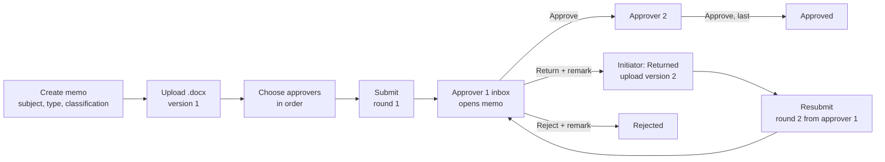

# E01 First slice — screen flows for review

> **For the owner, before the screens are built** (overview Q1). Wireframe level: layout, content and actions, not visual detail. The screens use the Ledger direction and the Phase 1a templates (list, detail, form, dialog). Please answer the questions in §8; the backend slices start meanwhile.
>
> **Status:** waiting for the owner. Written 2026-11-09.

## 1. The journey (D1 scenario)



## 2. Inbox

```
┌ memo ─────────────────────────────────────────────── 🔔3  Amina R. ▾ ┐
│ Inbox                                                    [+ New memo] │
│ ┌──────────┬────────┬──────┬────────┐                                 │
│ │ My tasks 4│ Drafts 2│ Sent 5│ Closed │                                │
│ └──────────┴────────┴──────┴────────┘                                 │
│  Subject                          From          Round  Waiting since │
│  ● Budget transfer for Q4 audit   Karim H.      1      today 09:12   │
│  ● Branch renovation, North 3     Sara M.       2      yesterday     │
│    Vendor contract renewal        Omar T.       1      3 days ⚠      │
│    Restricted item                 —             1      5 days        │
│                                                  [Load more]          │
└───────────────────────────────────────────────────────────────────────┘
```
- **My tasks:** memos waiting for my decision, newest first. Bold dot = not opened yet. "Restricted item" appears if my clearance was lowered after the memo reached me (I can no longer open it; the admin reassigns).
- **Drafts:** my unsent memos. **Sent:** my memos in review or returned, with "Now with: <name>". **Closed:** approved, rejected, withdrawn.
- Overdue marks (⚠) arrive with SLAs in E05; in E01 the column only shows the age.

## 3. Create memo

```
┌ New memo ─────────────────────────────────────────────────────────────┐
│ Subject *        [_____________________________________________]     │
│ Memo type *      [General memo        ▾]                              │
│ Classification * [Internal            ▾]   (cannot be lower than the  │
│                                            type's default)            │
│                                         [Cancel]  [Create draft]     │
└───────────────────────────────────────────────────────────────────────┘
```
Creating opens the memo view in **Draft**, where the document and the approvers are added. One short form, then one page to finish.

## 4. Memo view — Draft (initiator)

```
┌ ← Inbox   Budget transfer for Q4 audit                 Draft         ┐
│ General memo · Internal · created by you today                        │
├───────────────────────────────────────────────┬───────────────────────┤
│ Document                                      │ Approvers (in order)  │
│ ┌───────────────────────────────────────────┐ │ 1. Karim H.  Head,   │
│ │ budget-transfer.docx   v1 · 48 KB · today │ │    Finance       ↑ ↓ ✕│
│ │ [Download]  [Upload new version]          │ │ 2. Leila N.  Director │
│ └───────────────────────────────────────────┘ │                  ↑ ↓ ✕│
│   No document yet? [Upload .docx]             │ [+ Add approver]      │
│                                               │                       │
├───────────────────────────────────────────────┴───────────────────────┤
│ [Edit details]   [Discard draft]                       [Submit ▶]    │
└───────────────────────────────────────────────────────────────────────┘
```
- **Approvers:** added with the people picker; ↑ ↓ reorder (keyboard and screen-reader friendly, no dragging); ✕ removes. People who cannot be chosen show the reason in the picker ("Not cleared for Confidential", "Inactive", "That's you").
- **Submit** is enabled when there is a document and at least one approver; otherwise the button explains what is missing.

## 5. Memo view — In review (approver)

```
┌ ← Inbox   Budget transfer for Q4 audit          In review · round 2  ┐
│ General memo · Internal · from Karim H. · submitted today 09:12      │
├───────────────────────────────────────────────┬───────────────────────┤
│ Document  budget-transfer.docx  v2  [Download]│ Route — round 2       │
│ 🔒 Locked while in review                      │ ✓ Karim H.  approved  │
│                                               │ ● You       now       │
│ History                                       │ ○ Leila N.            │
│ ▾ Round 2 (current)                           │                       │
│   today 09:12  Karim H. resubmitted v2         │                       │
│     "Updated the figures as asked."            │                       │
│   today 10:03  Karim H. approved v2            │                       │
│ ▸ Round 1 — returned by you, yesterday         │                       │
│   (2 actions; approvals in round 1 do not count)│                      │
├───────────────────────────────────────────────┴───────────────────────┤
│                         [Return…]  [Reject…]        [Approve ✓]      │
└───────────────────────────────────────────────────────────────────────┘
```
- The action bar appears only for the person who holds the task. Everyone else sees the same page without buttons.
- **History by round:** the current round is open on top; earlier rounds are collapsed with a one-line summary of how they ended. Each entry shows who, what, which document version, when, and the remark.

## 6. Action dialogs

```
┌ Approve ────────────────────────────┐  ┌ Return to initiator ────────────────┐
│ You approve version 2 of            │  │ Tell Karim H. what to change. *     │
│ budget-transfer.docx.               │  │ [________________________________]  │
│ Remark (optional)                   │  │ [________________________________]  │
│ [______________________________]    │  │                                     │
│              [Cancel] [Approve]     │  │            [Cancel] [Return memo]   │
└─────────────────────────────────────┘  └─────────────────────────────────────┘
```
- **Approve** may first ask for the authenticator code (step-up). One code covers 30 minutes of approvals (Q5).
- **Reject** has the same form as Return, with a clear warning that rejection is final.
- **Resubmit** (initiator, after a return): an optional reply to the remark, the version being sent, and the approvers who will review again from the start.
- **Withdraw** (initiator): optional reason; confirm.

## 7. Admin: tasks waiting for reassignment

```
┌ Administration › Memo tasks ──────────────────────────────────────────┐
│ [Blocked 1] [All open 37]       Assignee [Any ▾]                      │
│  Memo                       Waiting for     Since     Problem         │
│  Vendor contract renewal    Omar T.         5 days    Inactive account│
│                                                    [Reassign…]        │
└───────────────────────────────────────────────────────────────────────┘
```
Reassign asks for the new approver (picker, same checks) and a reason, then the authenticator code. Both people are notified. The admin sees the memo's subject only if they are cleared for its classification; otherwise "Restricted item".

## 8. Questions for the owner
1. **Layout:** document and history on the left, approvers on the right (stacked on a phone). OK?
2. **Inbox tabs:** My tasks, Drafts, Sent, Closed. Anything missing for D1?
3. **Approver ordering by ↑ ↓ buttons** instead of dragging. OK for D1?
4. **Who sees a memo:** the initiator and its approvers, if cleared. Tenant admins see only what they need to reassign. Is that right for the bank, or should someone else (for example a secretariat) see all memos already in D1?
5. **Names:** "Return" and "Reject", or does the pilot use other words (for example "Send back", "Decline")? Tenant terminology overrides (ADR-0032) can change them per tenant later.

## 9. Review record

| Date | Reviewer | Outcome |
|---|---|---|
| — | Product owner | Waiting |
