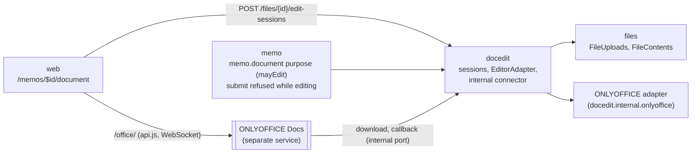
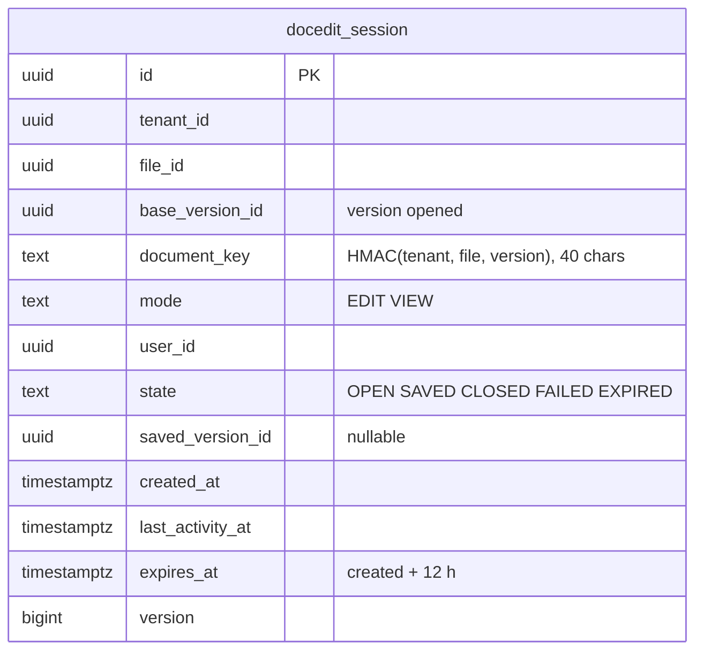

# E02 In-browser editing (ONLYOFFICE, minimal) — design

Decision: [ADR-0037](../../../adr/0037-onlyoffice-editing-integration.md). Builds on the files service (ADR-0028, ADR-0029), memo documents and the review lock (ADR-0036), step-up (ADR-0024), the security headers (ADR-0012) and the network layout of Compose and Helm (ADR-0011, ADR-0015). Research: [research.md](research.md).

**Scope (overview E02):** the initiator edits the memo's .docx in the browser while the memo is a draft or returned to them; closing the editor saves a new document version; everyone who may see the memo can view the document in the browser. Not in E02: co-editing by several people, templates, conversion to PDF, spreadsheets, the Phase 3 hardening review.

## 1. Module boundaries

- **New module `docedit`** (`com.memo.docedit`), depending on `files` only.
  - Public API: `DocumentEditing` (`open(fileId, mode)`, `openSessions(fileId): Boolean`), `EditableFilePurpose` (extends `FilePurpose` with `mayEdit(file: FileInfo): Boolean`), `EditMode { EDIT, VIEW }`.
  - `EditorAdapter` (internal interface): `config(session, file, version, user): EditorConfig` (signed), `verifyCallback(headers, body): EditorCallback`, `fetchResult(callback): InputStream`. The ONLYOFFICE adapter is the only implementation; a no-op adapter answers 404 when `memo.docedit.document-server-url` is blank (editing off).
  - **Internal connector:** a second Tomcat connector on `memo.docedit.internal-port` (default 8082) serves only `/internal/docedit/**`; a filter refuses those paths on the public connector (404) and everything else on the internal one (404).
- **`files`** gains a public `FileUploads` method to store a version for a given acting user (already used by the demo seeder) and `FileContents` (exists) for the download. No change to the pipeline: an edited version is scanned, inspected (DOCX), encrypted, stored as a record and announced with `FileVersionCreated`, exactly like an upload.
- **`memo`**: `MemoDocumentPurpose` implements `EditableFilePurpose` (`mayEdit` = `mayUpload`, `mayRead` for view); `MemoReviews.submit` and `resubmit` refuse while `DocumentEditing.openSessions(documentFileId)` (409 `DOCUMENT_BEING_EDITED`); the memo view's `allowedActions` gains `EDIT_DOCUMENT` and `VIEW_DOCUMENT`.

## 2. Data model

- RLS forced; index `(tenant_id, file_id, state)` for `openSessions`; a partial unique index allows one `OPEN` `EDIT` session per (file, user) — reopening returns the open one.
- A system job (`docedit.expire`, every 15 minutes) marks sessions past `expires_at` as `EXPIRED`; an expired edit session no longer blocks submit. Callbacks for an expired session are still accepted for saving if the memo still allows it (the editor may have been open overnight).

## 3. Flows

### Open
1. Browser `POST /api/v1/files/{fileId}/edit-sessions {mode}` with `Idempotency-Key` → `docedit` checks the purpose (`mayEdit` for `EDIT`, `mayRead` for `VIEW`; 403/404 as the purpose says), creates or reuses the session, asks the adapter for the config.
2. The config (signed JWT in `token`) holds `document.key`, `document.url` = `http://<backend-internal>:8082/internal/docedit/sessions/{id}/content?exp=…&sig=…` (HMAC, five minutes), `document.permissions` (§R8.5), `editorConfig.callbackUrl` = `http://<backend-internal>:8082/internal/docedit/sessions/{id}/callback`, `editorConfig.user` (id, display name), `editorConfig.lang` (the user's locale), `customization` (no plugins, no macros, no "open file location", no help links to the internet).
3. The web page `/memos/$memoId/document` loads `/office/web-apps/apps/api/documents/api.js` and starts `DocsAPI.DocEditor` with the config.

### Download (document server → backend)
`GET /internal/docedit/sessions/{id}/content` on the internal connector: signature and expiry checked, then the ONLYOFFICE JWT in the header; the session must be `OPEN`; streams the **base version** through `FileContents` (decrypting); audited as `file.opened` with `channel: editor`.

### Save (callback)
`POST /internal/docedit/sessions/{id}/callback`:
1. Verify the body token (HS256, our secret, `exp`); its payload must equal the body (`key`, `status`, `url`); `key` must equal the session's key.
2. By status (research §R8.2): 1 → touch `last_activity_at`; 4 → `CLOSED`; 2 and 6 (types 0/1) → **save**; 3, 7 → `FAILED` / audit; others → ignore. Always answer `{"error":0}` once the request is authentic; answer `{"error":1}` (and audit `docedit.callback.refused`) when it is not.
3. **Save:** take only the **path** of the callback `url` (ONLYOFFICE names it on the browser-facing address, research §R8.4), refuse unless it lies under the document server's `/cache/` (after removing the public `/office` prefix), and fetch it from the configured internal address; download with a 60-second timeout and the purpose's size limit; store through `FileUploads` **as the session's user** with an idempotency key of `docedit:{sessionId}:{status}:{url hash}` (a repeated callback stores once). A veto from the purpose (the memo was submitted meanwhile) marks the session `FAILED` with reason `LOCKED`, keeps the uploaded bytes nowhere, and notifies the user ("your changes could not be saved because the memo was submitted").
4. On success: `SAVED` with `saved_version_id` (status 2) or still `OPEN` (status 6); audit `docedit.version.saved`; the memo view shows the new version on its next refresh.

### Submit while editing
`openSessions(fileId)` is true while an `EDIT` session is `OPEN` and not expired → submit and resubmit answer 409 `DOCUMENT_BEING_EDITED`; the memo view says "Close the editor to submit". ONLYOFFICE sends status 2 about ten seconds after the last editor closes, so the memo is submittable shortly after closing.

## 4. API

| Method and path | Connector | Purpose | Access |
|---|---|---|---|
| `POST /api/v1/files/{fileId}/edit-sessions` | public | Open an editor (`mode`: `EDIT` or `VIEW`), returns the signed config and the session id | `@SignedIn`; the purpose decides (`mayEdit`/`mayRead`); `Idempotency-Key` |
| `GET /api/v1/edit-sessions/{id}` | public | How my edit session ended (`OPEN`, `SAVED`, `CLOSED`, `FAILED` with a reason, `EXPIRED`); opening again resumes an open one | `@SignedIn`; own sessions only |
| `GET /internal/docedit/sessions/{id}/content` | internal | Document for the editor | signed link + ONLYOFFICE JWT |
| `POST /internal/docedit/sessions/{id}/callback` | internal | Status callbacks | ONLYOFFICE JWT |

The internal endpoints are `@PublicEndpoint` for the authz interceptor (no user session) and are listed in a separate matrix file with `host: internal`; the endpoint-coverage test learns that `/internal/**` exists only on the internal connector.

## 5. Configuration

| Property / env | Default | Meaning |
|---|---|---|
| `memo.docedit.document-server-url` / `MEMO_DOCSERVER_URL` | blank (off) | Internal URL the backend uses for the document server (existing health probe uses it too) |
| `memo.docedit.public-path` | `/office/` | Where browsers reach the document server on the tenant host |
| `memo.docedit.internal-port` | 8082 | Internal connector |
| `memo.docedit.internal-url` / `MEMO_DOCEDIT_INTERNAL_URL` | `http://backend:8082` | How the document server reaches the backend |
| `memo.docedit.jwt-secret` / `MEMO_DOCEDIT_JWT_SECRET` | none (required when the URL is set) | Shared with ONLYOFFICE's `JWT_SECRET`; at least 32 bytes; start-up fails on the vendor placeholder |
| `memo.docedit.link-key` | derived from the data key (HKDF, label `docedit-link`) | Signs download links and document keys |

## 6. Deployment
- **Compose (dev `full` profile, on-prem):** the existing `onlyoffice` service on the internal network; the dev gateway stays for the host-run backend; the edge (Caddy) proxies `/office/*` to it with `X-Forwarded-Host: {host}/office` and `X-Forwarded-Proto` (T1 verifies; fallback host `office.<domain>`); memory limit after T1's measurement; the cache directory on a named volume; `JWT_SECRET` from the generated `.env`.
- **Helm:** values for an ONLYOFFICE Deployment (optional, `documentServer.enabled`), a Service, a NetworkPolicy admitting ingress only from the edge/ingress controller on 80 and from nothing else, and egress only to the backend's internal port; the backend's NetworkPolicy admits the internal port only from ONLYOFFICE pods; the Ingress routes `/office/` and never `/internal/`.
- **Dev VM:** ONLYOFFICE joins dev after the 16 GB upgrade (Phase 2 Q2); until then editing is off on dev (`MEMO_DOCSERVER_URL` blank) and the UI hides the edit buttons. The D1 demo does not use it.

## 7. Security headers
With the sub-path, `script-src 'self'`, `frame-src 'self'`, `connect-src 'self'` (including `wss:` to the same host, which `'self'` covers in current browsers; T4 checks Firefox and WebKit). The editor iframe is same-origin, so `frame-ancestors 'self'` must be served by the document server's responses too: the edge adds our header set to `/office/` responses. `worker-src 'self' blob:` if the editor needs workers (T4 checks; any widening is recorded in the security-headers file with a reason).

## 8. Audit

| Action | Object | Data |
|---|---|---|
| `docedit.session.opened` | session | file id, version id, mode |
| `file.opened` (existing) | file version | channel `editor` |
| `docedit.version.saved` | session | new version id, SHA-256, callback status |
| `docedit.session.closed` | session | outcome (`SAVED`, `CLOSED`, `FAILED`, `EXPIRED`), reason |
| `docedit.callback.refused` | session (or none) | reason code (bad token, wrong key, foreign host), remote address |
| `file.version.created` (existing) | file | as for uploads |

## 9. Web
- Memo view: "Edit in browser" next to "Upload a new version" when `EDIT_DOCUMENT` is allowed; "Open in browser" (view) for everyone else who sees the memo. Hidden when the server reports editing is off (`GET /api/v1/files/editing` → `{enabled}`; cached).
- `/memos/$memoId/document?mode=edit` (and `?mode=view`): a full-height page with a back link and the editor; leaving waits for the save ("Saving your changes as a new version…") until the session reports how it ended or 30 seconds pass.
- Phones: view mode only (the editor's mobile edit mode is out of E02); the button reads "Open" there.
- i18n en/ar; the editor's own UI follows `editorConfig.lang`.

## 10. Performance and limits
- One session per user and file; at most `memo.docedit.max-sessions-per-tenant` (default 50) open edit sessions.
- Download and save stream; the save path reuses the upload pipeline's limits (purpose 25 MiB).
- Measured in T1: memory idle and with one editor; recorded in `nfr.md`.
