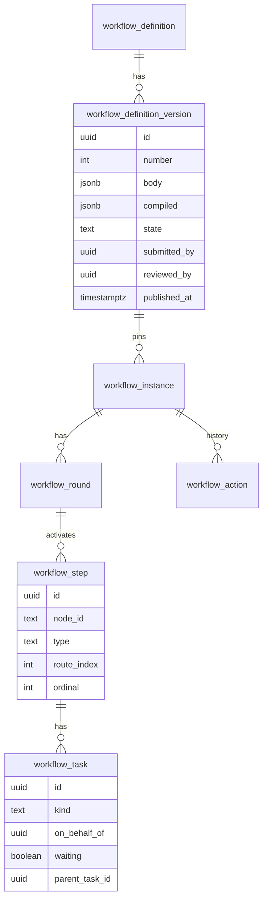

# E03 Definition model and runtime — design

Builds on E01 (ADR-0034, ADR-0035): the same tables, the pure transition function and the subject boundary. E03 widens what a definition can say and what people can do on a task; it does not replace E01's runtime. Decisions: ADR-0038 (definitions, lifecycle, migration), ADR-0039 (conditions).

## 1. Module boundaries

- **`workflow`** owns definitions (format, validation, compilation, lifecycle), conditions, the runtime and its events. New public API on `Workflows` (actions), `WorkflowDefinitions` (admin), `WorkflowSubject.attributes()` (the subject's attribute catalogue and values).
- **`memo`** chooses a definition per memo type, maps instance statuses to memo statuses, offers the new actions in the memo view and endpoints, and sends notifications for `notify` steps.
- **`authz`** gains three permissions (§6). **`audit`** records the new events (§7). No other module changes.

Events published by `workflow` (all carry `tenantId`, ids only): `WorkflowTaskCreated`, `WorkflowTaskClosed`, `WorkflowActionTaken` (E01), and new `WorkflowStepCompleted`, `WorkflowInstanceEnded` (status `APPROVED`, `REJECTED`, `WITHDRAWN`, `CANCELLED`), `WorkflowNotifyRequested` (a `notify` step: recipients and the step's message key), `WorkflowEscalatedToForum` (Phase 4 consumes it). `WorkflowEscalated` is defined now and published by E05.

## 2. Definition format (schema version 2)

```json
{
  "schemaVersion": 2,
  "attributes": [{ "name": "memoType", "type": "string" }, { "name": "classificationRank", "type": "int" }],
  "resubmit": "restart",
  "start": "review",
  "steps": [
    { "id": "review", "type": "review", "name": "Department review",
      "assignee": { "kind": "person", "userId": "…" },
      "actions": ["RECOMMEND", "RETURN", "SEND_BACK", "FORWARD", "REFER", "ASK"],
      "remarks": ["RETURN", "SEND_BACK", "FORWARD"],
      "next": "route" },
    { "id": "route", "type": "route", "name": "Approvers chosen by the initiator", "next": "size" },
    { "id": "size", "type": "branch",
      "branches": [{ "when": "item.classificationRank >= 3", "next": "board" }],
      "otherwise": "end" },
    { "id": "board", "type": "parallel", "name": "Directors", "mode": "n-of-m", "n": 2,
      "assignees": [{ "kind": "person", "userId": "…" }, { "kind": "person", "userId": "…" }, { "kind": "person", "userId": "…" }],
      "next": "tell" },
    { "id": "tell", "type": "notify", "recipients": [{ "kind": "initiator" }], "message": "approvedByBoard", "next": "end" }
  ]
}
```

| Step type | Human? | Properties | Behaviour |
|---|---|---|---|
| `route` | yes | `name` | The initiator's chosen approvers (memo route), one sequential step each, as in E01. At most one per definition. |
| `review` | yes | `assignee`, `actions`, `remarks`, `name`, `sla` | One person; the positive action is **Recommend** (`RECOMMEND`). |
| `approve` | yes | same as review | One person; the positive action is **Approve** (`APPROVE`); step-up per memo type (ADR-0036). |
| `parallel` | yes | `assignees` (2–20), `mode` `all` / `any` / `n-of-m` with `n`, `actions`, `remarks`, `name`, `sla` | One step, one task per assignee (§4.3). |
| `branch` | no | `branches` (1–10 of `when` + `next`), `otherwise` | First condition that is true wins; recorded (`ROUTE`). |
| `notify` | no | `recipients`, `message` | Publishes `WorkflowNotifyRequested`, continues; recorded (`NOTIFY`). |
| `subworkflow` | — | `definition` (key) | Replaced at publish by the fragment's steps (ADR-0038). The fragment may not contain `route` or `subworkflow`. |
| `escalate-to-forum` | no | `forum` (key) | Publishes `WorkflowEscalatedToForum`, continues (Phase 4 acts on it). |
| `sign` | — | `assignee` | Schema only; publishing a definition with it is refused until Phase 5. |

- **Assignee kinds in E03:** `person` (a user id) and `initiator` (notify recipients only). E04 adds position, relative, role in unit, DoA, queue.
- **Actions** a step may offer: `APPROVE` or `RECOMMEND` (by type, always offered), `RETURN`, `REJECT` (approve and parallel only), `SEND_BACK`, `FORWARD`, `DELEGATE`, `ASK`, `REFER`. Default when `actions` is absent: positive, `RETURN`, `REJECT` (approve) — the E01 set. `remarks` lists the actions whose remark is mandatory; `RETURN`, `REJECT`, `SEND_BACK`, `FORWARD`, `ASK` and `REFER` always need one (Q4 of the overview keeps approve optional).
- **`resubmit`:** `restart` (default, E01), `resume`, `skip-unchanged` (§4.6).
- **`sla`:** `{ "due": "P2D", "workingTime": true }` is validated now (ISO-8601 durations); E05 gives it behaviour.
- **`attributes`:** what conditions may read; each must exist in the subject type's catalogue with the same type.
- **Validation** (`DefinitionValidator`, errors with JSON pointers): JSON Schema; ids `^[a-z][a-z0-9-]{0,39}$`, unique; `start` and every `next` resolve (or `end`); all steps reachable; every path reaches `end`; acyclic; ≤ 100 steps; ≤ 20 conditions; conditions compile (ADR-0039); ≤ 1 `route`; `parallel` `n` between 1 and the number of assignees; assignees exist and are active (warning only for inactive: the task blocks, as in E01); fragments published and fragment-safe.
- **Built-in `sequential-approval`:** its schema-1 body upgrades on read to `{ start: "route", steps: [{ id: "route", type: "route", next: "end" }] }` with the E01 actions — so E01 instances run unchanged.

## 3. Domain model and data



Changes (migration `workflow/V3__definitions_runtime.sql`, expand-only):
- `workflow_definition_version`: `compiled jsonb` (null until published), `submitted_by`, `submitted_at`, `reviewed_by`, `reviewed_at`, `published_at`, `review_remark`; a partial unique index "one `PUBLISHED` per definition"; `CHECK (reviewed_by <> submitted_by)`.
- `workflow_definition`: `description`, `fragment boolean` (a definition meant for use as a sub-workflow).
- `workflow_instance.status` adds `CANCELLED`; `current_step_name text` for the inbox ("who holds it, at which step").
- `workflow_round.outcome` adds `RECALLED`, `CANCELLED`; `route uuid[]` (the initiator's route for the round; backfilled from E01 steps).
- `workflow_step.type` adds `REVIEW`, `PARALLEL` (E01 `APPROVE` stays); `node_id text` (backfilled `route`), `route_index int` (backfilled `ordinal - 1` for E01 rows), ordinals keep growing on re-activation.
- `workflow_task`: `kind` (`DECIDE`, `OPINION`, `CLARIFY`; backfilled `DECIDE`), `on_behalf_of uuid`, `waiting boolean`, `parent_task_id uuid` (the task an opinion or clarification belongs to); `state` adds `TRANSFERRED` (forward/delegate) and keeps `REASSIGNED` for admin moves; `outcome` adds `RECOMMEND`, `SEND_BACK`, `ANSWER`, `OPINION`. The E01 index "one open task per step" becomes "one open `DECIDE` task per step and assignee".
- `workflow_action.kind` adds `RECOMMEND`, `ROUTE`, `NOTIFY`, `ESCALATE_TO_FORUM`, `SEND_BACK`, `FORWARD`, `DELEGATE`, `ASK`, `ANSWER`, `REFER`, `OPINION`, `RECALL`, `CANCEL`, `MIGRATE`, `CARRY`; `details jsonb` (≤ 4 KiB: condition inputs and result, target step, recipients).
- RLS: every new column is on an existing tenant table with forced RLS; no new table.

### Invariants (E01's, plus)
13. An instance's `definition_version_id` changes only through `MIGRATE`.
14. A parallel step completes at most once: the deciding task's update and the step's `ACTIVE → DONE` update are guarded in the same transaction.
15. A `DECIDE` task that is `waiting` (an open clarification) cannot be decided.
16. Open `OPINION` and `CLARIFY` tasks of a step are cancelled when the step ends.
17. A delegate's action records `acting_for_id` = the task's `on_behalf_of`.
18. Branch and notify steps never hold a task; reaching `end` approves the round.

## 4. Runtime

### 4.1 Engine state
`InstanceState` gains the compiled definition and the round's `route`. Each `Step` carries `nodeId`, `type`, `routeIndex`. The service loads the latest round as in E01 and passes, in `TransitionContext`, the subject's attribute values (for branches) and, for `skip-unchanged`, the previous round's approvals with their document hashes.

### 4.2 Advancing
After a human step completes, the engine finds the next step: the next route entry if the step is a route entry with more approvers, else the node's `next`. It then walks: `end` → round and instance `APPROVED`; `branch` → evaluate, record `ROUTE`, continue; `notify` / `escalate-to-forum` → effect and record, continue; human step → activate (create the step row and its tasks) and stop. One command can therefore add several action rows (the decision, then `ROUTE` / `NOTIFY` rows): `Outcome.actions` becomes a list.

### 4.3 Parallel steps
One step, one `DECIDE` task per assignee, all open at once.

| Mode | Completes when | A `REJECT` | A `RETURN` |
|---|---|---|---|
| `all` | every task approved | rejects the round and the instance (others cancelled) | returns the round to the initiator (others cancelled) |
| `any` | the first approval (others cancelled) | counts as a "no"; when every task has said no, rejects the instance | returns the round |
| `n-of-m` | `n` approvals (others cancelled) | counts as a "no"; when `n` approvals can no longer be reached, rejects the instance | returns the round |

`SEND_BACK` from a parallel task sends the whole step back (others cancelled). `FORWARD` / `DELEGATE` move one task. Concurrency: two approvals that would both complete the step race on the step's guarded `ACTIVE → DONE` update; the loser gets `409 CONFLICT` and retries on the new state (E01's harness extended).

### 4.4 Actions

| Action | Who | Effect | Remark |
|---|---|---|---|
| `APPROVE` / `RECOMMEND` | task holder (or delegate) | completes the task; the step completes per type and mode; advance | optional unless in `remarks` |
| `RETURN` | holder | round `RETURNED`, instance waits for the initiator (E01) | required |
| `REJECT` | holder (approve, parallel) | instance `REJECTED` (parallel: per mode) | required |
| `SEND_BACK` to step *s* | holder | *s* must be an earlier `DONE` human step of this round; the current task (and open siblings) close; *s*'s node is activated again with *s*'s assignee; later steps are redone when reached | required |
| `FORWARD` to person *p* | holder | the task is `TRANSFERRED`; *p* gets a new `DECIDE` task on the same step and becomes the step's assignee; *p* eligible, not the initiator, not already on this step | required |
| `DELEGATE` to person *p* | holder | as forward, but the new task has `on_behalf_of` = the holder; *p*'s actions are recorded as acting for the holder | optional |
| `ASK` person *p* (or the initiator) | holder | a `CLARIFY` task for *p*; the holder's task is `waiting`; the item is now held by *p* | required (the question) |
| `ANSWER` | the `CLARIFY` task's holder | completes it; the asker's task stops waiting | required (the answer) |
| `REFER` to persons *p₁…pₙ* (≤ 10) | holder | an `OPINION` task each; the holder's task stays active | required (what to comment on) |
| `OPINION` | an `OPINION` task's holder | completes it; the opinion is in the history and the memo view | required (the opinion) |
| `RECALL` | initiator | only while no action other than `SUBMIT`/`RESUBMIT`, `ROUTE`, `NOTIFY` exists in the current round: round `RECALLED`, instance `RETURNED` (the initiator may edit and resubmit) | optional |
| `CANCEL` | holder of `workflow.instances.cancel` | instance `CANCELLED` (terminal), round `CANCELLED`, every open task cancelled | required |
| `WITHDRAW`, `RESUBMIT`, `REASSIGN` | as E01 | — | as E01 |

Refusals added: `ACTION_NOT_ALLOWED` (not in the step's `actions`), `NOT_AN_EARLIER_STEP`, `WAITING_FOR_ANSWER`, `ALREADY_ON_STEP`, `TOO_MANY_REFERRALS`, `NOT_RECALLABLE`, `NOT_A_FRAGMENT`.

### 4.5 Who holds it now
`current_assignees` = holders of open `DECIDE` tasks that are not `waiting`, plus holders of open `CLARIFY` tasks. Opinion holders are "consulted", not holders. `current_step_name` = the active step's name. The inbox lists every open task of the user (`DECIDE`, `CLARIFY`, `OPINION`), each labelled by kind.

### 4.6 Resubmission policies
- `restart`: round *n+1* starts at `start` (E01).
- `resume`: round *n+1* starts at the step whose holder returned the item; for a route entry, at that approver's position in the new route if they are still in it, else at the route's first approver. Steps before it are not repeated.
- `skip-unchanged`: round *n+1* starts at `start`; a review, approve or route step whose same person approved or recommended in round *n* on the same subject snapshot (for memos: the same document version and hash) is passed with a `CARRY` action by that person. Parallel steps always run again (E03 keeps their completion rule simple; carrying single holders of a parallel step is a later refinement).

### 4.7 Version pinning and migration
New instances use the newest `PUBLISHED` version of the memo type's definition. Migration (§5) per instance: allowed when the instance is `RUNNING` or `RETURNED`, the target is a newer `PUBLISHED` version of the same definition, and every open step's `node_id` exists in the target with the same `type`. It sets `definition_version_id`, adds a `MIGRATE` action (from and to version) and audits `workflow.instance.migrated`. Open tasks stay; the path after them follows the target.

## 5. API sketch

| Endpoint | Purpose | Access |
|---|---|---|
| `GET /api/v1/admin/workflow-definitions` | list (key, name, published version, draft in progress) | `workflow.definitions.manage` or `.approve` |
| `GET …/{key}` · `GET …/{key}/versions/{n}` | definition, versions, a version's body and validation result | same |
| `POST …` | new definition (key, name, body) as draft v1 | `.manage` |
| `PUT …/{key}/versions/{n}` | replace a draft body (import) | `.manage`, version in `DRAFT`, `If-Match` |
| `POST …/{key}/versions` | new draft from the published version (or from a body) | `.manage` |
| `POST …/{key}/versions/{n}/validate` | validation only | `.manage` |
| `POST …/{key}/versions/{n}/submit` | `DRAFT → IN_REVIEW` (refused if invalid) | `.manage` |
| `POST …/{key}/versions/{n}/approve` | `IN_REVIEW → PUBLISHED` (retires the previous one); not the submitter | `.approve`, step-up |
| `POST …/{key}/versions/{n}/send-back` | `IN_REVIEW → DRAFT` with a remark | `.approve` |
| `POST …/{key}/versions/{n}/retire` | `PUBLISHED → RETIRED` when no memo type uses it | `.approve`, step-up |
| `GET …/{key}/versions/{n}/export` | the body as a JSON file | `.manage` or `.approve` |
| `POST …/{key}/migrations/preview` | instances on older versions (or listed ones) → per instance: migratable, reason, path change | `.approve` |
| `POST …/{key}/migrations` | migrate the listed instances (≤ 100), `Idempotency-Key` | `.approve`, step-up |
| `POST /api/v1/tasks/{id}/{send-back,forward,delegate,ask,answer,refer,opinion,recommend}` | the new task actions (body: remark, target) | task holder (engine check), `Idempotency-Key` |
| `POST /api/v1/memos/{id}/recall` | recall | initiator |
| `POST /api/v1/admin/workflow/instances/{id}/cancel` | cancel with reason (next to E01's `/admin/workflow/tasks`) | `workflow.instances.cancel`, step-up |
| `GET /api/v1/memos/{id}` | gains `step` (name, type), `allowedActions` per the step, `sendBackTargets`, `opinions`, `clarification` | as E01 |

Errors: Problem Details with `reason` (the engine refusal, or `DEFINITION_INVALID` with `errors[]`: pointer, code, message).

## 6. Authorisation

| Permission | Scopable | Privileged | Default role |
|---|---|---|---|
| `workflow.definitions.manage` | no | yes | Tenant administrator |
| `workflow.definitions.approve` | no | yes | Tenant administrator |
| `workflow.instances.cancel` | no | yes | Tenant administrator |

Maker-checker is a rule, not a role split: `approve` and `send-back` refuse when the actor submitted the version (`SAME_PERSON`). Task actions stay engine-checked (the holder); memo visibility rules (participation and clearance) gate everything item-related, as in E01. Matrix file `p2-e03-workflow.yaml`.

## 7. Audit events

`workflow.definition.created`, `.draft_created`, `.draft_updated`, `.submitted`, `.sent_back`, `.published`, `.retired`; `workflow.instance.migrated`, `workflow.instance.cancelled`; the task actions are audited as `workflow.task.<action>` like E01's (`sent_back`, `forwarded`, `delegated`, `asked`, `answered`, `referred`, `opinion_given`, `recommended`), `memo.recalled`. Each in the action's transaction (ADR-0019), ids only, remarks never in the audit payload (they are in the workflow history, readable under the memo's rules).

## 8. Tenancy and RLS
No new table. New columns inherit the tables' forced RLS. Definitions, compiled bodies and conditions are per tenant; a fragment reference resolves only within the tenant. `RlsMetaTest` covers the tables already.

## 9. Migrations and compatibility
Expand only: new nullable or defaulted columns, widened `CHECK` lists, the task index replaced in the same migration (the old one is a subset of the new rule for E01 data). Backfills: `node_id = 'route'`, `route_index = ordinal - 1`, `kind = 'DECIDE'`, `round.route` from the steps. The schema-1 built-in body is upgraded on read; no row rewrite. Existing E01 instances keep running on the built-in version.

## 10. Performance budget

| Path | Budget (p95) | How |
|---|---|---|
| Inbox (unchanged query, more task kinds) | 300 ms at V2 | the E01 inbox index; `kind` read from the row |
| Task action including branch evaluation | 250 ms | compiled definition cached per version id (immutable once published); CEL programs cached; ≤ 20 conditions |
| Definition validate / publish | 1 s for 100 steps | in-memory |
| Migration preview, 500 instances | 2 s | one query for open steps by version; mapping in memory |

## 11. Background work
None new: notify and escalate steps publish events handled in the action's transaction (notifications already queue their e-mails through the outbox). Migration runs synchronously in batches of at most 100 instances per request, each instance under its own lock order (subject, then instance) in one transaction per batch.

## 12. Web (E06 adds the visual editor on the same API)
- **Admin → Workflows:** list; definition page with versions, a readable step list (type, name, assignees, actions, conditions) beside the JSON, validation errors by step; import (paste or upload JSON) into a draft; export; submit; review page for the checker (submitter, remark, a step-list diff against the published version); approve with step-up; send back; retire; migration: preview table, select, migrate.
- **Memo view:** the step name with the holder; action buttons per `allowedActions` (Recommend, Approve, Return, Reject, Send back (choose step), Forward, Delegate, Ask, Refer (choose people)); answer and opinion forms for those tasks; opinions panel; recall for the initiator; history shows the new kinds, branch decisions ("Routed to Directors: classification rank 3 ≥ 3"), carried approvals.
- **Memo types:** choose a published definition; route policy `FIXED` hides the route builder; `BOTH` shows it.
- **Inbox:** task kind label (Decide, Clarify, Opinion).

UX review: `ux-review.md`.
