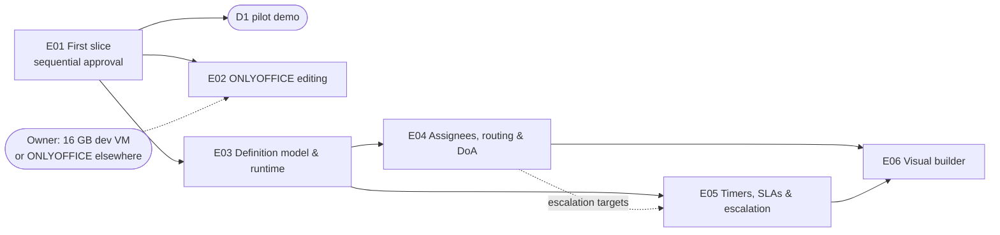

# Phase 2 — Workflow engine: overview

> Level-1 plan (see `AGENTS.md §5`). It splits the phase into epics, fixes their order and dependencies, lists the phase-level research and ADRs, and maps the exit criteria to epics. Each epic gets its own detailed plan (`epic-<NN>-<slug>/`: research, ADRs, design, threat model, tasks, test plan) just before it starts.
>
> **Status:** approved 2026-11-09 (see §10). Written 2026-11-09.

---

## 1. Phase goal (from `MASTER_PLAN.md`)

A general, data-driven routing engine used for memos and, later, agenda submissions, minutes approval, circular resolutions and action closure. The **first slice** ("simple sequential memo approval") comes before anything else: it is milestone **D1, the pilot demo**.

### What Phase 1a left us
- **Kernel:** tenant context in requests, transactions, db-scheduler jobs and async listeners, all failing closed (ADR-0017, ADR-0018); the transactional outbox; Caffeine caches with `LISTEN/NOTIFY` invalidation (ADR-0020).
- **Audit:** the per-tenant hash-chained store written in the business transaction; the actor already carries an `acting-as` id (ADR-0019), so delegated actions need no new audit shape. `AuditActionCoverageTest` fails when a recorded action has no asserting test.
- **Identity:** step-up ("fresh MFA within N minutes") as a service with a Problem Details answer the web client turns into an MFA prompt (ADR-0024); rate limiting (ADR-0025).
- **Org and authorisation:** units, positions, effective-dated primary assignments and reporting lines (ADR-0026; the assignment table already has a type column for 1b's `ACTING` and `ADDITIONAL`); classification levels and clearances; the policy service with SQL-pushed filters; the authorisation matrix and its endpoint-coverage meta-test (ADR-0027); the people picker.
- **Files:** scanned, envelope-encrypted, versioned files with SHA-256 content hashes, object-locked record buckets and streamed range downloads (ADR-0028, ADR-0029). The policy callback lets an owning module decide who may read a file. Its first real owner is the memo.
- **Notifications:** in-app centre and localised email from module events (ADR-0030).
- **Web:** the Ledger visual direction, the list, detail and form templates, modal dialogs under the strict CSP (ADR-0021), and per-role Playwright logins.
- **Idempotency keys:** `system.Idempotency` (a key row claimed in the business transaction, the stored result replayed, 422 on a reused key with another body), used today by file uploads. Phase 2 applies it to every workflow and memo action.
- **Not there yet:** no `workflow` or `memo` package, and no ONLYOFFICE integration: the service runs in the local Compose stack (ADR-0003, Phase 0) but no code uses it, and it is off on the 7.8 GB dev VM (Phase 1a Q7).

### What Phase 2 deliberately does *not* do
These belong to Phase 3 or later. Phase 2 designs for them so they plug in without rework:
- **The full memo:** metadata form builder, gapless numbering, templates with placeholders, attachments, "copy to", final PDF/A rendition, search, dashboards, legacy import (Phase 3). Phase 2's memo is the minimum: subject, memo type, classification, one main document with versions, and the note sheet.
- **Full ONLYOFFICE:** co-editing, conversion to PDF, templates and the Phase 3 hardening review. Phase 2 does only the last first-slice task: edit a .docx in the browser while the memo is Draft or Returned, saving a new version (E02).
- **Delegation management, acting assignments and their admin screens** (Phase 1b). Phase 2 builds the workflow side of "acting for" (§9 Q3).
- **Forums.** The `escalate-to-forum` step type and the forum queue resolver are defined in the schema and publish events. The forum module that consumes them comes in Phase 4.
- **Signatures.** The `sign` step type is in the schema; PAdES signing is Phase 5.
- **Mobile.** Idempotency keys and the API shape are ready for Phase 6a; no app yet.

---

## 2. Epics

Six epics. Estimates are in team-weeks and size the scope. Phases 0 and 1a ran faster than their estimates with the agent working alone, so the quality gates set the pace, not these numbers.

| # | Epic | Purpose | Est. | Depends on |
|---|---|---|---|---|
| E01 | **First slice: sequential memo approval** | The D1 scenario end to end on the engine's real tables: draft memo, .docx upload and versions, initiator-built route, submit, approve / return / reject / withdraw, resubmit as round 2, admin reassignment, note sheet, inbox, memo view, notifications, step-up on approve | 5–6 wks | — |
| E02 | **In-browser editing (ONLYOFFICE, minimal)** | The last first-slice task: ONLYOFFICE as an isolated service in Compose, Helm and dev; JWT-signed editor configs and callbacks; edit in Draft or Returned saves a new document version; read-only during review | 2–3 wks | E01; dev VM memory (§9 Q2) |
| E03 | **Definition model and runtime** | Versioned JSON definitions validated by schema; step types (review, approve, notify, parallel all / any / n-of-m, conditional branch, sub-workflow, plus the schema for sign and escalate-to-forum); the sandboxed condition language; all step actions; resubmission policies; draft → review (maker-checker) → published; version pinning and admin-driven migration of in-flight instances; recall, cancellation, "who holds it now"; the engine's published events | 5–6 wks | E01 |
| E04 | **Assignees, routing rules and DoA** | Assignee resolvers (position, relative, role within unit, DoA lookup, queue, explicit person); queues with claim and release; extended initiator routes (parallel groups, positions, allowed lists, DoA validation before submit); ad-hoc routing within limits; the DoA matrix screen and simulator; the workflow side of "acting for" | 4–5 wks | E03 |
| E05 | **Timers, SLAs and escalation** | SLA per step, reminders and escalation on db-scheduler; tenant business calendars (working days, holidays, time zones); a controllable clock in tests; synthetic volume V2 (10,000 active instances with timers) and the inbox load test | 3–4 wks | E03 (E04 for escalation targets) |
| E06 | **Visual workflow builder** | React Flow editor with live validation, preview and simulation; diff between definition versions; the maker-checker review screen; the admin journey "build, simulate, get approval, publish" end to end | 4–5 wks | E03, E04, E05 |

### Order and parallelism

- **D1 comes after E01, not E02** (§9 Q1). The scenario in the exit criterion uploads version 2; it does not need the editor. That keeps the pilot demo off the VM-memory question.
- **Critical path:** E01 → E03 → E04 → E06, about 18–22 team-weeks.
- **Parallel work:** E02 can run beside E03 once the VM question is answered. E05 can start beside E04 once E03 is merged.
- **One engine from the start.** E01 builds the generic tables (definition, definition version, instance, round, step, task, action) and the built-in "sequential" definition. E03 widens what a definition can say; it does not replace E01's runtime. This is the master plan's rule: later features extend the first slice.
- **Every epic uses the kernel.** Every action is audited in its own transaction; every endpoint enters the authorisation matrix; every state transition is a guarded update with a test for each allowed and each forbidden transition.
- **Gantt:** the master plan gives the first slice 25 days and the full engine 45. This plan sizes 23–29 team-weeks. As in Phase 1a, the gates set the pace; the Gantt is a placeholder.

---

## 3. Epic scope

### E01 — First slice: sequential memo approval
Exactly the eight steps of the master plan's first slice, on the engine's real tables.
- **Modules:** a subject-agnostic `workflow` module (definitions, instances, rounds, tasks, actions; it knows a subject only as type + id + a policy callback) and a minimal `memo` module (the first subject). The memo listens to workflow events and owns its own state and note sheet; the workflow never reads memo tables.
- **Memo types (minimum):** a tenant-defined memo type with name, default classification, route policy (`initiator-defined | fixed | both`), the definition it uses, and "step-up before approve" (on by default; AGENTS §3.4). The demo tenant seeds a "General memo" type on the built-in sequential definition, so the scenario needs no admin setup. A plain admin list for memo types; the full memo-type admin is Phase 3.
- **Draft memo:** subject, memo type, classification. Upload a .docx through the files service (allow-list: .docx only for the main document in this slice) → document version 1 with its content hash. The memo is the file owner and answers the files policy callback.
- **Route builder:** an ordered approver list from the people picker. Validation: at least one approver, no duplicates, not the initiator, only active users, and clearance for the memo's classification. Clearance is checked again when each task is assigned; an approver who lost clearance blocks the step visibly (the memo shows it to the initiator and the tenant admin) rather than leaving the memo stuck unseen.
- **Runtime:** submit starts round 1 and creates the first task. Approve moves to the next approver; Return (remark mandatory) unlocks the memo for the initiator; Reject (remark mandatory) is final; Withdraw is open to the initiator until final approval. Resubmit continues the **same instance as round N+1 from the first approver**. Approvals from earlier rounds stay in history and never count. The last approval of the current round sets the memo to Approved.
- **Document binding and lock:** every action records the document version and hash it applied to. While in review the document is read-only (the upload endpoint refuses, and the version a task shows is the version the round started with). Return and Draft unlock it.
- **Concurrency:** guarded updates (`… WHERE id = ? AND state = ? AND version = ?`, 0 rows → 409) on instance and task, plus **idempotency keys** on every mutating workflow and memo endpoint (the existing `system.Idempotency`, extended from creating requests to actions, and reused by mobile).
- **Step-up on approve:** the existing step-up service, per the memo-type flag, with its own tenant setting for the approval window (default 30 minutes; Q5) so the security-settings window stays short.
- **Reassignment:** a tenant admin reassigns a pending task (approver on leave or deactivated), with a mandatory reason; audited; both people notified.
- **Note sheet:** an append-only entry per action (actor, action, remark, round, document version and hash, time). Remarks are plain text in this slice; rich text and attachments are Phase 3.
- **Notifications:** in-app and email to the new assignee, and to the initiator on return, reject, approval and reassignment. Email subjects carry no memo subject (AGENTS §3.4).
- **Screens:** create memo, my inbox (my tasks, my drafts, sent), memo view (document with download, route, history grouped by round, action bar), route editor, and admin reassignment. Built on the Ledger list, detail and form templates.
- **Phone-friendly approval pages** (benchmark follow-up, 2026-11-09): the inbox, the memo view and the approve / return / reject dialogs work at phone width (about 400 px) with large targets, so approvers can act from a phone browser long before the approver app (Phase 6a).
- **Demo tenant:** sample .docx documents, memos in each state for the inbox and the screens, and the first-slice E2E fixture.
- **D1 demo script** for the owner and the pilot.

### E02 — In-browser editing (ONLYOFFICE, minimal)
- **Service:** ONLYOFFICE Docs (Community, AGPL) as a separate, unmodified service, recorded in the licence register with its obligations. No outbound network, CPU and memory limits, macros and plugins off. In Compose (dev and on-prem profile), Helm (with a network policy) and the dev VM (§9 Q2).
- **Integration:** an editor adapter interface (so the editor can be swapped); JWT-signed editor configs, browser requests and callbacks; the callback endpoint reachable only from the ONLYOFFICE network; document download URLs as short-lived, single-purpose signed links to the backend; a document key per version.
- **Behaviour:** edit is offered only in Draft and Returned; a save creates a new document version through the files pipeline (type detection, ClamAV, encryption), never a silent overwrite. During review the viewer opens read-only or the editor is not offered.
- **Tests:** an integration test against an ONLYOFFICE Testcontainer (callback statuses, JWT refusal), and the first-slice E2E extended with an edit.
- Co-editing, conversion to PDF, templates and the full hardening review stay in Phase 3.

### E03 — Definition model and runtime
- **Definition format:** versioned JSON validated by a JSON Schema; round-trip stable (property test). Step types: review, approve, notify, parallel (all / any / n-of-m), conditional branch, sub-workflow, plus schema-only `sign` (Phase 5) and `escalate-to-forum` (Phase 4, publishes an event).
- **Step actions:** approve, reject, return to originator, return to a previous step, forward with remark, seek clarification (and answer), **refer for opinion** (send the item to one or more people for comments; they can read it and add an opinion to the note sheet but cannot approve or route it; the task stays with the referrer, who sees the opinions arrive and then decides; e-office "send for comments"), delegate (hand a single task to someone else, recorded). Mandatory remarks per definition.
- **Condition language:** safe, sandboxed expressions over item attributes, no arbitrary code, chosen by research (R4). Evaluated with limits on size and cost; every evaluation that routes an item is recorded in the history with its inputs.
- **Resubmission policies:** `restart from first step` (default, the E01 behaviour), `resume from the returning step`, `restart but skip steps whose approvers saw an unchanged document version`.
- **Lifecycle governance:** draft → review → published, with maker-checker (the checker cannot be the maker). Instances are pinned to the version they started on. Moving in-flight instances to a new version only by explicit admin action, with a preview of what changes and an audit entry per instance.
- **Runtime completion:** recall by the initiator before the first action, cancellation with reason, "who holds it now" (denormalised current assignee and step on the subject row for the inbox), and the history timeline.
- **Events for other modules:** task created, step completed, instance completed, rejected, cancelled, escalated, each carrying `tenantId`.
- **Definition admin (without the builder):** list, view, import and export JSON, submit for review, approve and publish. E06 adds the visual editor on the same API.
- **Memo types** may now point at any published definition (`fixed` and `both` route policies become real).

### E04 — Assignees, routing rules and DoA
- **Assignee resolvers:** position; relative (initiator's supervisor, N levels up, unit head); role within unit; DoA rule lookup; queue (a group of people, such as a secretariat; the forum queue arrives with Phase 4); explicit person chosen by the initiator, governed by the memo-type policy. Resolution happens at task creation and is recorded with its inputs ("resolved to X because…").
- **Queues:** claim and release, a queue inbox, and a fallback when a resolver finds nobody (configurable: block and alert the tenant admin, or route to a named fallback).
- **Extended initiator routes:** parallel groups, positions instead of named people, restriction to an allowed approver list, and validation against DoA rules before submit (for example a required approver must be in the route).
- **Ad-hoc routing:** free forwarding within allowed units and levels, mixed with fixed skeleton steps.
- **DoA rules:** a tenant-maintained matrix (memo type, amount bands, unit, required approver levels), versioned with maker-checker, and a simulator ("for this memo type, amount and unit, who approves?"). Phase 2's memo has no amount field yet; the simulator and the rules work on item attributes, and Phase 3's memo metadata feeds them.
- **Separation of duties and conflict of interest** (benchmark follow-up): tenant rules checked when a route is validated and when each task is created: the initiator never approves their own item (already in E01); one person approves at most once per round, even when two steps resolve to them; people marked as interested in an item (a declared beneficiary, a related party, the memo's subject person) cannot approve it; per memo type, the same person cannot both prepare and approve. A failing rule blocks submit with a reason, or blocks the task for reassignment like a missing clearance. Declared conflicts and every rule decision are audited.
- **"Acting for" (workflow side, §9 Q3):** a task can be acted on by someone acting for the assignee; the audit actor records both (`acting-as`); the inbox shows tasks held in an acting capacity. Where the "acting" relation comes from depends on Q3.
- **Out-of-office substitution (workflow side; benchmark follow-up):** while a user's substitution is in force, new tasks for them go to their substitute (or are offered to both, per tenant setting), recorded as acting for them; open tasks can move on request. The self-service screen where a user names their substitute and dates is Phase 1b (delegation); E04 tests against substitutions created through the API, like acting assignments (Q3). Separation-of-duties rules apply to the substitute too.
- **Staff changes mid-workflow:** what happens to open tasks when an assignee changes position or is deactivated (re-resolve for position-based tasks; flag for reassignment for person-based ones).

### E05 — Timers, SLAs and escalation
- **SLA per step** in the definition: due time, reminders before and after, escalation policy (notify, reassign, escalate to the next level or a queue).
- **Timers** on db-scheduler, carrying `tenantId`, cancelled or rescheduled when the task moves. Design chosen for volume (R7: one scheduled task per timer vs a periodic sweep over a due-time index).
- **Business calendars:** tenant working days, working hours, holidays and time zone; SLA in working hours or calendar time per step.
- **Overdue** indicators in the inbox and the memo view.
- **Test clock:** an injectable clock so timer, reminder and escalation tests run in milliseconds (TESTING_STRATEGY §12).
- **Synthetic volume V2** (10,000 active instances with timers per tenant) in the generator, and a Gatling inbox load test against it (P1: p95 < 300 ms).

### E06 — Visual workflow builder
- **Editor:** React Flow; a palette of step types; property panels for assignees, actions, SLAs and conditions; keyboard-operable (WCAG 2.2 AA: every node and edge reachable and editable without a mouse, with a list view that mirrors the canvas).
- **Validation** as you edit (the same JSON Schema and semantic checks the server runs: unreachable steps, dead ends, conditions over unknown attributes).
- **Simulation:** run a definition against sample item attributes and see the path and the resolved assignees, using the E04 simulator.
- **Diff** between two versions (structure and properties), shown in the maker-checker review.
- **Exit journey E2E:** a tenant admin builds a multi-step workflow with a condition, a parallel branch, an SLA and an escalation, simulates it, a second admin approves it, it is published, and a memo routes through it.

---

## 4. Scope coverage (master plan scope → epic)

| Master plan Phase 2 scope item | Epic |
|---|---|
| First slice steps 1–8 (draft, .docx v1, route builder with clearance checks, submit, approve / return / reject / withdraw, round 2, Approved, note sheet and audit with version + hash, document lock, admin reassignment) | **E01** |
| Minimal memo screens (create, inbox, memo view with history by round) | **E01** |
| In-browser ONLYOFFICE editing as the last first-slice task | **E02** |
| Definition model: versioned JSON, schema, step types, allowed actions, SLA per step | **E03** (SLA fields), E05 (SLA behaviour) |
| Rounds and resubmission policies | E01 (restart), **E03** (the other two) |
| Initiator-defined routes (extended) | **E04** |
| Assignee resolvers | **E04** |
| Condition language | **E03** |
| Lifecycle governance, version pinning, in-flight migration | **E03** |
| Runtime: tasks, inbox, claim / release, mandatory remarks, history, "who holds it", recall, cancellation | E01, **E03**, E04 (claim / release) |
| Ad-hoc routing mode | **E04** |
| Scheduling: SLA timers, reminders, escalations, business calendars | **E05** |
| DoA rules management and simulator | **E04** |
| Visual builder with validation, preview, simulation, diff | **E06** |
| Events for other modules | E01 (first events), **E03** |
| *(kernel)* Idempotency keys on every action endpoint | **E01** |

## 5. Exit criteria → epics

| Exit criterion (`MASTER_PLAN.md`) | Delivered by | Evidence |
|---|---|---|
| **First slice:** create with .docx, choose approvers, submit; return; v2; resubmit; round 2 from the first approver; last approval → Approved. With: one approval per double-click, round-1 approvals not counted in round 2, document locked during review, cross-tenant isolation, an audit event per action | **E01** | The first-slice Playwright journey (every PR); concurrency tests (double-click, two devices, resubmit vs withdraw); property-based invariants; lock tests; cross-tenant suite for `workflow` and `memo`; `AuditActionCoverageTest` |
| A tenant admin can build, simulate, get approval for and publish a multi-step workflow with conditions, parallel branches, SLAs and escalation, without developer involvement | E03, E04, E05, **E06** | The builder exit journey (Playwright) |
| In-flight instances survive definition changes (version pinning proven by test) | **E03** | Pinning integration test; migration-by-admin test with preview and per-instance audit |
| Load test: 10,000 active instances with timers per tenant without degraded inbox latency | **E05** | V2 volume + Gatling inbox test, p95 < 300 ms (NFR P1), weekly load stage |
| Full audit of every action, including delegated "acting for" actions | every epic; E04 for "acting for" | Audit assertions per action; acting-for tests (§9 Q3 decides the source of the "acting" relation) |

**Phase-2 special tests** (`TESTING_STRATEGY.md §12`):

| Special test | Epic |
|---|---|
| First-slice E2E scenario | E01 |
| Property-based workflow invariants (only the current assignee acts, earlier rounds never count, Approved only after the last approver of the current round, terminal states are terminal) | E01, widened in E03 |
| Double-action concurrency (two approvers, two devices, double-click → one action; resubmit vs withdraw resolve deterministically) | E01 |
| Round counting; version binding; document lock during review | E01 |
| Clearance re-check on assignment | E01 |
| Timers and escalations with a controlled clock | E05 |
| Version pinning of in-flight instances | E03 |
| 10,000-instance load test | E05 |

Also from `TESTING_STRATEGY.md`: **PIT mutation testing** nightly on `workflow` (score ≥ 70 %) from E01; the first-slice scenario and admin reassignment join the **critical-journey list**.

**Generic phase-exit items** (`AGENTS.md §5`):

| Item | Where |
|---|---|
| Demo script | D1 script in E01; phase demo (`demo.md`) in E06 |
| `retrospective.md` | At phase close |
| STATUS | Every session |
| Usability check | E01: route builder, inbox and memo view walked through with the owner (and a pilot user if available) before build; E06: the builder. Recorded in each epic's `ux-review.md` |
| ASVS | Updated per epic: V2 business logic (anti-automation, sequential steps, double actions), V8 authorisation, V16 audit; L3 for the authorisation and audit parts |
| Manual accessibility | Keyboard and screen-reader pass over the inbox, memo view, route builder and the builder's list view |

---

## 6. Phase-level research list

Each item is answered in the `research.md` of the epic shown, with sources and access dates. Versions are re-verified from official sources, never taken from this plan or from memory.

| # | Question | Epic |
|---|---|---|
| R1 | Current stable versions, licences and maintenance status of everything the epic adds: ONLYOFFICE Docs, a JSON Schema validator for the JVM, the expression library (R4), React Flow (`@xyflow/react`), dnd-kit (route ordering), Spring Boot 4.2 status | Every epic |
| R2 | **Engine approach:** our own state machine on PostgreSQL vs embedding an engine (Flowable OSS; the Camunda 7 Community line and its forks such as Operaton — verify their support status). Licences, on-prem footprint, fit with data-driven JSON definitions, audit and RLS, testability. Default expectation: our own engine | E01 |
| R3 | **Double actions:** guarded updates vs row locks, and the idempotency-key store (key scope, retention, replaying the original response, conflicting bodies) as in established API guidance (for example the IETF `Idempotency-Key` header draft) | E01 |
| R4 | **Condition language:** CEL (Java implementation) vs SpEL in a restricted evaluation context vs a small custom DSL vs JsonLogic. Sandboxing, cost limits, auditability, error messages an admin understands | E03 |
| R5 | **Industry practice in e-office and memo products:** return, seek clarification, park, forward; how returned and resubmitted rounds are labelled and shown; what auditors expect in the history; staff transfer mid-workflow | E01 (rounds), E03, E04 |
| R6 | **DoA matrices in banks and large organisations:** amount bands, levels, unit scope, combined signatures, how they are maintained and approved; simulator patterns | E04 |
| R7 | **Timers at volume:** one db-scheduler task per timer vs a periodic sweep over a due-time index; rescheduling cost; behaviour at 10,000 instances and two app nodes; business-calendar arithmetic (working hours, holidays, time zones, DST) | E05 |
| R8 | **ONLYOFFICE Docs API:** callback statuses, force-save, document keys, JWT for configs, browser requests and callbacks; network isolation; memory footprint; AGPL plus additional-terms obligations for SaaS and on-prem distribution | E02 |
| R9 | **Visual builders:** UX of approval-flow builders in workflow and low-code products (validation, simulation, diff), and keyboard accessibility of node editors | E06 |
| R10 | **Definition versioning:** schema evolution of the definition JSON itself, in-flight migration strategies in other engines, and how they show a diff | E03 |
| R11 | **Industry benchmark (benchmark follow-up):** a sourced comparison of SAP Flexible Workflow and My Inbox, ServiceNow approvals, NIC e-Office and at least two commercial memo-approval products: step actions, routing rules, substitution, separation of duties, consultation, history and audit. Every Phase 2 feature is checked against it, and gaps are recorded as adopt / later / deliberately not | E03 (used by E04, E05, E06) |
| R12 | **Separation of duties in approvals:** how banks and ERP systems express SoD and conflict-of-interest rules (rule types, declared interests, exceptions with justification), and what auditors test | E04 |

## 7. Planned ADRs

Numbers are assigned when written, starting at ADR-0034. Each one uses MADR.

| ADR | Decision | Epic |
|---|---|---|
| ADR-ENGINE | Own workflow engine on PostgreSQL (or an embedded one), and the `workflow` / subject module boundary | E01 |
| ADR-WFDATA | Workflow data model: instance, round, step, task, action; guarded transitions with idempotency keys; denormalised "who holds it" | E01 |
| ADR-DOCBIND | Memo documents: versions bound to actions, lock during review, step-up on approve | E01 |
| ADR-OO | ONLYOFFICE integration: adapter, JWT, callback isolation, signed document links, licence obligations | E02 |
| ADR-DEF | Definition format, schema, versioning, maker-checker lifecycle and in-flight migration | E03 |
| ADR-EXPR | Condition language and its sandbox | E03 |
| ADR-ASSIGN | Assignee resolution, queues, DoA rules and "acting for" in the workflow | E04 |
| ADR-TIMER | Timers, SLAs, escalation and business calendars | E05 |

## 8. Risks

| # | Risk | Mitigation |
|---|---|---|
| R1 | Building the first slice "simply" leads to tables E03 has to replace | E01 designs the generic model (ADR-WFDATA) with E03's step types sketched; the built-in sequential definition runs on it; a design review against E03's needs before E01's migration is written |
| R2 | ONLYOFFICE does not fit on the 7.8 GB dev VM (ClamAV already uses about 1 GiB) | D1 does not depend on E02; Q2 asks for 16 GB or another host; E02 can run beside E03 when it is answered |
| R3 | The condition language becomes a security hole (code execution, denial of service through expensive expressions) | Choose a non-Turing-complete language with cost limits (R4); fuzz the evaluator nightly (Jazzer); L3 review |
| R4 | Timers at 10,000 instances overload db-scheduler or the database | R7 measures both designs early in E05; the V2 load test runs weekly |
| R5 | Parallel steps and simultaneous actions create races (two approvals both "complete" a parallel group) | Guarded updates on the step as well as the task; the concurrency harness from E01; property tests over parallel definitions |
| R6 | "Acting for" needs 1b's delegation, which is not scheduled yet | Q3; the audit actor already carries `acting-as` |
| R7 | The visual builder fails WCAG 2.2 AA (canvas editors are mouse-first) | A list view that mirrors the canvas and is the keyboard path; manual screen-reader check in E06 |
| R8 | The D1 demo reveals that the pilot works differently (for example, routes are always fixed, or approvals need comments) | Usability check of the E01 flows with the owner, and a pilot user if possible, before build; E03 and E04 absorb the findings |

## 9. Open questions for the human

1. **Q1 — Approval, gate delegation and D1.** Do you approve this overview? In Phases 0 and 1a you delegated the per-epic review gate (the agent writes each epic plan, then implements it without waiting). Does that still apply in Phase 2? Recommendation: keep the delegation, except the E01 screen flows (route builder, inbox, memo view), which go to you before build, and the D1 demo itself. Also: is D1 the upload-only scenario after E01 (recommended), or should it wait for in-browser editing (E02)?
2. **Q2 — ONLYOFFICE in dev.** ONLYOFFICE is off on the dev VM because 7.8 GB is not enough for it next to ClamAV; the NFR capacity note (`nfr.md`, ADR-0015) asks for 16 GB to run dev and staging with ONLYOFFICE. E02 measures its real footprint (R8). Options: (a) upgrade the dev VM to 16 GB (recommended), (b) run ONLYOFFICE on a second small VM for dev, (c) keep ONLYOFFICE local-only (Compose on your machine) until staging exists. Which one?
3. **Q3 — "Acting for" before Phase 1b.** The exit criterion asks for full audit of delegated "acting for" actions, but delegation itself is Phase 1b. Options: (a) Phase 2 builds the workflow side and tests it with acting assignments created through the org API (no delegation screens); Phase 1b adds delegation management, and this exit item is checked again then (recommended); (b) pull 1b's delegation (time-boxed, scoped, with its admin screen) into Phase 2 E04; (c) leave "acting for" entirely to 1b and carry the exit item. Which one?
4. **Q4 — Pilot input for the D1 scenario.** Do you know yet how the pilot bank routes memos today: does the initiator choose approvers, or are routes fixed per memo type? Must approvers always comment, or only on return and reject? If unknown, E01 follows the master plan (initiator-built routes allowed per memo type; remarks mandatory on return and reject only) and the D1 demo is where we learn.
5. **Q5 — Step-up on approve.** Recommendation: on by default for every memo type (AGENTS §3.4), so an approval asks for the TOTP code when the last MFA is older than the tenant's step-up window. A tenant admin can turn it off per memo type. OK?

---

## 10. Approval

| Item | By | Date | Notes |
|---|---|---|---|
| Phase 2 exit | Product owner (aradnazihar) | 2026-11-14 | Closed at the owner's instruction ("merge and close this phase"). All five exit criteria met with evidence (`retrospective.md`); all six epics merged and on dev (PRs #34–#83); `ci`, the dev deploy and the nightly green on `master`. **Carried:** the D1 and phase demos, the builder usability walkthrough and the manual keyboard and screen-reader pass, which need the owner in person. |
| Phase 2 overview | Product owner (aradnazihar) | 2026-11-09 | Approved as recommended. The owner **kept the per-epic gate delegation**: the agent writes each epic plan in full, then implements it without waiting, stopping only for decisions that need the owner. The E01 screen flows (route builder, inbox, memo view) go to the owner before build. |

### Answers to open questions
| Q | Date | Answer |
|---|---|---|
| Q1 | 2026-11-09 | **Approved; delegation kept** (E01 screen flows reviewed by the owner before build). **D1 is the upload-only scenario after E01**; it does not wait for E02. The owner asked whether E02–E06 would cover E01: no, every later epic builds on E01's memo, engine tables, inbox and idempotency keys, so E01 comes first. |
| Q2 | 2026-11-09 | **The owner upgrades the dev VM to 16 GB.** ONLYOFFICE runs on dev from E02. |
| Q3 | 2026-11-09 | **Option (a):** Phase 2 builds the workflow side of "acting for" and tests it with acting assignments created through the org API; the exit item is checked in full when Phase 1b adds delegation. |
| Q4 | 2026-11-09 | **Follow the master plan:** route policy per memo type (initiator-defined, fixed or both); remarks mandatory on return and reject only. The D1 demo is where we learn the pilot's practice. |
| Q5 | 2026-11-09 | **Step-up on approve, on by default**, with a separate **approval step-up window** (tenant setting, default 30 minutes) so one code covers a sitting of approvals, and the security-settings window stays short. A tenant admin can turn it off per memo type. The owner asked whether this burdens senior management: the window, passkeys (Phase 1b) and mobile biometrics (Phase 6a) keep it to one prompt or one touch. |
| Benchmark | 2026-11-09 | After a comparison with industry leaders, the owner **added**: self-service out-of-office substitution (Phase 1b screen, E04 workflow side), separation-of-duties and conflict-of-interest rules (E04), "refer for opinion" (E03), phone-friendly approval pages (E01), and a sourced industry benchmark (R11, E03). **Bulk approval from the inbox: not wanted.** Deliberately not adopted: approve from email or chat tools (third-party SaaS, content in email, step-up) and BPMN as the definition format (ADR-0034). |
