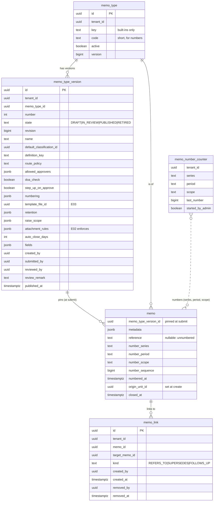
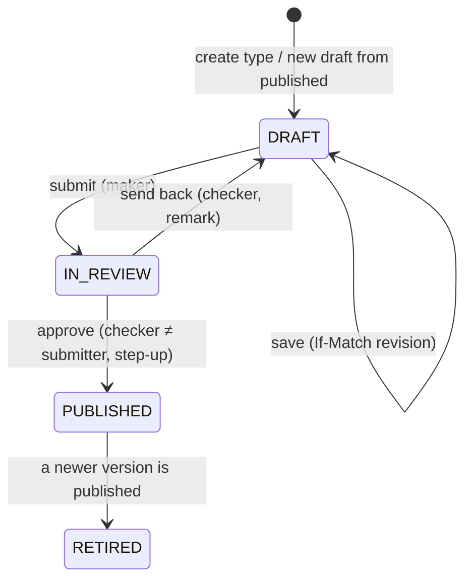

# E01 Memo types, metadata and numbering — design

> Step 3 of `AGENTS.md §5`. Decisions: ADR-0043 (versions, fields, attributes), ADR-0044 (numbering). Research: `research.md`.

**Scope (overview E01):**
- the full memo-type admin (settings, field builder, numbering, versions with maker-checker);
- metadata on memos;
- fields as workflow attributes;
- configurable gapless numbering taken at submit or final approval, with a register and voids;
- the lifecycle completed with closed, links between memos and "linked from";
- who may raise a type;
- retention and attachment rules stored.

**Not in E01:**
- templates (the slot only; E03);
- enforcing attachment rules (E02);
- search over metadata and inbox columns from fields (E05);
- acting on retention (Phase 7).

## 1. Domain model

### Invariants
- At most one PUBLISHED and one open (DRAFT or IN_REVIEW) version per type (unique partial indexes). `reviewed_by <> submitted_by` (CHECK).
- A type can be used to create memos only if it is active and has a published version. A user may raise it only if the raise scope admits them.
- A memo in any status other than DRAFT has `memo_type_version_id`; once set it never changes.
- `reference` is null exactly while the memo has not reached its version's numbering moment. It is set once, never changed. Legacy memos keep theirs.
- `(tenant_id, reference)` is unique. For each `(series, period, scope)`, the issued sequences are exactly 1..`last_number` with no gaps (or start..`last_number` after a starting number).
- `memo.metadata` holds only keys of the memo's current (draft) or pinned (submitted) version, except for the "no longer on this form" values on drafts.
- CLOSED is reached only from APPROVED and is terminal. Links are never deleted; removal is a recorded `removed_at`.

### Memo lifecycle (additions in bold)

```mermaid
stateDiagram-v2
  [*] --> DRAFT
  DRAFT --> IN_REVIEW: submit (pins version; number if ON_SUBMIT)
  DRAFT --> DISCARDED: discard
  IN_REVIEW --> RETURNED: return
  RETURNED --> IN_REVIEW: resubmit (keeps version and number)
  IN_REVIEW --> APPROVED: final approval (number if ON_APPROVAL)
  IN_REVIEW --> REJECTED
  IN_REVIEW --> WITHDRAWN
  RETURNED --> WITHDRAWN
  IN_REVIEW --> CANCELLED
  APPROVED --> CLOSED: close (initiator or tenant admin) / auto-close after N days
  CLOSED --> [*]
```

Forbidden transitions, each with a test: close from any status but APPROVED; reopen from CLOSED; any change to number, version or metadata after submit; link removal after submit.

### Memo-type version lifecycle

## 2. Module boundaries and events
- **memo** owns types, versions, metadata, numbering, links and closing. The new `memo.internal.numbering` package holds the format, rendering and counters; it is pure apart from the counter store.
- **common.review**: a pure `ReviewLifecycle` (state enum, allowed transitions, same-person and remark rules), with no persistence. Used by the memo module. Workflow definitions and DoA are unchanged.
- **workflow**: `WorkflowSubject.attributes` becomes `attributes(tenantId)`. `DefinitionChecks`, `DoaChecks` and `BuilderCatalogueController` ask per tenant. The workflow also asks subjects whether an attribute is still declared before a subject removes it. The memo module calls the published API `WorkflowDefinitions.declaredAttributes(subjectType)` (new), which returns the attributes declared by published definitions and published DoA versions.
- **org**: the directory search gains `kind: unit` for the unit picker. `OrgDirectory.primaryUnit(userId, at)` is added for the origin unit.
- **Events:** `MemoTypePublished(tenantId, typeId, versionId)` (memo-internal, invalidates the type and attribute caches after commit). No new cross-module events. The memo already listens to `WorkflowActionTaken`; final approval numbering runs there, in the same transaction as the status change.

## 3. API sketch
All under `/api/v1`; errors are RFC 9457 with `errors[{field, code, message}]`; mutating calls take `Idempotency-Key` (creates, actions) or `If-Match` (updates).

| Endpoint | Access | Notes |
|---|---|---|
| `GET /memo-types` | signed in | Active types with a published version that the caller may raise: `{id, name, defaultClassificationId, stepUpOnApprove, numberingMoment}` |
| `GET /memo-types/{id}/form` | signed in, may raise | The current published version's fields (for the create and edit forms) |
| `GET /admin/memo-types` | `memo.types.manage` or `.approve` | Types with published version number, open draft state, active |
| `POST /admin/memo-types` | manage; Idempotency | `{name, code}` creates the type and draft version 1 from defaults |
| `GET /admin/memo-types/{id}` | manage or approve | Type with all versions (summary) |
| `GET /admin/memo-types/{id}/versions/{n}` | manage or approve | Full version, ETag = revision |
| `POST /admin/memo-types/{id}/versions` | manage; Idempotency | New draft copied from the published version (`DRAFT_EXISTS` if one is open) |
| `PUT /admin/memo-types/{id}/versions/{n}` | manage; If-Match | Replace the draft body; validation problems as JSON pointers |
| `POST …/versions/{n}/submit` | manage; Idempotency | DRAFT → IN_REVIEW; full validation |
| `POST …/versions/{n}/approve` | approve; step-up; Idempotency | Publishes; attribute and series checks run again in the transaction |
| `POST …/versions/{n}/send-back` | approve; Idempotency | Remark required |
| `PUT /admin/memo-types/{id}/active` | manage; If-Match | `{active}`; `LAST_ACTIVE` kept |
| `POST /admin/memo-types/numbering/preview` | manage or approve | `{numbering, typeCode, unitCode?, at?}` → sample numbers (now, next period) and problems |
| `GET /admin/memo-numbering` | manage, approve, or `audit.read` | Series with their periods, scopes, last numbers and the types using them |
| `GET /admin/memo-numbering/{series}/register` | manage, approve, or `audit.read` | `?period&scope&cursor`: numbers in order with memo id, status, void reason; subject only if the reader may see the memo |
| `POST /admin/memo-numbering/{series}/start` | approve; step-up; Idempotency | `{period, scope, next}`; refused once a number exists (`ALREADY_STARTED`) |
| `POST /memos` | `memo.create`; Idempotency | Adds `metadata`; checks raise scope; sets origin unit |
| `PUT /memos/{id}` | initiator; If-Match | Adds `metadata` (DRAFT and RETURNED: subject, classification as before; metadata only in DRAFT) |
| `GET /memos/{id}` | memo readers | Adds metadata with labels from the version (current for drafts, pinned otherwise), `reference` nullable, `numberingMoment`, `staleFields`, links, `linkedFrom`, `closedAt` |
| `POST /memos/{id}/links` | participant (any status but CLOSED); Idempotency | `{targetReference, kind}`; the target must be readable by the caller; at most 50 |
| `DELETE /memos/{id}/links/{linkId}` | link creator, memo DRAFT or RETURNED | Records removal |
| `POST /memos/{id}/close` | initiator or tenant admin; Idempotency | APPROVED → CLOSED, remark optional |

Problem codes: `SAME_PERSON`, `DRAFT_EXISTS`, `NOT_PUBLISHED`, `ATTRIBUTE_CONFLICT`, `ATTRIBUTE_IN_USE`, `SERIES_OVERLAP`, `ALREADY_STARTED`, `NO_ORIGIN_UNIT`, `NOT_ALLOWED_TO_RAISE`, `FIELD_REQUIRED`, `FIELD_INVALID`, `LINK_LIMIT`, `LINK_TARGET_UNREADABLE`, `NOT_APPROVED`.

## 4. Authorisation matrix

| Action | Initiator | Participant | Other user | Tenant admin (manage) | Second admin (approve) | Auditor |
|---|---|---|---|---|---|---|
| See raisable types and their form | if in raise scope | — | if in raise scope | ✓ | ✓ | — |
| Create, edit, submit type drafts | — | — | — | ✓ | ✗ (unless also manage) | — |
| Approve or send back a type version | — | — | — | ✗ on own submission | ✓ (step-up for approve) | — |
| Activate or deactivate | — | — | — | ✓ | — | — |
| Number preview, numbering overview, register | — | — | — | ✓ | ✓ | ✓ (read) |
| Set a starting number | — | — | — | ✗ | ✓ (step-up) | — |
| Fill or change metadata | ✓ in DRAFT | — | — | — | — | — |
| Add a link | ✓ (not CLOSED) | ✓ (not CLOSED) | ✗ | ✗ unless participant | — | — |
| Remove own link | ✓ in DRAFT or RETURNED | — | — | — | — | — |
| Close | ✓ if APPROVED | ✗ | ✗ | ✓ if APPROVED | — | — |

The new permission `memo.types.approve` is added to the tenant-admin role template. The demo's `reviewer@` gets it, and `admin@` keeps manage, so maker-checker can be shown. Every new endpoint goes into `authz/p3-e01-memo-types.yaml`.

## 5. Audit events
- **Types:** `memo.type.created`, `memo.type.draft_created`, `memo.type.draft_updated`, `memo.type.submitted`, `memo.type.published`, `memo.type.sent_back`, `memo.type.updated` (active toggle, as today, now with all fields in the audited map).
- **Numbering:** `memo.numbering.started` (series, period, scope, next).
- **Memos:**
  - `memo.created` and `memo.updated` gain metadata keys (values not copied into audit for LONG_TEXT, only "changed");
  - `memo.type_pinned` (version, dropped keys);
  - `memo.numbered` (reference, series, period, scope, sequence);
  - `memo.link.added`, `memo.link.removed`;
  - `memo.closed` (actor or `system` for auto-close).

Each is written in the business transaction and asserted in a test (`AuditActionCoverageTest`).

## 6. Tenancy and RLS
- New tables `memo_type_version`, `memo_link` and `memo_number_counter` have `tenant_id` first in every index, RLS ENABLE + FORCE, and the standard `tenant_isolation` policy.
- Composite foreign keys `(tenant_id, …)` like the existing memo tables. `RlsMetaTest` covers them automatically.
- Cross-tenant tests:
  - a version, link target or register entry of tenant B is not found from tenant A;
  - a link by number to another tenant's memo answers "not found";
  - counters are per tenant.
- The auto-close job runs per tenant with `tenantId` in its data (ADR-0018).

## 7. Migrations (expand → migrate → contract)
- **One migration per task** (each task ships the schema it uses):
  - T1 `memo/V6__type_versions.sql`: `memo_type_version`, `memo_type.code` and `published_version`, and the backfill below;
  - T2: `memo.memo_type_version_id`, `memo.metadata`, `memo.origin_unit_id` use, field columns on the version;
  - T4: numbering columns, `memo_number_counter`, the `reference` change;
  - T5: `memo_link`, CLOSED.
- The backfill runs across tenants as the schema owner. FORCE ROW LEVEL SECURITY applies to the owner too, so the migration lifts FORCE for its own transaction and restores it before commit (`MemoTypeBackfillIT` checks both the data and that FORCE is back).
- **Expand, in the order above:**
  - create `memo_type_version`;
  - add `memo_type.code` (backfilled from the key or name initials, made unique per tenant);
  - add the new memo columns (all nullable or defaulted);
  - drop NOT NULL and the format CHECK on `memo.reference` and add a length CHECK;
  - create `memo_link` and `memo_number_counter`;
  - add `CLOSED` to the status CHECK.
- **`memo/V7__type_versions_backfill.sql`** (migrate):
  - one PUBLISHED version 1 per type from its current columns, with numbering `M-{YEAR:4}-{SEQUENCE:5}` on series `general` (yearly, ON_SUBMIT), `created_by` the system id;
  - every non-draft memo pinned to it;
  - existing memos' `number_series = 'general'`, period and sequence parsed from their references;
  - `memo_reference_counter` copied into `memo_number_counter`.
- During this release the app writes the published settings back into the old `memo_type` columns, so a node still on the previous release behaves the same.
- **Contract** (a later epic, after one release on dev): drop the old `memo_type` settings columns and `memo_reference_counter`; make `memo_type_version_id` NOT NULL for non-drafts by CHECK.
- Drafts created by an old node still get an `M-` reference at create during the rollout. They keep it, and they are recognised as already numbered at submit.

## 8. Performance budget

| Operation | Target | How |
|---|---|---|
| `GET /memo-types`, `/form` | p95 < 50 ms | Caffeine cache per tenant (published versions), invalidated on publish |
| Create and save draft | p95 < 200 ms | Validation in memory against the cached version |
| Submit with numbering | p95 < 300 ms; counter lock held < 20 ms | Number taken late in the transaction (just before the workflow starts); one counter row per series, period and scope |
| Numbering under contention | 50 parallel submits on one series: all succeed, sequences 1..50, no gaps | `NumberingConcurrencyIT` |
| Register page | p95 < 300 ms at 100,000 numbers in a period | Index `(tenant_id, number_series, number_period, number_scope, number_sequence)`; keyset paging |
| Link lookup by number | p95 < 50 ms | Unique `(tenant_id, reference)` |
| Attribute catalogue | built once per tenant per publish | `TenantCaches` (`memo.attributes`) |

`EXPLAIN` is recorded in the epic log for the register and link-lookup queries against seeded volumes.

## 9. Background work
- **Auto-close:** a daily recurring db-scheduler task fans out one tenant task per active tenant. Each closes APPROVED memos whose pinned version has `auto_close_days` and whose approval is older than that. Each memo is closed in its own transaction with a guarded update, so a run can be repeated safely. The actor is `system`.
- Final-approval numbering runs in the memo's workflow listener, in the transaction that sets APPROVED, so it is retried with that listener if anything fails.

## 10. UX flows (wireframes in `ux-review.md`; reviewed by the owner before build, Phase 3 Q1)
1. **Memo types list:** name, code, published version, draft state ("Draft v3", "In review v3 by Admin"), active. New type asks only for name and code.
2. **Memo type page:**
   - Version selector and state badge.
   - Toolbar: Save, Submit, Approve, Send back, New draft.
   - Tabs:
     - Settings: workflow, route policy, approvers, classification, step-up, who may raise, retention, auto-close, attachment rules.
     - Form: an ordered field list with up/down, add or edit a field in a side sheet, and a live preview of the create form.
     - Numbering: format parts, series, reset, count per, moment, a live sample.
     - Changes: against the published version.
3. **Numbering overview and register:** series → periods → numbers, with void reasons. "Set starting number" appears only while a period is unused.
4. **Create memo:**
   - Choose the type. With six or fewer types: radio cards with descriptions. With more: a searchable select.
   - Then subject, classification and the type's fields in one form.
   - "Save draft" keeps incomplete data; Submit lists missing required fields.
5. **Memo view:**
   - The number, or "Unnumbered (numbered on submit/approval)".
   - A Details section with the field values.
   - Links and "linked from".
   - Close for approved memos.
   - A notice when the type has changed since the draft was saved.
