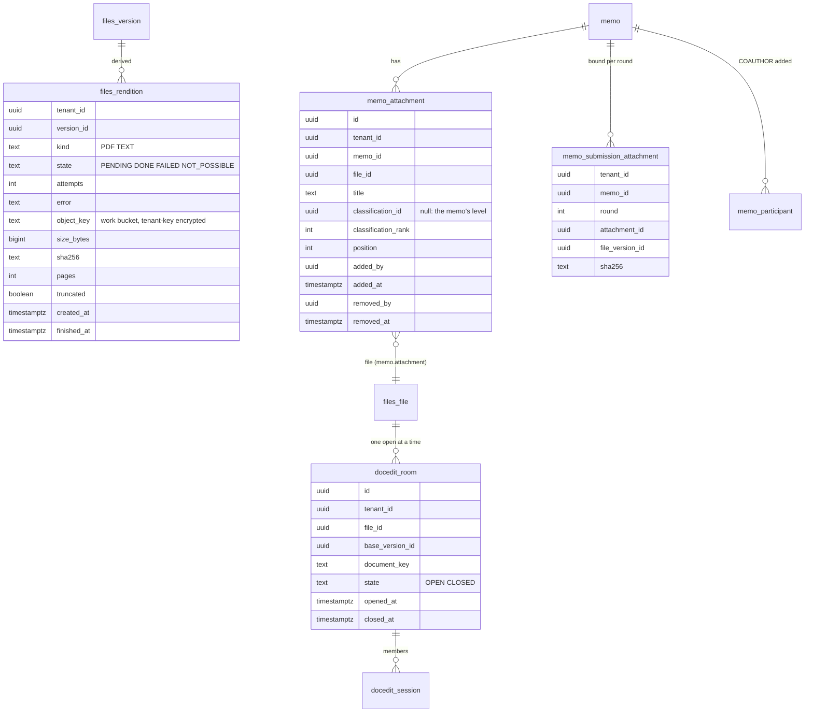

# E02 Documents: conversion, versions, attachments, editing — design

> Step 3 of `AGENTS.md §5`. Decisions: ADR-0045 (renditions and text), ADR-0046 (attachments), ADR-0047 (ONLYOFFICE 10, co-editing, hardening; desktop Word not adopted). Research: `research.md`. The screen flows here are not on the owner's review list (Phase 3 Q1: E01, E03 and E05 only), so they follow the existing patterns.

## 1. Domain model

### Invariants
1. A rendition is unique per (version, kind); its content is derived and may be rebuilt; a `DONE` row has an object, a size and a hash.
2. An attachment's own rank, when set, is strictly above the memo's rank at the time it is set; its **effective** rank is `max(own, memo)`.
3. Attachments change (add, new version, retitle, reclassify, remove) only while the memo is `DRAFT` or `RETURNED`, by the initiator or a co-author. Rows are never deleted.
4. Every submit and resubmit writes one `memo_submission_attachment` row per attachment present, with the version and SHA-256 at that moment; rows of a round never change (append-only trigger).
5. At most one `OPEN` room per file (partial unique index); every open `EDIT` session of the file belongs to it.
6. A submit is refused while a room is open on the memo document or on one of its attachments.
7. Co-authors are memo participants of kind `COAUTHOR`: at most ten, never the initiator, added and removed only in `DRAFT`.

## 2. Module boundaries and ports
- **files** owns renditions: `files_rendition`, the jobs, storage and reads. It declares two ports:
  - `RenditionConverter.toPdf(input, name, type): ConversionResult`, implemented by `docedit` (ONLYOFFICE conversion API);
  - `TextExtractor.text(input, type): ExtractionResult`, implemented by `files.internal.TikaClient`.
  When no implementation is configured, the kind is `NOT_POSSIBLE`.
- **FilePurpose** gains `renditions: Set<RenditionKind>` (default empty) and `allowedTypesNow(): Set<FileType>` (default `allowedTypes`; the attachment purpose narrows it by tenant setting).
- **memo** owns attachments, the submission binding, co-authors and the attachment rules check at submit. `MemoAttachmentPurpose` is an `EditableFilePurpose` for DOCX and XLSX.
- **docedit** owns rooms and sessions, the ONLYOFFICE adapter (editor, callbacks, conversion) and the hardening configuration. `DocumentEditing.beingEdited(fileIds)` takes a set.
- **Version comparison** is computed in the browser; the server only serves the two texts.

## 3. Flows
### Rendition
1. `FileVersionCreated` (in the upload's transaction) → for each kind the purpose wants: insert `PENDING`, or `NOT_POSSIBLE` when the type cannot have one (PDF originals need no PDF rendition; images need none; ZIP has neither).
2. After commit: tenant one-off job `files.rendition` with (version, kind). The job:
   - takes the row `FOR UPDATE SKIP LOCKED`;
   - decrypts the original to a spool file;
   - calls the port (PDF: ONLYOFFICE from-file conversion, async, polled every two seconds up to 150 s; TEXT: Tika `/tika/text`);
   - checks the PDF result with `PdfInspector` (pages ≤ the purpose's `maxPdfPages`, no JavaScript actions);
   - encrypts the result with the tenant's key into the `work` bucket;
   - sets `DONE` with size, hash, pages and truncated, or a retry time, or `FAILED` / `NOT_POSSIBLE` with the error code.
3. A recovery job every five minutes re-schedules `PENDING` rows older than five minutes and rows whose retry time has passed. At most two conversions and two extractions run at a time per node (semaphores).
4. Reading a rendition: the original's purpose `mayRead` decides (and, for attachments, the effective classification); audited as `file.opened` with `rendition`.

### Attachment
- **Add:** `POST /memos/{id}/attachments` with an upload id from the files pipeline (purpose `memo.attachment`, owner = memo). The memo checks state, actor, count and the classification; the row and the file commit together.
- **New version:** an ordinary upload of a new version of the attachment's file, or a save from the editor.
- **Remove:** sets `removed_at`; the file and its versions stay as records.
- **Reclassify:** raises it (or clears it back to the memo's level) while editable.
- **Submit / resubmit:** checks the type version's `attachmentRules` (`ATTACHMENTS_REQUIRED`), refuses while a room is open, then writes the round's binding.

### Edit room (ADR-0047)
- **Open (EDIT):** if the file has an open room, the session joins it (its key and base version); otherwise a room opens with key HMAC(tenant, file, base version, room id).
- **Callback** by key → room:
  - status 6 (types 0, 1) stores a version as the user named in `users[0]`, who must hold a session in the room; the room stays open.
  - status 2 stores and closes the room.
  - status 4 closes the room.
  - status 3 and 7 mark it failed and tell the members.
  - The saved version's base is checked: a callback for a room whose file got a new version from elsewhere (an upload) is refused as `STALE` and the members are told.
- **Expiry:** the room closes when its last session expires (12 h) or after one hour idle.

### Comparison
`GET /memos/{id}/documents/{fileId}/compare?from=v&to=w` returns both texts (or the reason one is missing), each with number, name, SHA-256, uploader and time. It is audited as two `file.opened` with `channel: compare`. The browser diffs in a worker: lines first, then words in changed lines, with a two-second budget; beyond that it shows both texts side by side without inline marks.

## 4. API sketch
| Endpoint | Who | Notes |
|---|---|---|
| `GET /files/{id}/versions/{v}/renditions` | readers of the file | State of PDF and TEXT per version |
| `GET /files/{id}/versions/{v}/renditions/pdf` | readers | The PDF (the original when it is a PDF); range requests; `inline` |
| `GET /memos/{id}/attachments` | memo readers | Present attachments, in order; restricted ones without title, type or size |
| `POST /memos/{id}/attachments` | initiator, co-author; editable; Idempotency | `{uploadId, title?, classificationId?}` |
| `PATCH /memos/{id}/attachments/{aid}` | initiator, co-author; editable; If-Match | `{title?, classificationId?, position?}` |
| `DELETE /memos/{id}/attachments/{aid}` | initiator, co-author; editable | Soft remove |
| `GET /memos/{id}/rounds/{n}/attachments` | memo readers | The bound list of a round (restricted ones redacted) |
| `GET /memos/{id}/documents/{fileId}/compare` | memo readers cleared for the file | `?from&to` (version numbers) |
| `PUT /memos/{id}/coauthors` | initiator; DRAFT; If-Match | `{userIds}` (at most ten) |
| `POST /files/{id}/edit-sessions` | as Phase 2 | Joins the open room |
| `MemoView` | — | Adds `coauthors`, `attachmentCount`, `canEditAttachments` |

## 5. Authorisation
- Attachments: the memo's rules plus the effective classification for content, renditions and text. Restricted rows hide title, type and size.
- Co-authors edit content only: the document and the attachments. Subject, details, classification, route and every action stay the initiator's.
- New permission: none. A co-author needs `memo.create`.
- Matrix: `authz/p3-e02-attachments.yaml` covers every new endpoint for initiator, co-author, approver, reader, uncleared reader, other tenant and anonymous.

## 6. Audit
| Event | When |
|---|---|
| `memo.attachment.added`, `.removed`, `.reclassified`, `.retitled` | Attachment changes (ids, ranks; titles not logged) |
| `memo.coauthors.changed` | Before and after id lists |
| `file.rendition.failed` | A rendition ended `FAILED` (version, kind, code) |
| `file.opened` with `rendition: PDF\|TEXT` or `channel: compare` | Reads of derived content |
| `docedit.room.opened`, `.closed`, `docedit.version.saved` (with members) | Edit rooms |

## 7. Tenancy, encryption and storage
- New tables have `tenant_id`, RLS enabled and forced, and composite foreign keys.
- Rendition objects are named `t/<tenant>/r/<version>/<kind>` in the `work` bucket and encrypted with the tenant's data key (ADR-0028). They have no object lock and are rebuilt if lost.
- Extracted text is as confidential as the document: never logged, and kept only in storage, not in the database. E05 decides how its index stores searchable text.

## 8. Migrations
- `files/V2`: `files_rendition`.
- `memo/V10`: `memo_attachment`, `memo_submission_attachment` (append-only trigger), the participant kind `COAUTHOR`.
- `docedit/V2`: `docedit_room`, plus `room_id` on sessions, with a backfill of open sessions into rooms (lifting FORCE, as `MigrationDmlRlsTest` requires).
- Expand only.

## 9. Performance budget
| Operation | Target |
|---|---|
| Rendition scheduled after upload | < 1 s after commit |
| DOCX of 20 pages to PDF | p95 < 10 s end to end (single ONLYOFFICE) |
| Text of a 20-page DOCX | p95 < 5 s |
| Attachment list of a memo | p95 < 50 ms with 50 attachments |
| Compare endpoint | p95 < 300 ms for two 1 MB texts (server side) |
| Browser diff of two 50-page texts | < 2 s in the worker, or the fallback |

## 10. Deployment and configuration
- **ONLYOFFICE 10.0.0.1** in every deploy path (Compose dev, on-prem Compose, Helm, the E2E stack):
  - `ALLOW_PRIVATE_IP_ADDRESS` dropped; a `local.json` override sets `externalRequest`, `aiSettings`, `docbuilderEnable`, `expire`, `autoAssembly`, the `inputLimits` and `queue.visibilityTimeout`;
  - `PLUGINS_ENABLED=false`;
  - the cache on a tmpfs of 2 GiB;
  - resource limits.
- **The `/office/` proxy** (web nginx, Caddy, ingress) denies `/office/converter`, `/office/ConvertService.ashx`, `/office/docbuilder`, `/office/coauthoring/CommandService.ashx`, `/office/command`, `/office/info` and `/office/example`.
- **Tika 4.2.0:**
  - a new `tika` service on an internal network with the backend only;
  - `tika-config.json` with the ADR-0045 limits;
  - 1.5 GiB memory limit;
  - setting `memo.files.tika-url`, empty to switch text off.
- **Settings:**
  - `memo.files.renditions.concurrency` (2 / 2);
  - `memo.attachments.types` (tenant);
  - `memo.attachments.max-count` (50);
  - `memo.docedit.co-authors.max` (10).

## 11. UX
- **Memo view, Attachments section** (below Document):
  - a list with type icon, title, size, classification badge when stricter, the rendition state, and Preview, Download, Edit (DOCX and XLSX, while editable) and Remove;
  - an upload control that asks for a classification (default "Same as the memo");
  - restricted rows say "Restricted attachment".
- **Preview:**
  - a dialog with PDF.js for renditions and PDFs (a page at a time, zoom, keyboard paging), or the image;
  - "Preview not available" with the reason and Download.
- **Document section:** "Compare versions" (from and to selectors) opens a full-width side-by-side view with change marks, a legend and a "next change" button.
- **Co-authors:** in the memo's People area for the initiator in a draft: a picker of up to ten people. Co-authors see "You are a co-author" and can open the editor.
- **Submit blocked:**
  - while an editor is open: "Someone is still editing <document>"; the memo already blocks the submit and says so;
  - when attachments are missing: "This memo type needs at least N attachments".
