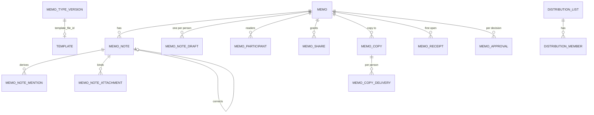

# E03 Templates, note sheet and access — design

> Step 3 of `AGENTS.md §5`. Decisions: ADR-0048 (templates), ADR-0049 (note sheet), ADR-0050 (access and copy-to), ADR-0051 (authenticated approvals). Screen flows: `ux-review.md`, reviewed by the owner before the web tasks.

## 1. Scope
- **In:**
  - .docx templates per memo-type version, validated on upload and filled at create;
  - the note sheet (rich remarks, comments, mentions, attachments on a remark, corrections, private drafts);
  - the access model (shares, copy-to with distribution lists and read receipts, unit readers) as one SQL predicate;
  - authenticated approvals with stamps and a check;
  - the Phase 2 follow-up on the step ordinal after a recusal.
- **Out:**
  - the second fill of the template and the PDF/A (E04);
  - search over notes (E05 uses `body_text`);
  - CA e-Sign and server-key sealing (E04 and later);
  - editing a template in the browser (admins upload from Word).

## 2. Domain model

- **Template:**
  - a file of purpose `memo.template` owned by a memo-type version, with its validated tag list (`template_tags jsonb`);
  - the memo records `template_version_id` (the file version it was filled from).
- **Note entry** (`memo_note`):
  - kind `REMARK` (a decision's remark, with `action_id`), `COMMENT` or `CORRECTION` (with `corrects_id`);
  - author, acting-for, round, `body jsonb` (`noteDoc/v1`), `body_schema`, `body_text`, created time.
  - Append-only. Invariants:
    - a correction references an entry of the same memo, by the same author (or the person they act for), not itself a correction of a correction chain longer than 10;
    - the memo is not closed.
- **Draft** (`memo_note_draft`): one per memo and person, mutable, private; deleted when an entry is posted or the memo closes.
- **Participant** (`memo_participant`):
  - Kinds: `INITIATOR`, `COAUTHOR`, `APPROVER`, `NOTIFIED`, `COPY`, `SHARED`.
  - New columns `granted_by`, `revoked_at`. `COPY` and `SHARED` rows are written only through their tables below.
- **Share** (`memo_share`): who, given by, reason (1–500 characters), `expires_at` (optional, ≤ 1 year), `revoked_at`/`revoked_by`.
- **Copy** (`memo_copy`):
  - recipient kind `USER`, `POSITION` or `LIST`, the recipient id;
  - `send_when`: `AT_SUBMIT` or `AFTER_APPROVAL`;
  - added by and when, `sent_at`.
- **Delivery** (`memo_copy_delivery`):
  - per resolved person, one row: `SENT`, or refused with `NOT_CLEARED` / `INACTIVE`;
  - a person reached through two copies gets one participant row and one notification.
- **Receipt** (`memo_receipt`):
  - first open of the memo view by a copy recipient or an approver;
  - the time and the document version shown; one row per memo and person, never updated.
- **Distribution list** (`memo_distribution_list`, `memo_distribution_member`): name, active, members (people and positions), version (If-Match).
- **Approval** (`memo_approval`):
  - one per approve, return or reject; the id is the action id;
  - auth, client and content JSON;
  - `prev_hash` and `record_hash` (ADR-0051).

### Lifecycles
- **Copy:** `PENDING` (added) → `SENT` (at submit or at final approval, depending on `send_when`). A pending `AFTER_APPROVAL` copy on a memo that is rejected or withdrawn stays pending and is shown as "not sent". Copies are never removed once sent; before sending, the initiator or a co-author may remove them.
- **Share:** active → revoked, or active → expired (by time). Neither comes back; a new share is a new row.
- **Template on a type version:** none → uploaded (validated, with problems) → valid (no problems, test fill done) → part of the submitted and published version (maker-checker). A published version's template never changes.

## 3. Templates (ADR-0048)
- **Upload:**
  - The admin uploads through the files API (`purpose=memo.template`, `owner=<typeVersionId>`) while the version is a draft.
  - The purpose's `inspect` hook runs the sanitiser. It refuses with a list of problems, or stores the re-serialised package.
  - A listener then builds the tag inventory and the problem list and stores them on the version.
- **Test fill:**
  - `POST …/template/preview` fills the template with sample values (field labels in brackets, today's date, "Sample approver") into a file of purpose `memo.template.preview`.
  - Its PDF rendition (ADR-0045) is shown in the existing preview dialog.
  - Previews are kept for 24 hours, then deleted.
- **Submit for review** is refused while the template has problems or no successful preview.
- **Create from template:**
  - `POST /memos` gets the filled document as version 1 when the type version has a template.
  - The fill runs inside the create request on a bounded executor (2 per node, 5-second timeout). On timeout, the memo is created without a document and the problem is shown; the initiator may retry ("Fill from template").
- **Tag values:**
  - pre-formatted strings in the tenant's locale settings (dates `d MMM yyyy`, amounts with currency and grouping);
  - the approval table is empty at create; E04 fills it;
  - `memo.number` is "(number on submit)" until numbered.

## 4. Note sheet (ADR-0049)
- **Reading:**
  - `GET /memos/{id}/notes` returns the entries in order, rendered from the tree, and the legacy entries.
  - **Legacy entries:** decision remarks recorded before E03 have no note row. The API merges the actions' plain remarks in as entries of kind `REMARK` with a one-paragraph body, so nothing is backfilled across modules.
- **Writing a decision remark:**
  - The approve, return, reject, submit, resubmit and withdraw endpoints accept `remarkBody` (`noteDoc/v1`) as well as `remark`.
  - Given only the old `remark`, it is wrapped as a paragraph.
  - The note and the action's derived text are written in one transaction.
- **Comments:** any reader except copy recipients (unless `memo.copy.comments` is on) and unit readers may comment while the memo is open (not closed).
- **Mentions:**
  - The mentioned person must be able to read the memo, or the post is refused with `MENTION_NO_ACCESS` naming them; the UI offers "Share and mention".
  - Notification kind `memo.mentioned`, with a deep link to the entry.
- **Attachments on a remark:**
  - Up to 5 per entry, purpose `memo.note.attachment` (same safe types and size as memo attachments).
  - They are uploaded while drafting, owned by the draft, and bound to the entry on post.
  - Unbound uploads are removed after 24 hours.
- **Corrections:** `POST /memos/{id}/notes` with `kind: CORRECTION`, `correctsId`.
- **Draft:** `PUT /memos/{id}/notes/draft` (auto-save every 5 seconds while typing; If-Match), `GET`, `DELETE`.

## 5. Access and copy-to (ADR-0050)
- **`MemoReadable(user, clearance, unitScopes)`:**
  - a jOOQ condition:
    `memo.classification_rank <= :clearance AND (EXISTS participant(memo, user, revoked_at IS NULL) OR memo.origin_unit_id = ANY(:unitScopes))`;
  - every query that lists or loads memos for a user uses it. An ArchUnit rule forbids `MEMO_PARTICIPANT` joins outside the access class.
  - `:unitScopes` is the expanded unit subtree list from the actor's `memo.read.unit` grants (cached with the grants, ADR-0020).
- **Share endpoints:** `POST /memos/{id}/shares {userId, reason, expiresAt?}` and `DELETE /memos/{id}/shares/{shareId}`.
- **Copy endpoints:**
  - `PUT /memos/{id}/copies` (the whole list while editable, If-Match on the memo);
  - `POST /memos/{id}/copies/additions` (after approval, `memo.copy.add`);
  - `GET /memos/{id}/copies` (with delivery state per person).
- **Receipts:**
  - `GET /memos/{id}/receipts` (initiator, co-authors, the person who added the copy, auditors);
  - written by `GET /memos/{id}` when the caller is a `COPY` or `APPROVER` participant without a receipt (`INSERT … ON CONFLICT DO NOTHING`).
- **Sending at submit and at final approval:**
  - The memo module listens to its own submit and the workflow's `WorkflowInstanceEnded` event with status approved, in the same transaction for submit and in an after-commit listener with an idempotent job for approval.
  - It resolves recipients, writes deliveries and participant rows, and queues notifications.
- **Distribution lists:** `GET/POST /distribution-lists`, `GET/PUT/DELETE /distribution-lists/{id}` (If-Match; delete only deactivates).

## 6. Authenticated approvals (ADR-0051)
- **Identity port:** a new `AuthenticationContext.current()` in identity returns:
  - the factors of the session with the time each was proven;
  - the session-id hash (HMAC with a per-install key, so it is not reversible);
  - client IP and user agent as resolved by the trusted-proxy rules.
- **Writing:**
  - `MemoTasks.approve/returnToInitiator/reject` write `memo_approval` after the workflow action, in the same transaction.
  - `record_hash = SHA-256(canonical JSON of the row without hashes || prev_hash)`, with a per-memo chain. Rows are locked with the memo row, so the chain is linear.
- **Reading and checking:**
  - `GET /memos/{id}/approvals` returns the stamps; client fields only for `audit.read` holders.
  - `POST /memos/{id}/approvals/check` recomputes the content hashes from storage and the chain, and returns `{ok, problems[]}`. It is audited and rate-limited.
- **Recusal follow-up:** the stamp and history use the step's ordinal from the instance, not a count of earlier actions.

## 7. Authorisation matrix
| Action | Initiator | Co-author | Approver | Copy | Shared | Unit reader | Admin perms |
|---|---|---|---|---|---|---|---|
| Read memo, notes, stamps | ✓ | ✓ | ✓ | ✓ | ✓ | ✓ | — |
| Comment | ✓ open | ✓ open | ✓ open | setting | ✓ open | — | — |
| Decision remark | submit/resubmit | — | own task | — | — | — | — |
| Correct own entry | ✓ open | ✓ open | ✓ open | own | ✓ open | — | — |
| Share | ✓ | ✓ | ✓ | — | — | — | `memo.share.manage` revokes any |
| Copy-to (edit list) | draft/returned | draft/returned | — | — | — | — | `memo.copy.add` after approval |
| Receipts | ✓ | ✓ | — | — | — | — | `audit.read` |
| Stamp client fields | — | — | — | — | — | — | `audit.read` |
| Check stamps | ✓ | ✓ | ✓ | ✓ | ✓ | ✓ | — |
| Templates | — | — | — | — | — | — | `memo.types.manage` (draft), `memo.types.approve` |
| Distribution lists | read for picking | read | — | — | — | — | `memo.distribution.manage` |

All rows also require clearance ≥ the memo's classification. Every "—" cell is a 404 for unknown-memo cases, or a 403 for known, readable memos, as today. New permissions:
- `memo.read.unit` (scopable, privileged);
- `memo.share.manage`, `memo.copy.add` and `memo.distribution.manage` (tenant-wide, privileged).

None of these is in the user role. The tenant-admin role template gets `memo.distribution.manage`.

## 8. Audit events
- **Templates:** `memo.template.uploaded`, `memo.template.refused` (with rule codes), `memo.template.previewed`, `memo.created.from-template`.
- **Notes:** `memo.note.posted` (kind, entry id; never the body), `memo.note.corrected`, `memo.mentioned` (entry id, user ids).
- **Shares:** `memo.share.granted` (user, reason length, expiry), `memo.share.revoked`, `memo.share.expired`.
- **Copies:** `memo.copy.changed`, `memo.copy.sent` (counts and refused names), `memo.copy.added-after-approval`.
- **Approvals:** `memo.approval.checked` (result).
- **Distribution lists:** `distribution.list.created`, `distribution.list.changed`, `distribution.list.deactivated`.
- **Receipts** are records themselves and not audited again. `memo.opened` stays as today.

## 9. Performance budget
| Operation | Target | How |
|---|---|---|
| Template fill at create | p95 < 1.5 s (5 pages) | bounded executor; template bytes cached per version (immutable) |
| Template validation on upload | < 3 s | streaming OPC checks; one compile |
| Note sheet, 200 entries | p95 < 100 ms | index `(tenant_id, memo_id, created_at)`; bodies returned as stored JSON |
| Post a note | p95 < 150 ms | validation in memory; mention rows in one insert |
| Memo list with the access predicate | p95 < 100 ms at 100,000 memos, 20,000 shares and copies | partial index on `memo_participant (tenant_id, user_id, memo_id) WHERE revoked_at IS NULL`; `memo (tenant_id, origin_unit_id)` |
| Receipts of a memo with 500 recipients | p95 < 50 ms | PK `(tenant_id, memo_id, user_id)` |
| Approval check | p95 < 500 ms | hashes stored per version (no re-read of content unless `deep=true`, auditors only) |
| Copy sending at approval, 500 people | < 5 s, in a job | batched inserts; notifications queued |

## 10. Tenancy, RLS and migrations
- Every new table has `tenant_id`, RLS ENABLE + FORCE on `app.tenant_id`, composite FKs within the module, and an index for every FK (RlsMetaTest).
- Append-only tables:
  - `memo_note`, `memo_note_mention`, `memo_note_attachment`, `memo_receipt`, `memo_copy_delivery` and `memo_approval` revoke `UPDATE`/`DELETE`/`TRUNCATE` from `memo_app`, with a guard trigger as for `workflow_action`;
  - `memo_share` and `memo_copy` allow only the documented column updates (`revoked_*`, `sent_at`).
- **Migrations:**
  - `memo/V12__templates.sql`: the template columns on `memo_type_version` and `memo`;
  - `memo/V13__notes.sql`;
  - `memo/V14__access_and_copies.sql`: participant kinds and revocation, shares, copies, deliveries, receipts, lists;
  - `memo/V15__approvals.sql`.
  - All are expand-only. Old remarks are not backfilled (§4).
- `files`: new purposes `memo.template`, `memo.template.preview` and `memo.note.attachment` (code, no migration).

## 11. Background work
| Job | Trigger | Idempotency | Tenant context |
|---|---|---|---|
| Template preview conversion | rendition jobs (ADR-0045) | per version and kind | the task's tenant id |
| Send copies after approval | `WorkflowInstanceEnded` (approved), after commit | `memo_copy.sent_at` set in the same transaction as the deliveries; a re-run skips sent copies | task carries the tenant and memo id |
| Expire shares | daily sweep | marks `revoked_at` with `expired` once | per-tenant task (ADR-0018) |
| Remove unbound note uploads and old previews | hourly sweep | delete by age and state | per-tenant task |

## 12. Events
- **Consumed:** workflow `WorkflowInstanceEnded` (send `AFTER_APPROVAL` copies), `WorkflowActionTaken` (not needed: notes and approvals are written by the memo in the same transaction), files `FileVersionCreated` (template inventory).
- **Published:**
  - `MemoMentioned(tenantId, memoId, noteId, userId)` and `MemoCopied(tenantId, memoId, userId)`, consumed by notification;
  - `MemoAccessChanged(tenantId, memoId)` for E05's search cache.

## 13. UX
Flows and wireframes: `ux-review.md`.
- **C:** the note sheet with the editor, mentions, attachments and corrections.
- **D:** sharing and copy-to, with receipts.
- **E:** stamps and the check.
- **F:** template admin.

The owner reviews C and D before T7 and T8 (overview §9 usability check); E and F follow existing patterns and are shown for information.
