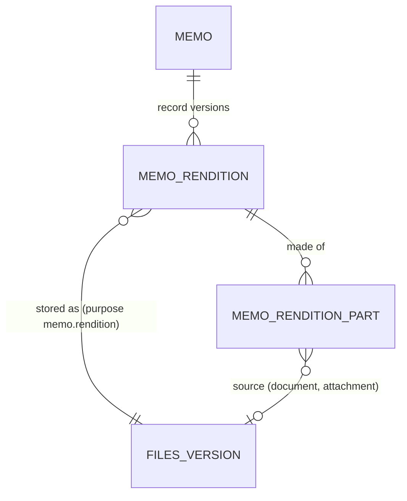
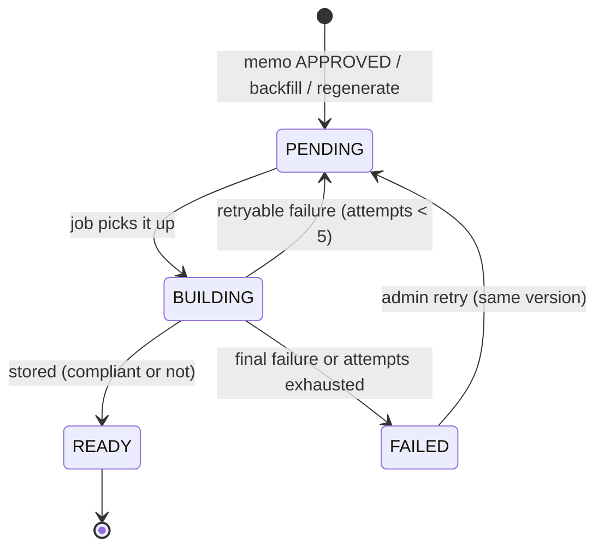

# E04 Final rendition (PDF/A) — design

> Step 3 of `AGENTS.md §5`. Decisions: ADR-0052 (generated pages) and ADR-0053 (the final rendition). Research: `research.md`. The screens follow existing patterns, so `ux-review.md` is for information; the owner kept the per-epic gate delegation and listed no E04 flow for review (overview §10 Q1).

## 1. Scope
- **In:**
  - one PDF/A-2u record per approved memo, built in the background and validated by veraPDF;
  - stored as an object-locked record file; its checksum in the audit log;
  - generated pages (cover, approval history, note sheet, placeholders) through one rendering interface;
  - the memo page's Final record box: state, download, and details for auditors;
  - deliberate regeneration with a reason;
  - the lock extended at closure;
  - a weekly fixity check;
  - a backfill for memos approved before E04.
- **Out:**
  - PAdES sealing and RFC 3161 timestamps (upgrade path);
  - PDF/A-3 embedding;
  - per-clearance variants;
  - complex-script pages (§10 Q3);
  - printing the note sheet on its own (it reuses the renderer later).

## 2. Domain model

- **`memo_rendition`:** one row per record version of a memo:
  - `version` (1, 2, …) and `state`;
  - `file_id` and `file_version_id` once stored;
  - `sha256`, `size_bytes`, `pages`;
  - the classification level and rank of the record;
  - `compliant`, plus `validation` (jsonb: profile, validator version, failed rule ids and counts);
  - `flags` (jsonb: rasterised parts, placeholders, missing glyphs);
  - `renderer` (jsonb: our renderer version, PDFBox, ONLYOFFICE build, font version);
  - `reason` and `requested_by` (for version 2 and later), `attempts`, `error`, `created_at`, `finished_at`.
- **`memo_rendition_part`:** what went in, in order. Each row has:
  - the kind: COVER, DOCUMENT, APPROVALS, NOTES, ATTACHMENT or PLACEHOLDER;
  - the source file version and its SHA-256;
  - the first page and page count;
  - how it was included: CONVERTED, NORMALISED, RASTERISED, GENERATED or PLACEHOLDER.

  It is written once with the record and never updated.
- **Invariants:**
  - Version 1 is created only when the memo reaches APPROVED. A version above 1 is created only by regeneration, with a reason.
  - At most one version per memo is PENDING or BUILDING.
  - A READY row never changes; a new version supersedes it. The current record is the highest READY version.
  - The record's classification rank is at least the memo's, and at least that of each included attachment.
  - The document part is the version bound by the final round's stamps (ADR-0051), and its SHA-256 equals the stamps' document hash.

### Lifecycle

- **Forbidden transitions:** READY to anything; FAILED to READY directly; a second PENDING or BUILDING version while one exists.
- **Not compliant still means READY.** A record that veraPDF rejects is stored with `compliant = false` and its failed rules, and an alert is raised (ADR-0053).

## 3. Building the record (ADR-0053)
1. **Gather**, in one read transaction as the system acting for the tenant:
   - the memo, its type version and number;
   - the final round's stamps with their document version and hash;
   - the note sheet (all rounds);
   - the attachment versions bound to the final round (ADR-0046);
   - the classification levels.

   Fail (final) if the stamps' document hash does not match the document version's SHA-256.
2. **Parts:**
   - **Document:** ONLYOFFICE `outputtype: "pdfa"` from the approved .docx (T1's spike decides the fallback).
   - **Attachments:**
     - PDFs are normalised;
     - Office files go through ONLYOFFICE `pdfa`;
     - images (PNG, JPEG) are drawn one per page, fitted;
     - anything else, or a failed conversion, becomes a placeholder.
   - **Bounds:** each conversion has the converter's own limits; each part is capped at 2,000 pages and the record at 5,000. Above those, the part becomes a placeholder.
3. **Generated pages** (ADR-0052):
   - a cover;
   - the approval history, as stamps by round, with the hash chain;
   - the note sheet by round, with notes rendered from `noteDoc/v1` (ADR-0049): bold, italic, lists and links as text with their URL, mentions as `@Name`, memo references as numbers or "restricted";
   - placeholder pages.
4. **Assemble** with PDFBox:
   - merge;
   - one sRGB output intent;
   - our XMP (`pdfaid` 2/U, Dublin Core, a `memo:` schema);
   - remove actions, JavaScript, forms and banned annotations;
   - give transparency groups a colour space;
   - rebuild the outline and the page labels (C for the cover, D for the document, AP for approvals, N for notes, A1-, A2- for attachments);
   - `PageMode.USE_OUTLINES`.

   Parts that still break a rule are rasterised at 150 dpi, sRGB, and flagged.
5. **Validate** with veraPDF 1.30.3, flavour `2u`, on a bounded executor (2 per node, 60-second limit). Record the result.
6. **Text check:** extract the text and check that the key items are present in order. A miss is recorded as a flag; it does not block storing.
7. **Store** through the files pipeline:
   - purpose `memo.rendition`, record storage, owner = memo id;
   - the scan runs as for any file;
   - idempotency key `rendition:<memoId>:<version>`;
   - retention: retain-until is given by the caller (§6).
8. **Commit:** the `memo_rendition` row goes READY and the part rows are written. Audit `memo.rendition.created` with the SHA-256, size, pages, compliant flag and failed-rule count.

## 4. Generated pages (ADR-0052)
- **The model:** `PageSpec` blocks:
  - `Title(text)`, `Heading(text)`, `Paragraph(runs)` (runs are bold, italic or plain);
  - `KeyValues(rows)`, `Table(columns, rows)`;
  - `RoundHeader(round, current)`;
  - `Stamp(decision, person, actingFor, at, factors, factorAge, documentVersion, documentHash, recordHash, previousHash)`;
  - `Note(kind, author, at, runs, corrected)`;
  - `Placeholder(title, type, size, sha256, classification, reason)`.
- **The renderer:**
  - fonts: Noto Sans Regular and Bold (TTF), subset-embedded;
  - A4, 20 mm margins, 10.5 pt body;
  - a header with the memo number and subject on every generated page, and a footer with the page label and "Final record v{n}";
  - colour: black text, grey rules; nothing depends on colour.
- **Determinism:**
  - the clock and ids come from the caller;
  - no current time is drawn except the record's own creation time, which is given.

## 5. API
| Method and path | Who | Request | Response | Errors |
|---|---|---|---|---|
| `GET /api/v1/memos/{id}/rendition` | Readers of the memo | — | `RenditionView`: `state`, `current` (version, `fileId`, `versionId`, pages, size, classification, `readable`, `createdAt`), `history` (versions with state and reason), and `audit` (SHA-256, `compliant`, validation summary, flags, renderer versions) for holders of `audit.read` | 404 (not readable) |
| Download | Readers cleared to the record's classification | `GET /api/v1/files/{fileId}/versions/{versionId}/content` (existing; purpose `mayRead`) | PDF, `Content-Disposition: attachment` | 403, 404 |
| `POST /api/v1/memos/{id}/rendition/regenerate` | `memo.rendition.regenerate` + step-up | `{reason}` (1–500 characters) | `RenditionView` (new version PENDING) | 409 `RENDITION_BUSY`, `WRONG_STATE` (not approved or closed), 422 |
| `POST /api/v1/memos/{id}/rendition/retry` | `memo.rendition.regenerate` | — | `RenditionView` (FAILED back to PENDING, same version) | 409 `WRONG_STATE` |

- **`MemoView` additions:**
  - `rendition`: a state summary (`NONE`, `PENDING`, `READY`, `FAILED`), so the page can show the box without a second call;
  - the action `REGENERATE_RENDITION` when allowed.

## 6. Retention and fixity
- **Retain-until at build time:**
  - if the type's retention counts from APPROVAL: approval time + its years;
  - otherwise: approval time + the tenant setting `files.records.retention.years`.
- **At closure:** when a memo with a CLOSURE retention closes, a listener extends every version of its record to closure + years. Locks are only extended (ADR-0029); the files module gains `RecordRetention.extend(versionId, until)` for owning modules.
- **The fixity job:**
  - Weekly, a platform task schedules a tenant task per tenant (`memo-rendition-fixity`).
  - The tenant task re-reads each READY record version in pages of 100, decrypts, re-hashes and compares with the stored SHA-256.
  - It audits one `memo.rendition.verified` per run (counts) and one `memo.rendition.mismatch` per bad version.
  - Metrics `memo.rendition.fixity{outcome}`.
  - Above 10,000 records per tenant it switches to a rolling sample (a tenth a week) plus every version younger than a month. The setting is `memo.rendition.fixity.sample` and the default is "all".

## 7. Authorisation matrix
| Action | Initiator, co-author | Approver, notified, copy, shared, unit reader | Auditor (`audit.read`) | Holder of `memo.rendition.regenerate` | Others |
|---|---|---|---|---|---|
| See the Final record box and state | ✓ | ✓ | ✓ if a reader | ✓ if a reader | 404 |
| Download the record | ✓ if cleared to its classification | ✓ if cleared | ✓ if a reader and cleared | ✓ if a reader and cleared | 403/404 |
| See SHA-256, validation, flags, renderer | — | — | ✓ | — | — |
| Retry a failed build | — | — | — | ✓ | 403 |
| Regenerate (step-up, reason) | — | — | — | ✓ | 403 |

- **`memo.rendition.regenerate`:** scopable to units, privileged, granted on purpose (added to `GRANTED_ON_PURPOSE`, like `memo.read.unit`), in no built-in role. The demo gives it to the tenant admin.
- **Purpose `memo.rendition`:**
  - `mayUpload` is true only for the system actor of the rendition job;
  - `mayRead` requires that the reader may read the memo (the read rule) and is cleared to the record's classification;
  - reads are audited (`file.opened`).

## 8. Audit events
- `memo.rendition.requested`: version, trigger (`APPROVED`, `BACKFILL`, `REGENERATE`, `RETRY`), and reason when regenerating.
- `memo.rendition.created`: version, SHA-256, size, pages, compliant, failed-rule count, rasterised and placeholder counts.
- `memo.rendition.failed`: version, code (for example `CONVERTER_DOWN`, `HASH_MISMATCH`, `TOO_LARGE`).
- `memo.rendition.superseded`: the old and new versions with their SHA-256s, and the reason.
- `memo.rendition.verified`: run counts per tenant.
- `memo.rendition.mismatch`: version, the expected and actual SHA-256.
- `memo.rendition.retention_extended`: version and until.
- Downloads are `file.opened` (existing).

## 9. Performance budget
| Operation | Target | How |
|---|---|---|
| Generated pages for 30 notes and 10 stamps | p95 < 1 s | Font subsets cached per job; one content stream per page |
| Record for a 10-page document, 30 notes, 5 attachments (about 60 pages) | p95 < 30 s end to end in the job | Conversions in parallel (2 per job); streaming merge; spool on disk |
| veraPDF on a 200-page record | < 15 s | Bounded executor, 60-second limit; measured in T1 |
| `GET /memos/{id}/rendition` | p95 < 50 ms | Index `(tenant_id, memo_id, version)` |
| Fixity of 10,000 records | < 2 h per tenant per week, off-hours | Streaming hash; pages of 100; one tenant at a time |
| Memory per job | < 256 MB heap | PDFBox `MemoryUsageSetting.setupTempFileOnly()`; parts streamed from the spool |

## 10. Tenancy, RLS and migrations
- `memo/V17__renditions.sql` creates `memo_rendition` and `memo_rendition_part`:
  - `tenant_id` on each, with RLS ENABLE and FORCE on `app.tenant_id`;
  - composite foreign keys to `memo` and within the module, and an index for every foreign key;
  - unique `(tenant_id, memo_id, version)`;
  - a partial unique index for at most one PENDING or BUILDING row per memo;
  - `memo_rendition_part` is append-only for `memo_app`, with a guard trigger;
  - `memo_rendition` allows only the documented state-column updates.
- Expand only. Existing approved memos get records through the backfill (§11), not through the migration.
- `files`: a new purpose `memo.rendition` (code only) and the `RecordRetention` port; no migration.
- `authz`: the permission `memo.rendition.regenerate` (code, plus the permission catalogue migration if the catalogue is seeded by migration).

## 11. Background work
| Job | Kind | Trigger | Retries and idempotency |
|---|---|---|---|
| `memo-final-rendition` | tenant one-off | A listener on the approval (`WorkflowActionTaken` with APPROVED), after commit; regeneration; retry | Instance id `<memoId>:<version>`; up to 5 attempts with backoff; converter timeouts are retryable; hash mismatch and too-large are final |
| `memo-rendition-backfill` | platform, at start-up and daily | Memos APPROVED or CLOSED with no rendition row, 100 per tenant per run | Creates version 1 as PENDING and schedules the build; the unique keys make it safe to repeat |
| `memo-rendition-fixity` | platform weekly, scheduling tenant tasks | Sunday 02:00 in the tenant's time zone | One run per tenant per week (instance id `<tenant>:<ISO week>`) |
| Retention extension | in transaction | `MemoClosed` | Synchronous; a failure retries through the files module's provisional-lock job |

The tenant and the actor (`System("memo-rendition")`) are bound from the task data (ADR-0018).

## 12. Events
- **Consumed:**
  - `WorkflowActionTaken` (the memo reaches APPROVED), already handled by `MemoWorkflowSubject`, which now also requests version 1;
  - the memo module's own closure.
- **Published:** `MemoRenditionReady(memoId, version, compliant)`, for notifications later. No subscriber in E04.

## 13. UX
- **Memo page, Final record box** (approved and closed memos):
  - **Being prepared:** "The final record is being prepared." Polls every 10 seconds while the page is open.
  - **Ready:** "Final record, version 1 · 62 pages · PDF/A" with **Download**.
    - If the reader is not cleared: "Classified Secret: you are not cleared to open it."
    - For auditors: SHA-256 (with copy), "Valid PDF/A-2u (veraPDF 1.30.3)" or "Not valid: 3 rules failed", flags ("2 pages without text", "1 attachment kept as original"), and the renderer versions.
  - **Failed:** "The final record could not be made. Administrators have been told." Holders of the permission see **Retry**.
  - **History:** earlier versions with their reasons, each downloadable.
- **Regenerate dialog:** a reason (required), a warning that the current version stays as it is, then the step-up.
- Arabic strings; RTL as usual. The record itself is English only (§10 Q3), which the box says when the interface is in Arabic.
