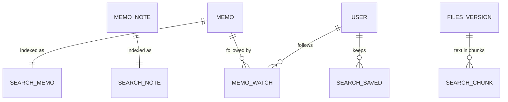

# E05 Inbox, search and dashboards — design

> Step 3 of `AGENTS.md §5`. Decision: ADR-0054 (search). Research: `research.md`. The screen flows for **search** (H) and the **team view** (I) go to the owner before their web tasks (overview §10 Q1 and §9); see `ux-review.md`.

## 1. Scope
- **In:**
  - **Search:** full-text search over memo metadata, the note sheet and the extracted text of documents and attachments, with filters (type, status, dates, unit, amount), sorted by relevance or newest, permission-filtered, audited and rate-limited; private saved searches.
  - **Inbox:** watching (follow a memo, a Watching tab, two-tier notifications); sorting by due time; non-decision bulk actions (watch, unwatch, claim, release, and reassign for those allowed).
  - **Team view** for unit heads and holders of `inbox.team.read`.
  - **Dashboards:** pending by person and unit with ageing, overdue, cycle time (median and P90) per memo type, throughput (created vs completed); scoped by the viewer's rights.
  - **Volume:** synthetic volume V1 (1,000,000 memos in one tenant, with history, notes and extracted text); Gatling search and inbox tests; `EXPLAIN` gates run as the application role.
- **Out:**
  - shared saved searches and search subscriptions (later);
  - OpenSearch (ADR-0054 triggers);
  - other languages (English only, §10 Q3);
  - bulk decisions (never; research R10).

## 2. Domain model

- **`search_memo`, `search_note`, `search_chunk` (search module):** derived rows, rebuilt from their sources (ADR-0054). The invariants:
  - every memo has exactly one `search_memo` row;
  - a chunk's rank is the effective classification of its file version (the higher of the file's and the memo's);
  - note and chunk rows carry their memo's rank, origin unit, status, type, creation date and amount, equal to the memo row's (`search_put_memo` updates them; ADR-0054 amendment);
  - a deleted or superseded file version leaves no chunks behind.
- **`search_saved` (search module; tables carry their module's prefix):** id, tenant, owner, name (1–100), criteria (jsonb: q, filters, sort; at most 4 KB), created and updated. Private to the owner, at most 50 per person. A saved search keeps criteria, never results.
- **`memo_watch` (memo module):** tenant, memo, user, reason (`MANUAL`, `INITIATED`, `ACTED`, `MENTIONED`), created. Unique per (memo, user). Auto-watch follows the person's preference (`notifications.autoWatch`, default on for memos they initiate or act on).

## 3. Search (ADR-0054)
- **API:** `GET /api/v1/search?q=&type=&status=&unit=&from=&to=&amountMin=&amountMax=&in=metadata,notes,documents&sort=relevance|newest&cursor=`
  - **Returns:** results (memo id, number, subject, type, status, unit, updated, a snippet with `<mark>` delimiters as data, "found in" flags), a count that is exact up to 2,000 and "2,000+" above it, facets (status, type, unit) counted on the same permitted set, and a cursor.
  - **Errors:** 422 (no words, query too long, too many terms, bad filter), 400 (malformed cursor or value), 429 (rate limit), 503 (`SEARCH_TIMEOUT`).
  - **Decided in T3:**
    - A search needs words: filters alone narrow a search, they do not list memos (the memo lists do that).
    - "Newest first" orders the same candidate set (the best 2,000 matches) by last update.
    - Results page by a keyset over that set (score or update time, then memo id), recomputed per request.
    - Snippets come as text parts with a `match` flag, never as HTML.
    - Search-as-you-type is audited like a search (`mode: suggest`).
    - A stale `If-Match` on a saved search is 412, as everywhere else.
  - **Search as you type** (the top-bar box): `GET /api/v1/search/suggest?q=` matches the last word as a prefix (3+ characters) over 200 candidates and returns at most 8 memos, without facets or count (E05 T1: the unit head's prefix search over 2,000 candidates was 307 ms at V1).
- **Function `search.find`:**
  - Its parameters are the tenant, the reader, the clearance rank, the unit scopes, the parsed query terms, the filters, the sort, the cursor and the limit.
  - The application computes the unit scopes from the policy, as `MemoReadable` does.
  - It runs the three branches (metadata, notes, readable chunks), each capped at 2,000 candidates. It filters each by the access rule and clearance, combines and ranks, and pages by a keyset (score, memo id). Snippets come from the page's rows only.
- **Indexing:**
  - **Metadata and notes:** listeners in the search module on `MemoChanged`, `MemoNotePosted` and the like (a memo-module event published in the same transaction) upsert rows in that transaction.
  - **Chunks:** a listener on `RenditionDone(TEXT)` (files) schedules the `search-chunks` tenant job. The job splits the text into chunks of at most 2,000 words (catching "string is too long" and splitting further) and replaces the version's chunks. Classification changes of an attachment update its chunks' rank.
  - **Backfill:** `search-backfill`, in pages of 1,000 memos per tenant, until done.
- **Saved searches:** `GET|POST /api/v1/saved-searches`, `PUT|DELETE /api/v1/saved-searches/{id}` (If-Match). Owner only.
- **Audit:** `search.performed` (terms, filters, sort, count, page ids) and `search.saved` / `search.updated` / `search.deleted`.

## 4. Inbox
- **Watching:**
  - `PUT /api/v1/memos/{id}/watch` and `DELETE …/watch` (readers only);
  - `GET /api/v1/inbox/watching?cursor=`;
  - the inbox gains a Watching tab.
  - **Auto-watch** for memos the person initiates or acts on, unless their preference turns it off. A watch is dropped when the person loses read access (checked on read; a nightly sweep removes stale rows).
- **Notifications (two tiers):**
  - **Needs you** (assigned, returned, mentioned, asked): immediate, and cannot be turned off (as today).
  - **Watching** (a step decided, a note added, the memo closed, its final record made): in the app at once, batched per memo with a 3-minute idle window. By email, a daily digest at 08:00 in the tenant's time zone by default; "immediate" and "off" are preferences.
  - No notification to the actor about their own action.
  - Every notification says why ("you follow this", "you approved step 2") and carries one-click Unwatch.
- **Sorting:** `GET /api/v1/inbox/tasks?sort=due|assigned`. By due: overdue first, then due soonest, then no due time; by assigned, as today.
- **Bulk:** `POST /api/v1/inbox/bulk` `{action: WATCH|UNWATCH|CLAIM|RELEASE|REASSIGN, ids, to?, reason?}`, at most 100 items; `ids` are memo ids for WATCH and UNWATCH and task ids for the others (T4).
  - Each item is checked as if acted on alone. The response gives a result per item (`OK`, `FORBIDDEN`, `CHANGED`, `NOT_FOUND`) and nothing is rolled back across items.
  - Reassign needs `workflow.tasks.reassign` (Phase 2), or a team head within their scope.
  - No decision is ever accepted in bulk.
- **Decided in T4:**
  - **Watch settings** live with the memo module, as `GET|PUT /api/v1/me/watch-settings` (`autoWatch`, `email`: `DIGEST|IMMEDIATE|OFF`), not in identity's preferences.
  - **In-app news:** `MEMO_WATCHED` in a new category `WATCHING`, with the memo's number, the count of news and why the person follows it.
  - **Emails:** `WATCH_UPDATE` (at once) and `WATCH_DIGEST` (the count of followed memos with news, and a link to the Watching tab), without subjects.
  - **Following status** of a memo is `GET /api/v1/memos/{id}/watch`.
  - **Bulk reassign** follows the administrators' reassignment: the permission and step-up, not read access to the memo.
  - **The access sweep** runs as each follower, so their own unit scopes count.

## 5. Team view
- **Who:**
  - a holder of a unit's head position sees that unit and its subtree;
  - a holder of `inbox.team.read` (scopable, granted on purpose) sees their grant's scope.
- **API:** `GET /api/v1/inbox/team?unit=&status=pending|overdue&person=&sort=due&cursor=`. It returns open tasks held by people seated in the scope, with the memo summary (subject and number only when the viewer may read the memo; otherwise "Restricted memo", as in the inbox), the holder, the due time and the age.
- **Actions:**
  - open the memo (if readable);
  - reassign (heads within scope, through the Phase 2 reassignment with a reason).

## 6. Dashboards
- **`GET /api/v1/dashboards/approvals?scope=me|unit:{id}&from=&to=` returns:**
  - pending by person and by unit, in ageing buckets (0–2, 3–5, 6–10, over 10 working days, by the business calendar);
  - overdue counts;
  - cycle time per memo type (median and P90, submit to final decision);
  - throughput per week (created vs completed).
- **Scope:**
  - **`me`:** anyone.
  - **`unit`:** heads (their subtree) and holders of `memo.dashboard.read` (scopable, granted on purpose).
  - Counts come from the server over memos the viewer may read, except "pending by person", which comes from tasks within the viewer's scope.
- **Links:** every figure links to the inbox, team view or search list behind it.
- **Data:** aggregates from indexed queries over `memo`, `workflow_task` and `workflow_instance` (the workflow's public `WorkflowTeamQueries`). No new tables at first. A nightly materialised summary is added only if V1 misses the budget.
- **Decided in T5:**
  - **Memo figures** (cycle time, throughput) count memos the viewer may read: for `me`, those they take part in; for a unit, those from the unit (origin) that they may read. Pending tasks count the people seated in the unit, whatever the memo.
  - **Cycle time** runs from the instance's start (submission) to its last update (the final decision) for approved or rejected memos decided in the period, in days, as median and P90 (nearest rank).
  - **Throughput** weeks start on Monday in the tenant's time zone. The default period is the last 12 weeks; at most a year.
  - **Team view filters:** `unit` narrows to that unit's subtree within the viewer's scope (403 outside it), `status=pending|overdue` and `person`; the answer lists the units overseen for the picker.
  - **Heads** reassign through bulk `REASSIGN` (step-up, with a reason): a task whose holder sits in their scope.
  - **Permissions:** `inbox.team.read` is privileged (it shows other people's work); `memo.dashboard.read` is not. Both are granted on purpose only.

## 7. API and authorisation matrix
| Endpoint | Rule |
|---|---|
| `GET /search` | signed in; results filtered by the access rule; rate-limited |
| `GET /search/suggest` | signed in; as `GET /search` (same rule, same rate limit) |
| `GET/POST/PUT/DELETE /saved-searches` | signed in; owner only (others 404) |
| `PUT/DELETE /memos/{id}/watch` | readers of the memo (others 404) |
| `GET /inbox/watching` | signed in (own) |
| `POST /inbox/bulk` | signed in; per item as alone |
| `GET /inbox/team` | heads within scope, or `inbox.team.read`; others 403 |
| `GET /dashboards/approvals` | `me`: signed in; `unit`: heads or `memo.dashboard.read` within scope; others 403 |

**New permissions:** `inbox.team.read` and `memo.dashboard.read`, both scopable and granted on purpose. Head positions give the same within their subtree, without a grant.

## 8. Audit events
- `search.performed`, `search.saved`, `search.updated`, `search.deleted`;
- `memo.watch.added` and `memo.watch.removed` (manual only; auto-watch is not audited);
- `inbox.bulk.performed` (action, count, results by code);
- team view and dashboard reads are not audited (they are lists; ADR-0019 audits sensitive reads only).

## 9. Performance budget
| Operation | Target at V1 (1,000,000 memos, one tenant) | How |
|---|---|---|
| Search, any reader profile | p95 < 300 ms | ADR-0054: GIN through the definer function, 2,000-candidate caps, page-only snippets |
| Saved-search list | p95 < 50 ms | index on owner |
| Inbox by due | p95 < 150 ms | index `(tenant_id, assignee_id, due_at)` on open tasks |
| Watching tab | p95 < 150 ms | `(tenant_id, user_id, created_at)` on `memo_watch` |
| Team view (a unit of 500 people) | p95 < 300 ms | open tasks by assignee in scope; the seat closure from org |
| Dashboard (unit scope, 12 weeks) | p95 < 800 ms | indexed aggregates; a summary table only if missed |
| Chunk indexing of 1 MB of text | < 5 s, in a job | chunked inserts, one transaction per file version |

## 10. Tenancy, RLS and migrations
- **`search/V1`** (new module `search`):
  - `search_memo`, `search_note`, `search_chunk` with RLS ENABLED but not FORCED, owned by the schema owner, with no grants to `memo_app`;
  - `saved_search` with RLS ENABLED and FORCED;
  - the search functions (`search_find`, `search_snippets` and the writers; SECURITY DEFINER, `search_path` pinned, EXECUTE to `memo_app` only);
  - B-tree indexes on `ref_norm` and `ref_tail` for numbers (no `pg_trgm`: the migration role cannot create extensions; ADR-0054 amendment);
  - `RlsMetaTest` gains a documented exception list for the three search tables.
- **`memo/V18`:** `memo_watch` (RLS ENABLED and FORCED); indexes for the due-time sort and the team view.
- **`identity`:** the notification preferences gain `autoWatch` and `watchEmail` (`DIGEST|IMMEDIATE|OFF`). Code only, if they live in the existing jsonb preferences.
- **Expand only.** The search tables fill by backfill.

## 11. Background work
| Job | Trigger | Retries and idempotency |
|---|---|---|
| `search-chunks` | TEXT rendition done; attachment reclassified | instance id = file version; replaces that version's chunks |
| `search-backfill` | start-up and daily, until done | pages by memo id; upserts |
| `watch-digest` | daily, 08:00 tenant time | one per tenant per day |
| `watch-sweep` | nightly | removes watches whose reader lost access |

## 12. UX (summary; details and wireframes in `ux-review.md`)
- **H. Search:**
  - one box in the top bar and a Search page;
  - filters in a panel, with chips and Clear;
  - results with snippets and a "found in" note;
  - the count announced politely;
  - filters kept in the URL;
  - "Save this search", and saved searches in the menu.
- **I. Team view:** a Team tab for heads, by due time: overdue first, filters by person and status, reassign within scope.
- **J. Watching and bulk:** a Follow toggle on the memo, a Watching tab, checkboxes with a bulk bar (Watch, Unwatch, Claim, Release, Reassign), and results per item.
- **K. Dashboards:** an Approvals dashboard with a scope picker. Each chart sits in a `<figure>` with a summary and a data table, and every figure links to its list.
