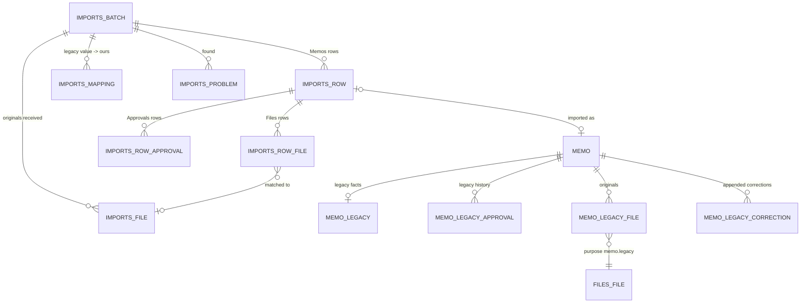
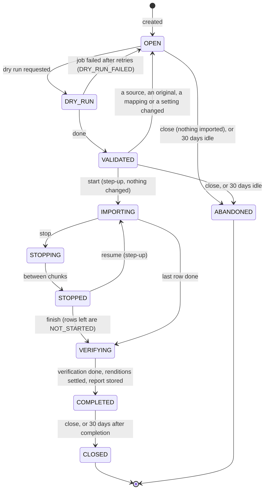
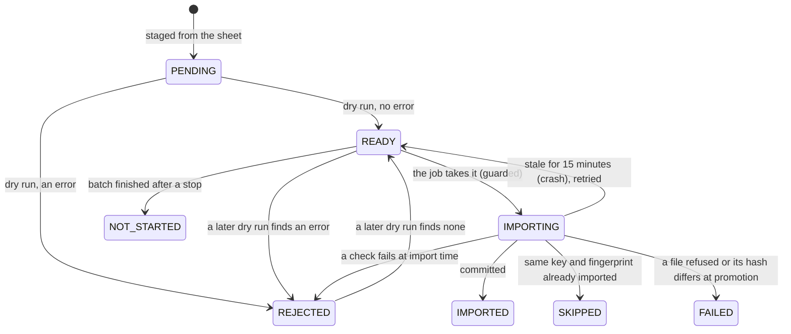

# E06 Legacy import — design

> Step 3 of `AGENTS.md §5`. Decision: ADR-0055 (legacy import). Research: `research.md` (R11, R1). The owner reviews only the screen flows of E01, E03 and E05 (overview §10 Q1), so E06 has **no owner gate**: `ux-review.md` shows the flows for information, and the choices made under the delegation are listed there and in §17.

## 1. Scope
- **In:**
  - **Batches:** a tenant admin with `memo.import` creates a batch, uploads the metadata (an XLSX workbook or CSV files) and the originals (a folder, one file at a time), maps legacy values, runs a dry run, starts the import with a step-up, follows its progress, and downloads the reconciliation report.
  - **Imported memos:** a final-state memo with `origin = IMPORTED`, its legacy number as its reference, its legacy facts and approval history as given, its originals as records with PDF and text renditions, readable by linked people, unit readers and later shares.
  - **Across the product:** the memo view's legacy sections, an Imported filter in search, exclusion from dashboards' throughput, auto-close, the final-record backfill and the initiator's boxes; the weekly fixity job over imported originals; appended corrections and classification raises.
  - **A synthetic legacy sample** (workbook and folder) in the demo generators, for tests, the demo and E07.
- **Out:**
  - a command-line uploader (the path for volumes the browser cannot carry; not built);
  - server-side archive extraction or a drop folder (never; ADR-0055);
  - importing in-flight legacy memos (refused; ADR-0055);
  - per-file classification raises after import, and note-sheet comments on imported memos (carried);
  - OCR of scans (no OCR anywhere; ADR-0045);
  - a customer's own legacy sample (no pilot, §10 Q2; E07 imports a representative one).

## 2. Modules
- **`imports` (new module, package `com.memo.imports`):** batches, staging, parsing, mappings, the dry run, the import job, verification and the report. Tables `imports_*`, migrations `db/migration/imports/`. It depends on `memo`, `files`, `org`, `identity`, `authz` (through `common.authz`) and `audit`. Nothing depends on it.
- **`memo`:** what an imported memo is. It publishes **`LegacyMemos`** (check a row, create an imported memo in the caller's transaction, look up an existing import, describe the live number series) and **`ReportPages`** (draws a simple report through ADR-0052's `PageRenderer`, which stays internal). It owns the purpose `memo.legacy`.
- **`files`:** legacy formats for two purposes, `copyFrom` (promotion through the pipeline with an expected hash), purging of ordinary staged versions, a per-purpose upload rate limit, and a count of pending renditions by purpose.
- **`search`:** an `origin` column and filter; `initiator_id` becomes nullable.
- **Events:**
  - **Consumed by `imports`:** `FileVersionCreated` for `imports.source` and `imports.intake` (binds a stored file to its batch).
  - **Published by `memo`:** the existing `MemoChanged` and `MemoFileChanged` when an imported memo is created or corrected, so search indexes it in the same transaction (ADR-0054). No workflow event, so no watch or notification fires.

## 3. Domain model

### 3.1 Memo module (`memo/V19__legacy.sql`)
- **`memo` changes:**
  - `origin text NOT NULL DEFAULT 'NATIVE' CHECK (origin IN ('NATIVE', 'IMPORTED'))`.
  - `initiator_id` becomes nullable, with `memo_initiator_native CHECK (origin = 'IMPORTED' OR initiator_id IS NOT NULL)`.
  - V1's unnamed CHECK `(status IN ('DRAFT', 'DISCARDED')) = (workflow_instance_id IS NULL)` is replaced by `memo_workflow_by_status CHECK (origin = 'IMPORTED' OR …)`. The migration looks the old constraint up by its definition in `pg_constraint`, because V1 did not name it.
  - `memo_imported_shape CHECK (origin = 'NATIVE' OR (status IN ('APPROVED', 'REJECTED', 'WITHDRAWN', 'CANCELLED', 'CLOSED') AND workflow_instance_id IS NULL AND current_round = 0 AND reference IS NOT NULL AND number_series IS NULL AND document_file_id IS NULL AND approved_at IS NULL AND memo_type_version_id IS NOT NULL))`.
  - V9's `memo_closed_at` CHECK still holds: an imported CLOSED memo has `closed_at` (the legacy closing date, see below).
  - **Trigger `memo_imported_guard`** (BEFORE UPDATE): `origin` never changes. On an imported memo only `subject` (a correction), `classification_id` and `classification_rank` (raised only), `updated_at` and `version` may change. The existing `memo_number_guard` and `memo_pinned_guard` already keep the reference, type and metadata.
  - Partial index `memo_tenant_imported_idx (tenant_id, created_at) WHERE origin = 'IMPORTED'`.
- **`memo_legacy`** (one row per imported memo; append-only):
  - `tenant_id`, `memo_id` (primary key with the tenant), `batch_id`, `row_number`;
  - `source_code` (`^[A-Z0-9][A-Z0-9-]{0,19}$`), `legacy_number` (as given, 1–100), `legacy_number_key` (normalised: trimmed, inner spaces collapsed, NFC, upper case);
  - `row_fingerprint bytea` (32 bytes), `time_zone` (IANA name);
  - `raised_on date NOT NULL`, `decided_on date`, `closed_on date`;
  - as given: `legacy_status`, `legacy_type`, `legacy_classification`, `legacy_unit` (each at most 200), `subject_as_given` (1–300);
  - `initiator_name` (1–200), `initiator_email`, `initiator_legacy_id` (at most 100), `initiator_user_id` (null unless linked);
  - `imported_at`, `imported_by` (who started the batch);
  - `UNIQUE (tenant_id, source_code, legacy_number_key)`: the row key; index `(tenant_id, batch_id)`.
- **`memo_legacy_approval`** (append-only): `tenant_id`, `memo_id`, `ordinal` (1–50), `name` (1–200), `email`, `legacy_id`, `user_id` (null unless linked), `position_text` (at most 200), `decision` (as given, 1–100), `decided_on date`, `remark` (at most 4,000). Primary key `(tenant_id, memo_id, ordinal)`.
- **`memo_legacy_file`** (append-only): `id`, `tenant_id`, `memo_id`, `file_id` (purpose `memo.legacy`), `role` (`MAIN` or `ATTACHMENT`), `position`, `title` (1–255), `relative_path` (1–1,024), `classification_id` and `classification_rank` (null: the memo's level; set: strictly above it), `sha256 bytea`, `size_bytes`. `UNIQUE (tenant_id, file_id)`; one MAIN per memo (partial unique index); index `(tenant_id, memo_id, position)`.
- **`memo_legacy_correction`** (append-only): `id`, `tenant_id`, `memo_id`, `field` (`SUBJECT`, `RAISED_ON`, `DECIDED_ON`, `CLOSED_ON`, `INITIATOR_NAME`, `LEGACY_UNIT`, `LEGACY_TYPE`, `CLASSIFICATION`), `value_before`, `value_after` (each at most 300), `reason` (1–500), `corrected_by`, `corrected_at`. Index `(tenant_id, memo_id, corrected_at)`.
- **Append-only:** `REVOKE UPDATE, DELETE, TRUNCATE` on the four legacy tables from `memo_app`.
- **Invariants:**
  1. An imported memo is in a final state, has a reference, no number series, no workflow instance, no document file, no final record and no `approved_at`.
  2. Its legacy facts, approvals and originals never change; a correction is a new row, and only the subject and the classification of the memo row follow it.
  3. A linked person (`*_user_id`) was linked by an explicit identifier confirmed in the batch's people mapping (§6.4); the importer is never written as a person.
  4. Exactly one MAIN original; a file's rank is at least the memo's.
  5. `(source_code, legacy_number_key)` is unique in the tenant.
- **Dates on the memo row:**
  - `created_at` and `updated_at` are the import time (TNA: never reset dates silently; the legacy dates are kept as given in `memo_legacy`).
  - `closed_at` (CLOSED only) is the start of `closed_on` in the batch's time zone, because V9's CHECK needs it. The view shows the legacy date, never this instant.
  - `approved_at` stays null, so auto-close (`MemoClosing.due`) and E04's backfill never see imported memos (they also filter on `origin`).
- **As built (T3):**
  - `memo_imported_guard` compares the whole row as JSON less `subject`, `classification_id`, `classification_rank`, `updated_at` and `version`, so a column added later is locked too; a lower rank is refused.
  - The three child tables reference `memo_legacy` (not `memo`): approvals, originals and corrections exist only beside legacy facts. `memo_legacy_file` has `UNIQUE (tenant_id, memo_id, position)` and `size_bytes > 0` (`FILE_EMPTY` rows are never imported).
  - Optional legacy values that are blank are stored as null; emails are 1–320 characters (the service does not judge their form).
  - `LegacyMemos` (package `com.memo.memo`) takes a `LegacyMemoRow` (`source`, `given`, `mapped`, `dates`, `initiator`, `approvals`, `originals`) and answers `LegacyProblem(code, field)`. `create` checks again, requires each original to be a `memo.legacy` file owned by the memo with a current version (`FILE_NOT_RECEIVED` otherwise), and turns a lost race on the row key or the reference into `ALREADY_IMPORTED` or `NUMBER_IN_USE`. Codes beyond §9: `PERSON_UNKNOWN` (a linked id that is no user of the tenant) and `VALUE_INVALID` (an approval order below 1).
  - `series()` returns `LiveSeries` with `mayStillGive(number)`: the period and counter logic of §5.2 stays in the memo module, and T6 only calls it. A unit code no unit has yet counts as a counter at zero.
  - A unit is "current" when it exists: the org directory has no open or closed state for units.

### 3.2 Imports module (`imports/V1__imports.sql`)
- **`imports_batch`:**
  - `id`, `tenant_id`, `name` (1–200), `source_code`, `time_zone`, `default_classification_id` (optional), `number_prefix` (optional, at most 20, `^[A-Za-z0-9][A-Za-z0-9/._-]{0,19}$`);
  - `state` (§4), `version` (optimistic lock), `created_by`, `created_at`, `updated_at`;
  - sources: `source_kind` (`XLSX` or `CSV`), and for each table (`WORKBOOK`, `MEMOS`, `FILES`, `APPROVALS`) the staged `…_file_id` and `…_version_id`;
  - `input_hash bytea` (§5.2) and `dry_run_hash`, `dry_run_at`;
  - `started_by`, `started_at`, `step_up_at`, `finished_at`, `completed_at`, `closed_at`, `close_reason`;
  - `max_rank` (highest level written), `totals jsonb` (the report's counts, at most 16 KB), `report jsonb` (file and version ids and SHA-256s of the report parts, `balanced`).
  - Partial unique index `imports_batch_one_running (tenant_id) WHERE state IN ('IMPORTING', 'STOPPING', 'VERIFYING')`: one running import per tenant.
- **`imports_file`** (an original received): `id`, `tenant_id`, `batch_id`, `path` (NFC, `/` separators, 1–1,024 characters, at most 32 segments), `path_fold` (case-folded, for the case-insensitive match), `size_bytes`, `state` (`EXPECTED`, `RECEIVED`, `REFUSED`, `PURGED`), `file_id`, `version_id`, `sha256`, `media_type`, `refusal` (the pipeline's reason code), `received_at`. `UNIQUE (tenant_id, batch_id, path)`; indexes `(tenant_id, batch_id, path_fold)` and `(tenant_id, batch_id, state, path)`.
- **`imports_row`** (a Memos row): `id`, `tenant_id`, `batch_id`, `row_number`, `legacy_number`, `legacy_number_key`, `data jsonb` (the canonical values as strings, at most 256 KB), `fingerprint bytea`, `result` (§4.2), `memo_id` (assigned when the import starts; UUIDv7), `errors`, `warnings`, `attempts`, `updated_at`. `UNIQUE (tenant_id, batch_id, row_number)`; indexes `(tenant_id, batch_id, legacy_number_key)` and `(tenant_id, batch_id, result, row_number)`.
- **`imports_row_file`** (a Files row): `id`, `tenant_id`, `batch_id`, `row_number`, `legacy_number_key`, `path`, `role`, `title`, `expected_sha256`, `classification` (as given), `row_id`, `file_id` (the matched `imports_file`), `match` (`EXACT`, `CASE`, `NONE`, `AMBIGUOUS`). Indexes `(tenant_id, batch_id, legacy_number_key)` and `(tenant_id, row_id)`.
- **`imports_row_approval`** (an Approvals row): `tenant_id`, `batch_id`, `row_number`, `legacy_number_key`, `ordinal`, `name`, `email`, `legacy_id`, `position`, `decision`, `decided_on` (as given), `remark`, `row_id`. Index `(tenant_id, row_id, ordinal)`.
- **`imports_mapping`:** `tenant_id`, `batch_id`, `kind` (`STATUS`, `TYPE`, `CLASSIFICATION`, `UNIT`, `PERSON`), `legacy_value` (1–500), `legacy_order` (CLASSIFICATION only), `target` (a status name or an id), `proposed` (boolean), `confirmed_by`, `confirmed_at`, `row_count`. Primary key `(tenant_id, batch_id, kind, legacy_value)`.
- **`imports_problem`:** `id`, `tenant_id`, `batch_id`, `stage` (`DRY_RUN`, `IMPORT`, `VERIFY`), `level` (`BATCH`, `ERROR`, `WARNING`, `FILE`, `INFO`), `code`, `sheet` (`MEMOS`, `FILES`, `APPROVALS`, `ORIGINALS`, `BATCH`), `row_number`, `column_name`, `row_id`, `file_id`, `params jsonb` (at most 2 KB; values, never subjects). Index `(tenant_id, batch_id, level, code, id)`.
- No foreign keys to other modules' tables (each module migrates alone, ADR-0007); ids are checked by the services. Staging rows are kept after the batch closes (they are small and part of the chain of custody); only the staged **objects** are purged.
- **As built (T7)** (`imports/V2__import_run.sql`, expand only): `imports_batch.throttled_at` (since when the job waits for renditions) and `imports_row_file.stored_file_id` and `stored_version_id` (the original as promoted into `memo.legacy`, set as soon as it is stored).
- **As built (T8)** (`imports/V3__report.sql`, expand only): `imports_batch.verified_at` and `verification` (the verification's counts, at most 4 KB; both or neither), `imports_batch.purged_at` (every staged object of a CLOSED or ABANDONED batch purged; a CHECK allows it only in those states), and the index `imports_file_version_idx (tenant_id, version_id)`, by which a purged version marks its original PURGED.
- **As built (T5):**
  - `imports/V1` creates every table above, so T6–T8 add no migration for them. The staging tables keep the sheets' values as text (`imports_row_approval.ordinal` and `decided_on` too); T6 parses them.
  - **`imports_staged`** (new): every staged version a batch was given, source or original, with `superseded_at` (a later upload took its place) and `purged_at`, so that a replaced copy is purged too and T8's sweep finds everything to purge in one table.
  - `imports_file` gains `refusal_signature` (the scanner's signature, for the report) and `registered_at`; `path_fold` may be up to 4,096 characters (case folding lengthens some strings: "ß" folds to "ss").
  - `memo_app` cannot delete batches, originals or staged versions. Staging rows (rows, Files and Approvals rows, mappings, problems) stay deletable, because each dry run replaces them.

### 3.3 Files module (`files/V4__purge.sql`)
- `files_version.purged_at timestamptz` and `purged_by`: the object is deleted from the `work` bucket, the row and its hash stay. A purged version answers 410 to downloads.
- Allowed only for ORDINARY purposes that declare `purgeable` (only `imports.intake` and `imports.source`); record versions can never be purged (CHECK in code and an architecture test; the bucket's object lock refuses anyway).
- **As built (T2):**
  - `FilePurges.purge(versionId)` marks the version and audits `file.version.purged` in one transaction, then deletes the object. A repeat answers false and deletes the object again, so a crash in between leaves nothing behind.
  - The database holds the rule too: a CHECK (`purged_at` only on `work`, unlocked versions) and the `files_version` guard, which now lets `purged_at` and `purged_by` be set once and nothing else change with them.
  - A purgeable purpose may have no renditions (their objects would stay behind); the start-up check refuses it.
  - Downloads of a purged version answer 410 with `reason: PURGED`; `copyFrom` refuses it. `FileVersionInfo.purgedAt` tells owning modules.

### 3.4 Search module (`search/V3__origin.sql`)
- `search_memo`, `search_note` and `search_chunk` gain `origin text NOT NULL DEFAULT 'NATIVE'` (each part filters on its own table, per ADR-0054's "one table per part").
- `search_memo.initiator_id` becomes nullable.
- `search_put_memo` takes `p_origin`; `search_find` and `search_find_sql` take `p_origin text[]` (null: both). The functions are replaced in the same migration, keeping `search_path`, owner and grants; `RlsMetaTest`'s exception list does not change.
- **As built (T4):**
  - The new parameters come **last, with defaults** (`search_put_memo(…, p_origin text DEFAULT 'NATIVE')`, `search_find(…, p_origins text[] DEFAULT NULL)`), so an application one release older still resolves its calls while a release rolls out. `search_find` and `search_put_memo` are dropped and created (a new argument, and `search_find` returns `origin` as a new last column); `search_put_note`, `search_put_chunks` and `search_find_sql` are replaced in place; `search_keep` gets `s_origin` and `p_origins` (a new overload, the old one dropped). `search_find_sql` takes the origins as `$22`; an empty array counts as null.
  - The three `origin` CHECKs are added `NOT VALID`: existing rows all hold the default, new rows are checked, and validating would read every chunk under the lock.
  - `search_put_memo` now also updates `created_at` on conflict, because a corrected raised-on date moves an imported memo's date (notes and chunks already followed it).
  - The access rule is unchanged; `SearchEquivalenceIT` now mixes imported memos (final, pinned, no initiator) and random origin filters into its cases, and the `EXPLAIN` gate prepares `$22` and checks that an origin filter never adds a sequential scan.

## 4. Lifecycles
### 4.1 Batch

- **Forbidden:** any change to sources, originals, mappings or settings outside OPEN and VALIDATED (409 `WRONG_STATE`); a start from anything but VALIDATED; a second batch entering IMPORTING, STOPPING or VERIFYING in the tenant (`ANOTHER_IMPORT_RUNNING`, backed by the partial unique index); leaving CLOSED or ABANDONED; closing while DRY_RUN, IMPORTING, STOPPING or VERIFYING.
- Every transition is a guarded update on `(id, state, version)` (AGENTS §4); 0 rows is a conflict.
- **As built (T7):** VALIDATED → IMPORTING is guarded on the version too (the `If-Match`); IMPORTING → STOPPING, STOPPING → STOPPED, STOPPED → IMPORTING, STOPPED → VERIFYING and IMPORTING → VERIFYING on the state, each on the locked batch row. Entering IMPORTING or VERIFYING checks for another running batch first and maps the partial unique index's refusal to `ANOTHER_IMPORT_RUNNING`; STOPPED does not hold the slot, so resuming or finishing can be refused while another batch runs.
- **At most 5 batches** per tenant may be in a state other than CLOSED or ABANDONED (`TOO_MANY_BATCHES`).
- **As built (T8):** closing and abandoning are two endpoints (§10): `close` moves COMPLETED → CLOSED and needs a reason; `abandon` moves OPEN or VALIDATED → ABANDONED (the reason is optional) and turns the rows the import never reached (READY, or PENDING) NOT_STARTED. Every other state refuses both with 409 `WRONG_STATE`; a STOPPED batch is finished first (its rows may be imported already, so it cannot be abandoned). Both are guarded on the locked batch's state, set `closed_at` and `close_reason`, and schedule the purge of the staged objects (§15). VERIFYING → COMPLETED is guarded on the state and on `verified_at`. The sweep closes and abandons as `System("legacy-import")` with a reason of its own, and only a batch whose version and state are still those it read.

### 4.2 Row

- **Final:** IMPORTED, SKIPPED, REJECTED (once the import started), FAILED, NOT_STARTED. A row is imported at most once (the guarded update, the unique row key and the promotion idempotency keys).
- **A dry run never moves a row to IMPORTING**, and an import never re-runs a REJECTED row of the same batch: it goes into a later batch after fixing, where the key makes that safe.
- **As built (T7):** a row taken by the job carries its attempt number, and every change from IMPORTING is guarded on it. Rows IMPORTING for 15 minutes go back to READY, or to FAILED once they had 3 attempts. Finishing a stopped batch makes READY rows and rows held by no job NOT_STARTED. A row the import settles REJECTED or FAILED records its problems with stage IMPORT.

### 4.3 Original received
`EXPECTED` (path registered) → `RECEIVED` (stored by the pipeline) or `REFUSED` (the pipeline's reason: `MALWARE`, `TYPE_NOT_ALLOWED`, `TYPE_MISMATCH`, `ENCRYPTED`, `TOO_LARGE`, `MALFORMED`, `LIMIT_EXCEEDED`) → `PURGED` (staged object deleted). A RECEIVED file can be replaced by uploading the same path again while the batch is OPEN or VALIDATED (it then returns to OPEN); the earlier staged version is purged.
- **As built (T5):**
  - An entry takes an upload while it is EXPECTED, RECEIVED **or REFUSED** (the resume lists REFUSED paths so they can be sent again once fixed) and its batch is OPEN or VALIDATED; a PURGED one never.
  - A refusal of an entry that was RECEIVED makes it REFUSED and supersedes its earlier version: the entry always says what the last upload of that path gave.
  - A replaced version (a source uploaded again, the other kind of source, an original sent again) is marked superseded in `imports_staged`; `StagedPurges.purgeSuperseded(batchId)` purges such versions in pages of 500. No job runs it yet: T8's hourly sweep will, for every open batch. (A T5 job would also run in test contexts without object storage, which share the scheduler table.)
  - VALIDATED goes back to OPEN when a source is attached, an original is received, or a refusal replaces a received original. Registering paths changes nothing a dry run reads (only received originals count), so it keeps the state.

## 5. Stages
### 5.1 Intake
- **Sources:** `POST /api/v1/files?purpose=imports.source&owner={batchId}:{table}` with `table` one of `WORKBOOK`, `MEMOS`, `FILES`, `APPROVALS`. A WORKBOOK clears any CSV sources and the reverse. The `FileVersionCreated` listener binds the version to the batch (in the upload's transaction) and moves a VALIDATED batch back to OPEN.
- **Originals:**
  1. The client lists the chosen folder, drops system files (`.DS_Store`, `Thumbs.db`, `desktop.ini`, names starting `~$`; counted as skipped) and normalises each relative path (NFC, `/`).
  2. It registers paths in groups of at most 1,000: `POST /api/v1/admin/imports/{id}/files` `{files: [{path, size}]}`. The answer gives each path's intake id and state. New paths are EXPECTED; known paths keep their state.
  3. It uploads each EXPECTED file, three at a time: `POST /api/v1/files?purpose=imports.intake&owner={intakeId}` with `Idempotency-Key: imp-{intakeId}-{size}`.
  4. The listener marks the entry RECEIVED with the version, SHA-256 and detected type; a pipeline refusal marks it REFUSED with the reason (the imports module listens to `file.upload.rejected` through a files event `FileUploadRejected(tenantId, purposeKey, ownerId, fileId, idempotencyKey, reasonCode, signatureName)`, added in T2). The event is published in the transaction that audits the refusal. It is not published for `SCAN_UNAVAILABLE` (scanner or Tika server down): that refuses nothing, and the client uploads again. (Named `FileUploadRejected` because the files module's internal exception is already `UploadRejected`.)
- **Path rules** (server; the client applies the same): no empty segment, `.` or `..`, no leading `/`, no `\` (converted by the client), no control or format characters, at most 1,024 characters and 32 segments (`PATH_INVALID`). Two paths equal after NFC are one path (`PATH_DUPLICATE`). Paths that differ only in case are both kept and flagged (`PATH_CASE_ONLY`, a warning, as BagIt advises).
- **Resume:** after a reload or on another day, the admin picks the same folder; the client lists `GET …/files?state=EXPECTED,REFUSED` (pages of 5,000) and uploads only paths the server does not hold at the same size. A path held at another size is uploaded again (replacing it).
- **Rate limit:** uploads of purpose `imports.intake` use their own bucket, `IMPORT_INTAKE_PER_USER` (600 a minute), instead of `UPLOAD_PER_USER` (30 a minute, which would take 14 hours for 25,000 files). The per-node upload semaphore (8) still applies. A purpose chooses its limit with `FilePurpose.uploadRateLimit` (one of the two, checked at start-up; T2).
- **Legacy formats (T2):** for a purpose with `acceptsLegacyFormats`, an OLE2 container is typed by the Tika server's `PUT /detect` after clamd has scanned it. Word, Excel and PowerPoint are allowed. Anything else is `TYPE_NOT_ALLOWED` (an Outlook message), and encrypted OOXML in its OLE2 wrapper is `ENCRYPTED`. If no Tika server is configured, or it cannot answer, the upload is refused as `SCAN_UNAVAILABLE` (503 with `Retry-After`; no new reason code, because the web already handles that one). Old Office types that the in-process magic names without an OLE2 container (Word for DOS and similar) are refused everywhere: only the server names a .doc, .xls or .ppt. RTF and TIFF are recognised in process.
- **As built (T5):**
  - The source owner is `{batchId}:{TABLE}` with the table in capitals (`WORKBOOK`, `MEMOS`, `FILES`, `APPROVALS`). The listeners lock the batch row, so a binding and a later start cannot interleave, and veto the upload when the batch left OPEN and VALIDATED meanwhile.
  - Registration answers each path's entry in the order given. A known path keeps its state **and its size**: the entry's size is the registered one until a version is stored, then the stored one, so the client compares sizes to decide what to send again. Sizes are 0 or more; the limits count registered sizes (200,000 entries, 200 GiB). 422 entries: `files[i].path` `PATH_INVALID` or `PATH_DUPLICATE`, `files[i].size` `SIZE_INVALID`, `files` `COUNT` (not 1–1,000) or `LIMIT_EXCEEDED`; the call is refused as a whole.
  - Registering new paths is audited as `import.originals.registered` (counts and bytes; §12 named no event for it, and it changes the batch).
  - `PathRules` also refuses line and paragraph separators, lone surrogates and unassigned code points; a valid path normalises to itself (a property test and a fuzz target).

### 5.2 Dry run
Requested with `POST …/dry-run`; runs as the `imports-dry-run` job in four steps, each resumable:
1. **Stage** (write transactions on staging tables only): parse the sources (§7) into `imports_row`, `imports_row_file` and `imports_row_approval`, replacing the previous dry run's staging rows. Batch-level problems (§9) stop here.
2. **Group and match** (staging only): attach Files and Approvals rows to their Memos row by `legacy_number_key`; match each Files row's path to an `imports_file`: exact NFC match, else a unique case-insensitive match (`PATH_CASE_MATCH` warning), else `AMBIGUOUS` or `NONE`.
3. **Propose mappings** (staging only): collect the distinct legacy values per kind with their counts; add new ones with a proposal (§6.4); keep confirmed ones.
4. **Validate**, in chunks of 500 rows, each in a `readInTenant` transaction, which PostgreSQL holds read-only (the T1 spike: pgjdbc begins it `READ ONLY`, and a write fails with SQLSTATE 25006; a test keeps it so). The validators are the import's own (`LegacyMemos.check` plus the imports module's row rules, §9). Each chunk's results (row states and problems) are written afterwards in a separate write transaction on staging tables.
- **Input hash:** SHA-256 over the source versions and their hashes, the RECEIVED originals (path and SHA-256, in path order), the mappings (kind, value, order, target) and the settings. Stored as `dry_run_hash` when the dry run starts. A start is refused unless the batch is VALIDATED, which no change since the dry run allows.
- **Cross-row checks** run as set-based queries over the staging rows: duplicate legacy numbers in the batch, legacy numbers that equal an existing reference (`memo.reference`, after the batch prefix), numbers that differ from another only in case or separators (`NUMBER_SIMILAR`, a warning, because search's `ref_norm` would find both), and the same file content referenced by two rows (`FILE_SHARED`, a warning).
- **Live series check:** `LegacyMemos.series()` gives each published type version's number format as a pattern (TEXT and TYPE_CODE literal, UNIT_CODE as a unit code, YEAR, FINANCIAL_YEAR, SEQUENCE as digits). A legacy number (with the prefix) that matches a pattern **and** whose period is the current or a later one (or the series never resets) **and** whose sequence is above that period's counter is `NUMBER_IN_LIVE_SERIES`: a native memo could later take it. Older periods cannot be produced again; the unique reference index stays the last guard.
- **Clearance:** the dry run records the highest level the READY rows and their files would write (`max_rank`). The start is refused if the importer is not cleared to it (`IMPORTER_NOT_CLEARED`).
- **Nothing else is written.** A test runs a dry run and compares every business table's row count and a checksum before and after; another writes inside the validation transaction and expects SQLSTATE 25006.
- **As built (T6)** (`com.memo.imports.internal.dryrun`, `ImportDryRuns`):
  - **Request:** `POST …/dry-run` locks the batch; DRY_RUN answers 202 as it is (one dry run at a time); anything but OPEN or VALIDATED is 409 `WRONG_STATE`; a batch without a workbook, or without the Memos and Files CSV files, is 409 `SOURCE_MISSING`. OPEN or VALIDATED → DRY_RUN is a guarded update, audited `import.dry_run.requested`, and the job is scheduled with the instance id `{batchId}:{version}` (one per request, so a finished request never blocks the next).
  - **Steps are not resumable one by one:** a retried attempt starts again from staging, which replaces the batch's staging rows and problems wholesale, so a retry is idempotent. The dry run's budget (5 minutes at 10,000 memos) did not justify checkpoints.
  - **Stage:** rows go in a thousand at a time; a staging write that fails is rethrown for the job's retry, not reported as a `MALFORMED` source. Cell findings (`NUMBER_NOT_TEXT`, `FORMULA_CACHED`, `FORMULA_NO_VALUE`) are kept in memory by sheet and row and charged to the Memos row their Files or Approvals row belongs to. A Memos row whose values exceed 100,000 characters together is staged with each long value cut to 1,000 and `VALUE_TOO_LONG`. A batch problem, or a `field:<key>` column no active type has (`COLUMN_UNKNOWN`, left over from T5), clears the staged rows: only the problems remain, and the batch is OPEN.
  - **Group:** Files and Approvals rows join the first Memos row with their legacy number key; those without one are `ORPHAN_ROW` (ERROR on that row, rejecting nothing).
  - **Match:** a Files row's path is read with `\` as `/` and NFC-normalised, then matched against every registered original (not only received ones): the same path, else the one original with the same case-folded path (`CASE`), else `AMBIGUOUS` (several) or `NONE`. The original's state then decides: EXPECTED, PURGED or no match `FILE_NOT_RECEIVED`, REFUSED `FILE_REFUSED` with the reason, size 0 `FILE_EMPTY`, a given SHA-256 that differs `FILE_HASH_MISMATCH` (one that is not 64 hex digits `VALUE_INVALID`).
  - **Originals no row uses** are FILE problems on the sheet `ORIGINALS`: `FILE_UNREFERENCED`, or `FILE_REFUSED` for a refused one; registered paths that differ only in case are `PATH_CASE_ONLY`.
  - **Validate:** `DryRunValidator` reads the batch, mappings, levels, live series and the cross-row sets once, then each chunk of 500 rows in a `readInTenant` transaction and writes the chunk's results in a separate write transaction. It checks `transaction_read_only` itself and refuses to validate in a transaction that could write (it would otherwise join a caller's). Values that are unmapped stand in as ids no tenant has (a WITHDRAWN status, which needs no dates), so `LegacyMemos.check` adds nothing about what the imports module already reported; a check problem on a cell that already has an imports error is dropped. Check problems are placed in the sheets: an original's on its Files row, an approval's on its Approvals row, the rest on the Memos row.
  - **Codes beyond §9:** `VALUE_INVALID` for a Files role other than MAIN or ATTACHMENT, a malformed SHA-256 and an approval order that is not a whole number; `VALUE_REQUIRED` for a blank legacy number, raised-on date, role or path. An earlier import of the row key with the same fingerprint is INFO `ALREADY_IMPORTED` (the row stays READY: T7 skips it); with another fingerprint it is ERROR `ALREADY_IMPORTED_CHANGED`. Either way `NUMBER_IN_USE` is not reported for it, since the reference is that memo's.
  - **The live series** is checked on the reference (the prefix and the legacy number), against every published version's `LiveSeries.mayStillGive`; the problem's params name the series' format.
  - **The fingerprint** is SHA-256 over the Memos row's values (by column), its Approvals rows' values and its Files rows' values with the received originals' SHA-256 (in row order). Row numbers are left out, so moving a row changes nothing. It is stored in `imports_row.fingerprint`; the mapped memo's highest rank (its level or a stricter original's) goes in `imports_row.data.rank`, and `max_rank` is the highest over READY rows.
  - **Per row** at most 20 problems are kept (errors first), while `errors` and `warnings` count them all; past 250,000 problems a batch problem `TOO_MANY_PROBLEMS` is recorded and the batch stays OPEN.
  - **Outcome:** VALIDATED when no BATCH problem was found (rejected rows do not block: they are simply not imported), otherwise OPEN. The input hash is taken after the proposals (it covers the mappings the validation read) and stored as `dry_run_hash`; it is taken again when the dry run ends and stored as `input_hash`; if they differ the batch is OPEN. `totals` holds the rows by result and the problems by level. Audited `import.dry_run.finished` (state, rows by result, problems by level, input hash, `max_rank`) by `System("legacy-import")`.
  - **Failure:** the task has three attempts (`Jobs.tenantTaskCounting` tells the handler how many failed before); the last failure clears the staging rows, records the BATCH problem `DRY_RUN_FAILED` and moves DRY_RUN → OPEN, audited as finished with `failed`.
  - **Staleness** is the state: a settings change, a source attached, an original received or refused after being received (T5) and a mapping saved (T6) each move VALIDATED → OPEN with a new version; nothing can change while the batch is DRY_RUN (every change needs OPEN or VALIDATED).
  - **Not done:** an encrypted PowerPoint original cannot be reported `UNREADABLE` by the dry run as ADR-0055's amendment says: intake versions have no renditions (a purgeable purpose may have none, T2), so nothing reads the file before promotion. T7 meets it when the promoted original's renditions fail.

### 5.3 Import
- **Start:** `POST …/start` (step-up, `If-Match`, `{expectedRows}`): VALIDATED → IMPORTING; `expectedRows` must equal the READY count the screen showed (409 `ROWS_CHANGED` otherwise). Each READY row gets its `memo_id` (UUIDv7). Audited `import.batch.started`.
- **The job** `imports-run` (tenant one-off, instance id `{batchId}`, actor `System("legacy-import")`) takes READY rows in chunks of 50 in row order, then reschedules itself:
  1. **Throttle:** if 200 or more renditions of purpose `memo.legacy` are PENDING in the tenant (`FileRenditions.pendingCount(purposeKey, atMost)`, a count that stops at `atMost`), reschedule in 30 seconds. Live users' conversions are not stuck behind a migration.
  2. **Stop:** if the batch is STOPPING, move it to STOPPED and end.
  3. **Take** the row: guarded update READY → IMPORTING (`attempts + 1`).
  4. **Pre-check** in a read-only transaction: `LegacyMemos.existing(source, key)` (same fingerprint → SKIPPED; different → REJECTED `ALREADY_IMPORTED_CHANGED`) and `LegacyMemos.check(row)` again (a type unpublished, a unit closed or a number taken since the dry run → REJECTED with its code).
  5. **Promote** each original, outside a transaction: `FileUploads.copyFrom(intakeVersionId, "memo.legacy", memoId, idempotencyKey = "imp-{batchId}-{rowFileId}", expectedSha256)`. The files module streams the decrypted staged content through the full pipeline (scan with current signatures, detection, encryption, record storage with the memo's retention). A hash that differs is refused before anything is stored (`HASH_MISMATCH`). A refusal makes the row FAILED with the file's reason. As built (T2): `copyFrom` throws `UploadRefusedException` with the reason code (`SCAN_UNAVAILABLE` is worth a retry); it keeps the staged name, does not count against an upload rate (the job is not a person), reads the source without an access check (the caller decides), and refuses a staged copy whose ciphertext fails authentication as `HASH_MISMATCH` too.
  6. **Commit** in one transaction: `LegacyMemos.create(...)` writes the memo, `memo_legacy`, approvals, participants, `memo_legacy_file` rows and the `memo.imported` audit entry, and publishes `MemoChanged` and `MemoFileChanged`; the row becomes IMPORTED and its files are marked imported. A failure rolls everything back; the row returns to READY for a retry (at most 3 attempts, then FAILED `IMPORT_ERROR`).
- **Crash:** db-scheduler's dead-execution handling restarts the job; the sweep (§10) returns rows IMPORTING for more than 15 minutes to READY. Promotion is idempotent by key, so a retried row reuses the versions already stored.
- **Files promoted for a row that then fails** (a race on the reference between pre-check and commit) stay stored under the reserved memo id. The report lists them as "stored, not bound" with their ids (§8). This is rare; the residual risk is in the threat model.
- **Last chunk:** IMPORTING → VERIFYING, audited `import.batch.finished`.
- **As built (T7)** (`com.memo.imports.internal.run`: `ImportRunControl`, `ImportRunner`, `RowImport`, `RunRows`, `Promotions`, `RunProgress`):
  - **Start, in this order of checks:** `memo.import` (403), the step-up (401 `step-up-required`, before anything is read), `If-Match` (428 without; 412 stale, checked after the state), then on the locked batch: VALIDATED (409 `WRONG_STATE`), no BATCH problem (422 `problems: BATCH_PROBLEMS`), READY rows (422 `expectedRows: NOTHING_TO_IMPORT`), `expectedRows` equal to them (409 `ROWS_CHANGED`), the importer's clearance at least `max_rank` (422 `clearance: IMPORTER_NOT_CLEARED`), the input hash taken again equal to `dry_run_hash` (409 `DRY_RUN_STALE`, a code beyond §10: something the dry run read changed without moving the batch to OPEN), and no other running batch (409 `ANOTHER_IMPORT_RUNNING`, also when the partial unique index refuses the update because another batch started meanwhile). The guarded update records `started_by`, `started_at` and `step_up_at` (when the session's step-up factor was proven: `StepUpCheck.provenAt()`, new). Then every READY row without one gets its memo id (UUIDv7, pages of 1,000).
  - **The job** is a new kind of task, `Jobs.tenantStepTask`: a db-scheduler custom task whose handler answers the delay before its next step (or null when done), and which reschedules **the same instance** `{batchId}`; a dead execution is revived; a step that throws is retried with backoff (10 times; a row's own failures never throw). One step: rows IMPORTING for more than 15 minutes go back to READY (or FAILED `IMPORT_ERROR` once they had their 3 attempts) — so the stale-row recovery of §10's sweep is done by the job itself, and T8's sweep only needs to call it for batches whose job is gone; a STOPPING batch becomes STOPPED; with 200 or more pending `memo.legacy` renditions the step ends and the next is in 30 seconds (`imports_batch.throttled_at`, new, says since when); else the next 50 READY rows are imported one by one and the next step follows at once. With no READY row left, the batch waits a minute while a row is still held by another execution, else becomes VERIFYING.
  - **A row:** taken READY → IMPORTING (`attempts + 1`); every later change of the row is guarded on IMPORTING **and that attempt**, so a row recovered as stale or finished after a stop is never settled by the job that lost it (its commit rolls back). The pre-check reassembles the row from staging through T6's `RowAssembly` (the mappings, levels and live series read again per chunk; the cross-row sets of the dry run are not, since a VALIDATED batch cannot change), with the reserved memo id and the batch's `started_by`. Order: an earlier import of the key (SKIPPED with INFO `ALREADY_IMPORTED`, or REJECTED `ALREADY_IMPORTED_CHANGED`), the imports module's own errors, a Files row without a received original (`FILE_NOT_RECEIVED`), then `LegacyMemos.check` (REJECTED with its codes, placed in the sheets as the dry run places them). Problems found by the import have stage IMPORT and count in the row's `errors`.
  - **Promotion** calls `copyFrom` with the key `imp-{batchId}-{rowFileId}` and the intake SHA-256 read from `imports_file` at that moment; each stored copy is recorded at once in `imports_row_file.stored_file_id` and `stored_version_id` (new), so a row that then fails leaves its "stored, not bound" originals listed for T8. A refusal fails the row: `HASH_MISMATCH` as `FILE_HASH_MISMATCH`, any other reason as `FILE_REFUSED` with the reason, both on the Files row; `SCAN_UNAVAILABLE` and any other exception return the row to READY until its third attempt, then FAILED `IMPORT_ERROR`.
  - **Commit:** one transaction settles the row IMPORTED (guarded) and calls `LegacyMemos.create`. A refusal from `create` (a race since the pre-check) is decided again: the key imported meanwhile as in the pre-check, anything else REJECTED with its codes.
  - **Retention:** after the commit, `LegacyMemos.retainOriginals(memoId)` (new; `LegacyRetention` in the memo module) extends each original's current version to its upload time plus the pinned type version's retention years, through `RecordRetentions.extend` (audited `file.retention.extended`; only ever later). A type without years keeps the tenant's default. If storage fails here the row stays IMPORTED and the failure is logged: the call is idempotent, and T8's verification pass, which reads every original of the batch anyway, repeats it.
  - **Stop, resume, finish:** `POST …/stop` moves IMPORTING → STOPPING (a repeat answers the batch as it is) and schedules the job in case it is not there; the job's next step makes it STOPPED, so a stop takes effect between chunks. `POST …/resume` (step-up, clearance, no other running batch: a STOPPED batch does not hold the per-tenant slot, so another may have started) moves STOPPED → IMPORTING. `POST …/finish` moves STOPPED → VERIFYING (the slot is needed again) and turns the rows left (READY, or held by no job) NOT_STARTED. `started_by` stays the starter's; a resume is audited with its holder and step-up time.
  - **Hand-off to T8:** VERIFYING is where T7 stops. Nothing is scheduled on entering it; T8's `imports-verify` takes batches from there (scheduled where `ImportRunner.done` and `ImportRunControl.finish` move the batch, or by its sweep).
  - **Not done:** the sources are not yet copied into `imports.record` at start (§5.4's chain of custody): it belongs with the report's records in T8. An **encrypted PowerPoint** original cannot be caught at import either: its renditions are made asynchronously after promotion (ONLYOFFICE -5, Tika 422), and nothing may parse it in the backend JVM, so the import cannot refuse its row synchronously. It is imported, its PDF and TEXT renditions end FAILED, and T8's report must name such originals (renditions "failed") — ADR-0055's "the dry run reports it `UNREADABLE`" is not met; see the T7 log.

### 5.4 Verification and report
- **`imports-verify`:** re-reads every original stored by the batch (the `memo.legacy` versions), decrypts, re-hashes and compares with the intake SHA-256. A mismatch adds `FIXITY_MISMATCH` (stage VERIFY), audits `memo.legacy.mismatch` and raises an alert (runbook). Audited `import.batch.verified` with counts.
- **`imports-report`:** runs every 10 minutes while the batch is VERIFYING. It builds the report once no rendition of the batch's originals is PENDING (`FileRenditions.pendingCount(versionIds)`), or 72 hours after the import finished, whichever is first (still-pending renditions are then a stated category). It stores the parts (§8) as files of purpose `imports.record`, writes their ids and hashes into `imports_batch.report`, audits `import.batch.completed` with the SHA-256s and the balance, and moves the batch to COMPLETED.
- **Chain of custody:** at start, each source version is also copied into `imports.record` (`copyFrom`), so the workbook actually used is a record.
- **As built (T8)** (`com.memo.imports.internal.report`: `ImportVerification`, `ImportReports`, `ReportFactsBuilder`, `ReportQueries`, `ReportSummary`, `ReportWorkbook`, `ReportRowSheets`, `ReportManifest`):
  - **Scheduling:** `ImportRunner.done` and `ImportRunControl.finish` schedule `imports-verify` in the transaction that enters VERIFYING; the verification schedules `imports-report`; the report re-schedules the verification if it finds the batch not yet verified. `ImportJobs` holds the four schedules (and the switch tests use).
  - **Verification** reads the IMPORTED rows 500 at a time, the memos through `LegacyMemos.imported(memoIds)` (new: the memo row with origin IMPORTED, its legacy facts and its bound originals), and for each row checks: the memo exists (`VERIFY_MEMO_MISSING`); its batch, row number, source code, row key, fingerprint and number of originals are the staged row's (`VERIFY_FACTS_DIFFER`, `params.fields` naming which); each Files row's stored copy is bound to the memo and is still the file's current version (`VERIFY_ORIGINAL_UNBOUND`, `params.reason` `NOT_BOUND` or `VERSION`); and the bound hash, and the content read back and re-hashed, equal the SHA-256 taken at intake (`FIXITY_MISMATCH`, also audited `memo.legacy.mismatch` and logged as an error for the alert). All are ERROR problems of stage VERIFY on the Memos or Files row; the row stays IMPORTED. `LegacyMemos.retainOriginals` is called again for every imported memo (T7's retention, idempotent). The counts (memos, originals, mismatches, problems) go into `imports_batch.verification` with `verified_at`, audited `import.batch.verified`. A retry deletes the batch's VERIFY problems and starts again.
  - **The report** looks every 10 minutes while a rendition of an imported original is PENDING, until 72 hours after `finished_at`; then builds once. It copies each source into `imports.record` (`copyFrom`, key `imp-{batchId}-source-{TABLE}`) **when the report is built, not at start** (the sources cannot change once VALIDATED and are purged only at close, after the report; this keeps the slow copy out of the start request). The parts are stored with `uploadFile` as `System("legacy-import")`, each with the key `imp-{batchId}-{kind}-{first 16 hex of its SHA-256}`, so a retry after a crash finds the same version for the same content and a changed content (a rendition finished in between) is a new record rather than a refused key. The parts are built in a temporary directory deleted afterwards (as E04's final records). The batch then goes VERIFYING → COMPLETED with `report` (balance, completeness, validity, totals and the parts) and `completed_at`, audited `import.batch.completed`. Neither holds a subject or a remark.

## 6. Mapping legacy data
### 6.1 Columns
Headers are matched case-insensitively, with spaces, `-` and `_` treated alike ("Legacy number" = `legacy_number`). Unknown, duplicate or missing required columns are batch problems.

| Table | Columns (* required) |
|---|---|
| Memos | `legacy_number`*, `memo_type`*, `subject`*, `status`*, `classification`, `origin_unit`*, `raised_on`*, `decided_on` (required for APPROVED and REJECTED), `closed_on` (required for CLOSED), `initiator_name`*, `initiator_email`, `initiator_id`, and `field:<fieldKey>` for the mapped type's metadata fields |
| Files | `legacy_number`*, `path`*, `role`* (`MAIN` or `ATTACHMENT`), `title`, `sha256`, `classification` |
| Approvals | `legacy_number`*, `order`*, `name`*, `email`, `legacy_id`, `position`, `decision`*, `decided_on`, `remark` |

- A `field:<key>` column is allowed when some active type has that key. Per row, a value is checked with `MemoMetadata` rules for the row's mapped type, without `requireAll` (required fields are a submit rule).
- A legacy number held as a numeric cell gives `NUMBER_NOT_TEXT` (a warning: leading zeros may have been lost).

### 6.2 Statuses and dates
- STATUS maps each legacy value to `APPROVED`, `REJECTED`, `WITHDRAWN`, `CANCELLED`, `CLOSED` or `NOT_IMPORTED` (in flight: the row is refused with `IN_FLIGHT_NOT_IMPORTED`). A value equal to one of ours (case-insensitive) is proposed as itself.
- Dates: `raised_on` ≤ `decided_on` ≤ `closed_on`, none after today in the batch's time zone, none before 1900-01-01 (`DATE_ORDER`, `DATE_FUTURE`, `DATE_INVALID`). Times, if given, are kept for display; dates without a time are normal.

### 6.3 Types, units and classification
- **TYPE:** each legacy value maps to a memo type with a published version (proposed when it equals a type's code or name). The memo is pinned to that version (`memo_type_version_id`).
- **UNIT:** each legacy value maps to a current unit (proposed when it equals a current unit's code). The legacy text is kept in `memo_legacy.legacy_unit`. The origin unit is required, because it drives `memo.read.unit` (ADR-0050).
- **CLASSIFICATION:**
  - each legacy value maps explicitly to a tenant level (proposed when it equals a level's name), and the admin gives the legacy values' order (`legacy_order`, 1 = least strict);
  - the mapping must keep the order: if `a < b` in legacy order, then `level(a) ≤ level(b)` (`CLASSIFICATION_ORDER`, refused on save);
  - a blank cell is `CLASSIFICATION_BLANK` unless the batch has a default level, which every such row then gets (`CLASSIFICATION_DEFAULTED`, a warning; the report states it);
  - a Files row's level must be strictly above the memo's or blank (`FILE_CLASSIFICATION_LOWER`).

### 6.4 People
- PERSON mapping rows are keyed by the identifier given: `email:<lower-case email>` or `id:<legacy id>`.
- **Email:** proposed when it equals a user's email in the tenant (any status: a DEACTIVATED leaver links too). **Legacy id:** never proposed; the admin may map it to a user through the people picker.
- **A person given by name only is never linked** and has no mapping row. The admin can add an email or id in the workbook and re-run the dry run.
- An unlinked initiator or approver is `PERSON_NOT_LINKED` (a warning): the row is imported, the name shows as given, `initiator_id` is null.
- **Linked people** become participants (`INITIATOR` for the initiator, `APPROVER` for approvers), so they can read the memo under clearance. A person who is not cleared for the memo's level stays linked in the legacy record but cannot read it, as for any participant.
- The directory has no employee numbers today (identity holds email only), so the research's "employee number" identifier is not offered.

### 6.5 Confirmation
- Every mapping row must be **confirmed** before rows that use it can be READY; an unconfirmed one gives the row `MAPPING_UNCONFIRMED`. "Confirm all proposals" exists per kind, and the mapping screen shows the count of rows each value affects.
- Saving mappings (`PUT …/mappings/{kind}`) moves a VALIDATED batch back to OPEN; the dry run is run again.

### 6.6 As built (T6)
- **Proposals** (`MappingProposals`, step 3): STATUS when the value, upper-cased with spaces and `-` as `_`, is one of ours (`NOT_IMPORTED` included); TYPE by a type's code or name, without regard to case; UNIT by a unit's code, without regard to case (never by name); CLASSIFICATION by a level's name, with a proposed legacy order of the level's rank + 1, and Files rows' classifications count too; PERSON by email to a user of any status (`UserSummaries.byEmails`, new in identity). A value longer than 500 characters gets no mapping row (its row fails the length check).
- **A person's key** is `email:<lower-case email>` when an email is given, else `id:<legacy id>`: one mapping per person as written, not both.
- **Every mapping row needs confirming,** PERSON ones too: a confirmed PERSON mapping without a target means "not linked" (`PERSON_NOT_LINKED`, a warning), an unconfirmed one refuses the row (`MAPPING_UNCONFIRMED`). An unconfirmed mapping with a target is still used for the other checks, so a row has only the one error.
- **Kept across dry runs:** a value the sheets still use keeps its target, order and confirmation; an unconfirmed one without a target takes the new proposal; an unconfirmed one the sheets no longer use is dropped; a confirmed one they no longer use is kept with a row count of 0.
- **`proposed`** says the target is the proposal unchanged; a target the admin changes is no longer proposed. The original proposal is not kept beside it.
- **Saving** (`ImportMappings.save`): only values the batch has (`legacyValue` `MAPPING_INVALID`), 1 to 5,000 at a time; a target must exist (a status name, an active type with a published version, a level, a unit, a user; `MAPPING_INVALID`); `legacyOrder` only for CLASSIFICATION, 1 or more, and required with a confirmed target; `CLASSIFICATION_ORDER` is checked over the kind's mappings with the changes applied, and names the stricter marking that maps lower. The batch row is locked at the `If-Match` version (412 otherwise), editable only (409 `WRONG_STATE`), and goes to OPEN with a new version.
- **Field values from text** (memo module, `LegacyFieldText`): a sheet holds text, so an amount field reads `1500.50 BDT`, `BDT 1500.50` or `1500.50` (the field's first currency), and a multiple choice `a; b` or `a, b`; the metadata check then judges them as for a native memo.

## 7. Parsing (sources)
- **Where:** `com.memo.imports.internal.sheet`, on a dedicated pool `imports-parse` (1 thread per node, queue 4) with a 120-second limit per source and a catch-all mapping any `Throwable` (including `StackOverflowError` and `OutOfMemoryError` from POI) to `MALFORMED`.
- **XLSX** (POI 6.0.0 on `poi-ooxml-lite`):
  - `OPCPackage` over a decrypted temporary copy of the source in the private spool directory, encrypted at rest like upload spools (ADR-0029); `XSSFReader` with `ReadOnlySharedStringsTable` and `StylesTable`; a SAX `SheetContentsHandler` per sheet.
  - The `ZipSecureFile` limits (64 MiB per entry, ratio 0.01) are set at start-up by a shared initialiser used by templating and imports (today they are set in `PoiTlFiller.limitZips`).
  - Sheets are found by name (`Memos`, `Files`, `Approvals`; `Instructions` and `Lists` ignored); any other sheet is a batch problem (`SHEET_UNKNOWN`).
  - Date cells: a numeric cell with a date format (`DateUtil.isADateFormat`), read in the workbook's date system (`date1904` from `workbook.xml`; POI's streaming handler assumes 1900, so the reader's `DataFormatter` applies the system, as the T1 spike showed). Formula cells: the cached value with `FORMULA_CACHED`; none is `FORMULA_NO_VALUE`.
  - XML: POI's own secure parser settings; a DTD anywhere is refused (`MALFORMED`), which the corpus checks.
- **CSV** (Commons CSV 1.14.1): `BOMInputStream` (UTF-8 BOM only; a UTF-16 or UTF-32 BOM is `NOT_UTF8`), a strict `CharsetDecoder` (`REPORT` on malformed input), `CSVFormat.RFC4180` with header, `setDuplicateHeaderMode(DISALLOW)`, `setAllowMissingColumnNames(false)`, `setTrim(true)`, `setMaxRows` per table; delimiter `,` or `;` chosen by which one splits the first line into known column names (`DELIMITER_UNKNOWN` otherwise).
- **Caps:** 20 MiB per source, 100 columns, 32,767 characters per value, 50,000 Memos rows, 200,000 Files rows, 250,000 Approvals rows; at most 50 approvals and 51 files (one MAIN, 50 attachments, ADR-0046) per memo.
- **The template** (`GET …/template`): written with POI XSSF on request; sheets Instructions, Memos, Files, Approvals, Lists; every column formatted as Text; data validation on status, type, classification and unit as **warning** lists (legacy values can still be pasted; the mappings handle them); a sample row per sheet marked "delete me". The Instructions sheet says: never open a legacy CSV export in Excel before uploading; extract archives on the desktop; one MAIN per memo.
- **As built (T5)** (`com.memo.imports.internal.sheet`):
  - **One row model:** `XlsxSheetReader` and `CsvSheetReader` give `SheetRow(table, rowNumber, cells)` through a `RowSink`, and a `SheetResult` with the batch problems and the rows read per table. They never throw: every failure, errors such as a stack overflow included, is a batch problem. Cells are trimmed and carry how they were held (`TEXT`, `NUMBER`, `DATE`) and a formula state (`NONE`, `CACHED`, `NO_VALUE`), from which T6 makes `NUMBER_NOT_TEXT`, `FORMULA_CACHED` and `FORMULA_NO_VALUE`. A date cell is ISO 8601 (`2019-03-14`, or `2019-03-20T10:30` with a time) in the workbook's own system; a number is its plain decimal text (POI's `NumberToTextConverter`), never its display format.
  - **Headers and rows:** the first row with a value is the header; blank rows are skipped; a value in a column without a header is `HEADER_MISSING` with its position, and past 100 columns `TOO_MANY_COLUMNS`. Memos and Files are required (a workbook without one is `SHEET_MISSING`, CSV files without one `SOURCE_MISSING`), Approvals is optional, and a second sheet for the same table is `SHEET_UNKNOWN`. A `field:<key>` column is accepted by its form (`[A-Za-z][A-Za-z0-9_]{0,63}`); T6 checks the key against the types' fields, which `LegacyMemos.types()` (new in T5) gives with each active type's code and name. A source of the wrong type for its table (a workbook as a CSV table, or the reverse) is `SOURCE_KIND_MIXED`; a source above 20 MiB is `MALFORMED` with the limit (the purpose already refuses such uploads).
  - **CSV:** the header line is read first and checked by our own rules, so a duplicate, unknown or blank column is named; then T1's strict profile reads the rest, with empty lines ignored (`setIgnoreEmptyLines`) and `setMaxRows` at the cap plus one. The row number is the record's (the header is 1), not the line's, since a quoted value may span lines.
  - **Content in memory, not a temporary copy:** a source (at most 20 MiB) is decrypted into memory and POI opens the package from that stream. The shared `PoiLimits` (in `common`, used by templating too, in place of `PoiTlFiller`'s own settings) sets the zip limits and keeps any part above 1 MiB in POI's temporary files, encrypted with a key held in memory, so a large sheet neither fills the heap nor leaves plaintext on disk.
  - **The pool** (`ImportParsePool`): the 120 seconds count from when a read starts, not while it waits in the queue; the reader checks its deadline at every row and stops there; a full queue throws `ParsePoolBusyException` (the dry run's job retries); the caller's tenant and actor travel to the worker. The limit is the setting `memo.imports.parse-timeout`.
  - **The template:** headers are the plain column keys (a marker such as `*` would not read back), and Instructions lists the required ones; Lists has the columns `status` (with `NOT_IMPORTED`), `memo_type` (codes), `classification` (level names), `origin_unit` (codes) and `field_keys`; the Memos sheet's four list columns point at them as warning lists. The template reads back through the reader without a problem.

## 8. The reconciliation report
- **Parts** (purpose `imports.record`, owner the batch):
  1. `report-summary.pdf`, drawn through `ReportPages` (ADR-0052's renderer, English only, §10 Q3);
  2. `report-detail.xlsx` (POI SXSSF, string cells only; values starting with `=`, `+`, `-`, `@`, tab, CR, LF or their full-width forms prefixed by `'`), sheets Summary, Rows, Files, Problems, Mappings;
  3. `manifest-sha256.txt`: `<sha256>  <path>` per stored original, as RFC 8493 §2.1.3 (plain text, never a spreadsheet);
  4. the sources used, copied at start (§5.4).
- **Header:** tenant, batch id and name, source code; who created, started and finished it, and when (UTC); the step-up time; each source's name, size and SHA-256; the time zone; each mapping kind with its hash; the default classification if used; the number prefix; the software version.
- **Totals and balance lines** (the summary says BALANCED or UNBALANCED, and names each failing line):
  - **Rows:** read = imported + rejected + skipped + failed + not started; rejected broken down by code.
  - **Files listed:** Files rows = matched + not received + ambiguous.
  - **Originals received:** registered = stored + refused + never uploaded; stored = imported + held back (only rows not imported use them) + unreferenced; bytes likewise.
  - **Renditions:** for each kind (PDF, TEXT), imported originals = done + failed + not possible + pending (pending is non-zero only after the 72-hour cap).
  - **Fixity:** verified = imported originals; mismatches = 0.
  - **Stored, not bound:** originals promoted for rows that then failed, listed with ids (expected 0).
- **Rows sheet:** row number, legacy number as given and as stored (with prefix), result, codes and messages, memo id, every date as given and as stored, linked people (user ids only).
- **Files sheet:** path, size, SHA-256 at intake, expected (if given) and stored, verification result, file and version ids, PDF and TEXT rendition states, or the refusal reason.
- **Classification:** the report parts are classified at the batch's `max_rank`; `mayRead` requires `memo.import` or `audit.read`, and clearance to that level. Downloads are audited (`file.opened`).
- **Complete and valid** (BagIt's words): complete when every Files row has a received original and every received original is accounted for; valid when every hash was verified at intake, at promotion and in the verification pass. The summary states both.
- **As built (T8):**
  - **Parts** (`GET …/report` lists them with kind, file, version, name, SHA-256 and size): `SUMMARY` (`report-summary.pdf`), `DETAIL` (`report-detail.xlsx`), `MANIFEST` (`manifest-sha256.txt`, left out when the batch stored no original) and `SOURCE_WORKBOOK`, or `SOURCE_MEMOS`, `SOURCE_FILES` and `SOURCE_APPROVALS`. All are files of `imports.record` owned by the batch: records in the `records` bucket with the tenant's default retention.
  - **The PDF** is drawn through `ReportPages` (new public API of the memo module: a title, a running header and footer, and sections of paragraphs and label-value lines, rendered by ADR-0052's `PageRenderer`), English only: the header, the result (BALANCED, or UNBALANCED with the failing lines), complete and valid, each total, the originals stored but not bound and those whose renditions failed (at most 200 listed each; the workbook has them all), and the problems by level and code. Golden test `ReportPagesTest`.
  - **The workbook** is written with POI's `SXSSFWorkbookWithCustomZipEntrySource` (streaming; its temporary sheet data is encrypted with a key held in memory) a page of 500 at a time: sheets Summary, Rows, Files, **Originals** (every registered path with its state, size, SHA-256, type, refusal and scanner signature; a sheet beyond the design, so refused and never-uploaded originals are listed too), Problems and Mappings. Rows: the legacy number as given and the reference as stored (with the prefix), result, codes, error and warning counts, memo id, the subject, status, type, classification and unit as given, each date as given and as stored, the initiator's name, and the linked people as user ids (from the confirmed PERSON mappings). Files: path, role, match, the Memos row's result, the original received, its size, the SHA-256 at intake, expected and stored, the verification result (`OK` or the VERIFY codes), file and version ids, the PDF and TEXT rendition states, the refusal. Every value is a string cell through `ReportCells.safe` (the `'` prefix for `=`, `+`, `-`, `@`, tab, CR, LF and the full-width `＝`, `＋`, `－`, `＠`; at most 32,767 characters).
  - **The manifest** lists every original the import stored, bound or not, as `<sha256>  <path>` with the SHA-256 the files service recorded for the stored copy and the path as received (NFC, `/`; `%`, CR and LF percent-encoded), one line per distinct pair, in path order.
  - **Balance lines** (`ReportBalance`): `ROWS`, `FILES_LISTED`, `ORIGINALS_REGISTERED`, `ORIGINALS_STORED`, `RENDITIONS_PDF`, `RENDITIONS_TEXT` and `FIXITY` (verified = imported originals, no mismatch and no other verification problem). Each count comes from its own query, so a row in no final result, a Files row with no match recorded, or a missing rendition breaks its line. The renditions line counts **done, failed, not possible, pending and not needed** (a PDF or a picture is its own preview, so it has no PDF rendition). "Stored, not bound" is listed with its ids but is not a balance line (it is legitimate, if rare). **Complete:** no Files row not received or ambiguous, and the stored line balances. **Valid:** no fixity mismatch, no other verification problem, and no original refused at promotion for its hash (`FILE_HASH_MISMATCH` of stage IMPORT).
  - **Encrypted PowerPoint** and any other original whose rendition failed are named in the summary's "Renditions failed" and in the Files sheet (ADR-0055 amended).

## 9. Problem codes
| Level | Codes |
|---|---|
| **BATCH** (nothing proceeds) | `SOURCE_MISSING`, `SOURCE_KIND_MIXED`, `NOT_UTF8`, `DELIMITER_UNKNOWN`, `HEADER_MISSING`, `COLUMN_UNKNOWN`, `COLUMN_DUPLICATE`, `COLUMN_REQUIRED`, `SHEET_MISSING`, `SHEET_UNKNOWN`, `TOO_MANY_ROWS`, `TOO_MANY_COLUMNS`, `VALUE_TOO_LONG_FOR_FILE`, `MALFORMED`, `PARSE_TIMEOUT`, `TOO_MANY_PROBLEMS` (over 250,000), `DRY_RUN_FAILED` |
| **ERROR** (row rejected) | `VALUE_REQUIRED`, `VALUE_TOO_LONG`, `SUBJECT_TOO_LONG`, `DATE_INVALID`, `DATE_ORDER`, `DATE_FUTURE`, `MAPPING_UNCONFIRMED`, `STATUS_UNMAPPED`, `IN_FLIGHT_NOT_IMPORTED`, `TYPE_UNMAPPED`, `UNIT_UNMAPPED`, `CLASSIFICATION_UNMAPPED`, `CLASSIFICATION_BLANK`, `FIELD_INVALID`, `NUMBER_TOO_LONG`, `NUMBER_DUPLICATE_IN_BATCH`, `NUMBER_IN_USE`, `NUMBER_IN_LIVE_SERIES`, `ALREADY_IMPORTED_CHANGED`, `MAIN_FILE_MISSING`, `MAIN_FILE_MULTIPLE`, `TOO_MANY_FILES`, `TOO_MANY_APPROVALS`, `APPROVAL_ORDER_DUPLICATE`, `FILE_NOT_RECEIVED`, `FILE_AMBIGUOUS`, `FILE_REFUSED`, `FILE_EMPTY`, `FILE_HASH_MISMATCH`, `FILE_CLASSIFICATION_LOWER`, `FORMULA_NO_VALUE`, `ORPHAN_ROW` (a Files or Approvals row whose legacy number has no Memos row; reported on that row) |
| **WARNING** (imported, listed) | `PERSON_NOT_LINKED`, `PATH_CASE_MATCH`, `FORMULA_CACHED`, `CLASSIFICATION_DEFAULTED`, `NUMBER_NOT_TEXT`, `NUMBER_SIMILAR`, `FILE_SHARED` |
| **FILE** (listed) | `FILE_UNREFERENCED`, `PATH_CASE_ONLY`, `FILE_REFUSED` (with the pipeline's reason, for a file no row uses) |
| **INFO** | `ALREADY_IMPORTED` (skipped) |
| **Import and verify stages** | `IMPORT_ERROR`, `FIXITY_MISMATCH`, and any ERROR code found again at import time |

- At most 20 problems per row. Messages are built from `code` and `params` in the web (English and Arabic) and in the report (English). `params` hold column names, values the admin typed (a status, a path), counts and limits, never subjects or remarks.
- **As built (T8):** the verification stage adds `VERIFY_MEMO_MISSING`, `VERIFY_FACTS_DIFFER` (`params.fields`: `batch`, `row`, `source`, `number`, `fingerprint`, `originals`) and `VERIFY_ORIGINAL_UNBOUND` (`params.reason`: `NOT_BOUND` or `VERSION`) beside `FIXITY_MISMATCH`, all ERROR on an IMPORTED row (which stays IMPORTED). `REPORT_NOT_READY` is the 409 reason of a report asked for before completion.

## 10. API and authorisation
All paths are under `/api/v1`. Bodies are JSON. Errors are RFC 9457 Problem Details with a `code`. Mutations take `If-Match` on the batch version (412 when stale) and `Idempotency-Key` where noted.

| Method and path | Who | Request | Response | Errors |
|---|---|---|---|---|
| `GET /admin/imports?cursor=` | `memo.import` | — | batches, newest first (name, source code, state, counts, who, when) | 403 |
| `POST /admin/imports` | `memo.import` (Idempotency-Key) | `{name, sourceCode, timeZone, defaultClassificationId?, numberPrefix?}` | `BatchView` | 422 `SOURCE_CODE_INVALID`, `TIME_ZONE_INVALID`; 409 `TOO_MANY_BATCHES` |
| `GET /admin/imports/{id}` | `memo.import` | — | `BatchView`: settings, state, sources, intake counts by state, problem counts by level, row counts by result, progress (rows done, rate, estimated end, throttled), report summary, `allowedActions` | 404 |
| `PUT /admin/imports/{id}` | `memo.import` | settings as in POST | `BatchView` (back to OPEN) | 409 `WRONG_STATE` |
| `GET /admin/imports/template` | `memo.import` | — | the .xlsx (attachment) | — |
| `POST /files?purpose=imports.source&owner={id}:{table}` | `memo.import`; batch OPEN or VALIDATED | raw body | file version (existing upload API) | 422 pipeline reasons; 409 `WRONG_STATE` |
| `POST /admin/imports/{id}/files` | `memo.import` | `{files: [{path, size}]}` (1–1,000) | `[{path, intakeId, state, size}]` | 422 `PATH_INVALID`, `PATH_DUPLICATE`, `LIMIT_EXCEEDED` (200,000 originals or the batch byte cap) |
| `GET /admin/imports/{id}/files?state=&cursor=&limit=` | `memo.import` | — | intake entries (limit ≤ 5,000) | — |
| `POST /files?purpose=imports.intake&owner={intakeId}` | `memo.import`; entry EXPECTED or RECEIVED, batch OPEN or VALIDATED | raw body | file version | 422 pipeline reasons; 429 |
| `POST /admin/imports/{id}/dry-run` | `memo.import` | — | 202 `BatchView` (DRY_RUN) | 409 `WRONG_STATE`, `SOURCE_MISSING` |
| `GET /admin/imports/{id}/problems?level=&code=&sheet=&cursor=` | `memo.import` | — | problems (100 a page) and counts by level and code | — |
| `GET /admin/imports/{id}/rows?result=&cursor=` | `memo.import` | — | rows (legacy number, result, codes, memo id; the subject only within the viewer's clearance, else "Restricted") | — |
| `GET /admin/imports/{id}/mappings` | `memo.import` | — | per kind: legacy value, rows affected, legacy order, proposal, target, confirmed | — |
| `PUT /admin/imports/{id}/mappings/{kind}` | `memo.import` | `[{legacyValue, target, legacyOrder?, confirmed}]` | mappings; batch back to OPEN | 422 `MAPPING_INVALID`, `CLASSIFICATION_ORDER`; 409 `WRONG_STATE` |
| `POST /admin/imports/{id}/start` | `memo.import` + **step-up** | `{expectedRows}` | 202 `BatchView` (IMPORTING) | 409 `WRONG_STATE`, `ROWS_CHANGED`, `ANOTHER_IMPORT_RUNNING`; 422 `NOTHING_TO_IMPORT`, `BATCH_PROBLEMS`, `IMPORTER_NOT_CLEARED` |
| `POST /admin/imports/{id}/stop` | `memo.import` | — | `BatchView` (STOPPING) | 409 |
| `POST /admin/imports/{id}/resume` | `memo.import` + **step-up** | — | `BatchView` (IMPORTING) | 409 |
| `POST /admin/imports/{id}/finish` | `memo.import` | — | `BatchView` (VERIFYING) | 409 |
| `POST /admin/imports/{id}/close` | `memo.import` | `{reason?}` | `BatchView` (CLOSED or ABANDONED) | 409 |
| `GET /admin/imports/{id}/report` | `memo.import` or `audit.read`, cleared to `max_rank` | — | `{state, balanced, complete, valid, totals, parts: [{kind, fileId, versionId, sha256, size}]}`; parts download through `GET /files/{fileId}/versions/{versionId}/content` | 403 (not cleared), 404 |
| `GET /memos/{id}` | readers (ADR-0050) | — | `MemoView` + `origin`, `legacy` (§11) | 404 |
| `POST /memos/{id}/legacy/corrections` | readers with `memo.import` + **step-up** | `{field, value, reason}` | `MemoView` | 409 `NOT_IMPORTED`; 422 |
| `POST /memos/{id}/legacy/reclassify` | readers with `memo.import` + **step-up**, cleared to the new level | `{classificationId, reason}` | `MemoView` | 422 `CLASSIFICATION_NOT_HIGHER` |
| `POST /search` | signed in (ADR-0054) | adds `origin: ["IMPORTED" \| "NATIVE"]` | results with `origin` | as today |

- **`memo.import`** (new): privileged, not scopable, in `GRANTED_ON_PURPOSE` (no built-in role carries it; the demo grants it through a role to the tenant admin). Holders count as administrators for the MFA policy (ADR-0024).
- **Matrix rule:** every `/admin/imports` endpoint is 403 for every subject without `memo.import`; start and resume need the step-up (`tenantAdminStepUp`); the report needs clearance.
- **The importer reads no memo by importing it.** `GET /memos/{id}` stays under ADR-0050.
- **Purposes:**

| Purpose | Owner | Storage | Types | Max | Upload by | Read by | Renditions |
|---|---|---|---|---|---|---|---|
| `imports.source` | `{batchId}:{table}` | ORDINARY, purgeable | XLSX, TEXT (csv) | 20 MiB | `memo.import`, batch OPEN or VALIDATED | `memo.import` | — |
| `imports.intake` | intake id | ORDINARY, purgeable, legacy formats | as `memo.legacy` | 100 MiB | `memo.import`, entry and batch state | `memo.import` | — |
| `imports.record` | batch id | RECORD | PDF, XLSX, TEXT | 1 GiB | `System("legacy-import")` | `memo.import` or `audit.read`, cleared to `max_rank` | — |
| `memo.legacy` | memo id | RECORD, legacy formats | PDF, PNG, JPEG, WEBP, TIFF, TEXT, ZIP, DOCX, XLSX, PPTX, ODT, ODS, ODP, DOC, XLS, PPT, RTF | 100 MiB | `System("legacy-import")` | readers of the memo cleared to the file's effective level | PDF, TEXT |

- `memo.legacy` retention: the memo type's retention years when set (whatever it counts from), else the tenant's default, counted from the import. This is never shorter than counting from the legacy dates; Phase 7's disposition reads the legacy dates.
- `inline` display for PDF and images, as for attachments.
- **As built (T3):** `MemoLegacyPurpose.retentionYears(owner)` gives the type's years only once the memo exists. Promotion (§5.3, step 5) stores an original before its memo is committed, so it gets the tenant's default. **T7** must apply the type's years when they are longer: after the row commits, extend each original's lock with `RecordRetentions.extend` (as closure does for final records), or give `copyFrom` the years.
- **As built (T3):** `memo.import` is in the catalogue (`Permission.MEMO_IMPORT`, `GRANTED_ON_PURPOSE`), with English and Arabic labels in the web's access screens. The demo grant waits for T5, where its endpoints arrive.
- **As built (T5):**
  - Built: `GET /admin/imports` (`cursor`, `limit` 1–100, default 50), `POST /admin/imports` (`Idempotency-Key` required), `GET` and `PUT /admin/imports/{id}` (`If-Match`), `GET /admin/imports/template`, and `POST` and `GET /admin/imports/{id}/files` (`state` as a comma-separated list, `cursor` over state and path, `limit` up to 5,000, default 1,000). All need `memo.import`; none needs a step-up (start and resume come with T7).
  - Settings: the source code is upper-cased, then checked (`SOURCE_CODE_INVALID`); the time zone must be an IANA region id (`TIME_ZONE_INVALID`); the prefix `NUMBER_PREFIX_INVALID`; the name `REQUIRED` or `TOO_LONG`; an unknown default level `defaultClassificationId: unknown`. A change in any state but OPEN or VALIDATED is 409 `WRONG_STATE`; a stale `If-Match` 412.
  - `BatchView` has the settings, state, version, sources (file, version, name, size, SHA-256), originals by state with bytes, problem counts by level and row counts by result (empty until T6), the dry run's time and `allowedActions` (`EDIT`, `ATTACH_SOURCE`, `REGISTER_ORIGINALS` while editable). Progress and the report summary arrive with T7 and T8.
  - **Purposes:** `imports.source` (XLSX and text, 20 MiB, ordinary and purgeable; uploaded with `memo.import` while the batch is editable), `imports.intake` (the `memo.legacy` types, 100 MiB, legacy formats, purgeable, `IMPORT_INTAKE_PER_USER`; uploaded with `memo.import` while the entry is not purged and its batch is editable) and `imports.record` (PDF, XLSX and text, 1 GiB, record; stored only by `System("legacy-import")`; read with `memo.import` or `audit.read` and a clearance of at least the batch's `max_rank`). Reads of the staged purposes need `memo.import`. T2's test-only `imports.intake` purpose is gone; its tests use the real one.
  - **Demo:** `admin@demo.example` holds `memo.import` through a custom role, "Legacy importer" (`DemoAccessSeeder`).
  - **Matrix:** the seven batch endpoints are in `p3-e06-imports.yaml` (403 for every subject). The purposes' uploads go through `POST /files`, which `e05-files.yaml` covers; their refusals without the permission and for a batch that moved on are in `ImportBatchIT`.
- **As built (T6)** (`ImportDryRunController`):
  - `POST /admin/imports/{id}/dry-run`: 202 with the `BatchView` and its `ETag`; no `If-Match` (a repeat while it runs answers the same batch).
  - `GET …/problems?level=&code=&sheet=&row=&cursor=&limit=`: `level` and `code` comma-separated, `row` the sheet's row number, `limit` 1–100 (default 100); keyset on `(level, code, id)` as the index orders it. The page carries `byLevel` and `byCode` for the whole batch. A problem has `stage`, `level`, `code`, `sheet`, `rowNumber`, `column`, `rowId`, `intakeId` and `params`.
  - `GET …/rows?result=&cursor=&limit=`: in row order (cursor on the row number), `result` comma-separated; each row has its legacy number, result, error and warning counts, distinct codes and memo id. The subject shows only when the viewer's clearance reaches the row's rank; a row whose level is not mapped counts as the tenant's highest level. `restricted` says the subject is withheld.
  - `GET …/mappings?kind=` and `PUT …/mappings/{kind}` (`If-Match`, a JSON array of `{legacyValue, target, legacyOrder, confirmed}`) answer `{batchVersion, mappings}` with the batch's `ETag`; the classification order is saved through the same call.
  - `BatchView` gains `dryRunHash`, and `allowedActions` gains `MAP` (while editable) and `DRY_RUN` (while editable with a source).
  - **Matrix:** the five endpoints are in `p3-e06-imports.yaml` (403 for every subject); the allowed paths and cross-tenant 404s are in `DryRunIT` and `MappingIT`.
- **As built (T7)** (`ImportRunController`): `POST …/start` (`If-Match` required, body `{expectedRows}`), `POST …/stop`, `POST …/resume` and `POST …/finish` (no `If-Match`: each acts from one state only, and a repeated stop answers the batch as it is) all answer 202 with the `BatchView` and its `ETag`. Start and resume ask for the step-up before anything else. `BatchView` gains `maxRank`, `startedBy`, `startedAt`, `stepUpAt`, `finishedAt` and `progress` (rows the import took on, done, imported, skipped, rejected, failed, not started, left, the rate a minute over the last ten minutes, the estimated end at that rate, `throttled` and `throttledSince`; absent before the start); `allowedActions` gains `START` (VALIDATED with READY rows and no batch problem), `STOP` (IMPORTING), `RESUME` and `FINISH` (STOPPED). The four endpoints are in `p3-e06-imports.yaml` (403 for every subject); their allowed paths, the step-up, clearance and state refusals and the cross-tenant 404s are in `ImportRunIT` and `ImportConcurrencyIT`.

- **As built (T8)** (`ImportReportController`):
  - `GET …/report` needs `memo.import` or `audit.read` (`@RequiresPermission` with `orAnyOf`), then clearance to the batch's `max_rank` (403 otherwise, before anything of the report is read), and answers `{batchId, state, completedAt, balanced, failing, complete, valid, totals, parts}`; 409 `REPORT_NOT_READY` before COMPLETED; it stays readable once CLOSED. Not cached (`no-store`). The parts download through the files API, whose `imports.record` purpose asks the same and audits `file.opened`.
  - `POST …/close` (`{reason}`, required, 1–500 characters: 422 `reason` `REQUIRED` or `TOO_LONG`) and `POST …/abandon` (`{reason}` optional) need `memo.import`, take no `If-Match` (each acts from its own states only) and answer 200 with the `BatchView` and its `ETag`; 409 `WRONG_STATE` from any other state.
  - `BatchView` gains `verifiedAt`, `completedAt`, `report` (`{balanced, complete, valid}`), `closedAt`, `closeReason` and `purgedAt`; `allowedActions` gains `ABANDON` (OPEN or VALIDATED) and `CLOSE` (COMPLETED).
  - **Matrix:** the three endpoints are in `p3-e06-imports.yaml`: close and abandon 403 for every subject; the report 403 for the plain user and 404 for the tenant administrator (who holds `audit.read`; the id is random). Allowed paths, clearance refusals (an uncleared holder and auditor), the plain reader and the cross-tenant 404s are in `ReconciliationIT` and `ImportCloseIT`.

- **As built (T9):** `ImportMappingsView` gains `targets` (`{kind, id, label, detail, rank}`): for the kinds listed, the active types with a published version (code as detail), every unit (code), the levels (rank), and for PERSON only the users the mappings already point at (email). A holder of `memo.import` need hold no permission that lists types, units or users, and the screen can name a linked person. STATUS targets are fixed and not listed. `GET …/mappings` and `PUT …/mappings/{kind}` both answer them; `MappingIT` checks them.

## 11. Imported memos across the product
- **`MemoView`:**
  - `origin` (`NATIVE` or `IMPORTED`);
  - `initiator` becomes optional (null for an unlinked imported initiator). This is an OpenAPI change; the web client is regenerated in the same task;
  - `legacy`: source code, batch name, legacy number as given, `importedAt`; dates as given (`raisedOn`, `decidedOn`, `closedOn`); status, type, unit and classification as given; the initiator as given with the linked user if any; the approval history (ordinal, name, linked user, position, decision, date, remark); the originals (role, title, type, size, classification, readable or "Restricted original", renditions; SHA-256 for auditors); the corrections;
  - `allowedActions` on an imported memo: `CORRECT_LEGACY` and `RECLASSIFY` for holders of `memo.import`; share and copy-to as for any approved memo (ADR-0050); watch. Nothing else: no route, workflow, note, close, link from it, edit or final record.
  - **As built (T3):**
    - `legacy` (`LegacyMemoView`) carries the **batch id**, not its name: batches belong to the imports module, which the memo module does not read. The page names the batch through the imports API (T9).
    - People appear by **name and linked user only**. Their legacy emails and ids are kept in `memo_legacy` for the import's audit and report, not shown to every reader.
    - Originals show role, position, title, media type, size, the current version (for the rendition and download endpoints), a stricter level, and the SHA-256 to `audit.read` holders. One above the reader's clearance is `restricted` with none of these.
    - `allowedActions` is empty for an imported memo except `ADD_COPIES` (with `memo.copy.add`); shares and following have their own endpoints, as for any memo. `CORRECT_LEGACY` and `RECLASSIFY` arrive with their endpoints in T4. `canLink` is false.
  - **As built (T4):** `CORRECT_LEGACY` and `RECLASSIFY` are in `allowedActions` for holders of `memo.import` (who read the memo by definition); the step-up is asked for when they act. `LegacyCorrectionView.field` is the enum `LegacyCorrectionField`. `MemoOrigin` moved to the memo module's API package (`com.memo.memo`), so search can use it.
    - The server refuses closing (409 `IMPORTED`), comments (403) and links from the memo (409 `WRONG_STATE`), not only the buttons.
- **Lists and boxes:** the initiator's Drafts, Sent and Closed boxes filter `origin = 'NATIVE'`; imported memos are found by search. They show an "Imported" badge wherever they appear (search results, links, related files).
- **Search (ADR-0054):**
  - `MemoSearchFacts` gains `origin`, a nullable `initiatorId`, and for imported memos `createdAt` = the start of `raised_on` in the batch's time zone, so the date filter finds them by when they were raised;
  - `fieldsText` adds the legacy number as given, the initiator's and approvers' names, the legacy unit and type, so people who left can be found by name;
  - `MemoSearchSource.files` includes `memo_legacy_file` originals at their effective rank;
  - the Search page gets an **Origin** filter (Created here, Imported) and a chip.
  - **As built (T3):** `LegacyMemos.create` publishes `MemoChanged` and `MemoFileChanged` as designed, but `MemoSearchFacts.initiatorId` and `search_memo.initiator_id` stay non-null until `search/V3`. Until then the memo module answers no search facts for an imported memo, so the index skips it. T4 indexes imported memos, and its backfill picks up any imported before.
  - **As built (T4):**
    - `MemoSearchFacts` has `origin` and a nullable `initiatorId`. For an imported memo, `createdAt` is the start of the **current** raised-on day (as corrected) in the batch's time zone, and `fieldsText` adds the legacy number as given, the initiator's name as given and as corrected, each approver's name as given, and the legacy unit and type as given and as corrected (`LegacySearchSource`). The subject as given is not added: the memo's subject is indexed, and a subject correction replaces it.
    - `MemoSearchSource.file` and `files` include originals at their own level when stricter, else the memo's; the MAIN original is reported as the document ("Found in: document"), the others as attachments by name.
    - **Originals whose text was ready before their memo existed:** promotion stores an original before `LegacyMemos.create` (§5.3), so its TEXT rendition may finish while it is no memo's file, and `RenditionDone` then schedules nothing. The search module now also schedules the chunk job on `MemoFileChanged` when the file's text is ready (for a native attachment whose level changed this rewrites its chunks once more). A rendition that finishes in the instant between the import's check and its commit can still be missed; the residual is small and a later classification change or the next version reindexes it.
    - The backfill needed no change: imported memos have no search row, so `search_unindexed` lists them and `putMemo` now indexes them, with their originals' chunk jobs.
    - The API takes `origin: ["NATIVE" | "IMPORTED"]` in the body of `POST /search` (absent or empty: both), saved searches keep it as `SearchQuery.origins`, every result carries `origin`, and `search.performed` records the filter. No Origin facet (the design does not ask for one).
    - **The Search page's Origin filter and "Imported" badge are left to T9** with the other screens (they need English and Arabic text and new visual baselines); T4 regenerated the web client and added `origin` to the search fixtures only.
- **Dashboards (E05):** throughput's "created" counts `origin = 'NATIVE'` only. Cycle time and pending come from workflow instances and tasks, which imported memos do not have.
- **Watching (E05):** no auto-watch on import; nothing notifies. A reader may follow an imported memo by hand; nothing will happen to it except corrections, which publish no watch news.
- **Final record (E04):** none. The backfill and `MemoWorkflowSubject` skip `origin = 'IMPORTED'`. The memo page says "No final record: for an imported memo the original documents are the record."
- **Auto-close and closing:** `MemoClosing.due` filters `origin = 'NATIVE'`; imported memos cannot be closed in the system (a legacy CLOSED is imported as CLOSED).
- **Numbering register (ADR-0044):** imported numbers have no series, so they are never in the register or its gap check.
- **Fixity (ADR-0053):** `RecordFixity` also re-reads `memo_legacy_file` versions in pages of 100, auditing `memo.legacy.verified` (counts) and `memo.legacy.mismatch`. The rolling sample setting applies to both.
  - **As built (T4):** each weekly run checks final records, then every original: the current version of its file is read back through the files service, decrypted, re-hashed and compared with `memo_legacy_file.sha256` (the hash it was imported with). `memo.legacy.mismatch` names the file, version, expected and actual hashes; `memo.legacy.verified` carries the counts. **There is no rolling sample setting in the code** (E04 built a full weekly pass), so originals get a full pass too; `FixityResult` gains `originalsChecked` and `originalsMismatched`.
- **Corrections:** `CORRECT_LEGACY` appends a `memo_legacy_correction` (field, before, after, reason); `SUBJECT` also updates `memo.subject` and reindexes it. `RECLASSIFY` raises the memo's level (never lowers; the effective level of originals follows), appends a `CLASSIFICATION` correction and updates search ranks. Both audited.
  - **As built (T4)** (`LegacyCorrections`, `LegacyMemoController`):
    - `POST /memos/{id}/legacy/corrections` takes `{field, value, reason}` with `field` any of the table's values but `CLASSIFICATION` (422 `field: USE_RECLASSIFY`); `POST /memos/{id}/legacy/reclassify` takes `{classificationId, reason}`. Both answer the `MemoView` with its new `ETag`.
    - Order of checks: `memo.import` (403, by the interceptor), the step-up (401 `step-up-required`, before any read, as for other step-up actions), the read rule (404), imported (409 `NOT_IMPORTED`), then the values (422 with the field and code). The memo row is locked for the change.
    - **Values:** the subject 1–300 characters, names, unit and type 1–200; dates as `yyyy-mm-dd`, checked as the dry run checks them once the change is applied (`DATE_INVALID` before 1900 or unparsable, `DATE_FUTURE` in the batch's zone, `DATE_ORDER` raised ≤ decided ≤ closed, `VALUE_REQUIRED` for a raised date, a decision date of APPROVED or REJECTED, or a closing date of CLOSED). A decision date the status does not need may be cleared (`value` empty). A value equal to the current one is 422 `value: UNCHANGED`, which also makes a repeated request harmless; there is no `If-Match` or `Idempotency-Key` (the design names none).
    - **Before** is the current value: the memo's subject, the latest correction of the field, else the value as given. The legacy facts stay as given; a correction of `CLOSED_ON` does not move `memo.closed_at` (the guard keeps it, and the view shows the legacy dates). Every correction gives the memo a new version and update time, and publishes `MemoChanged`, so search follows the subject, the names, the unit and type and the raised-on date.
    - **Reclassify:** 422 `classificationId` `unknown`, `CLASSIFICATION_NOT_HIGHER` (the same or lower) or `above-clearance` (above the holder's clearance). The `CLASSIFICATION` correction stores the levels' names (readable in the view); the audit entry carries the ids and ranks. Search ranks follow through `search_put_memo`; readers below the new level lose the memo and its originals.
    - Audit: `memo.legacy.corrected` (before: field and value; after: field, value and reason) and `memo.legacy.reclassified` (before: level id and rank; after: level id, rank and reason), in the change's transaction.

## 12. Audit events
- **imports:**
  - `import.batch.created`, `import.batch.changed` (settings before and after);
  - `import.source.attached` (table, file version, SHA-256);
  - `import.mapping.changed` (kind, entries, hash, before and after);
  - `import.dry_run.requested`, `import.dry_run.finished` (counts by level and result, input hash);
  - `import.batch.started` (step-up time, rows to import, input hash, `max_rank`), `import.batch.stopped`, `import.batch.resumed`, `import.batch.finished` (counts);
  - `import.batch.verified` (originals checked, mismatches);
  - `import.batch.completed` (totals, balanced, complete, valid, each report part's SHA-256);
  - `import.batch.closed` and `import.batch.abandoned` (staged versions purged).
- **memo:**
  - `memo.imported` (per memo, in its transaction): batch, source code, legacy number, row number, row fingerprint, each original's file version and SHA-256, mapped type, status, classification and unit, the number of linked people, `startedBy`;
  - `memo.legacy.corrected` (field, before, after, reason), `memo.legacy.reclassified` (before, after, reason);
  - `memo.legacy.verified` (weekly counts), `memo.legacy.mismatch` (file version, expected and actual hashes).
- **files:** `file.version.created` and `file.upload.rejected` for every source and original (existing), `file.version.purged` (new).
- **Actor:** the jobs act as `System("legacy-import")`; `memo.imported` carries `startedBy`, so every imported memo leads to a person and a step-up.
- Reads of the batch screens are not audited (lists, ADR-0019); report downloads are (`file.opened`).
- **As built (T5):** `import.batch.created` (settings), `import.batch.changed` (settings before and after), `import.source.attached` (table, file and version ids, SHA-256, size) and, new, `import.originals.registered` (paths added, paths already known, bytes added). A received or refused original is audited by the files module (`file.version.created`, `file.upload.rejected`); its entry's state is not audited again.
- **As built (T6):** `import.dry_run.requested` (state before and after, by the holder), `import.dry_run.finished` (state, rows by result, problems by level, input hash, `max_rank`; or `failed` after the last attempt; by `System("legacy-import")`) and `import.mapping.changed` (kind, the changed entries before and after with value, target, order and confirmation, at most 200 listed, the count and the hash of the kind's mappings after).
- **As built (T7):** `import.batch.started` (by the holder: state before and after, `stepUpAt`, rows to import, the input hash, `max_rank`); `import.batch.stopped` twice, by the holder when asked (IMPORTING → STOPPING) and by `System("legacy-import")` when the job stops (STOPPING → STOPPED, rows by result); `import.batch.resumed` (by the holder, with `stepUpAt`); `import.batch.finished` by the job after the last row (rows by result) or by the holder when finishing a stopped batch (rows by result and how many became NOT_STARTED). `memo.imported` carries the batch's `started_by`. Each promoted original is audited by the files module (`file.version.created`, or `file.upload.rejected` for a refusal) and each lengthened lock as `file.retention.extended`.

- **As built (T8):** `import.batch.verified` (memos, originals checked, mismatches; by `System("legacy-import")`); `memo.legacy.mismatch` for each original whose content or bound hash differs from intake (the memo as object: file, version, expected and actual hashes); `import.batch.completed` (state, balanced, the failing lines, complete, valid, rows by result, each part's kind, version and SHA-256; no subject); `import.batch.closed` and `import.batch.abandoned` (by the holder, or by `System("legacy-import")` from the sweep: state before and after, the reason, rows made NOT_STARTED, staged versions left to purge); and, new, `import.batch.purged` (by `System("legacy-import")` when the purge job ends: staged versions purged). Each purged version is also audited `file.version.purged` by the files module, and each report download `file.opened`.

## 13. Limits and settings
| Setting | Default | Notes |
|---|---|---|
| `imports.max-open-batches` | 5 per tenant | CLOSED and ABANDONED do not count |
| `imports.max-originals` | 200,000 per batch | |
| `imports.max-batch-bytes` | 200 GiB | staged bytes; the runbook sizes the `work` bucket |
| `imports.source.max-bytes` | 20 MiB | per source file |
| Rows | 50,000 memos, 200,000 files, 250,000 approvals | per batch |
| `imports.chunk-rows` | 50 | per job run |
| `imports.rendition-backlog` | 200 | pending `memo.legacy` renditions before the job waits |
| `imports.report.max-wait` | 72 hours | before the report is built with pending renditions |
| `imports.keep-staged-days` | 30 | after COMPLETED; then closed and purged |
| `imports.idle-days` | 30 | OPEN or VALIDATED without change, then ABANDONED |
| `IMPORT_INTAKE_PER_USER` | 600 a minute | uploads of `imports.intake` |
| Parse pool | 1 thread per node, 120 s per source | `imports-parse` |

- **As built (T7):** `imports.chunk-rows` (50) and `imports.rendition-backlog` (200), the per-row attempts (3), the stale time (15 minutes), the throttle wait (30 seconds) and the wait for a row held by another execution (1 minute) are constants in `ImportRunLimits`, not settings yet.

- **As built (T8):** `imports.report.max-wait` (72 hours), `imports.keep-staged-days` (30) and `imports.idle-days` (30), the report's wait between looks (10 minutes), and the pages of the verification, the report's reads and the purge (500) are constants in `ImportEndLimits`, not settings yet. "Idle" is the latest of the batch's update time, its last staged upload and its last registered path.

## 14. Performance budget
| Operation | Target | How |
|---|---|---|
| `GET /admin/imports/{id}` | p95 < 100 ms | counts kept in `totals` during jobs; indexed counts by state |
| Register 1,000 paths | p95 < 500 ms | one multi-row insert with `ON CONFLICT DO NOTHING` |
| Intake list page (5,000) | p95 < 300 ms | keyset on `(tenant_id, batch_id, state, path)` |
| Problem list page (100) | p95 < 150 ms at 250,000 problems | keyset on `(tenant_id, batch_id, level, code, id)` |
| Parse a 20 MiB XLSX (50,000 memos, 200,000 files) | < 120 s, heap < 512 MB | event API; batched inserts of 1,000; measured in T1 |
| Dry run, 10,000 memos and 30,000 originals | < 5 min | set-based cross-row checks; chunks of 500 |
| Import, 10,000 memos with 3 originals each (about 1.5 GB) | < 2 h on the 16 GB dev VM, renditions excluded | promotion streams; chunks of 50; measured in T10 |
| Promotion of a 5 MB original | p95 < 2 s | one pipeline pass (scan, encrypt, store) |
| Memo view of an imported memo | p95 < 150 ms | indexes on the legacy tables by memo |
| Search with the Origin filter | within ADR-0054's 300 ms | the `origin` column on each part's table |

## 15. Background work
| Job | Kind | Trigger | Retries and idempotency |
|---|---|---|---|
| `imports-dry-run` | tenant one-off, instance `{batchId}` | `POST …/dry-run` | steps resumable; staging rows replaced per batch; 3 attempts, then OPEN with `DRY_RUN_FAILED` |
| `imports-run` | tenant one-off, instance `{batchId}`, reschedules itself | start, resume | guarded row updates; promotion keys `imp-{batchId}-{rowFileId}`; row attempts ≤ 3 |
| `imports-verify` | tenant one-off, instance `{batchId}:verify` | entering VERIFYING | re-reads only; restarts from the beginning |
| `imports-report` | tenant one-off every 10 minutes while VERIFYING | the verify job | stored once; the report parts' idempotency keys are per batch |
| `imports-sweep` | platform, hourly, scheduling tenant tasks | — | returns stale IMPORTING rows to READY; abandons idle batches; closes and purges batches 30 days after COMPLETED; purges staged versions of CLOSED and ABANDONED batches in pages of 500 |

Every payload carries `tenantId` (`TenantScopedPayload`); the actor `System("legacy-import")` is bound from the task data (ADR-0018). A job that finds no tenant fails closed.

- **As built (T6):** `imports-dry-run` is built with `Jobs.tenantTaskCounting` (new: the handler learns how many attempts failed before), payload `DryRunTask(tenantId, batchId)`, instance `{batchId}:{version}`. The handler binds `System("legacy-import")` itself (tenant tasks run as the task's name), does nothing for a batch no longer in DRY_RUN, and on its third failure ends the dry run with `DRY_RUN_FAILED`. `ImportDryRuns.jobs` lets a test run the dry run itself, since test contexts share the scheduler table.
- **As built (T7):** `imports-run` is built with `Jobs.tenantStepTask` (new: a custom task that reschedules its own instance by the delay its handler answers, revives dead executions and retries a failing step 10 times with backoff), payload `ImportRunTask(tenantId, batchId)`, instance `{batchId}`; start, resume and stop schedule it with `scheduleIfNotExists` in their transaction (the starter's data source joins it). The handler binds `System("legacy-import")`, does nothing for a batch that is not IMPORTING or STOPPING, and returns stale rows to READY itself (§5.3, as built). `ImportRunControl.jobs` lets a test run the steps itself; `ImportRunner.chunkRows` and `renditionBacklog` hold §13's two settings (the constants of `ImportRunLimits`, changeable at run time only by tests; not yet configuration).

- **As built (T8)** (`ImportJobs`, `ImportEndJobs`; payloads `ImportBatchTask(tenantId, batchId)` and `ImportSweepTask(tenantId)`):
  - `imports-verify`: `Jobs.tenantTask`, instance `{batchId}:verify`; does nothing for a batch not VERIFYING, and only schedules the report for one already verified.
  - `imports-report`: `Jobs.tenantStepTask`, instance `{batchId}:report`; answers 10 minutes while waiting, null once stored or when the batch is not VERIFYING.
  - `imports-purge` (new): `Jobs.tenantStepTask`, instance `{batchId}:purge`, scheduled by closing and abandoning; a step purges 500 unpurged versions of `imports_staged` through `FilePurges` (each marked, its original PURGED) and answers ZERO while more are left; the last marks `purged_at` and audits `import.batch.purged`.
  - `imports-sweep`: a platform recurring task every hour that schedules `imports-sweep-tenant` (instance the tenant id) for each active tenant, as the fixity sweep does. The tenant task (`ImportSweep`) goes over every batch not yet closed and purged: IMPORTING or STOPPING batches get their stale rows returned (as the job does) and, when no row or state changed for 15 minutes, `imports-run` scheduled again (`scheduleIfNotExists`, so a live job is untouched); STOPPED batches get their stale rows returned and `retainOriginals` repeated for their imported memos (T7's "left for T8"; for every other batch the verification repeats it); VERIFYING batches unchanged for 15 minutes get the verification, or the report once verified, scheduled again; COMPLETED batches 30 days after completion are CLOSED, OPEN and VALIDATED batches idle for 30 days ABANDONED, both purged; CLOSED and ABANDONED batches not yet purged get the purge scheduled again; and every other batch's replaced staged versions are purged (`StagedPurges.purgeSuperseded`, pages of 500 until none is left). It answers a `SweepResult` (what it scheduled, ended and purged), logged when not empty.
  - **Tests:** test contexts share the scheduler table, so `ImportJobs.jobs` is off in the import tests and the tests run the verification, the report, the purge and the sweep themselves; the 15-minute quiet time keeps a sweep fired by another test context off a batch a test is still driving.

## 16. UX (summary; flows in `ux-review.md`)
- **Administration → Import** (holders of `memo.import`): a list of batches and **New batch**.
- **Batch page**, a stepper: 1 Metadata, 2 Originals, 3 Mappings, 4 Dry run, 5 Import, 6 Report. Each step says what is done and what is next; steps after a change go back to "needs a new dry run".
  - **Metadata:** download the template; upload a workbook, or CSV files per table.
  - **Originals:** choose a folder; a list of what will be sent (counts, size, skipped system files, too large); progress (files and bytes, rate, time left), pause and resume; refused files with their reason; resume after a reload by choosing the folder again.
  - **Mappings:** a tab per kind; each legacy value with its row count, proposal, target picker and Confirm; classification with the legacy order (move up and down) and the rule shown.
  - **Dry run:** totals by result; the problem list with filters (level, code, sheet) and a link from a row's problem to its sheet row number; "Download problems (XLSX)".
  - **Import:** a confirmation with the counts, the warnings and what will not happen ("no approvals, notifications or final records are created"), then the step-up; progress with Stop; "Waiting for previews to catch up" while throttled.
  - **Report:** balanced or not, complete and valid, the totals, and the downloads.
- **Memo page (imported):** a banner ("Imported from LEGACY-DMS on 16 Nov 2026. Created and decided in an earlier system; not verified by this system."), legacy details, "Legacy approval history (imported, not verified by this system)", "Original documents", corrections, and no final record box.
- **Search:** the Origin filter and an "Imported" badge.
- **i18n:** a catalogue part `imports` in English and Arabic; problem messages by code; paths, legacy numbers and hashes shown left-to-right in isolation (`<bdi dir="ltr">`) inside Arabic text. The report is English only (§10 Q3).
- **Accessibility:** the stepper is a list of links with `aria-current="step"`; progress is a `progressbar` with a polite live region updated at most every 5%; the problem table is a real table with sortable headers; nothing relies on colour alone.

- **As built (T9)** (`web/src/features/imports`, `features/memo/ImportedMemo.tsx`, the Search page):
  - Routes `/admin/imports` and `/admin/imports/$batchId?step=`; the menu entry "Import" for holders of `memo.import` (who also see the administration overview). Catalogue parts `imports` (`/admin/imports`) and `legacy` (`/memos`), so the core part does not grow.
  - The folder upload is plain logic (`folder.ts`: system files, path rules, NFC, chunks of 1,000, the resume rule; `upload-queue.ts`: three at a time, pause, retries with back-off, refusals, stop) driven by a per-batch session outside React (`intake-session.ts`). Sources and originals go through the generated `uploadFile` (originals with `Idempotency-Key: imp-{intakeId}-{size}`).
  - Problem and refusal messages are built from code and params (`codes.ts`) in English and Arabic; paths, columns, formats and legacy numbers are `<bdi dir="ltr">`, typed values `<bdi>`. Radix Tabs are given the page's direction: they default to LTR, which turned the mapping and problem tables left to right in Arabic (the memo-type page has the same flaw, not fixed here).
  - Start and resume use the step-up (`useWithStepUp`); start sends `If-Match` and `expectedRows` = the READY count shown.

## 17. Decided in planning (beyond the research)
1. **A separate module `imports`** owns batches and staging; the memo module owns what an imported memo is, behind `LegacyMemos`.
2. **Originals live in `memo_legacy_file`** (purpose `memo.legacy`), not as the memo's document and attachments: those carry editing, locking and per-round binding that a legacy memo does not have.
3. **The permission is `memo.import`** (one key, not `memo.import.manage`), granted on purpose; reports are also readable by `audit.read` holders cleared to them.
4. **The importer must be cleared** to every level the batch writes, and does not become a participant. Corrections need the permission, the memo's read rule and a step-up.
5. **Approvals are a third table** (an Approvals sheet or CSV), so CSV is three files, not two.
6. **Classification order:** the admin gives the legacy markings' order and the mapping must keep it; this is how "never less strict" is enforced, since the system cannot know legacy strictness otherwise.
7. **People are linked by email or a mapped legacy id only.** The directory has no employee numbers. A name-only person can never be linked.
8. **A legacy number held as a number** is flagged (`NUMBER_NOT_TEXT`); numbers differing only in case or separators are flagged (`NUMBER_SIMILAR`).
9. **The live-series check** looks at the period and the counter, so old legacy numbers in a matching format are allowed when the series can no longer produce them.
10. **An optional batch number prefix** for clashes that a starting number cannot fix.
11. **Dates:** `created_at` is the import time; search's date filter uses the legacy raised-on date; `closed_at` is the start of the legacy closing date only because V9's CHECK needs it; `approved_at` stays null.
12. **The dry run validates in `readInTenant` transactions**, which the T1 spike showed PostgreSQL holds read-only (`transaction_read_only` on, SQLSTATE 25006 on a write).
13. **Promotion refuses a hash mismatch before storing** (`copyFrom` with the expected SHA-256), so no locked record is left behind by a corrupted staged copy.
14. **Staged copies are purged by a new files capability** (`purged_at`; ORDINARY and `purgeable` purposes only); the files module had no deletion.
15. **Intake has its own upload rate limit** (600 a minute); the general 30 a minute would take 14 hours for 25,000 files.
16. **The report is stored once, when final** (renditions settled or 72 hours), not regenerated while renditions are pending, so no record versions pile up.
17. **TIFF and RTF** are accepted for the legacy purposes. ONLYOFFICE converts RTF but refuses TIFF (T1), so TIFF is download-only, never decoded in the backend. Outlook `.msg` and encrypted documents are refused (clamd at intake for Word and Excel; the dry run, from Tika's 422, for PowerPoint).
18. **Imported memos are excluded** from the initiator's boxes, throughput, auto-close and the final-record backfill; allowed actions are share, copy-to, follow, correct and reclassify.
19. **One running import per tenant** and at most five open batches.
20. **Staging rows are kept** after closing (the chain of custody); only staged objects are purged.

## 18. Migrations and compatibility
- **Order** (Spring Modulith runs modules in dependency order, ADR-0007): `files/V4__purge.sql` → `memo/V19__legacy.sql` → `search/V3__origin.sql` and `imports/V1__imports.sql`.
- **Expand only.** New columns have defaults (`origin = 'NATIVE'`), constraints are relaxed only for `origin = 'IMPORTED'`, and no existing row changes.
- **Rolling upgrade:** an old app version cannot read a memo with a null initiator. No such memo exists until an import runs, and imports run only on the new version (the endpoints and jobs exist only there). The runbook says: finish the rollout before the first import.
- **RLS:** every new table has `tenant_id`, RLS ENABLED and FORCED with the standard policy, `tenant_id` first in every composite index, and an index for every foreign key. `RlsMetaTest` covers them. The cross-tenant test reads, updates and deletes across tenants on every new table and endpoint.
- **jOOQ** code is regenerated (`JooqCodegenTest`).
