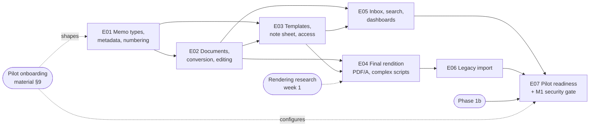

# Phase 3 — Memo and e-file management: overview

> Level-1 plan (see `AGENTS.md §5`). It splits the phase into epics, fixes their order and dependencies, lists the phase-level research and ADRs, and maps the exit criteria to epics. Each epic gets its own detailed plan (`epic-<NN>-<slug>/`: research, ADRs, design, threat model, tasks, test plan) just before it starts.
>
> **Status:** waiting for the owner's approval (§9). Written 2026-11-14.

---

## 1. Phase goal (from `MASTER_PLAN.md`)

The day-to-day memo system the pilot bank can run its approvals on. The phase ends at **milestone M1, pilot go-live**: after an external penetration test, ASVS L2 verification, UAT sign-off by the pilot, and a production deployment with monitoring, backups and runbooks.

### What Phases 1a and 2 left us
- **Memo (minimum):** subject, memo type, classification, initiator and origin unit; one main .docx with immutable versions and SHA-256 hashes; draft → in review (round N) → approved / rejected / withdrawn / cancelled, with returned as a loop back. Every action is bound to the document version and hash it applied to; the document is locked during review (ADR-0036).
- **Reference numbers:** `M-YYYY-NNNNN` from a counter row per tenant and year locked inside the business transaction, assigned when the memo is created. Gapless already, but the format is fixed and drafts consume numbers.
- **Memo types (minimum):** name, default classification, route policy, workflow definition, step-up on approve. No metadata fields, so DoA rules and CEL conditions have only the attributes Phase 2 declared; there is no amount on a memo yet.
- **Note sheet:** the workflow's action history (`workflow_action`): actor, acting-for, action, plain-text remark, round, document version and hash. No rich text, attachments, mentions or corrections.
- **Workflow engine (Phase 2):** versioned definitions with conditions, parallel steps, queues, DoA, substitution, separation of duties, SLAs, timers, escalation and the visual builder. Phase 3 feeds it real memo attributes; it does not change the engine's model.
- **Files:** scanned, type-detected, envelope-encrypted, versioned files in object-locked buckets, streamed with range requests; the owning module answers the read-policy callback (ADR-0028, ADR-0029).
- **ONLYOFFICE (minimal, ADR-0037):** edit the .docx in Draft or Returned, saving a new version through the files pipeline; JWT on configs and callbacks; signed single-purpose document links; on dev since 2026-11-11. No co-editing, spreadsheets, conversion, or templates yet.
- **Inbox:** my tasks, my drafts, sent; queue tasks; overdue markers; phone-width pages. No watching, team view, saved searches or dashboards.
- **Kernel:** tenant context and RLS everywhere, the hash-chained audit store in the business transaction, idempotency keys on every action, the authorisation matrix with its endpoint-coverage meta-test, step-up, rate limiting, notifications, terminology overrides.

### What Phase 3 deliberately does *not* do
- **Records disposition** (retention schedules executed, legal hold, eDiscovery export) is Phase 7. Phase 3 stores a retention policy on each memo type and never deletes anything.
- **Legally recognised digital signatures (PAdES)** are Phase 5. Phase 3's "electronic signature v1" is the approval record with its authentication context, shown as an approval stamp.
- **Forums, agenda items and the `escalate-to-forum` consumer** are Phase 4.
- **The approver app** is Phase 6a. Phase 3 keeps the memo API stable for it.
- **Bulk approval from the inbox.** The owner does not want it (Phase 2, 2026-11-09). Bulk actions in Phase 3 are limited to non-decisions: mark as read, watch or unwatch, export a list.
- **Enterprise identity** (SSO, delegation screens, key rotation, break-glass) is **Phase 1b**, which must finish before Phase 3 exits (§9 Q4).

---

## 2. Epics

Seven epics. Estimates are in team-weeks and size the scope. Phases 0–2 ran faster than their estimates with the agent working alone, so the quality gates set the pace, not these numbers. **E07 depends on people and vendors outside the team** (the pilot, a penetration tester, the hosting environment), so its calendar time is set by them.

| # | Epic | Purpose | Est. | Depends on |
|---|---|---|---|---|
| E01 | **Memo types, metadata and numbering** | Full memo-type admin: metadata form builder (text, number, amount + currency, date, unit, person, choice, required attachments), numbering schemes, default template, workflow, classification and retention policy, maker-checker on publish. Configurable gapless numbering assigned on submit or on final approval, voids recorded. Metadata becomes workflow attributes (amount for DoA and conditions). Memo lifecycle completed: closed / archived, references and links between memos, related files | 4–5 wks | — |
| E02 | **Documents: conversion, versions, attachments, editing** | Convert on upload (PDF rendition and text extraction as background jobs); attachments of any type with preview and stricter-only classification; version comparison (side-by-side text diff); ONLYOFFICE completed: .xlsx, co-editing while drafting, conversion API, and the hardening review; the desktop-Word round trip if research clears it | 5–6 wks | E01 (attachment rules on memo types) |
| E03 | **Templates, note sheet and access** | Tenant .docx templates with placeholders filled on the server; note sheet with rich-text remarks, attachments, mentions and linked corrections; access model (classification + unit scope + workflow participation + explicit share); "copy to" distribution with read receipts; approval stamps with authentication context (e-signature v1) | 4–5 wks | E01, E02 |
| E04 | **Final rendition (PDF/A) and complex scripts** | On final approval, an archival PDF/A combining the memo document, note sheet history, approval stamps and attachments, with bookmarks; stored in an object-locked bucket with its checksum in the audit log. Generated pages render Bengali, Arabic and other complex scripts correctly. **Its rendering research starts in week 1, beside E01** (§8 R2) | 4–5 wks | E02 (PDF renditions), E03 (note sheet, stamps) |
| E05 | **Inbox, search and dashboards** | Inbox completed: watching, team view for unit heads, sorted by due time, non-decision bulk actions; full-text search over metadata, note sheet and extracted text, permission-filtered, one text-search configuration per language, saved searches; dashboards (pending by person and unit, average approval time per type, overdue, throughput); synthetic volume V1 (1,000,000 memos) and the search and inbox load tests | 4–5 wks | E02 (extracted text), E03 (access model) |
| E06 | **Legacy import** | Bulk import of legacy memos from files plus a metadata spreadsheet: originals kept as the source of truth, PDF renditions and extracted text generated, numbers preserved, a dry run, and a reconciliation report | 3 wks | E01, E02, E04 |
| E07 | **Pilot readiness and the M1 security gate** | The pilot's memo types, templates, numbering and DoA configured by admins without code; production deployment to the pilot's environment; backups with a restore drill; monitoring and alerting; runbooks, support process and training material; external pen test and ASVS L2 verification of Phases 0–3 (and 1b), findings fixed and retested; UAT sign-off | 4–6 wks (calendar time set by external parties) | E01–E06, Phase 1b |

### Order and parallelism

- **Critical path:** E01 → E02 → E03 → E04 → E06 → E07, about 24–30 team-weeks plus the external parties' time in E07.
- **The rendering question goes first.** PDFBox does not shape complex scripts, and every generated page (note sheet, stamps, rendition cover) depends on the answer. Its research and a throwaway prototype run in week 1, beside E01, so E04 starts with a decided approach (ADR-RENDER).
- **Parallel work:** E05 can start once E03's access model is merged, beside E04. E06's spreadsheet format and dry-run design can start once E01 is merged.
- **E07 waits for Phase 1b.** The pen test must cover what the pilot will run, including SSO and key management. §9 Q4 proposes the order.
- **Every epic extends Phase 2's memo.** Nothing replaces the Phase 2 tables. Changes to existing tables follow expand → migrate → contract, and existing memos on dev keep their `M-YYYY-NNNNN` references.

---

## 3. Epic scope

### E01 — Memo types, metadata and numbering
- **Metadata form builder:** field types text, long text, number, amount + currency, date, unit (org picker), person (people picker), choice (single, multiple), and "attachments required" rules. Per field: label (localised), help text, required, validation (range, length, pattern), default, and whether it is shown in the inbox. Field definitions are versioned with the memo type; a memo keeps the version it was created with.
- **Workflow attributes:** chosen fields are exposed to the engine as declared CEL attributes (ADR-0039), so DoA rules (amount bands, unit) and conditions use real memo data. A field used by a published definition cannot be removed or change type.
- **Memo-type admin (full):** template, numbering scheme, workflow definition, route policy, default classification, retention policy (stored only; Phase 7 executes it), step-up on approve, and who may raise the type (units, roles). Publishing a changed type uses the maker-checker review Phase 2 built for definitions.
- **Numbering service:** schemes made of parts (fixed prefix, entity or unit code, memo-type code, year or financial year, sequence with padding) with reset rules (never, yearly, financial year). One locked counter row per tenant + scheme + period inside the business transaction (never a PostgreSQL sequence). Assigned **on submit** or **on final approval** per type; drafts carry no number. A number lost to a cancelled or withdrawn memo is recorded as a void with its reason, never reused. A counter can be set once at go-live, so the pilot continues its current sequence.
- **Lifecycle completed:** closed / archived after approval (manual or by type rule), reopening forbidden; links between memos (refers to, supersedes, follows up) and "related files"; a linked memo shows only what the viewer may see.
- **Screens:** memo-type admin with the form builder and its preview; the create-memo form rendered from the metadata schema; numbering scheme editor with a live sample; the memo view shows metadata, number, links.

### E02 — Documents: conversion, versions, attachments, editing
- **Convert on upload:** every uploaded or saved document gets a PDF rendition (ONLYOFFICE conversion API) and extracted text (Tika) in background jobs with progress, retries and tenant context. Hostile-file limits on both (size, pages, time, decompression ratio); conversion with no outbound network.
- **Attachments:** any type allowed by the tenant's list; preview through the rendition; required attachments per memo type (E01); a per-attachment classification that may only be stricter than the memo's; attachments lock with the document during review.
- **Version comparison:** side-by-side diff of the extracted text of two document versions, with the version, hash and author of each.
- **ONLYOFFICE completed:** .xlsx editing; co-editing by the initiator and named co-authors while drafting; read-only once submitted; document key per version; cache cleanup after sessions; the master plan's hardening list reviewed point by point (JWT on configs, browser requests and callbacks; callback reachable only from the ONLYOFFICE network; macros and plugins off; encrypted cache volume; CPU and memory limits); all behind the existing adapter.
- **Desktop Word (research-gated, R6):** "Edit in desktop Word" through WebDAV and the `ms-word:` URI scheme only if research shows tokens can be scoped, short-lived and audited. Otherwise it is recorded as not adopted.
- **Licence:** a legal-review brief on ONLYOFFICE's AGPL and additional terms for SaaS and on-prem distribution (for the owner's lawyer).

### E03 — Templates, note sheet and access
- **Templates:** tenants upload their .docx letterheads and templates with placeholders (number, dates, names, metadata fields, approval block); the server fills them when a memo is created from the template and again for the final rendition. The library is chosen by research (R4) against real bank-style templates.
- **Note sheet:** rich-text remarks (a small, sanitised editor: bold, italic, lists, links to memos), attachments on a remark, mentions (notifying the person if they may see the memo), and corrections as new entries that reference the one they correct. Append-only stays enforced in the database. Where the richer entry lives (the memo module beside `workflow_action`, or the action itself) is decided by ADR-NOTES.
- **Access model:** a memo is readable by its workflow participants, people with an explicit share, "copy to" recipients, and holders of a unit-scope reader role over the memo's unit; always subject to classification clearance and recusal. Expressed as a SQL-pushed filter so lists and search never load what the user cannot see (ADR-0027 extended).
- **"Copy to":** distribution lists and individual recipients on the memo, at submit or after approval; read receipts recorded at document-open granularity (AGENTS §3.3).
- **E-signature v1:** each approval recorded with its authentication context (MFA freshness, IP, device, document hash) and rendered as an approval stamp in the memo view and, from E04, in the rendition.
- **Phase 2 follow-up:** the step ordinal after a recusal (retrospective, "Carried").

### E04 — Final rendition (PDF/A) and complex scripts
- **Rendering approach (ADR-RENDER):** decided in week 1 of the phase (R3): ONLYOFFICE Document Builder, an HTML-to-PDF engine with OpenType shaping, or another option, merged with PDFBox. Proven with Bengali and Arabic names and remarks before E04 starts.
- **Final rendition:** on final approval, a background job builds one PDF/A file: the memo document (filled template), a cover page with metadata and number, the note sheet history by round, approval stamps, and the attachments (converted, or embedded as PDF/A-3 attachments where conversion is impossible), with bookmarks. Stored in an object-locked record bucket; its checksum in the audit log; validated by veraPDF in tests.
- **Golden tests:** render-and-compare of generated pages with complex scripts in names, remarks and stamps (TESTING_STRATEGY §3.8), plus text-extraction checks.
- **Memo view:** download the rendition; the rendition's checksum and validation result shown to auditors.

### E05 — Inbox, search and dashboards
- **Inbox completed:** watching (follow a memo), team view for unit heads (their unit's pending and overdue items, permission-filtered), sorted by due time (Phase 2 follow-up), and non-decision bulk actions.
- **Search:** PostgreSQL full-text search with generated `tsvector` columns and GIN indexes over metadata, note sheet and extracted document text; a text-search configuration per language (R7: Bengali has no built-in PostgreSQL dictionary); filters on type, status, dates, unit, amount; permission-filtered through E03's access filter; saved searches; search is rate-limited and audited at query level. Extracted text is as confidential as the document.
- **Dashboards:** pending by person and unit, average approval time per memo type, overdue, throughput over time; scoped by the viewer's rights.
- **Volume:** the generator adds V1 (1,000,000 memos with history, extracted text and note sheets for a large tenant); Gatling tests for search and the inbox against it (NFR P1: p95 < 300 ms); `EXPLAIN` reviewed for every new list and search query. The threshold for introducing OpenSearch is recorded (R7).

### E06 — Legacy import
- **Input:** a folder or archive of original files plus a metadata spreadsheet (one row per memo: number, type, dates, subject, initiator, approvers, status, classification, links to files), in a documented format with a downloadable template.
- **Process:** a dry run that validates everything and reports problems without writing; then a background import, resumable and idempotent per row, preserving original documents as the source of truth, generating renditions and extracted text, keeping legacy numbers (marked as imported, outside the gapless series), and an audit entry per imported memo.
- **Reconciliation report:** counts and checksums per row (files found, files imported, renditions made, rows rejected and why), downloadable and kept with the import.

### E07 — Pilot readiness and the M1 security gate
- **Pilot configuration:** the pilot's top memo types, templates, numbering and DoA configured by a tenant admin through the UI, with no code, from the onboarding material (§9 Q2). A sample of the pilot's legacy data imported with a reconciliation report.
- **Production deployment** to the environment the pilot chooses (§9 Q5), from the same artifacts as dev; monitoring and alerting; backups with a **restore drill** (NFR A2–A4, audit-chain and object-lock checks after restore); runbooks; the support process; user training material (initiator, approver, tenant admin).
- **Security gate:** ASVS 5.0 L2 verification of everything built in Phases 0–3 and 1b, recorded in `docs/security/asvs-checklist.md`; an external penetration test; every critical and high finding fixed and retested before M1.
- **UAT** with the pilot's users against their memo types, and their sign-off.

---

## 4. Scope coverage (master plan scope → epic)

| Master plan Phase 3 scope item | Epic |
|---|---|
| Memo types: metadata form builder, default template, numbering scheme, default workflow, default classification, retention policy | **E01** (template slot), E03 (templates) |
| Numbering service: formats, gapless, assigned on submit or final approval, voids | **E01** |
| Memo lifecycle (closed / archived, references, links, related files) | **E01** |
| Document versioning, version binding, comparison view | Phase 2 (chain, binding), **E02** (comparison) |
| Main document editing (ONLYOFFICE: .docx and .xlsx, co-editing, read-only once submitted, conversion) | Phase 2 E02 (minimum), **E02** |
| ONLYOFFICE hardening | **E02** |
| Convert on upload | **E02** |
| Desktop Word option (research-gated) | **E02** |
| Templates with placeholders, server-side fill | **E03** |
| Note sheet: rich text, attachments, mentions, corrections | **E03** |
| Attachments: any type, preview, stricter classification | **E02** |
| Access: classification + unit scope + participation + share; "copy to" with read receipts | **E03** |
| Electronic signature v1 and step-up per memo type | Phase 2 (step-up), **E03** (stamps, context) |
| Final rendition (PDF/A, bookmarks, object lock, checksum) | **E04** |
| Inbox and tracking (my tasks, sent, drafts, watching, team view, overdue, bulk actions where allowed, mobile-friendly) | Phase 2 (my tasks, drafts, sent, overdue, phone width), **E05** |
| Search (FTS, per-language configuration, permission-filtered, saved searches) | **E05** |
| Migration and import | **E06** |
| Dashboards | **E05** |
| Pilot readiness (deployment, backups and restore drill, monitoring, runbooks, support, training) | **E07** |
| Pre-go-live security gate (pen test, ASVS L2) | **E07** |

## 5. Exit criteria → epics

| Exit criterion (`MASTER_PLAN.md`) | Delivered by | Evidence |
|---|---|---|
| The pilot bank's top memo types run end to end with their real templates, numbering and DoA rules, configured by admins without code | E01, E03, **E07** | A Playwright journey per pilot memo type, configured through the admin UI only; needs the pilot material (§9 Q2) |
| Final PDF renditions validate as PDF/A and match the approved content; object lock verified | **E04** | veraPDF in CI; text-extraction match; object-lock retention check on the record bucket |
| Legacy import of a sample of pilot data succeeds with a reconciliation report | E06, **E07** | Import IT on synthetic data (E06); the pilot sample's report (E07) |
| Generated pages render the pilot's languages correctly (golden-file tests with real names and remarks) | **E04** | Render-and-compare golden tests (§9 Q3 fixes the languages) |
| External pen test and ASVS L2 verification complete; no open critical or high findings | **E07** | Pen test report and retest; `asvs-checklist.md` |
| UAT sign-off by the pilot; production live with monitoring, backups (restore tested) and runbooks | **E07** | Signed UAT record; restore-drill report; runbooks in `docs/runbooks/` |

**Phase-3 special tests** (`TESTING_STRATEGY.md §12`):

| Special test | Epic |
|---|---|
| ONLYOFFICE integration and security (forged callbacks rejected, no outbound network) | E02 (Phase 2 E02 covered the editing callbacks) |
| Gapless numbering under concurrency (parallel submits and approvals, rollbacks leave no gap, voids recorded) | E01 |
| PDF/A validation | E04 |
| Complex-script golden tests with the pilot's languages | E04 |
| Permission-filtered search (no result, count, snippet or facet leaks an unreadable memo) | E05 |
| Legacy import reconciliation | E06 |
| External pen test + ASVS L2 verification before M1 | E07 |

Also from `TESTING_STRATEGY.md`: the hostile-file corpus extended to conversion and Tika in E02; Jazzer fuzzing nightly on template filling and the import spreadsheet parser; PIT on numbering; the restore drill before the milestone (§7).

**Generic phase-exit items** (`AGENTS.md §5`):

| Item | Where |
|---|---|
| Demo script | Phase demo (`demo.md`) at the end of E06, before E07's UAT |
| `retrospective.md` | At phase close |
| STATUS | Every session |
| Usability check | E01: memo-type admin and the create form; E03: note sheet and "copy to"; E05: search and team view; walked through with the owner (and a pilot user if possible) before build, in each epic's `ux-review.md`. UAT in E07 |
| ASVS | Rows per epic; the full L2 verification in E07 |
| Manual accessibility | Keyboard and screen-reader pass over the create form, memo view, note sheet editor, search and dashboards |

---

## 6. Phase-level research list

Each item is answered in the `research.md` of the epic shown, with sources and access dates. Versions are re-verified from official sources, never taken from this plan or from memory.

| # | Question | Epic |
|---|---|---|
| R1 | Current stable versions, licences and maintenance status of everything each epic adds: ONLYOFFICE Docs and its conversion API, Tika, PDFBox, veraPDF, the templating library (R4), the rich-text editor, the shaping engine (R3), Spring Boot 4.2 status | Every epic |
| R2 | **Numbering in e-office and bank practice:** formats, financial-year resets, when numbers are taken, voids, continuing a legacy sequence; and the locking pattern under concurrency (counter row per scheme and period) | E01 |
| R3 | **Complex-script rendering:** ONLYOFFICE Document Builder vs an HTML-to-PDF engine with HarfBuzz shaping (licences and on-prem footprint checked) vs other options; font licensing and embedding for PDF/A; validated with Bengali and Arabic | E04 (**runs in week 1**) |
| R4 | **Server-side .docx templating:** poi-tl vs docx4j vs ONLYOFFICE Document Builder; fidelity with real letterheads (headers, tables, images, fields), placeholder syntax admins can write, licences, maintenance | E03 |
| R5 | **ONLYOFFICE Docs API, production depth:** co-editing modes, force-save, document keys, the conversion API and its limits, cache behaviour and cleanup, scaling and HA; AGPL plus additional-terms obligations for SaaS and on-prem (legal-review brief) | E02 |
| R6 | **Desktop Word round trip:** WebDAV + `ms-word:` URI; token scoping, expiry, audit; Windows and macOS behaviour; whether it can meet our rules at all | E02 |
| R7 | **Search:** permission-filtered full-text search in PostgreSQL at 1,000,000 memos (RLS + access filter + GIN), Bengali and English text-search configurations (simple vs custom dictionaries vs ICU-based tokenising), snippets that never leak, and the point at which OpenSearch would be needed | E05 |
| R8 | **PDF/A for merged renditions:** PDF/A-2 vs PDF/A-3, converting arbitrary attachments vs embedding them, bookmarks, fonts; PDFBox + veraPDF | E04 |
| R9 | **Rich text in an append-only record:** a sanitised editor and storage format (ProseMirror/Tiptap JSON vs restricted HTML), rendering into the PDF, XSS defence under the strict CSP | E03 |
| R10 | **Industry practice:** memo-type configuration, "copy to" and file movement conventions, read receipts, note sheet corrections, team views and dashboards in e-office and memo products (extending Phase 2's R11 benchmark) | E01, E03, E05 |
| R11 | **Legacy import:** spreadsheet formats, mapping legacy statuses and people who have left, preserving originals, reconciliation reports in records migrations | E06 |
| R12 | **Go-live operations:** backup and restore of PostgreSQL + SeaweedFS with object lock, monitoring stack for small on-prem installs, pen-test scoping for ASVS L2 | E07 |

## 7. Planned ADRs

Numbers are assigned when written, starting at ADR-0043. Each one uses MADR.

| ADR | Decision | Epic |
|---|---|---|
| ADR-META | Memo-type metadata schema: field types, versioning, storage on the memo, exposure as workflow attributes | E01 |
| ADR-NUMBER | Numbering schemes, counter rows per period, assignment moment, voids, migration of the existing `M-YYYY-NNNNN` references | E01 |
| ADR-CONVERT | Convert on upload: conversion and extraction jobs, limits, renditions as derived files | E02 |
| ADR-OO-FULL | ONLYOFFICE in production: co-editing, spreadsheets, conversion, hardening, licence obligations (extends ADR-0037) | E02 |
| ADR-TEMPLATE | Template format, placeholder syntax and filling library | E03 |
| ADR-NOTES | Note sheet entries: rich-text format, attachments, mentions, corrections, where they live | E03 |
| ADR-ACCESS | Memo access model and its SQL filter (participants, shares, copy-to, unit scope, clearance, recusal) | E03 |
| ADR-RENDER | Generated pages with complex scripts: the rendering engine and how it joins PDFBox | E04 (decided in week 1) |
| ADR-PDFA | Final rendition: PDF/A level, structure, attachments, storage and verification | E04 |
| ADR-SEARCH | Full-text search design, language configurations, permission filtering, OpenSearch threshold | E05 |
| ADR-IMPORT | Legacy import format, dry run, idempotency, legacy numbers | E06 |

## 8. Risks

| # | Risk | Mitigation |
|---|---|---|
| R1 | **No pilot onboarding material yet** (`MASTER_PLAN §9`). Phase 3 design should start from the pilot's memo types, templates, numbering and languages | E01–E06 are built as general, configurable features against the demo tenant and realistic bank-style samples; the pilot material shapes them as it arrives; their configuration and UAT are in E07. §9 Q2 lists what is needed first and by when |
| R2 | Complex scripts render wrongly in generated pages (PDFBox does no shaping) | R3 and a prototype in week 1; ADR-RENDER before E04; golden tests with real names |
| R3 | The pen test finds high-severity issues late, or a tester cannot be booked in time | Book the tester early (§9 Q5); ASVS rows kept current per epic; ZAP and the security suite already in CI; a buffer in E07 for fixes and retest |
| R4 | Phase 1b not done when Phase 3 is otherwise ready, delaying M1 | §9 Q4 places 1b before E07 so the pen test covers it once |
| R5 | Search at 1,000,000 memos is slow once permission filters and RLS combine | R7 and a V1 prototype early in E05; `EXPLAIN` gates; OpenSearch threshold recorded rather than assumed |
| R6 | ONLYOFFICE's AGPL and additional terms constrain SaaS or on-prem distribution | Legal-review brief in E02 for the owner's lawyer; ONLYOFFICE stays unmodified and behind the adapter |
| R7 | Arbitrary attachments cannot become PDF/A | R8: embed originals as PDF/A-3 attachments where conversion fails, and say so in the rendition |
| R8 | Legacy data is messier than the import format allows | Dry run with a full problem report; the pilot sample tried early in E06 if available |
| R9 | Metadata changes break published workflows that read those fields | Fields used by a published definition are protected; type versions are pinned on the memo |

## 9. Open questions for the human

1. **Q1 — Approval and gate delegation.** Do you approve this overview? In Phases 0, 1a and 2 you delegated the per-epic review gate (the agent writes each epic plan, then implements it without waiting). Does that still apply in Phase 3? Recommendation: keep the delegation, except the screen flows for the memo-type admin and the create form (E01), the note sheet and "copy to" (E03), and search (E05), which go to you before build.
2. **Q2 — Pilot onboarding material.** The master plan asks for the pilot onboarding checklist (`MASTER_PLAN §9`) before Phase 3 design. Has any of it been collected? Most urgent, in order: (a) the top memo types with their current Word templates, sample memos and numbering formats (E01, E03); (b) the languages used in memos (E04's week-1 rendering research); (c) the DoA matrix (E01 attributes); (d) a sample of legacy memos and their metadata (E06); (e) hosting, identity provider and security questionnaire (E07, Phase 1b). Recommendation: start E01 now on general features with realistic bank-style samples, and fold the pilot material in as it arrives.
3. **Q3 — Languages.** Phase 1a chose English only, with Arabic as the right-to-left proof. Generated pages must render the pilot's languages. Which languages do the pilot's memos use? Recommendation, if unknown: assume **English and Bengali** for the rendering research and golden tests, keeping Arabic as the right-to-left case.
4. **Q4 — Phase 1b and the order to M1.** Phase 1b must finish before Phase 3 exits, and the pen test should cover it. Options: (a) Phase 3 E01–E06, then Phase 1b, then E07 (one pen test covers everything the pilot runs) (recommended); (b) interleave 1b's epics with Phase 3's; (c) Phase 1b first, then Phase 3. Which one?
5. **Q5 — External parties with lead time.** E07 needs (a) an external penetration tester (who books them, and is there a preferred firm or one the bank requires?); (b) the pilot's production environment (our server, a dedicated host, or the bank's own data centre); (c) a lawyer to read the ONLYOFFICE licence brief. Nothing is needed today; these are flagged now because booking takes weeks.

---

## 10. Approval

| Item | By | Date | Notes |
|---|---|---|---|
| Phase 3 overview | — | — | Waiting for the owner |

### Answers to open questions
| Q | Date | Answer |
|---|---|---|
