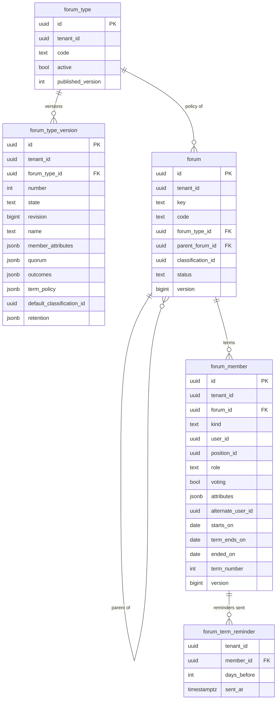

# E01 Forum types and forums — design

> Step 3 of `AGENTS.md §5`. Decisions: ADR-0056 (forum types, forums, membership) and ADR-0057 (quorum rules). Research: `research.md`. Screens: `ux-review.md`.

## 1. Domain model

### Forum type (versioned policy)
| Attribute | Notes |
|---|---|
| `code` | `^[A-Z0-9][A-Z0-9-]{0,9}$`, unique per tenant, set at creation |
| `active` | Direct toggle; an inactive type cannot be chosen for new forums |
| version: `name`, `description` | 1–200 and 0–2,000 characters |
| version: `defaultClassificationId` | A classification level of the tenant |
| version: `retention` | `{years: 1–100, from: "MEETING"}`, stored only |
| version: `memberAttributes` | 0–8 `{key: ^[a-z][a-zA-Z0-9]{0,29}$, label: 1–60}`, keys unique |
| version: `quorum` | ADR-0057 rule |
| version: `outcomes` | 1–8 `{kind, label: 1–60, resolution: bool}`, kinds unique; must include at least one of APPROVED or NOTED |
| version: `termPolicy` | `{termMonths?: 1–120, maxTerms?: 1–20, reminderDays: [1–365] × 0–3}` |

The version moves DRAFT → IN_REVIEW → PUBLISHED → RETIRED through `common.review`. There is at most one open and one published version per type, enforced by unique partial indexes.

### Forum
| Attribute | Notes |
|---|---|
| `key` | `^[a-z][a-z0-9-]{0,99}$`, unique per tenant, immutable (workflow definitions name it) |
| `code` | `^[A-Z0-9][A-Z0-9-]{0,9}$`, unique per tenant, editable until the first meeting (E03 locks it) |
| `name`, `shortName` | 1–200, 1–40 |
| `forumTypeId` | An active type with a published version |
| `parentForumId` | Optional; no cycles (checked by walking up, depth at most 10) |
| `classificationId` | Defaults to the type's default |
| `status` | ACTIVE → DISSOLVED (date, reason 1–500). There is no way back; clone instead |
| `version` | Optimistic lock (If-Match) |

### Forum member (one term of office)
| Attribute | Notes |
|---|---|
| `kind` | PERSON (`userId`) or POSITION (`positionId`) |
| `role` | CHAIR, VICE_CHAIR, SECRETARY, MEMBER, STANDING_INVITEE, OBSERVER |
| `voting` | Default from role (CHAIR, VICE_CHAIR, MEMBER: true) |
| `attributes` | Keys from the type's `memberAttributes`; unknown keys are refused |
| `alternateUserId` | Optional; not the member; must be an active user |
| `startsOn`, `termEndsOn`, `endedOn`, `endReason` | Dates in the tenant's zone; `termEndsOn` defaults from `termMonths`; `endedOn ≥ startsOn` |
| `termNumber` | 1 for a new member; renewal adds 1 |
| `authority` | Optional, 1–500 |
| `version` | Optimistic lock |

**In office on d:** `startsOn ≤ d ∧ (endedOn = null ∨ endedOn ≥ d) ∧ (termEndsOn = null ∨ termEndsOn ≥ d)`. A position seat in office resolves to the position's holders on d (normally one; a vacant seat counts as a vacancy, not as a member).

**State of a row:** derived, not stored. The states are UPCOMING, IN_OFFICE, TERM_ENDED (past `termEndsOn`, not ended) and ENDED.

```mermaid
stateDiagram-v2
  [*] --> UPCOMING: add (startsOn in future)
  [*] --> IN_OFFICE: add (startsOn ≤ today)
  UPCOMING --> [*]: withdraw (row removed from the roster, audited; never started)
  UPCOMING --> IN_OFFICE: startsOn reached
  IN_OFFICE --> TERM_ENDED: termEndsOn passed
  IN_OFFICE --> ENDED: end / change role (new row) / renew (new row)
  TERM_ENDED --> ENDED: end / renew (new row)
  TERM_ENDED --> IN_OFFICE: extend termEndsOn (edit, audited)
```

A withdrawn upcoming row is kept with `endedOn = startsOn - 1 day` and reason `WITHDRAWN`. Nothing is hard-deleted.

**Invariants**, checked in the service under `SELECT … FOR UPDATE` on the forum row; a violation answers 409 with a reason:
- `ONE_CHAIR`: no two CHAIR rows overlap in time.
- `ALREADY_MEMBER`: no two rows of the same person (or position) overlap in time.
- `FORUM_DISSOLVED`: no member changes on a dissolved forum, except ending rows.
- `SECRETARY_LIMIT`: a secretary cannot touch SECRETARY or CHAIR rows or their own row.

### ERD

## 2. Module boundaries and events
- **`forum` (new contents):**
  - Published API in `com.memo.forum`:
    - `ForumDirectory`: `forum(id|key)`, `membersOn(forumId, date)`, `rolesOf(userId, date)`, `isSecretary(userId, forumId, date)`, `forumsOf(userId)`, `visibleCondition()`;
    - `Quorum` and the rule types (ADR-0057);
    - `ForumTypes`: the published version of a type.
  - Internals in `com.memo.forum.internal`.
  - Depends on `org` (positions, holders), `authz` through `common.authz`, `audit`, `notification`, `tenancy`, and `workflow` (implements `EscalationTargets`).
- **Events published** (`TenantScopedEvent`, carrying `tenantId`):
  - `ForumChanged(tenantId, forumId)` on forum or membership changes;
  - `ForumTypePublished(tenantId, typeId, version)`.
  - Consumers come in later epics. The forum module itself evicts its caches synchronously.
- **Events consumed:** `OrgChanged` evicts the roster cache, because position seats change holders.
- **`workflow`:** new published SPI `EscalationTargets { fun active(keys: Set<String>): Set<String>; fun list(): List<EscalationTarget> }`. Definition validation calls it at submit and publish. With no implementation (tests of the workflow module alone), every key is accepted.
- `ApplicationModules.verify()` must stay green: `forum → workflow` only, never the reverse (the SPI is in `workflow`).

## 3. API
All endpoints follow these rules:
- under `/api/v1`, with RFC 9457 errors;
- If-Match on updates;
- `Idempotency-Key` required on the POSTs that create rows (forums, members, clones); the other changes are guarded by state, `If-Match` or a unique index;
- cursor pagination where lists can grow (members, forums).

| Method and path | Access | Notes |
|---|---|---|
| `GET /admin/forum-types` | `forum.types.manage` or `forum.types.approve` or `forums.manage` | List with published and open versions |
| `POST /admin/forum-types` | `forum.types.manage` | `{code, name, preset?}` → type with draft v1 |
| `GET /admin/forum-types/{id}` | as list | Type with versions |
| `GET /admin/forum-types/{id}/versions/{n}` | as list | Full version |
| `PUT /admin/forum-types/{id}/versions/{n}` | `forum.types.manage` | Draft only; If-Match on `revision`; field problems at `quorum.*`, `outcomes[i].*` |
| `POST …/versions/{n}/submit` | `forum.types.manage` | DRAFT → IN_REVIEW |
| `POST …/versions/{n}/approve` | `forum.types.approve` + step-up | `SAME_PERSON`; publishes; retires the previous version |
| `POST …/versions/{n}/send-back` | `forum.types.approve` | Remark required |
| `POST /admin/forum-types/{id}/drafts` | `forum.types.manage` | New draft from the published version |
| `POST /admin/forum-types/{id}/activate`, `/deactivate` | `forum.types.manage` | Direct, audited |
| `GET /admin/forum-types/presets` | `forum.types.manage` | Preset names and contents |
| `POST /forums/quorum-preview` | signed in, any of the admin permissions or a secretary | `{rule, attributes, roster? or forumId?, attendance}` → evaluation (no write) |
| `GET /forums` | signed in | Forums visible to the actor (`ForumVisible`), with the actor's role |
| `POST /forums` | `forums.manage` | Create |
| `GET /forums/{id}` | visible | Forum and counts |
| `GET /forums/{id}/policy?on=` | visible | Its type's published policy (read-only) and the quorum on a date: how many count and how many must attend (added in T5) |
| `PATCH /forums/{id}` | `forums.manage` | Name, short name, code (until the first meeting), parent, classification |
| `POST /forums/{id}/dissolve` | `forums.manage` | Date and reason |
| `POST /forums/{id}/clone` | `forums.manage` | `{key, code, name, withMembers, startsOn}` |
| `GET /forums/{id}/members?on=&include=history` | visible | Members on a date (default today), or every row |
| `POST /forums/{id}/members` | `forums.manage` or secretary of the forum | Add a person or position |
| `PATCH /forums/{id}/members/{mid}` | as add, with `SECRETARY_LIMIT` | Voting, attributes, alternate, planned term end, authority |
| `POST /forums/{id}/members/{mid}/end` | as add | `{endedOn, reason}` |
| `POST /forums/{id}/members/{mid}/renew` | as add | `{termEndsOn?, authority?}` → new row |
| `POST /forums/{id}/members/{mid}/change-role` | as add; to CHAIR or SECRETARY: `forums.manage` | `{role, from, voting?}` → ends the row, new row |
| `POST /forums/{id}/members/{mid}/withdraw` | as add | Upcoming rows only |
| `GET /me/forums` | signed in | My memberships in office and upcoming, with role and term |
| `GET /admin/workflow/escalation-targets` | `workflow.definitions.manage` | Active forums: key, name, code |

**Problems:**
- `UNKNOWN_ATTRIBUTE`, `UNKNOWN_ROLE`, `QUORUM_INVALID` (with sub-pointers) and `OUTCOME_DUPLICATE`, as field problems (422);
- `ONE_CHAIR`, `ALREADY_MEMBER`, `SECRETARY_LIMIT`, `FORUM_DISSOLVED`, `TYPE_INACTIVE`, `KEY_TAKEN`, `CODE_TAKEN`, `PARENT_CYCLE`, `WRONG_STATE` and `SAME_PERSON` (409);
- `UNKNOWN_FORUM` on workflow definitions (422 at the step pointer).

## 4. Authorisation matrix
| Action | tenant_admin | forums.manage (role) | forum.types.approve | secretary of F | member of F | forum.read | other user |
|---|---|---|---|---|---|---|---|
| List or read forum types | ✓ | ✓ | ✓ | – | – | – | – |
| Create or edit draft types, submit | ✓ | – | – | – | – | – | – |
| Approve or send back a type version | ✓ (not own) | – | ✓ (not own) | – | – | – | – |
| Create, edit, dissolve or clone a forum | ✓ | ✓ | – | – | – | – | – |
| See forum F and its members | ✓* | ✓* | – | ✓* | ✓* | ✓* | – |
| Add, edit or end MEMBER, VICE_CHAIR, OBSERVER or STANDING_INVITEE rows in F | ✓ | ✓ | – | ✓ (not own) | – | – | – |
| Add, change or end CHAIR or SECRETARY rows in F | ✓ | ✓ | – | – | – | – | – |
| Quorum preview | ✓ | ✓ | ✓ | ✓ | – | – | – |
| My forums | ✓ | ✓ | ✓ | ✓ | ✓ | ✓ | ✓ (empty) |
| Escalation targets | ✓ (`workflow.definitions.manage`) | – | – | – | – | – | – |

\* Only up to the actor's clearance for the forum's classification. A former member (all rows ended) still sees the forum's name and their own history in "My forums", but not the current roster.

`tenant_admin` holds `forum.types.manage`, `forum.types.approve` and `forums.manage` through the built-in role. `forum.read` is granted on purpose only (`GRANTED_ON_PURPOSE`). Role names in the table are column labels; the tests use the demo users.

## 5. Audit events
All of them are written in the business transaction with before and after where relevant:
- `forum.type.created`, `forum.type.draft_created`, `forum.type.version.saved`, `forum.type.version.submitted`, `forum.type.version.published`, `forum.type.version.sent_back`, `forum.type.activated`, `forum.type.deactivated`;
- `forum.created`, `forum.updated`, `forum.dissolved`, `forum.cloned`;
- `forum.member.added`, `forum.member.updated`, `forum.member.ended`, `forum.member.renewed`, `forum.member.role_changed`, `forum.member.withdrawn`;
- `forum.term.reminded`.

`AuditActionCoverageTest` lists them.

## 6. Tenancy and RLS
- Every new table has `tenant_id` first in every composite index, and RLS ENABLED and FORCED with the standard policy `tenant_id = (select nullif(current_setting('app.tenant_id', true), '')::uuid)`.
- Composite foreign keys `(tenant_id, …)` make a cross-tenant reference impossible.
- The reminder job runs per tenant with the tenant context set (ADR-0017/0018).
- The cross-tenant test covers every table and the `ForumVisible` predicate.

## 7. Migrations
- `forum/V1__forum_types.sql` (T1): `forum_type`, `forum_type_version`.
- `forum/V2__forums.sql` (T2): `forum`, `forum_member`, `forum_term_reminder`.
- `workflow`: no schema change. Validation only.
- All expand-only. No existing table changes. The demo seed adds rows (T6).

## 8. Performance budget
| Endpoint or screen | Target p95 | Volume | How |
|---|---|---|---|
| `GET /forums` | < 100 ms | 50 forums, 30 members each | Index `(tenant_id, status)`; members from the roster cache |
| `GET /forums/{id}/members` | < 100 ms | 300 rows of history | Index `(tenant_id, forum_id, starts_on)` |
| `GET /me/forums` | < 50 ms | — | Index `(tenant_id, user_id)` and `(tenant_id, position_id)`, holders from the org cache |
| `ForumDirectory.membersOn` (in-process) | < 1 ms cached | 50 forums | Caffeine per tenant, evicted on `ForumChanged` and `OrgChanged` |
| Term reminder job | < 2 s per tenant | 1,500 rows | Index `(tenant_id, term_ends_on) WHERE ended_on IS NULL` |

`EXPLAIN` is reviewed for each list query against the seed plus a generated set (50 forums × 300 rows) in T6.

## 9. Background work
- **Term reminders:** a recurring db-scheduler task `forum-term-reminders` runs daily at 06:00 in each tenant's zone. It works through the tenants and runs one transaction per tenant with the tenant context set.
  - For each type's `reminderDays` value r, it finds rows with `term_ends_on = today + r`, not ended.
  - It inserts `forum_term_reminder (member_id, r)` with `ON CONFLICT DO NOTHING`, and notifies only when the insert happened, so the job is idempotent.
  - Recipients are the secretaries in office, or the holders of `forums.manage` when there are none.
  - Kind `FORUM_TERM_ENDING`, category `GOVERNANCE`. The subject takes no parameters. The body names the forum and the member, which is not sensitive inside the tenant.
- **Membership notifications:** `FORUM_MEMBERSHIP_CHANGED` goes to the chair and secretaries in office, and to the member concerned when they are a person with an account. It is written in the change's transaction (ADR-0030).

## 10. UX flows
Screens in `ux-review.md` (flows J, K and L), reviewed by the owner before T4 and T5:
- **J:** committee types (list, type page with tabs Policy, Quorum, Outcomes, Terms, Changes; review).
- **K:** committees (list, committee page with Members and History; add-member side sheet; clone).
- **L:** "My committees" for members and the forum picker in the workflow builder.
