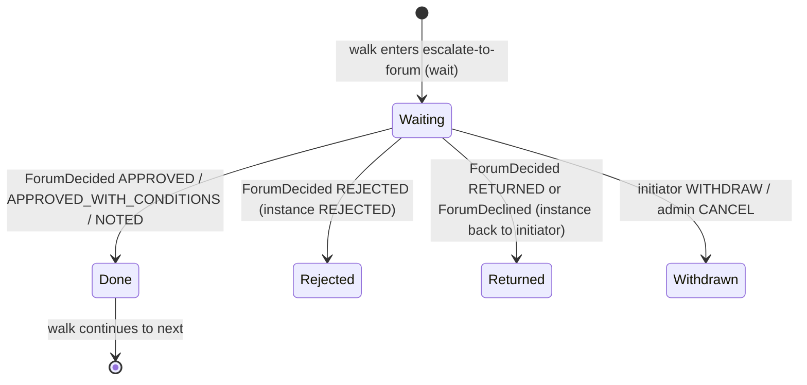
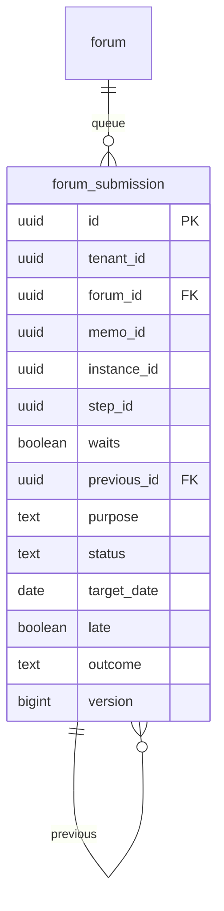

# E02 Submissions and the escalation link — design

> Step 3 of `AGENTS.md §5`. Decisions: ADR-0058 (the waiting forum step) and ADR-0059 (submissions and triage). Research: `research.md`. Screens: `ux-review.md` (flow M; reviewed with E03's flows, Phase 4 Q1).

## 1. Domain model

### Waiting forum step (workflow, ADR-0058)
- Definition: `{"type":"escalate-to-forum","forum":"<key>","wait":true,"next":"<step>"}`. `wait` is optional and false when absent.
- Runtime step: kind `FORUM`, state `ACTIVE`, no tasks, `name` = the forum's name at entry, `resolution = {forum, submissionId}`.
- Commands: `ForumDecided(actor, stepId, outcome, remark)` and `ForumDeclined(actor, stepId, remark)`.
- Action kinds added: `FORUM_DECIDED`, `FORUM_DECLINED`.

### Submission (forum, ADR-0059)
| Attribute | Notes |
|---|---|
| `forumId`, `memoId`, `instanceId`, `stepId` | `stepId` is null for a pass-through submission |
| `waits` | Whether the memo waits (copied from the step) |
| `previousId` | Earlier submission of the same memo (after a return), or the one that referred it |
| `purpose` | DECISION, DISCUSSION or INFORMATION |
| `resolutionSought`, `presenterUserId` | Optional; the presenter defaults to the initiator |
| `status` | QUEUED, ACCEPTED, DEFERRED, DECIDED, RETURNED, DECLINED, WITHDRAWN, REFERRED |
| `targetDate`, `late` | Optional target meeting date; late when the target is within the deadline |
| `submittedAt`, `triagedBy`, `triagedAt`, `reason` | Reasons are required for defer, return, decline and refer |
| `outcome`, `decidedAt`, `decidedBy` | Set when DECIDED |
| `remindedAt` | Set when the "waiting too long" reminder went out (once) |
| `version` | Optimistic lock |

```mermaid
stateDiagram-v2
  [*] --> QUEUED: escalation event
  QUEUED --> ACCEPTED: accept
  QUEUED --> DEFERRED: defer
  ACCEPTED --> DEFERRED: defer
  DEFERRED --> QUEUED: target reached / requeue
  QUEUED --> RETURNED: return (reason)
  ACCEPTED --> RETURNED: return (reason)
  QUEUED --> DECLINED: decline (reason)
  ACCEPTED --> DECIDED: decide (E06; tests and demo in E02)
  QUEUED --> DECIDED: decide (pass-through items: noted)
  QUEUED --> REFERRED: refer (reason, other forum)
  ACCEPTED --> REFERRED: refer
  QUEUED --> WITHDRAWN: memo withdrawn or cancelled
  ACCEPTED --> WITHDRAWN: memo withdrawn or cancelled
  DEFERRED --> WITHDRAWN: memo withdrawn or cancelled
```

Every forbidden transition answers 409 `WRONG_STATE`.

### Forum-type submission policy (version field, expand)
`submission: {deadlineWorkingDays: 0–30 (default 5), lateMode: ALLOW | BLOCK | CHAIR_APPROVAL (default CHAIR_APPROVAL), triageWorkingDays: 1–30 (default 5)}`.

### ERD

## 2. Modules and events
- **workflow:**
  - Definition schema 2 gains `wait`. The engine gains `StepKind.FORUM` and the two commands.
  - `Workflows.forumDecided(instanceId, stepId, outcome, remark)` and `Workflows.forumDeclined(...)` are published API, run as the given actor.
  - `WorkflowEscalatedToForum` gains `stepId` (null for pass-through) and `waits`.
  - Lists and views render FORUM steps.
- **forum:** consumes `WorkflowEscalatedToForum` synchronously (the submission is created in the same transaction) and `WorkflowInstanceEnded` (open submissions of an instance that ended become WITHDRAWN). It publishes `ForumSubmissionChanged(tenantId, submissionId)` for E03. It now depends on `workflow` and `memo`.
- **memo:**
  - The published `MemoReaders` API grants and retires the `FORUM` reader kind (`memo/V20`: the kind check gains `FORUM`).
  - `MemoNotes` gets a system entry kind for forum events.
  - The memo page's forum panel reads `GET /api/v1/memos/{id}/forum-submissions` (forum module, after the memo read check).
- **Module direction:** forum → workflow, memo. Never the reverse; the memo shows the forum's name through the workflow step's name.

## 3. API
| Method and path | Access | Notes |
|---|---|---|
| `GET /forums/{id}/submissions?status=` | Forum secretaries, chair, `forums.manage` | The queue, oldest first; flags late and waiting too long |
| `GET /forums/{id}/submissions/{sid}` | as above, or a reader of the memo | One submission with its timeline |
| `PATCH /forums/{id}/submissions/{sid}` | secretaries, `forums.manage`; If-Match | Cover sheet: purpose, resolution sought, presenter, target date |
| `POST …/{sid}/accept` | secretaries, `forums.manage`; If-Match | Optional `targetDate` |
| `POST …/{sid}/defer` | as accept | `reason`, optional `targetDate` |
| `POST …/{sid}/return` | as accept | `reason` (required) |
| `POST …/{sid}/decline` | as accept | `reason` (required) |
| `POST …/{sid}/refer` | as accept | `forumId` (an active forum), `reason` |
| `GET /memos/{id}/forum-submissions` | readers of the memo | The memo's submissions, newest first |

Problems: `WRONG_STATE`, `FORUM_INACTIVE`, `REASON_REQUIRED` (422 at `reason`), `TARGET_IN_PAST`, `SAME_FORUM` (refer).

## 4. Authorisation matrix
| Action | Secretary of F | Chair of F | forums.manage | Member of F | Memo initiator or presenter | Memo reader | Other |
|---|---|---|---|---|---|---|---|
| See F's queue | ✓ | ✓ | ✓ | – | – | – | – |
| Triage (accept, defer, return, decline, refer, edit the cover sheet) | ✓ | – | ✓ | – | – | – | – |
| See a submission | ✓ | ✓ | ✓ | – | ✓ | ✓ | – |
| The memo's forum panel | ✓ | ✓ | ✓ | – | ✓ | ✓ | – |

All under clearance of the memo's classification and of the forum's. An invisible forum or submission answers 404.

## 5. Audit events
`forum.submission.created`, `.updated`, `.accepted`, `.deferred`, `.returned`, `.declined`, `.referred`, `.decided`, `.withdrawn`, `.reminded`. Workflow: `workflow.forum.decided`, `workflow.forum.declined`. Memo: `memo.reader.forum_added`, `memo.reader.forum_retired`.

## 6. Tenancy and RLS
`forum_submission` has `tenant_id` first in every index, RLS ENABLED and FORCED, composite foreign keys to `forum` and to itself, and no DELETE for the app role. `memo/V20` only widens a CHECK.

## 7. Migrations
- `forum/V3__submissions.sql`: the table and indexes `(tenant_id, forum_id, status, submitted_at)`, `(tenant_id, memo_id)`, `(tenant_id, instance_id)`.
- `forum/V4`: none. The submission policy is a `jsonb` column `submission_policy` added to `forum_type_version` in V3, defaulting to `{}`, read with the defaults.
- `workflow/V16__forum_step.sql`: the action-kind check gains `FORUM_DECIDED` and `FORUM_DECLINED`; the step-type check gains `FORUM`.
- `memo/V20__forum_reader.sql`: the participant-kind check gains `FORUM`.

All expand-only. Published definitions are unchanged (absent `wait` means `false`).

## 8. Performance budget
| Endpoint | p95 | Volume | How |
|---|---|---|---|
| Queue `GET /forums/{id}/submissions` | < 150 ms | 2,000 open per forum, 50,000 total | Index `(tenant_id, forum_id, status, submitted_at)`; memo summaries in one query |
| `GET /memos/{id}/forum-submissions` | < 50 ms | < 10 per memo | Index `(tenant_id, memo_id)` |
| Escalation listener | < 20 ms within the action | — | One insert, two reader rows |

## 9. Background work
The hourly per-tenant sweep of E01 also flags QUEUED submissions older than `triageWorkingDays` (business calendar) and sends `FORUM_SUBMISSION_WAITING` once to the secretaries (`remindedAt` keeps it idempotent).

## 10. UX flows (`ux-review.md`, flow M)
- **The secretary's queue** on the committee page (a "Submissions" tab with counts): purpose, memo number and subject (when readable), submitter, age, late and waiting flags, and actions.
- **The forum panel** on the memo page: the timeline ("Sent to the Credit Committee 18 Nov", "Accepted for 12 Dec", "Returned: reason") with the current holder named.
- **Inbox and tracking:** a waiting memo shows "With the Credit Committee".
- **Workflow builder:** the escalate step has a "Wait for the committee's decision" switch, on by default.
