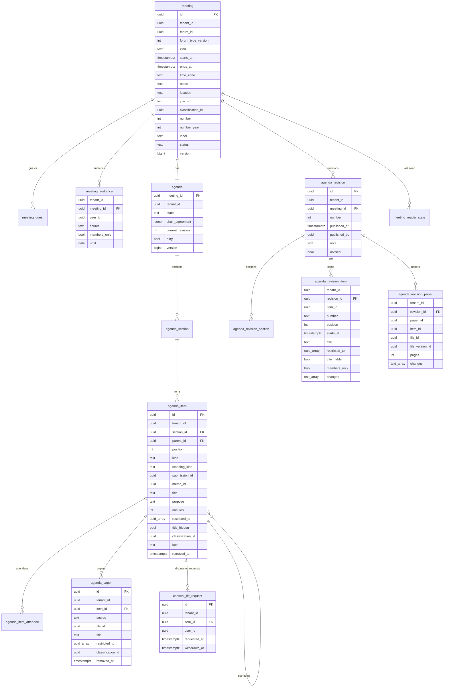

# E03 Meetings and the agenda builder — design

> Step 3 of `AGENTS.md §5`. Decisions: ADR-0060 (meetings and the agenda model) and ADR-0061 (meeting papers and the one access rule). Research: `research.md`. Screens: `ux-review.md` (flows N–R, reviewed by the owner with E02's flow M before any web task, Phase 4 Q1).

## 1. Domain model

### 1.1 Meeting
| Attribute | Notes |
|---|---|
| `forumId` | An ACTIVE forum. A dissolved forum takes no new meetings |
| `forumTypeVersion` | The type version published when the meeting was created. It is pinned: later policy changes do not touch it. Its agenda template, settings and late mode apply |
| `kind` | ORDINARY or SPECIAL (a label; the same number series) |
| `title` | Optional, 0–200 characters (for example "Strategy day"); the forum's name is shown otherwise |
| `startsAt`, `endsAt` | Sent as local date-times in `timeZone`, stored as `timestamptz`; `endsAt > startsAt`, at most 7 days apart. A local start or end in a daylight-saving gap is refused, and one in an overlap takes the earlier offset |
| `timeZone` | IANA name known to the JVM; default the tenant's zone |
| `mode` | IN_PERSON, ONLINE or HYBRID |
| `location` | 1–500 characters; required for IN_PERSON and HYBRID |
| `joinUrl` | `https` only, at most 2,000 characters, no credentials in the URL; required for ONLINE and HYBRID. A plain field: nothing calls it |
| `joinDetails` | Optional, 0–1,000 characters (meeting id, dial-in) |
| `classificationId` | Defaults to the forum's; never below it |
| `number`, `numberYear`, `label` | Set when the agenda is first published: the next number of the forum in the calendar year of `startsAt` in the meeting's zone; `label` = "`{code}` `{n}`/`{yyyy}`", for example "BRC 3/2026" |
| `status` | See the state machine; `statusReason` for cancellation |
| `version` | Optimistic lock (If-Match) |

**Guests** (`meeting_guest`): people in attendance for the whole meeting who are not on the roster, for example the CFO at ALCO. Each has an optional note ("Chief Financial Officer") and can be removed (an end time is recorded, never a deletion).

```mermaid
stateDiagram-v2
  [*] --> DRAFT: create (officers only see it)
  DRAFT --> SCHEDULED: schedule (audience sees date, place, link)
  DRAFT --> CANCELLED: discard (reason)
  DRAFT --> DRAFT: reschedule (times; no reason needed)
  SCHEDULED --> SCHEDULED: reschedule (times; reason; audited)
  SCHEDULED --> IN_PROGRESS: start (secretary)
  SCHEDULED --> CANCELLED: cancel (reason)
  IN_PROGRESS --> HELD: end (secretary)
  HELD --> MINUTES_APPROVED: minutes approved (E06)
  MINUTES_APPROVED --> CLOSED: close (E06/E07)
```


- Forbidden transitions answer 409 `WRONG_STATE`. Examples: start a draft, reschedule a held meeting, cancel an in-progress meeting.
- As built (T1): times change only through `reschedule`, so a draft is rescheduled too, without a reason; the place, mode and link change through `PATCH` (DRAFT or SCHEDULED). Guests change until the meeting is held.
- A meeting still SCHEDULED a day after `endsAt` is flagged "Not marked as held" to the secretaries (§9).
- E03 implements every transition up to HELD and CANCELLED. The CHECK constraint already allows E06's two states.
- **On cancellation:**
  - the agenda freezes;
  - submission items go back to the tray (their submissions stay ACCEPTED and the forum's placement is cleared);
  - members lose access to its papers (officers keep it);
  - the audience is told (E05 adds the iCalendar cancellation).
  - As built (T2): "go back to the tray" means each SUBMISSION item is removed with the reason `MEETING_CANCELLED` and its placement cleared (audited `meeting.agenda.item_removed`, `forum.submission.unplaced`, then `meeting.agenda.released`); the other items stay frozen. A rescheduled meeting's placements follow its new date.

### 1.2 Agenda: the working draft (ADR-0060)
One agenda per meeting, created on first opening the builder. It starts from the pinned type version's template or from an earlier meeting (§1.7).

| Entity | Attributes |
|---|---|
| `agenda` | `meetingId` (PK), `state` (DRAFT, PUBLISHED), `chairAgreement` (`{by, at, onBehalfBy?, note?}` or null), `currentRevision` (0 before publication), `dirty` (changes since the last revision), `version` |
| `agenda_section` | `position`, `title` 1–200, `kind` STANDARD or CONSENT, `membersOnly`, `receivesSubmissions` (at most one per agenda), `removedAt` |
| `agenda_item` | `sectionId`, `parentId` (one level only), `position`, `kind` SUBMISSION, STANDING, ITEM or BREAK, `standingKind` (APOLOGIES, DECLARATIONS, PREVIOUS_MINUTES, MATTERS_ARISING, AOB; STANDING only), `submissionId` and `memoId` (SUBMISSION only), `title` 1–300, `description` 0–2,000, `purpose` DECISION, DISCUSSION or INFORMATION (shown as "For decision", "For discussion", "For noting"), `resolutionSought` 0–2,000, `minutes` 0–600 (null on sub-items), `presenters` (users and typed names, 0–5), `restrictedTo` (user ids or null), `titleHidden`, `classificationId` (never below the meeting's), `late` (NONE, LATE, AWAITING_CHAIR, CHAIR_AGREED, TABLED), `addedAfterRevision`, `removedAt`, `version` |
| `agenda_item_attendee` | `itemId`, `userId`: in attendance for this item only (presenters who are users are attendees by default) |
| `agenda_paper` | `itemId`, `position`, `source` MEMO_DOCUMENT, MEMO_ATTACHMENT, MEMO_RECORD or UPLOAD, `fileId`, `title` 1–300, `restrictedTo`, `classificationId` (memo papers: the attachment's effective level; uploads: chosen, never below the item's), `late`, `removedAt` |

**Invariants**, checked under `SELECT … FOR UPDATE` on the agenda row, with the agenda's `version` as If-Match on every builder change:
- `ONE_LEVEL`: a sub-item cannot have sub-items, and a sub-item cannot be a BREAK.
- `ONE_PLACEMENT`: a submission is on at most one agenda that is not cancelled (unique `(tenant_id, submission_id) WHERE removed_at IS NULL`).
- `SUBMISSION_STATE`: only an ACCEPTED (or, through accept-and-place, a QUEUED) submission can be placed.
- `FROZEN`: no change once the meeting is HELD or CANCELLED. During IN_PROGRESS only "tabled" additions and paper additions are allowed.
- `RESTRICTION_AUDIENCE`: `restrictedTo` names only people in the meeting's audience (§1.6). An empty list is refused; "no restriction" is null.
- `CLASSIFICATION`: an item or paper is never below the meeting's level, and the people in `restrictedTo` must be cleared for it.
- Positions are dense integers per parent, rewritten for the parent on each move (lists of at most 100).
- `CAPS` (422 `TOO_MANY`), per agenda:
  - 30 sections;
  - 150 items and sub-items;
  - 20 papers per item;
  - 5 presenters and 30 attendees per item;
  - 100 names in a restriction.
- As built (T2): the tables are `meeting_agenda`, `meeting_section`, `meeting_item`, `meeting_item_attendee` and `meeting_paper` (module prefix, ADR-0006). FROZEN is not stored: the draft's `changes` (ANY, TABLED_ONLY, NONE) follows the meeting's status. Removing an item never removes its sub-items (they take its place); a section is removed only when empty (`SECTION_NOT_EMPTY`). Item attendees include the user presenters; a standing kind is on an agenda at most once. Uploads placed late under CHAIR_APPROVAL wait on the paper (AWAITING_CHAIR); memo papers ride with their item.

**Item numbers** are not stored on the draft. They are computed at publication:
- items count 1, 2, 3 … through the whole agenda, skipping breaks;
- sub-items are `n.1`, `n.2`;
- sections are unnumbered headings.

**Times:**
- An item's start is the meeting's start plus the minutes of the items before it.
- Sub-items have no time of their own.
- Totals are shown per section and for the agenda, with an overrun warning against `endsAt`.

### 1.3 Agenda states and revisions

```mermaid
stateDiagram-v2
  [*] --> DRAFT: builder opened (template or clone)
  DRAFT --> DRAFT: edit (secretary)
  DRAFT --> DRAFT: chair agrees / secretary records agreement
  DRAFT --> PUBLISHED: publish revision 1 (needs chair agreement if the type says so; meeting SCHEDULED or IN_PROGRESS)
  PUBLISHED --> PUBLISHED: edit (dirty = true; members still read revision n)
  PUBLISHED --> PUBLISHED: publish revision n+1 (note required)
  PUBLISHED --> FROZEN: meeting HELD or CANCELLED
  DRAFT --> FROZEN: meeting CANCELLED
```

- Publishing is refused with 409 when:
  - the meeting is a DRAFT (`MEETING_NOT_SCHEDULED`);
  - the chair's agreement is missing (`CHAIR_AGREEMENT_REQUIRED`);
  - a paper's PDF rendition is FAILED or NOT_POSSIBLE (`PAPER_NOT_READABLE`, with the paper ids);
  - nothing changed since the last revision (`NOTHING_TO_PUBLISH`).
- A pending rendition does not block publication. The paper shows "Being prepared" until it is done.
- Items AWAITING_CHAIR are left out of the revision. The publish dialog lists them. In the draft they have no number and do not count in the times.
- **A revision** (`agenda_revision`) records:
  - its number, when, by whom, the note (required from revision 2, 1–500 characters), and whether the audience was notified;
  - an immutable copy of every section, item (`agenda_revision_item`) and paper (`agenda_revision_paper`), with:
    - the computed number and start time;
    - the restrictions and classification;
    - the pinned `fileVersionId` of each paper (the file's current version at publication);
    - the change flags against the previous revision: ADDED, REMOVED (kept as a struck line in "What changed", not in the body), MOVED (with the old number), RETITLED, TIME_CHANGED, PAPER_ADDED, PAPER_REPLACED, PAPER_REMOVED, LATE, TABLED.
- Restriction changes are recorded on the revision but never shown as change flags to members.
- Revisions are append-only. The app role has no UPDATE or DELETE on them.
- As built (T3):
  - The tables are `meeting_revision` (number, when, by whom, note, notified, and revision 1's chair agreement), `meeting_revision_section`, `meeting_revision_item` and `meeting_revision_paper`; they have no UPDATE, DELETE or TRUNCATE for the app role. A revision item keeps `parent_item_id` (a declaration on an item covers its sub-items, E04), the section's `members_only`, the item attendees and its previous number. Items and papers a revision took off are rows with `removed` (the struck lines of "What changed"), never in the body.
  - `NOTHING_TO_PUBLISH` compares the copy with the last revision's body, not the `dirty` flag, so a change undone before publishing publishes nothing; a restriction change alone is something to publish, without a flag.
  - **MOVED** is an item outside the longest run of items kept in the same order, or one now in another section or under another item, so moving item 5 to position 3 flags it alone ("was 5") and the knock-on renumbering of items 3 and 4 is not a move (their previous number is still kept). **TIME_CHANGED** is a change of the item's own duration; a knock-on shift of start times is not a flag (the times shown are the current ones).
  - Lateness as members read it (`late`: NONE, LATE, TABLED) is decided when an item or paper is first published and carried afterwards: TABLED for what was tabled; LATE for what was placed late (ALLOW) or agreed by the chair, and for an item with papers, or a paper, first published after the deadline. LATE and TABLED are flags only in the revision that first carries them.
  - A refusal is checked in the order of design §1.3 (`RevisionRules.refusal`): `FROZEN`, `MEETING_NOT_SCHEDULED`, `CHAIR_AGREEMENT_REQUIRED`, `PAPER_NOT_READABLE` (with `paperIds`), `NOTHING_TO_PUBLISH`; the note is checked first (422 `note` `NOTE_REQUIRED` from revision 2, `LENGTH` over 500).
  - The meeting's number is taken at the first publication from the counter row (inserted if missing, then `SELECT … FOR UPDATE`), in the calendar year of the meeting's date in its zone (the owner confirmed calendar year on 2026-11-18); a meeting the next year starts again at 1. The forum's code locks in the same transaction (`ForumCodes.lock`). Audited `meeting.numbered`.

### 1.4 Late papers and the chair (E02 policy, enforced here)
- **Paper deadline** = the end of the working day that is `deadlineWorkingDays` working days before the meeting's date, in the meeting's zone, on the tenant's business calendar (`WorkingDays.before`, new).
- An item or paper is **late** when it is first published in a revision published after the deadline. When it is placed after the deadline, the type's late mode applies:
  - **ALLOW:** `late = LATE`; published with "Late paper".
  - **BLOCK:** placement refused with 409 `PAPER_DEADLINE_PASSED`; the submission stays in the tray for a later meeting.
  - **CHAIR_APPROVAL:** `late = AWAITING_CHAIR`. The chair (or the vice-chair when there is no chair in office) is notified and agrees or declines on the meeting page.
    - Agree: `CHAIR_AGREED`, published in the next revision with "Late paper".
    - Decline: the item is removed and the submission returns to the tray.
    - The secretary can record the chair's answer on their behalf ("by email on …").
    - As built (T3): the chair's answers carry the agenda's version (If-Match), so the chair agrees to what they read. An answer recorded on the chair's behalf needs a note (422 `note` `NOTE_REQUIRED`) and names the chair in office as `by`, with the secretary as `onBehalfBy`; with no chair or vice-chair in office it is refused (409 `NO_CHAIR`). A second agreement is 409 `ALREADY_AGREED`, and one after revision 1 `WRONG_STATE`. Late uploads waiting on the paper are decided with `POST …/agenda/papers/{pid}/late-decision`. An answer on something not waiting is 409 `WRONG_STATE`. Audited `meeting.agenda.chair_agreed`, `meeting.late.agreed` and `meeting.late.declined`; the agreement does not lapse when the draft changes before revision 1.
- **During the meeting** (IN_PROGRESS) the secretary may add an item or paper as TABLED. No late mode applies; it is marked "Tabled at the meeting".
- Secretary items without papers (standing items, breaks, procedural items) are never late.

### 1.5 Consent requests
`consent_lift_request(itemId, userId, requestedAt, withdrawnAt)`:
- Any person in the audience who can see the item can ask, while the item sits in a CONSENT section of the published revision and the meeting is SCHEDULED.
- One open request per person per item. The requester can withdraw it until the meeting starts.
- An item with an open request shows "Lifted for discussion at {names}'s request" on the published agenda at once, and is taken after the consent section.
- The secretary may move it in the next revision; the request stays on record for the minutes (E06).
- Requests are append-only: a withdrawal sets `withdrawnAt` once.
- As built (T4): the table is `meeting_consent_request` (module prefix), with the meeting and the revision the person read; the open-request index is unique `(tenant_id, item_id, user_id) WHERE withdrawn_at IS NULL`, and a trigger plus a column grant allow only `withdrawn_at` from null to a time. Who may ask: a member in office or a guest who sees the item in full (not a secretary: 403); an item they do not see is 404; outside a consent section, or once the meeting is not SCHEDULED, 409 `WRONG_STATE`; a second open request 409 `ALREADY_ASKED`; a withdrawal without one 409 `NO_REQUEST`. The meeting's row is locked first, so a request cannot land after the meeting has started. `MEETING_DISCUSSION_REQUESTED` goes to the secretaries and the chair (the vice-chair when there is none), never the requester; audited `meeting.discussion.requested` and `.withdrawn`. Every member who sees the item reads who asked (`discussion.requestedBy`), whatever section it is in later.

### 1.6 The audience (who the meeting is for)
`meeting_audience(meetingId, userId, source, membersOnly, until)` is materialised, recomputed in the same transaction on every change that affects it:
- **MEMBER:** every roster seat in office on the meeting's date (`ForumDirectory.membersOn(forum, date)`, position seats resolved to holders), whatever the role. `membersOnly = true` for CHAIR, VICE_CHAIR, MEMBER and SECRETARY. `until` is the seat's end of office (term end or ended date); null when open.
- **GUEST:** each current meeting guest; `membersOnly = false`; access lasts until the meeting is MINUTES_APPROVED (E06).
- **ATTENDEE:** item attendees, on `agenda_item_attendee` (for that item only).
- **Recomputed when:** the forum changes (`ForumChanged`, for meetings not HELD, CANCELLED or later), when guests change, and when the meeting's date changes.
  - As built (T1): `ForumChanged` is now also published for every change to the terms of office (it was only for the forum row). A row that no longer applies gets `removed_at` (the app role deletes nothing). A new holder of a position seat reaches the audience at the next roster or meeting change (org changes do not publish `ForumChanged`).
- **Alternates standing in** for members who sent apologies are added by E05.
- **Officers** are not audience rows. They are checked through `ForumDirectory.rolesOf` (secretary or chair in office today) and `forums.manage`.

### 1.7 Starting an agenda
- **From the template:** the pinned type version's `agenda.template` (sections with kinds and flags, standing items with titles, purposes and minutes) is copied into the draft.
- **From an earlier meeting** of any forum the actor is an officer of: its latest revision (or draft, if never published) is copied, keeping sections, item titles, kinds, purposes, durations, presenters, attendees and restrictions.
  - Restrictions are kept only for people in the new meeting's audience. The others are dropped and the builder lists them ("2 restrictions referred to people who are not on this meeting").
  - Never copied: SUBMISSION items, papers, lateness, chair agreement and consent requests.
- **Then the tray:** submissions accepted for this forum and not placed, ordered by target date (on or before this meeting first), then by age.
- As built (T2): a copy leaves out an item whose restriction would name nobody on the new meeting (listed as `skipped`), so a restriction only ever narrows; restrictions and attendees also drop people no longer cleared for the item. The tray is served by the forum module (`GET /forums/{fid}/submissions/ready?on=`).

### 1.8 From submissions to agenda items
```mermaid
sequenceDiagram
  participant S as Secretary
  participant M as meeting module
  participant F as forum module
  participant W as memo (MemoReaders, files)
  S->>M: place submission sid on meeting m (section, position)
  M->>F: ForumPolicies.of(m.typeVersion); SubmissionPlacements.place(sid, m, date)
  F-->>M: refused unless ACCEPTED (or QUEUED: accepted now, audited as forum.submission.accepted)
  M->>M: late mode check against the paper deadline
  M->>W: memo brief, document file, attachments (current files)
  M->>M: agenda_item SUBMISSION + papers (document's PDF + every attachment, untickable)
  Note over F,M: later: ForumSubmissionChanged(sid)
  F-->>M: status RETURNED / DECLINED / REFERRED / DEFERRED / WITHDRAWN
  M->>M: item removed from the draft; secretaries told "publish a revision" if it was published
```
- **Title:** the memo's subject, editable on the agenda. The memo number is shown beside it to officers and in the paper titles.
- **From the cover sheet:** the purpose, resolution sought and presenter.
- **Papers:**
  - the memo's document (its PDF rendition), titled "Paper: {memo number}";
  - each attachment, with its title and its own classification;
  - the memo's final record instead of the document when one exists (MEMO_RECORD).
- **The pack:** the secretary can remove a memo paper from the pack (an annex not for the committee) and add secretary papers.
- **Pinning:** papers pin the current file version at each publication. The memo cannot change while it waits (ADR-0058), so in practice the version is the one submitted.
- **Removing a SUBMISSION item** in the builder clears the forum's placement. The submission returns to the tray, ACCEPTED.
- **Deciding the item** is E06 (`ForumDecisions.decide`). Deferral at the meeting is an E06 outcome that requeues the submission.
- **Lock order** (as built in T3; it fixes T2's deadlock between a triage and a removal or a cancellation): every transaction that may place or unplace a submission takes the rows in this order: the submission rows (`SubmissionPlacements.lock`, `lockOn`; in id order), then the meeting's (`FOR NO KEY UPDATE` when it changes the meeting), then the agenda's. A triage already does (the forum updates the submission, then `ForumSubmissionChanged` reaches the agenda); placing, removing an item, the chair's decline, cancelling and rescheduling now lock the submissions first, and publishing locks the meeting before the agenda, as a cancellation does. A builder change reads the meeting again under the agenda's lock, so one that waited on a cancellation sees it (`FROZEN`). `AgendaConcurrencyIT` races a return against a placement, a removal and a cancellation of the same submission.
- As built (T3): when a submission item that is on the published agenda leaves the draft, its secretaries are told to publish a new revision (`MEETING_ITEM_WITHDRAWN`, English and Arabic); members read it in the published revision until then.

### 1.9 The paper access rule (ADR-0061)
One rule, written once as jOOQ conditions in `PaperAccess`, is used by every read path:
- the member's agenda, paper opens and "What changed";
- the per-recipient notifications;
- the `meeting.paper` purpose's `mayRead`;
- the preview.

```
officer(u, F)     := u is a secretary or the chair of F in office today, or holds forums.manage

seeItem(u, i in revision r of meeting m) :=
      cleared(u, i.classification)
  ∧ ¬excluded(u, i)                                  -- E04 hook (PaperExclusions); NoExclusions in E03
  ∧ ( officer(u, m.forum)
    ∨ ( r is published (latest, or an earlier one asked for by number)
      ∧ m.status ∈ {SCHEDULED, IN_PROGRESS, HELD, MINUTES_APPROVED, CLOSED}
      ∧ ( member(u, m) ∧ until ≥ today ∧ (¬i.section.membersOnly ∨ membersOnly(u))
        ∨ guest(u, m) ∧ ¬i.section.membersOnly ∧ m.status ∉ {MINUTES_APPROVED, CLOSED}
        ∨ attendee(u, i) ∧ m.status ∉ {MINUTES_APPROVED, CLOSED} )
      ∧ (i.restrictedTo is null ∨ u ∈ i.restrictedTo) ) )

seePaper(u, p of i in r) := seeItem(u, i) ∧ cleared(u, p.classification) ∧ ¬excludedFromPapers(u, i)
                            ∧ (p.restrictedTo is null ∨ u ∈ p.restrictedTo ∨ officer(u, m.forum))

seeTitle(u, i in r)      := seeItem(u, i)
                            ∨ (inAudience(u, m) ∧ ¬i.titleHidden ∧ (¬i.section.membersOnly ∨ membersOnly(u)))
                            ∨ (forumRead(u) ∧ cleared(u, m.classification) ∧ ¬i.titleHidden ∧ i.restrictedTo is null)
```
- **What others see:**
  - An item someone cannot see, but whose title they may, shows as "{n}. {title} — papers restricted".
  - With `titleHidden`, it shows as "{n}. Restricted item".
  - Otherwise the line is absent; members-only sections are absent for guests.
  - Restricted papers are absent: no title, no count.
- **The E04 hook:** `excluded` and `excludedFromPapers` are the two methods of `PaperExclusions`. E04 implements them from declarations (ADR-COI): recusal always hides the papers, and hides the title only when the item hides it (overview E04).
- **Guards:**
  - An architecture test fails if any class other than `PaperAccess` and the revision store selects from the revision tables.
  - A surface registry (`test-plan.md`, "Leak-suite skeleton") lists every read path for E04's leak suite.
- **As built (T4):**
  - `PaperAccess` (`com.memo.meeting`) holds the rule as jOOQ conditions over either table shape (`ItemColumns`, `PaperColumns`: the draft's `meeting_item` joined to its section, or `meeting_revision_item`): `itemCondition` (seeItem), `lineCondition` (seeItem or the line) and `paperCondition` (seePaper); seeTitle is seeItem, or a line whose `titleCondition` holds (amended 2026-11-18, below). The person is a `PaperViewer` read once per request (officer, the levels they are cleared for, member in office today and members-only, guest, item attendee, `forum.read` cleared for the meeting, and the meeting's state), so the conditions take constants. It answers what a person sees of a revision or of the draft (`Visibility`: each line's `LineAccess` FULL, TITLE or HIDDEN, and the papers), one pinned paper (`paper`, one indexed query), whether a revision changed something they see (`changed`, for the notifications) and the purpose's `readsFile`. T3's `AgendaVisibility` is gone: the notifications use `PaperAccess.changed`.
  - **The E04 hook:** `PaperExclusions.excluded(userId, item, parent)` and `excludedFromPapers(userId, item, parent)` take the item's and its parent's id columns and answer a jOOQ `Condition`; `PaperAccess` adds `NOT (…)` to every item and paper condition, officers included, on the draft and the revision tables alike. `NoExclusions` (a `@Component`, both `falseCondition()`) is E03's; E04 T2 drops its `@Component` and registers `DeclarationExclusions` with one `EXISTS` over its declarations each. E04's extra `seeTitle` clause for officers goes into `lineCondition`.
  - A line seen by title only carries its number, kind, purpose, time and duration, and the line flags (ADDED, REMOVED, MOVED, RETITLED, TIME_CHANGED; no RETITLED for a hidden title); never the description, resolution sought, presenters, papers or consent requests. An item seen in full shows a paper flag only when a paper the person may read carries it, so a restricted paper's replacement is not told. A section is listed when it has a line the person sees, or when it is not members-only (members-only headings only for members, secretaries and officers).
  - **Titles only within clearance and membership** (ADR-0061 amendment, 2026-11-18; `PaperAccess.titleCondition`): a line shows its title only when the item does not hide it, the person's clearance reaches the item's level, and the item is not in a members-only section unless the person reads members-only sections (a member for them, or an officer). Otherwise it reads "Restricted item" (no title, no RETITLED), for members, guests, presenters, attendees and `forum.read` holders alike, officers included within their own clearance. A members-only section shown to someone outside the membership (a `forum.read` holder: unrestricted, unhidden lines of every section, never a paper) has no heading (`title` null); guests and item attendees see nothing of it. The revision notifications only count items a person sees in full, so a title they may not read never reaches them through `MEETING_AGENDA_CHANGED`.
  - A cancelled meeting keeps its lines for the audience (titles), not its items or papers; a former member (out of office today) and, once the minutes are approved, guests and item attendees see no line.
  - **The `meeting.paper` purpose's `mayRead`** is `PaperAccess.readsFile`: through the generic files endpoints only the forum's officers, and only when every paper carrying the file, in the draft and in every revision, passes the rule for them. Members read the version a revision pinned through `GET /meetings/{id}/papers/{pid}/content` only: the generic endpoints serve any version of a file and cannot tell which one a revision carried.

### 1.10 ERD

- `meeting_counter (tenant_id, forum_id, year, last)` is locked with `SELECT … FOR UPDATE` when a number is taken, so numbers have no gaps.
- Ids in `restricted_to` are checked against the audience on write. They are not foreign keys.

## 2. Modules and events
- **`meeting` (new contents):**
  - Published API in `com.memo.meeting`:
    - `Meetings` (find, `ofForum`, `meetingsOf(user)`);
    - `PaperAccess` (the rule, ADR-0061: `itemCondition(user)`, `paperCondition(user)`, `canSeePaper(paperId, revision)`);
    - `PaperExclusions` (the E04 hook, an interface with `NoExclusions` as the E03 implementation);
    - the events `MeetingChanged(tenantId, meetingId, change)` and `AgendaPublished(tenantId, meetingId, revision)`, for E04–E07.
  - As built (T3): `MeetingChanged(tenantId, meetingId, change)` is published in the changing transaction with `change` one of CREATED, UPDATED, SCHEDULED, RESCHEDULED, STARTED, ENDED, CANCELLED, NUMBERED and GUESTS; `AgendaPublished(tenantId, meetingId, revision)` in the publishing transaction. Both are in `com.memo.meeting` (`MeetingEvents.kt`). `PaperAccess`, `PaperExclusions` and `NoExclusions` came with T4 (§1.9 as built).
  - Internals in `com.memo.meeting.internal`.
  - Depends on `forum`, `memo` (`MemoReaders`), `files`, `workflow` (`WorkingDays`), `org`, `notification`, `audit` and `tenancy`, through `common`.
- **`forum` changes (published, no behaviour change for E02):**
  - `ForumChanged`, `ForumTypePublished` and `ForumSubmissionChanged` move to `com.memo.forum`. `ForumSubmissionChanged` gains `status`.
  - `ForumPolicies.version(typeId, number)` returns the agenda, submission and quorum policy of a type version.
  - `SubmissionPlacements`:
    - `place(sid, meetingId, meetingDate)` accepts a QUEUED submission first and is refused unless the submission is open;
    - `unplace(sid)`;
    - `placed(forumId)` returns the ids placed and still open.
    - `forum_submission` gains `meeting_id` and `meeting_date`, so the memo's forum panel shows "On the agenda of the meeting on 12 Dec" without knowing meetings.
  - `Forums.lockCode(forumId)` is called at the first numbered meeting (E01 left the code editable until then). As built (T1): `Forums` is internal, so the meeting module calls the published `ForumCodes.lock(forumId)`; it is audited as `forum.code_locked`, the forum response gains `codeLocked`, and a code change after it answers 409 `CODE_LOCKED`.
  - As built (T1): `SubmissionStatus` and `SubmissionPurpose` move to `com.memo.forum` with the events; `SubmissionPlacements.place` also takes the forum id (a submission of another forum is 404) and returns a `SubmissionRef`; `ForumPolicies.version` returns a `ForumTypePolicy` whose agenda part comes with T2.
  - The forum-type version gains `agenda` (template and settings) in its checks, presets, changes view and maker-checker.
- **`files` (published addition):**
  - `FileServing.serve(versionId, kind: ORIGINAL | PDF, range, response, audit: OpenContext)` streams a version or its PDF rendition with the same headers, ranges and `file.opened` audit as the files endpoints. It is for a module that has already decided access, and the open is audited with the caller's context (`meeting`, `paper`, `revision`).
  - The `meeting.paper` purpose (owned by `meeting`) uses the files endpoints like any purpose.
  - As built (T4): `FileServing.serve(versionId, content: ORIGINAL | PDF, request, response, audit: OpenAudit)` answers `ServeOutcome` (SERVED, NOT_READY for a PDF still being prepared or not possible, MISSING), writing nothing unless SERVED. The PDF is the original when it is a PDF, else the version's done PDF rendition, shown inline; the original keeps its purpose's disposition. The open is audited once per session and version (the files module's open marks, not per range request) with the caller's action and details, plus the file, version, purpose and content: for a paper `meeting.paper.opened` on the meeting with the paper, item and revision. The implementation is `files.internal.PinnedServing`; `PaperAccessArchTest` pins its callers to the meeting module.
- **`workflow`:** `WorkingDays.before(date, n)`, the date n working days before `date`.
- **`ApplicationModules.verify()`:** meeting → forum, memo, files, workflow; never the reverse. The precomputed module metadata (#151) is regenerated.

## 3. API
All endpoints follow the conventions:
- `/api/v1`, RFC 9457 errors;
- If-Match on the meeting's `version` for meeting changes, and on the agenda's `version` for every builder change;
- `Idempotency-Key` on POSTs that create rows (meetings, items, papers, revisions, requests).

| Method and path | Access | Notes |
|---|---|---|
| `GET /forums/{fid}/meetings?from=&to=&status=` | officers of F, `forums.manage`; audience and `forum.read` see non-DRAFT | Cursor by `startsAt` |
| `POST /forums/{fid}/meetings` | officers (secretary) of F, `forums.manage` | Creates a DRAFT; `FORUM_DISSOLVED` |
| `GET /meetings/{id}` | officers; audience and `forum.read` when not DRAFT | Details, the viewer's relation, agenda state; 404 when invisible |
| `PATCH /meetings/{id}` | secretary, `forums.manage` | Title, kind, place, mode, link, classification; time changes go through `reschedule` |
| `POST /meetings/{id}/schedule`, `/reschedule`, `/start`, `/end`, `/cancel` | as PATCH | `reschedule` and `cancel` need a reason; state machine §1.1 |
| `GET /me/meetings?from=` | signed in | Upcoming and recent meetings where the actor is in the audience or an officer |
| `POST /meetings/{id}/guests`, `POST …/guests/{uid}/remove` | secretary | Guest users |
| `GET /meetings/{id}/agenda/draft` | officers (chair read-only) | The working draft with tray counts, deadline, totals, warnings |
| `POST /meetings/{id}/agenda` | secretary | Start: `{from: TEMPLATE}` or `{from: MEETING, meetingId}` |
| `POST …/agenda/sections`, `PATCH …/sections/{sid}`, `POST …/sections/{sid}/remove` | secretary | Kind, members only, receives submissions |
| `POST …/agenda/items` | secretary | `{kind, sectionId, parentId?, position?, …}`; for SUBMISSION `{submissionId}` (late mode, `ONE_PLACEMENT`) |
| `PATCH …/agenda/items/{iid}`, `POST …/items/{iid}/remove` | secretary | Title, purpose, minutes, presenters, attendees, restriction, hide title, classification |
| `POST …/agenda/moves` | secretary | `{itemId or sectionId, toSectionId?, toParentId?, toPosition}`, one move; the response is the new order |
| `GET /forums/{fid}/submissions/ready` | officers | The tray: accepted, unplaced, with memo briefs |
| `POST …/items/{iid}/papers` | secretary | Memo paper `{fileId}` from the submission's memo, or an uploaded `meeting.paper` file id |
| `PATCH …/papers/{pid}`, `POST …/papers/{pid}/remove` | secretary | Title, restriction, classification; a new file version replaces the paper's content |
| `POST …/agenda/chair-agreement` | the chair (vice-chair if none), or the secretary `{onBehalf: true, note}` | Agreement to the first publication |
| `POST …/agenda/chair-comments` | the chair | `{text}` 1–2,000: an in-app message to the secretaries; nothing changes on the agenda |
| `POST …/items/{iid}/late-decision` | as chair agreement | `{agree: bool, note?}` for AWAITING_CHAIR items |
| `GET …/agenda/preview?as={userId}` | secretary | The draft as that audience member would see it if published now (the rule run against the draft) |
| `POST …/agenda/publish` | secretary | `{note?, notify: true}` → revision n |
| `GET /meetings/{id}/agenda?revision=` | the rule | The published revision (latest by default) as the viewer may see it, with "What changed since you last looked" |
| `GET /meetings/{id}/agenda/revisions` | officers; the audience sees numbers, dates and notes | Revision list |
| `GET /meetings/{id}/papers/{pid}/content?revision=&kind=PDF\|ORIGINAL` | the rule; ORIGINAL officers only | Streams the pinned version; audited `meeting.paper.opened` |
| `POST /meetings/{id}/agenda/items/{iid}/discussion-requests`, `POST …/discussion-requests/mine/withdraw` | audience who see the item; meeting SCHEDULED | Consent "Ask to discuss" |
| `POST /meetings/{id}/seen` | audience | Records the last revision seen (for "What changed") |

**Problems:**
- 409: `WRONG_STATE`, `FROZEN`, `ONE_LEVEL`, `ONE_PLACEMENT`, `SUBMISSION_STATE`, `PAPER_DEADLINE_PASSED`, `CHAIR_AGREEMENT_REQUIRED`, `PAPER_NOT_READABLE`, `NOTHING_TO_PUBLISH`, `MEETING_NOT_SCHEDULED`, `FORUM_DISSOLVED`;
- 422 field problems: `RESTRICTION_AUDIENCE`, `CLASSIFICATION`, `UNKNOWN_ZONE`, `UNKNOWN_LOCAL_TIME` (a start in a daylight-saving gap), `LINK_NOT_HTTPS`, `TOO_MANY`, `REASON_REQUIRED`, `NOTE_REQUIRED`; as built (T1) also `REQUIRED` (location or link for the mode), `LINK_CREDENTIALS`, `FORMAT`, `LENGTH`, `END_BEFORE_START`, `TOO_LONG` (over 7 days) and `CLASSIFICATION` for a level above the actor's own clearance or a guest not cleared;
- 409 as built (T1) also `ALREADY_GUEST`, `CODE_LOCKED` (forum) and `TYPE_NOT_PUBLISHED`;
- 412 on a stale If-Match.
- As built (T2): every builder change answers the whole draft (`AgendaDraftResponse`) with the agenda's new version as the ETag; creates (start, section, item, paper) need an `Idempotency-Key`; builder writes are rate-limited per user (`AGENDA_WRITE_PER_USER`). Also 409 `AGENDA_STARTED`, `SECTION_NOT_EMPTY`, `ALREADY_IN_PACK`, `WRONG_KIND` (papers on a break), and 422 `meetingId` `unknown` / `SAME_MEETING` / `NO_AGENDA` for a copy, `standingKind` `duplicate`, `restrictedTo` `REQUIRED` (an empty list). Also 409 `NO_AGENDA` for a builder change before the agenda is started, and 422 `sectionId` `REQUIRED` (no section yet), `minutes` `RANGE` / `ONE_LEVEL` (a sub-item has no time), `submissionId` `REQUIRED` / `CLASSIFICATION` (above the actor's clearance), `presenters` `FORMAT`, `attendees` `unknown` / `CLASSIFICATION`, `fileId` `unknown` / `TOO_MANY`. Raising an item's level raises its papers below it.
- As built (T3): the chair's agreement and late decisions carry `If-Match` and answer the draft; publishing and chair comments need an `Idempotency-Key` and answer 201 with the draft. The draft gains `state`, `chairAgreement` (`by`, `at`, `onBehalfBy`, `note`), `canAgree` (the viewer is the chair in office, or the vice-chair when there is none), `chairComments` and `revisions` (number, when, by whom, note, notified). New: `POST …/agenda/papers/{pid}/late-decision` (late uploads wait on the paper) and `GET …/agenda/publish-preview` for officers (the next revision's number, whether a note is needed, `meetingNotScheduled`, `chairAgreementMissing`, `nothingToPublish`, `unreadablePapers`, `awaitingChair`, and the change summary with flags and previous numbers, for T7's publish dialog). Also 409 `ALREADY_AGREED`, `NO_CHAIR`, `WRONG_STATE` (an answer on something not waiting, or an agreement after revision 1) and `PAPER_NOT_READABLE` with `paperIds`; 422 `note` `NOTE_REQUIRED` / `LENGTH` and `text` `LENGTH` (a chair comment, 1 to 2,000 characters).

- As built (T4), the audience's endpoints (every one through `PaperAccess`; an invisible meeting, revision, item or paper is 404):
  - `GET /meetings/{id}/agenda?revision=` answers `MemberAgendaResponse`: the revision shown (null before the first), the latest, its note, the sections and lines as the viewer sees them (`access` FULL, TITLE or HIDDEN; papers with `ready` and `opened`; `discussion` on consent items), `lastSeenRevision`, and on the latest revision `whatChanged` (the revisions after the last one seen, each with its changed lines and papers as far as the viewer sees them, and a `count`). Nothing published: an empty agenda with `revision` null.
  - `GET /meetings/{id}/agenda/revisions`: numbers, dates and notes; officers also `publishedBy` and `notified`; `forum.read` outside the audience no notes.
  - `POST /meetings/{id}/seen {revision}` (204): moves the viewer's last revision seen forward only; 422 `revision` `unknown` for a revision not published.
  - `GET /meetings/{id}/agenda/preview?as={userId}`: for officers (403 otherwise); the person must be in the audience (422 `as` `NOT_IN_AUDIENCE`); a draft meeting is read as if scheduled.
  - `GET /meetings/{id}/papers/{pid}/content?revision=&kind=PDF|ORIGINAL`: ranges, `If-None-Match`; ORIGINAL for secretaries and `forums.manage` only (403; the chair reads the PDF, design §4); 409 `PAPER_NOT_READY` while the PDF is being prepared. The person's first open is recorded for the "Opened" tick (`meeting_paper_open`).
  - `POST …/items/{iid}/discussion-requests` (Idempotency-Key, 201) and `POST …/discussion-requests/mine/withdraw` (200) answer the members' agenda.
  - `GET /me/meetings` rows gain `agendaRevision`, `lastSeenRevision` and `changesSinceSeen` (the lines "What changed" would list, counted only for meetings with a revision newer than the one seen).

## 4. Authorisation matrix
Columns:
- **Sec:** a secretary of F in office.
- **Chair:** the chair of F in office (the vice-chair when there is none).
- **Mgr:** `forums.manage`.
- **Member:** in the audience as MEMBER, in office today.
- **Guest:** a meeting guest.
- **Att:** an item attendee or presenter, for their item.
- **Read:** `forum.read`.

| Action | Sec | Chair | Mgr | Member | Guest | Att | Read | Other |
|---|---|---|---|---|---|---|---|---|
| See a DRAFT meeting | ✓ | ✓ | ✓ | – | – | – | – | – |
| Create, edit, schedule, reschedule, start, end, cancel; guests | ✓ | – | ✓ | – | – | – | – | – |
| See a scheduled meeting's details and link | ✓ | ✓ | ✓ | ✓ | ✓ | ✓ | ✓ (no link) | – |
| Build the agenda (sections, items, papers, moves, publish) | ✓ | – | ✓ | – | – | – | – | – |
| Read the draft agenda; preview as a member | ✓ | ✓ (read) | ✓ | – | – | – | – | – |
| Agree the agenda; agree or decline a late paper | ✓ (on behalf) | ✓ | – | – | – | – | – | – |
| See published items and titles | ✓ | ✓ | ✓ | rule | rule (not members-only) | own item | titles only (not hidden or restricted) | – |
| Read papers (PDF) | ✓ | ✓ | ✓ | rule | rule | own item | – | – |
| Download originals | ✓ | – | ✓ | – | – | – | – | – |
| Ask to discuss a consent item | – | ✓ | – | ✓ | ✓ (if they see it) | – | – | – |

- "rule" means ADR-0061: published, in the audience, not excluded by a restriction or a members-only section, cleared for the classification, and not excluded by E04.
- Officers also pass clearance and the E04 exclusion: a conflicted chair is not exempt.
- An invisible meeting, item or paper answers 404. A restricted paper is absent from lists, not marked "no access".
- A former member (out of office today) keeps the meeting's name in their history and loses its papers.

## 5. Audit events
All of them are written in the business transaction, with before and after where relevant:
- **Meeting:** `meeting.created`, `.updated`, `.scheduled`, `.rescheduled`, `.started`, `.ended`, `.cancelled`, `.numbered`, `.guest_added`, `.guest_removed`.
- **Agenda:** `meeting.agenda.started` (template or source meeting), `.section_added`, `.section_updated`, `.section_removed`, `.item_added`, `.item_updated`, `.item_moved`, `.item_removed`, `.paper_added`, `.paper_updated`, `.paper_replaced`, `.paper_removed`, `.chair_agreed` (with `onBehalfBy`), `.chair_commented`, `.published` (revision, note, notified, counts).
- **Late papers:** `meeting.late.requested`, `.agreed`, `.declined`.
- As built (T2): also `meeting.agenda.section_moved` and `meeting.agenda.released` (a cancelled meeting's submissions back in the tray).
- **Consent requests:** `meeting.discussion.requested`, `meeting.discussion.withdrawn`.
- **Reads:** `meeting.paper.opened` (paper, revision, file version, kind), once per open, never per page or range request.
- As built (T4): `meeting.paper.opened` is written by `FileServing` with the paper, item, revision, file, file version, purpose and content (PDF or ORIGINAL), once per session and version within the files module's 30-minute open window; `meeting.discussion.requested` and `.withdrawn` with the request, item and revision. Marking a revision seen is not audited (a reading position, like marking a notification read).
- **Forum side:** `forum.submission.placed` and `forum.submission.unplaced`.

`AuditActionCoverageTest` lists them.

## 6. Tenancy and RLS
- Every new table has `tenant_id` first in every index and composite foreign keys `(tenant_id, …)`:
  - `meeting`, `meeting_counter`, `meeting_guest`, `meeting_audience`;
  - `agenda`, `agenda_section`, `agenda_item`, `agenda_item_attendee`, `agenda_paper`;
  - `agenda_revision`, `agenda_revision_section`, `agenda_revision_item`, `agenda_revision_paper`;
  - `consent_lift_request`, `meeting_reader_state`.
- RLS is ENABLED and FORCED with the standard policy `tenant_id = (select nullif(current_setting('app.tenant_id', true), '')::uuid)`.
- **No DELETE for the app role on any of them.** Removal is a timestamp.
- Revision tables and requests also have no UPDATE, except `withdrawn_at` on a request, guarded by a trigger that allows only null → value.
- References to another module's rows (`forum_id`, `submission_id`, `memo_id`, `file_id`, user ids) carry no foreign key across modules, as elsewhere. They are checked through the published APIs.
- The async notification listener carries `tenantId` (ADR-0017).
- `ForumCrossTenantIT` gains a meeting part; `RlsMetaTest` picks up the tables.
- As built (T4): `meeting_reader_state`, `meeting_paper_open` and `meeting_consent_request` have no DELETE or TRUNCATE for the app role; `meeting_paper_open` no UPDATE; `meeting_consent_request` only `UPDATE (withdrawn_at)` behind its trigger. `MeetingCrossTenantIT` covers them.

## 7. Migrations
- **`forum/V5__agenda_policy.sql`** (T1):
  - `forum_type_version.agenda jsonb` (null reads as the defaults: chair agreement on, the preset template of the type's kind);
  - `forum.code_locked_at timestamptz`;
  - `forum_submission.meeting_id uuid` and `meeting_date date`, with index `(tenant_id, forum_id, status) WHERE meeting_id IS NULL` for the tray.
- **`meeting/V1__meetings.sql`** (T1): `meeting`, `meeting_counter`, `meeting_guest`, `meeting_audience`.
  - Indexes: `(tenant_id, forum_id, starts_at)`, `(tenant_id, status, ends_at)`; audience `(tenant_id, user_id, meeting_id)` and `(tenant_id, meeting_id)`.
- **`meeting/V2__agenda.sql`** (T2): `agenda`, `agenda_section`, `agenda_item`, `agenda_item_attendee`, `agenda_paper` (as built: `meeting_agenda`, `meeting_section`, `meeting_item`, `meeting_item_attendee`, `meeting_paper`).
  - Unique `(tenant_id, submission_id) WHERE removed_at IS NULL`.
- **`meeting/V3__revisions.sql`** (T3): the revision tables, `consent_lift_request`, `meeting_reader_state`.
  - Indexes: `(tenant_id, meeting_id, number)`, revision items `(tenant_id, revision_id, position)`, revision papers `(tenant_id, revision_id, item_id)`, and `(tenant_id, paper_id, revision_id)` for paper opens.
  - As built (T3): `meeting_revision`, `meeting_revision_section`, `meeting_revision_item` (with `parent_item_id`), `meeting_revision_paper`, `meeting_revision_notice` (who was told of which revision, the notifications' dedupe key) and `meeting_chair_comment`; no UPDATE, DELETE or TRUNCATE for the app role on any of them. Indexes as above, plus `(tenant_id, item_id)` and `(tenant_id, parent_item_id)` on revision items for E04, and one per foreign key. `consent_lift_request` and `meeting_reader_state` move to T4's migration (whichever of T4 and E04 T1 merges first takes `meeting/V4`, as the E04 plan says), with the code that uses them.
- **`meeting/V4__members_reads.sql`** (T4): `meeting_reader_state` (the last revision each person saw), `meeting_paper_open` (each person's first open of a paper) and `meeting_consent_request` (with its withdrawal trigger). E04 T1's declarations take the next free number, `meeting/V5` (its plan first named V4).
- All expand-only. No existing column changes meaning. The demo seed adds rows in T9.

## 8. Performance budget
| Endpoint or screen | Target p95 | Volume | How |
|---|---|---|---|
| `GET /me/meetings` | < 100 ms | 30 forums × 12 meetings × 10 years = 3,600 meetings; 40,000 audience rows | Audience index `(tenant_id, user_id, meeting_id)` joined to `meeting (tenant_id, id)`, `starts_at` window |
| `GET /forums/{fid}/meetings` | < 100 ms | 120 meetings per forum per 10 years | `(tenant_id, forum_id, starts_at)`, cursor |
| `GET /meetings/{id}/agenda` (member) | < 200 ms | 60 items, 200 papers, 5 revisions, 40 audience | One query per table filtered by `PaperAccess` conditions on the revision; change flags precomputed at publication |
| `GET …/agenda/draft` | < 200 ms | as above, plus 50 tray entries | Draft rows by meeting; tray by the forum index; memo briefs in one `MemoReaders.readable` call |
| Builder change (edit, move) | < 150 ms | 100 rows per parent | One locked agenda row, one positions rewrite |
| `POST …/publish` | < 500 ms | 60 items, 200 papers | Set-based `INSERT … SELECT` into the revision tables; notifications fanned out after commit (§9) |
| Paper open (first byte) | < 300 ms | 50 MB PDF | `canSeePaper` (one indexed query) then the existing streaming with ranges |

`EXPLAIN` is reviewed for each list query against the T9 volume set (3,600 meetings, 180,000 items, 600,000 papers).

## 9. Background work
- **Notifications after publication:**
  - `AgendaPublished` is handled by an async module listener carrying `tenantId`.
  - For each audience member, the listener computes what that person may see through `PaperAccess`. It sends `MEETING_AGENDA_PUBLISHED` (revision 1) or `MEETING_AGENDA_CHANGED` (later revisions, only if something the person sees changed). The body holds the forum, the meeting date and a link; the subject has no parameters (ADR-0030). Item titles never go into email; the in-app item names the meeting.
  - The listener is idempotent on `(revision, recipient)` through the notification's dedupe key.
- **Synchronous notifications in the change's transaction:**
  - late-paper requests to the chair (`MEETING_LATE_PAPER`);
  - submission-item withdrawal to the secretaries (`MEETING_ITEM_WITHDRAWN`);
  - consent requests to the secretaries and chair (`MEETING_DISCUSSION_REQUESTED`).
- **Hourly sweep** (`meeting-sweep`, per tenant, with the tenant context set; idempotent through `reminded_*` columns):
  - (a) the paper deadline has passed and the agenda is not published → `MEETING_AGENDA_DUE` to the secretaries, once;
  - (b) a meeting is still SCHEDULED a day after `endsAt` → flagged, with `MEETING_NOT_HELD` to the secretaries, once;
  - (c) audience rows whose `until` has passed are left in place; the rule compares `until` with today, so nothing needs deleting.
- As built (T3): the notifications of a revision are a db-scheduler task (`meeting-agenda-notices`, one instance per revision, ADR-0018) scheduled by a listener of `AgendaPublished` in the publishing transaction, so a rolled-back publication tells nobody and the task runs after the commit, with the tenant in its data; the codebase has no `@Async` listeners. Each person is recorded in `meeting_revision_notice` before being told, so a retried task tells nobody twice. Revision 1 goes to everyone still in the audience and cleared for the meeting, but the publisher; a later revision to those who see an item or paper it flagged (a removed row judged as it was published before). The visibility check (`AgendaVisibility`) is the notification half of the paper rule; T4's `PaperAccess` takes it over. `MEETING_ITEM_WITHDRAWN` (to the secretaries, synchronous) and `MEETING_CHAIR_COMMENTED` (in the app only) are new kinds too.
- **No file work:** papers reuse the renditions built at upload (ADR-0045). `meeting.paper` uploads get PDF and text renditions like attachments.

## 10. UX flows (`ux-review.md`)
- **N, Meetings:** the Meetings tab on the committee page, "Schedule a meeting", the meeting's settings, cancel and reschedule; "My meetings" on the home page and the "My committees" cards.
- **O, The agenda builder:** start from the template or an earlier meeting; sections, items, sub-items; the tray of ready submissions; the item side sheet (details, papers, who can see it); the Move menu and dragging; times and the deadline; preview as a member; publish with the change summary.
- **P, The meeting page members read:** the agenda with times in two zones, purposes, papers, the consent section with "Ask to discuss", "What changed since you last looked", restricted and members-only items as others see them.
- **Q, The chair:** agree the agenda; agree or decline a late paper.
- **R, The agenda template** on the committee type (an "Agenda" tab on flow J).
- **Addition to flow M:** Accept gains "and place on the agenda of [meeting ▾]".
- As built (T7): the builder is `/meetings/$meetingId/agenda` (`web/src/features/meetings/agenda/`), with the Move menu on every row and dnd-kit 6.3.1 / sortable 10.0.0 dragging as an extra (the spike passed under React 19.3 in StrictMode); the chair reads it with the agreement and the late papers; the committee type gains an Agenda tab; the queue's Accept dialog places through `POST …/agenda/items` (`kind: SUBMISSION`), which accepts a queued paper in the same step. No API change; the deviations from flows O, Q, R and M are in `log.md` (T7), among them papers that cannot be reordered (the API has no paper move).
