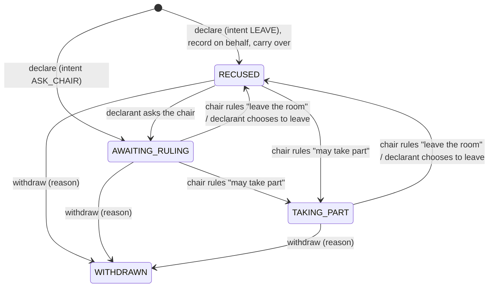
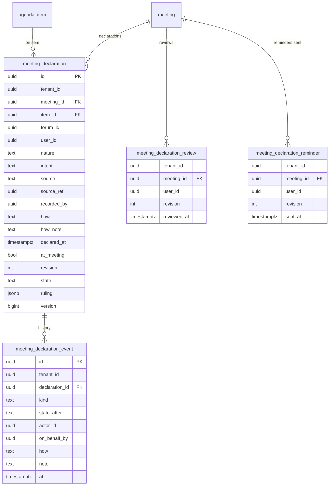

# E04 Conflicts of interest and recusal — design

> Step 3 of `AGENTS.md §5`. Decision: ADR-0062 (per-item declarations and one recusal rule). Builds on ADR-0061 (the paper-access rule and its `PaperExclusions` hook) and ADR-0057 (`recusedCount`). Research: `research.md`. Screens: `ux-review.md` (flows S–U; delegated by the owner, Phase 4 Q1).

## 1. Domain model

### 1.1 Declaration
A declaration is one person's interest in one agenda item of one meeting.

| Attribute | Notes |
|---|---|
| `meetingId`, `itemId` | An item of the meeting's agenda (`agenda_item.id`, stable across revisions). A sub-item may be chosen; a declaration on an item covers its sub-items |
| `forumId` | Copied from the meeting, for the register |
| `userId` | The declarant: someone in the meeting's audience (member, guest, item attendee) or an officer of the forum |
| `nature` | Free text, 1–1,000 characters, trimmed. Never changed: a correction is a withdrawal and a new declaration |
| `intent` | LEAVE ("I will leave the room for this item", the default) or ASK_CHAIR ("I ask the chair to decide whether I may take part") |
| `source` | SELF (the declarant, in the app); ON_BEHALF (a secretary or the chair recorded it); MEMO (carried from the memo's interests, SOD-4); EARLIER_MEETING (carried from an earlier placement of the same submission). REGISTER is reserved for a standing register (Q6) |
| `recordedBy`, `how`, `howNote` | Who entered it. `how` is IN_APP for SELF and SYSTEM for carried ones; for ON_BEHALF it is AT_MEETING, IN_PERSON, EMAIL or PHONE, with an optional note of 0–200 characters ("email of 4 Dec") |
| `sourceRef` | The memo id (MEMO) or the earlier declaration id (EARLIER_MEETING) |
| `declaredAt` | Server UTC. `atMeeting` is true when the meeting was IN_PROGRESS |
| `revision` | The published revision the declarant was reading (null before publication) |
| `state` | RECUSED, AWAITING_RULING, TAKING_PART or WITHDRAWN (§1.2) |
| `ruling` | The latest ruling: outcome, by, `onBehalfBy` (the secretary who recorded it), how, note 0–500, at |
| `version` | Optimistic lock (If-Match) |

**Invariants:**
- `ONE_OPEN`: at most one declaration per person per item that is not WITHDRAWN (unique partial index).
- `SEES_ITEM`: a person declares for themselves only on an item whose title they may see (ADR-0061 `seeTitle`) or on which they already hold a declaration. An officer may record a declaration for anyone in the audience or any officer, whether or not that person can see the item, because the secretary often knows of a conflict first.
- `PUBLISHED_FOR_SELF`: members declare on items of a published revision (an unpublished item is invisible to them: 404). Officers may record on draft items too.
- `NATURE_IMMUTABLE`, `USER_IMMUTABLE`, `ITEM_IMMUTABLE`: a trigger refuses changes to them.
- **Windows** (409 `FROZEN` or `WRONG_STATE` outside them):
  - The declarant and officers act while the meeting is DRAFT (officers only), SCHEDULED or IN_PROGRESS.
  - While the meeting is HELD and until the minutes are approved, only a secretary may record a declaration made in the room and not yet entered, or withdraw one entered in error, each with a reason ("correction"). It is audited as a correction.
  - From MINUTES_APPROVED, and for CANCELLED meetings, declarations are frozen.
  - E06 adds: once an item is decided, its declarations change only through the secretary's correction until the minutes are approved.

### 1.2 Lifecycle

- **Effective** (recused for the rule, §1.6) means RECUSED or AWAITING_RULING. Waiting for a ruling withholds the papers: fail-closed (ADR-0062).
- **Rulings** are made by the chair in office, or the vice-chair when the chair is the declarant, is recused from the item, or there is no chair. Nobody rules on their own declaration (409 `SELF_RULING`). The secretary may record the chair's ruling on their behalf, with how it was given.
- **Withdrawal** needs a reason (1–500 characters), by the declarant or an officer who is not recused from the item. Withdrawing a carried declaration does not change the memo's interests.
- **Forbidden:** anything from WITHDRAWN (409 `WRONG_STATE`); a ruling on a WITHDRAWN declaration; changing intent on someone else's declaration; any change outside the windows of §1.1.
- **History:** every transition is a row in `meeting_declaration_event` (kind DECLARED, INTENT_CHANGED, RULED, WITHDRAWN; state after; actor; `onBehalfBy`; how; note or reason; at). Append-only. The declaration row keeps the current state for the rule.

### 1.3 Who acts
| Act | Who |
|---|---|
| Declare for oneself | Anyone in the meeting's audience, for items whose title they see; officers too |
| Record on someone's behalf | A secretary or the chair in office, or `forums.manage`, not recused from that item |
| Change one's own intent (LEAVE ↔ ASK_CHAIR) | The declarant |
| Rule | The chair (or vice-chair, §1.2); a secretary on the chair's behalf |
| Withdraw | The declarant, or an officer not recused from the item, with a reason |
| Confirm the review (§1.5) | Anyone in the audience; officers. Only MEMBER-source audience and officers are reminded |

### 1.4 Carry-over and the memo
- **In from the memo:** when a SUBMISSION item is placed (E03 T2), and again when each revision is published, every person with a `memo_interest` on the item's memo who is in the audience or an officer gets a declaration on the item if they have none open:
  - `source` MEMO, `intent` LEAVE, state RECUSED, `recordedBy` the actor of the placement or publication, `how` SYSTEM;
  - `nature` is the fixed text "Interest declared on memo {number}". The memo's reason stays in the memo module (business content, never copied). The declarant can add their own declaration's words by withdrawing it and declaring again;
  - the declarant is told (`MEETING_DECLARATION_RECORDED`).
- **In from an earlier meeting:** when a submission is placed again (deferred, or its meeting cancelled), each declaration that was RECUSED or AWAITING_RULING on its last placed item is carried as RECUSED, with `source` EARLIER_MEETING. A TAKING_PART ruling does not carry: rulings belong to a meeting's chair, so it arrives as AWAITING_RULING and the new chair rules.
- **Out to the memo:** a declaration on a SUBMISSION item that is not MEMO-sourced records a memo interest for the declarant (`MemoInterestLinks.recordFromMeeting`), with the reason "Declared an interest at {meeting label}, item {n}" and never the nature. The workflow then keeps the declarant out of the memo's later steps (SOD-4). It is not removed when the meeting declaration is withdrawn.
- **Memo access is unchanged.** A recused person who reads the memo through the memo's own rule (an approver, a copy-to) keeps it. The meeting register flags it ("also reads the memo") so the secretary can act through the memo's access (ADR-0050).
- **Cloning** an earlier meeting's agenda never copies declarations (E03 §1.7).

### 1.5 The prompt and the review
- **At publication** of revision 1, E03's `MEETING_AGENDA_PUBLISHED` message gains one sentence: "Please read the agenda and declare any interests before the meeting." Later revisions that add items the person may see say the same in `MEETING_AGENDA_CHANGED`.
- **On the meeting page**, a banner shows until the person confirms: "Declarations of interest: 9 items to review".
- **The review** (`meeting_declaration_review`): the person confirms "I have declared my interests in this agenda" against the latest revision. It is append-only, one row per confirmation, with the revision number.
- **Items to review** are the items the person may see in the latest revision that were added after the revision they last confirmed (all of them before a first confirmation).
- **One reminder:** on the working day before the meeting, from 09:00 in the meeting's zone, the sweep reminds each MEMBER-source audience person and officer who has items to review (`MEETING_DECLARATIONS_DUE`), once per person and revision.
- Guests and item attendees can declare and confirm, but are not reminded.
- The standing item "Declarations of interest" (`standingKind` DECLARATIONS) shows, on the meeting page and in the builder, the declarations of the items the viewer may see: names and state ("S. Ali — will leave the room for item 5"). The nature is shown only to the declarant and officers.

### 1.6 The recusal rule (ADR-0062, in ADR-0061's hook)
```
effective(d)   := d.state ∈ {RECUSED, AWAITING_RULING}

recused(u, i)  := ∃ d ∈ meeting_declaration :
                    d.user_id = u ∧ d.item_id ∈ {i.id, i.parent_id} ∧ effective(d)

-- PaperExclusions (ADR-0061), implemented by DeclarationExclusions:
excluded(u, i)           := recused(u, i)
excludedFromPapers(u, i) := recused(u, i)

-- E03's seeTitle gains one clause, so a recused officer keeps the line of the item:
seeTitle(u, i in r) := seeItem(u, i)
                       ∨ (inAudience(u, m) ∧ ¬i.titleHidden ∧ (¬i.section.membersOnly ∨ membersOnly(u)))
                       ∨ (officer(u, m.forum) ∧ ¬i.titleHidden)                      -- new (E04)
                       ∨ (forumRead(u) ∧ cleared(u, m.classification) ∧ ¬i.titleHidden ∧ i.restrictedTo is null)
```
- Written once as a jOOQ `NOT EXISTS` condition inside `PaperAccess.itemCondition` and `paperCondition`, on the draft tables and the revision tables (both carry the item id and its parent's; E03 T3 keeps `parent_item_id` on `agenda_revision_item`).
- It applies to everyone, officers and `forums.manage` included (E03 threat E2). A conflicted chair is not exempt.
- It is evaluated now, not at publication: a declaration made at 09:59 hides the papers at 10:00 in every revision, old ones included.
- **What the recused person sees of the item:**
  - its number, start time, duration, purpose and section;
  - the title, unless the item hides it ("Restricted item");
  - their own declaration: "You declared an interest — you will be asked to leave for this item" (RECUSED) or "Waiting for the chair's decision — papers withheld until then" (AWAITING_RULING).
- **Withheld from them:** the description, resolution sought, presenters and attendees, papers (absent, not greyed), page counts, "Opened" ticks, the consent request flag and "Ask to discuss", other people's declarations on the item, the change flags beyond the title line (as for E03's title-only lines), and every notification about the item.

### 1.7 Effects per surface
| Surface | Effect for a recused person | Enforced in | Epic |
|---|---|---|---|
| Members' agenda, revision list, "What changed" | Title line only (§1.6) | `PaperAccess` | E04 (E03 surface) |
| Paper content (PDF, original) and the generic files endpoint for `meeting.paper` | 404 | `PaperAccess.canSeePaper`, the purpose's `mayRead` | E04 |
| Preview "as a member" | Shows the target's view; items the **actor** is recused from are shown as the actor's own recused line, never the target's full view | `PaperAccess` run for both | E04 |
| The builder's draft for an officer | The row shows title (unless hidden), time and "You declared an interest — another secretary handles this item"; edits, papers, restriction, moves and removal of that item answer 403 `RECUSED` | `AgendaBuilder` guard + `PaperAccess` on draft tables | E04 |
| Consent "Ask to discuss" | 404 on the item | `PaperAccess` | E04 |
| Late-paper decision for the item | A recused chair cannot decide; the request goes to the vice-chair; with nobody able, the secretaries are told to record the committee's agreement | `LatePapers` routing via `Recusals` | E04 |
| Per-recipient agenda notifications | No change about the item is counted or named | `PaperAccess` in E03's listener | E04 |
| Officer notifications about the item (late paper, discussion request, item withdrawn) | Not sent to a recused officer | `Recusals` | E04 |
| `/me/meetings` counts ("2 changes since you last looked") | Changes to the item are not counted | `PaperAccess` | E04 |
| Declarations of others on the item | Not shown | Declarations API | E04 |
| Meeting register, cross-forum register, export | A recused officer sees only their own declaration on the item | Declarations API | E04 |
| Memo search | Unchanged: meeting papers and declarations are not in search; the memo's rule decides | ADR-0054 | E04 (probe only) |
| Audit viewer and export | Declarations are audited with ids and a hash of the nature, never the text | Audit details | E04 (probe only) |
| Invites and their updates | No item content at all (overview E05) | E05 | E05 (placeholder) |
| Attendance and the item's quorum | Not counted for the item unless `recusedCount` (ADR-0057) | `Recusals` → `Quorum.evaluate` | E05 (placeholder) |
| The item's decision, vote counts, named dissent | Not counted or named; "took no part" recorded | `Recusals` | E06 (placeholder) |
| Draft and approved minutes | Heading, own declaration and decision; no discussion; "Item n — restricted" when the title is hidden | `Recusals` | E06 (placeholder) |
| Actions from the item | Not shown unless the person owns the action | `Recusals` | E07 (placeholder) |
| Decision register, `search_decision`, analytics | Rows carry the item's recused ids; excluded | `DeclarationChanged` → search rows | E08 (placeholder) |

### 1.8 Quorum warning before the meeting
- For each item with effective declarations, the meeting register runs `Quorum.evaluate(rule, roster, attendance)` with **every voting member in office present** and the declarants marked `recused` (ADR-0057; `recusedCount` decides whether they count).
- If the item cannot be quorate even then, the register and the builder warn: "Even if every member attends, item 5 cannot be decided: 3 of 7 members have declared an interest and the committee needs 4 (not counting members with an interest)."
- This is a planning check. Live quorum with attendance, alternates and departures is E05's.

### 1.9 ERD

- `forum_id`, `user_id`, `recorded_by` and `source_ref` refer to other modules' rows and carry no foreign key, as elsewhere. `meeting_id` and `item_id` are composite foreign keys `(tenant_id, …)` inside the module.

## 2. Modules and events
- **`meeting` (published additions in `com.memo.meeting`):**
  - `Recusals`: `isRecused(userId, itemId)`, `recusedFrom(itemId): Set<UUID>`, `ofMeeting(meetingId): Map<itemId, Set<UUID>>`, and `declarationsFor(meetingId)` (declarant, item, nature, intent, state, ruling, how, at) for E06's minutes. Inside a tenant transaction; callers decide who may read the nature.
  - `DeclarationChanged(tenantId, meetingId, itemId, userId, recused: Boolean)`, published through the event publication registry after each transition. E05 refreshes live quorum, E06 its decision screen, E08 its search rows.
  - `DeclarationExclusions` implements `PaperExclusions` and replaces `NoExclusions`. `NoExclusions` stays for tests only.
- **`memo` (published additions):** `MemoInterestLinks` with `of(memoId): Set<UUID>`, `recordFromMeeting(memoId, userId, recordedBy, reason)` (idempotent, audited `memo.interest.declared` with `via: meeting`), and `readersAmong(memoId, userIds): Set<UUID>` for the register's flag. The memo's own declare and remove rules (editable memos only) are unchanged; the meeting path is the only other writer.
- **`forum`:** unchanged. `Quorum.evaluate` and `ForumDirectory.membersOn` are read.
- **`notification`:** kinds `MEETING_DECLARATION_RECORDED` (to the declarant, when recorded on their behalf or carried), `MEETING_DECLARATION_MADE` (to the officers not recused from the item), `MEETING_RULING_NEEDED` (to the chair or vice-chair), `MEETING_DECLARATION_RULED` (to the declarant), `MEETING_DECLARATIONS_DUE` (the reminder). Subjects take no parameters (ADR-0030). Email bodies hold the committee, the meeting date and a link; never the item title or the nature. In-app texts name the meeting and the item number.
- **`ApplicationModules.verify()`:** meeting → memo already exists; no new direction.

## 3. API
Conventions as E03: `/api/v1`, RFC 9457 errors, If-Match on the declaration's `version` for changes, `Idempotency-Key` on creates.

| Method and path | Access | Notes |
|---|---|---|
| `GET /meetings/{id}/declarations/mine` | audience, officers | The actor's declarations in the meeting, items to review, the last confirmed revision |
| `POST /meetings/{id}/items/{iid}/declarations` | for oneself: audience who see the item's title, officers; on behalf (`onBehalfOf`, `how`, `howNote?`): officers not recused from the item | `{nature, intent}` → 201 with the declaration. `ONE_OPEN`, windows (§1.1) |
| `POST /meetings/{id}/declarations/{did}/intent` | the declarant | `{intent}`: LEAVE or ASK_CHAIR |
| `POST /meetings/{id}/declarations/{did}/ruling` | the chair (vice-chair, §1.2); a secretary `{onBehalf: true, how, note?}` | `{outcome: LEAVE \| TAKE_PART, note?}` |
| `POST /meetings/{id}/declarations/{did}/withdraw` | the declarant; officers not recused from the item | `{reason}` |
| `POST /meetings/{id}/declarations/review` | audience, officers | `{revision}`; must be the latest published revision |
| `GET /meetings/{id}/declarations` | officers (filtered for the items they are recused from) | The meeting register: per item the declarations with nature, the review status per member, quorum warnings (§1.8), "also reads the memo" flags |
| `POST /meetings/{id}/declarations/remind` | secretaries, `forums.manage` | Sends `MEETING_DECLARATIONS_DUE` now to those with items to review; once per person and revision (the sweep's reminder row) |
| `GET /declarations?forumId=&from=&to=&userId=&state=&cursor=` | `forum.read`, `forums.manage`; secretaries and chairs for their forums | The cross-forum register, newest first, 50 per page. Titles by `seeTitle`; the nature only where the viewer sees the title, is cleared for the item, and is not recused from it |
| `GET /declarations/export?…` | as above | Streamed XLSX of the same rows (at most 20,000), rate-limited, audited |
| `GET /meetings/{id}/agenda` (E03) | the rule | Items gain `recused` (for the viewer), `myDeclaration`, and `declarations` (names and states of others, for items the viewer sees) |
| `GET /meetings/{id}/agenda/draft` (E03) | officers | Items the actor is recused from come back as lines only, with `recused: true` |

**Problems:**
- 409: `ONE_OPEN` (an open declaration exists; the response names it), `WRONG_STATE` (the transition is not allowed, or the meeting is not in a window), `FROZEN`, `SELF_RULING`, `STALE_REVISION` (a review of a revision that is not the latest);
- 403 `RECUSED`: an officer acting on an item they are recused from (builder changes, rulings, recording for others on it);
- 422: `NATURE_REQUIRED`, `LENGTH`, `REASON_REQUIRED`, `HOW_REQUIRED` (on behalf), `NOT_IN_AUDIENCE` (on behalf of someone outside the audience);
- 404 for an item or meeting the actor cannot see; 412 on a stale If-Match.

## 4. Authorisation matrix
Columns as E03, plus **Recused**: a person with an effective declaration (RECUSED or AWAITING_RULING) on the item, whatever their role. For a recused officer the Recused column wins for that item.

| Action | Sec | Chair | Mgr | Member | Recused | Guest | Att | Read | Other |
|---|---|---|---|---|---|---|---|---|---|
| Declare for oneself on an item they see | ✓ | ✓ | ✓ | ✓ | – (has one: change intent ✓) | ✓ | own item | – | – |
| Record a declaration on someone's behalf | ✓ | ✓ | ✓ | – | – | – | – | – | – |
| Change one's own intent | own | own | own | own | own | own | own | – | – |
| Rule on a declaration | ✓ (on the chair's behalf) | ✓ (vice-chair when the chair declared) | – | – | – | – | – | – | – |
| Withdraw | ✓ (reason) | ✓ (reason) | ✓ (reason) | own | own | own | own | – | – |
| Confirm the review | ✓ | ✓ | – | ✓ | ✓ | ✓ | ✓ | – | – |
| See the item's details and papers | ✓ | ✓ | ✓ | rule | ✗ (404) | rule | own item | – | – |
| See the item's line (number, time, title unless hidden) | ✓ | ✓ | ✓ | rule | ✓ + own declaration | rule | ✓ | titles only | – |
| See who declared on the item | ✓ | ✓ | ✓ | if they see the item | own only | if they see the item | own item | register | – |
| See the nature | ✓ | ✓ | ✓ | own | own | own | own | register (title visible, cleared) | – |
| Change the item in the builder, preview it as someone | ✓ | – | ✓ | – | ✗ (403 `RECUSED`) | – | – | – | – |
| Meeting register (declarations, reviews, quorum warnings) | ✓ | ✓ | ✓ | – | own rows for the item | – | – | – | – |
| Cross-forum register and export | own forums | own forums | ✓ | – | – | – | – | ✓ | – |

- "rule" means ADR-0061, now including the recusal exclusion.
- Officers are subject to the exclusion (ADR-0061 consequences, E03 threat E2).
- Invisible meetings and items answer 404; refusals on visible things 403 or 409 as listed.

## 5. Audit events
In the business transaction (AGENTS §3.3):
- `meeting.declaration.made` (declaration, meeting, item, user, intent, source, how, `onBehalfOf`, `recordedBy`, revision, `atMeeting`, `natureSha256`). Carried declarations use the same action with `source` MEMO or EARLIER_MEETING.
- `meeting.declaration.intent_changed` (before and after).
- `meeting.declaration.ruled` (outcome, state before and after, `onBehalfBy`, how).
- `meeting.declaration.withdrawn` (state before, `reasonSha256`, `correction` when the meeting is HELD).
- `meeting.declarations.reviewed` (meeting, revision).
- `meeting.declarations.exported` (filter, row count).
- Memo side: `memo.interest.declared` with `via: meeting` and the declaration id.

The nature and reasons are business content: they stay in the module's tables, which are append-only, and the audit carries their SHA-256 so a change would be detected (the memo-interest precedent). `AuditActionCoverageTest` lists the new actions.

## 6. Tenancy and RLS
- New tables: `meeting_declaration`, `meeting_declaration_event`, `meeting_declaration_review`, `meeting_declaration_reminder`. Each has `tenant_id` first in every index and composite foreign keys.
- RLS ENABLED and FORCED with the standard policy `tenant_id = (select nullif(current_setting('app.tenant_id', true), '')::uuid)`.
- **No DELETE** for the app role on any of them.
- `meeting_declaration_event` and `meeting_declaration_review`: no UPDATE.
- `meeting_declaration`: UPDATE only of `state`, `ruling` and `version`, with a trigger that refuses changes to any other column and any transition not in §1.2 (a second line of defence behind the guarded update `… WHERE id = ? AND state = ? AND version = ?`).
- `meeting_declaration_reminder`: insert with `ON CONFLICT DO NOTHING`, no UPDATE.
- The sweep and `DeclarationChanged` listeners carry `tenantId` (ADR-0017).
- `MeetingCrossTenantIT` gains declarations; `RlsMetaTest` picks up the tables.

## 7. Migrations
- **`meeting/V4__declarations.sql`** (T1), numbered after E03 T2's `meeting/V2__agenda.sql` and T3's `meeting/V3__revisions.sql`, which are in progress. If E03 adds another meeting migration before E04 T1 merges, E04 takes the next number then.
  - The four tables of §1.9, with CHECK constraints on `intent`, `source`, `how`, `state` and the lengths.
  - Unique `(tenant_id, item_id, user_id) WHERE state <> 'WITHDRAWN'` (`ONE_OPEN`).
  - Index `(tenant_id, user_id, item_id) WHERE state IN ('RECUSED', 'AWAITING_RULING')` for the rule's anti-join.
  - Indexes `(tenant_id, meeting_id)`, `(tenant_id, forum_id, declared_at DESC, id)`, `(tenant_id, declared_at DESC, id)` and `(tenant_id, user_id, declared_at DESC, id)` for the registers; `(tenant_id, declaration_id, at)` on events; `(tenant_id, meeting_id, user_id, revision)` on reviews; primary key `(tenant_id, meeting_id, user_id, revision)` on reminders.
  - The guard trigger of §6.
- **No forum migration:** `recusedCount` exists (ADR-0057).
- **No memo migration:** a meeting-sourced memo interest uses the existing columns (`declared_by` the recorder, the fixed reason).
- Expand-only. No existing column changes meaning.

## 8. Performance budget
| Endpoint or screen | Target p95 | Volume | How |
|---|---|---|---|
| `GET /meetings/{id}/agenda` (member) | < 200 ms (E03 budget, unchanged) | 60 items, 200 papers, 30 declarations | One `NOT EXISTS` on the partial index `(tenant_id, user_id, item_id)`, per query not per row |
| `GET /meetings/{id}/declarations/mine` | < 100 ms | 60 items, 5 revisions | Meeting index plus the review rows of one person |
| `POST …/declarations` and transitions | < 150 ms | — | One guarded insert or update, one event row, audit, at most 5 notifications and one memo-interest insert, in the transaction |
| `GET /meetings/{id}/declarations` | < 200 ms | 60 items, 40 audience, 30 declarations, 6 quorum evaluations | Three set-based queries; `Quorum.evaluate` in memory; one `readersAmong` call |
| `GET /declarations` (cross-forum, 50 rows) | < 200 ms | 13,500 declarations | Keyset on `(tenant_id, forum_id, declared_at, id)` or `(tenant_id, declared_at, id)`; titles through `PaperAccess` for the page only |
| `GET /declarations/export` | first byte < 500 ms; 20,000 rows < 5 s | as above | Streamed SXSSF workbook, the import report's pattern, no temporary file |

- Volumes: the E03 T5 set (3,600 meetings, 180,000 items) plus about 13,500 declarations (5 % of items, 1.5 each), 40,000 events and 54,000 reviews, added by the volume generator in T4.
- `EXPLAIN` is reviewed for the anti-join inside the member's agenda query and for both register orders.

## 9. Background work
- **Synchronous, in the business transaction:** declarations and transitions with their events, audit, notifications (a handful of recipients) and the memo interest; carry-over at placement (E03 T2's `place`) and at publication (a set-based `INSERT … SELECT` of missing MEMO declarations).
- **After commit:** `DeclarationChanged` through the event publication registry, for E05, E06 and E08 listeners, each carrying `tenantId`.
- **The hourly sweep** (`meeting-sweep`, E03 T5) gains (d): on the working day before a SCHEDULED meeting with a published agenda, from 09:00 in the meeting's zone, `MEETING_DECLARATIONS_DUE` to each MEMBER-source audience person and officer with items to review. Idempotent through `meeting_declaration_reminder (meeting, user, revision)`. The working day comes from `WorkingDays.before(date, 1)` on the tenant's calendar.
- **No file work.**

## 10. UX flows (`ux-review.md`)
- **S, Declaring (members):** "Declare an interest" on each item of the meeting page; the declaration sheet; the review checklist and "I have declared my interests"; the recused line on the agenda; my declarations for the meeting.
- **T, Managing declarations (secretary and chair):** the Declarations panel on the meeting (who has reviewed, declarations per item, quorum warnings, "also reads the memo"); record a declaration on someone's behalf; the chair's ruling; the recused officer's row in the builder.
- **U, The register of declarations (oversight):** across forums, with filters and the XLSX export.
