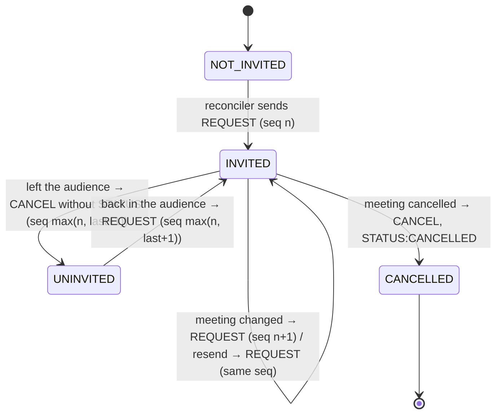
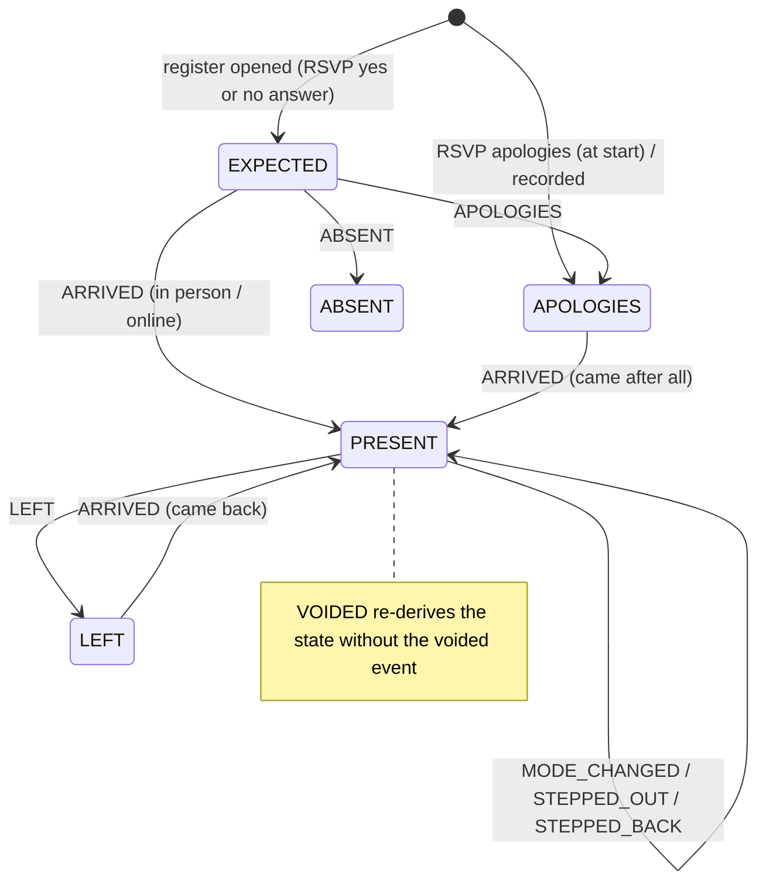
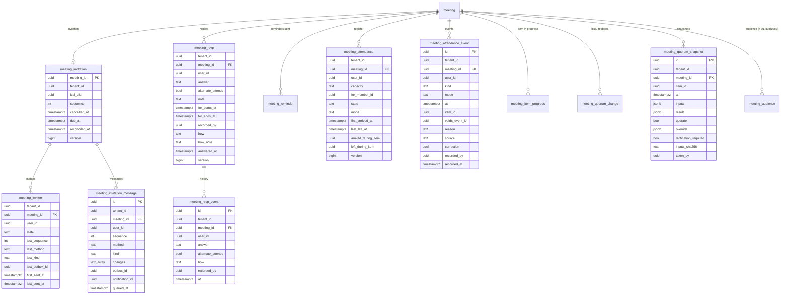

# E05 Invitations, attendance and quorum — design

> Step 3 of `AGENTS.md §5`. Decisions: ADR-0063 (invitations by iCalendar email, RSVP in the app) and ADR-0064 (attendance and quorum at the meeting; amends ADR-0057). Builds on ADR-0060 (meetings), ADR-0061 (the paper rule), ADR-0062 (recusal, E04 plan) and ADR-0030 (notifications). Research: `research.md`. Screens: `ux-review.md` (flows V–Z; delegated by the owner, Phase 4 Q1).

## 1. Domain model

### 1.1 The invitation
One invitation per meeting, created when the meeting is first scheduled.

| Entity | Attributes |
|---|---|
| `meeting_invitation` | `meetingId` (PK), `icalUid` (random UUID v4, unique per tenant, never changed), `sequence` (0 at creation), `cancelledAt`, `dueAt` (a send is pending from then), `reconciledAt`, `version` |
| `meeting_invitee` | per person ever invited: `userId`, `state` INVITED, UNINVITED or CANCELLED, `lastSequence`, `lastMethod` REQUEST or CANCEL, `lastKind` INVITATION, UPDATE, RESEND, UNINVITE or CANCEL, `firstSentAt`, `lastSentAt`, `lastOutboxId` (null when the member switched invitation emails off) |
| `meeting_invitation_message` | append-only log of every message: `userId`, `sequence`, `method`, `kind`, `outboxId`, `notificationId`, `queuedAt`, `changes` (TIME, PLACE, LINK, TITLE for an update) |

**What changes the sequence** (in the transaction of the change, ADR-0063):

| Change (E03 endpoint) | Sequence | Effect |
|---|---|---|
| `schedule` (DRAFT → SCHEDULED) | invitation created at 0 | REQUEST to everyone invitable |
| `reschedule` (start, end, zone) | + 1 | REQUEST with "The date or time changed"; RSVPs given for the old times become stale (§1.4) |
| `PATCH` of `title`, `mode`, `location`, `joinUrl`, `joinDetails` | + 1 | REQUEST with what changed in words ("The place changed") |
| `PATCH` of `kind` or `classificationId` | — | nothing sent |
| `cancel` (SCHEDULED → CANCELLED) | + 1, `cancelledAt` set | CANCEL with `STATUS:CANCELLED` to everyone INVITED, at once (no debounce) |
| Audience change (roster, guest, alternate; E03 §1.6 recompute) | — | REQUEST at the current sequence to the newcomers; CANCEL without STATUS to those no longer in the audience |
| Agenda publication, papers, declarations | — | nothing: the invite never carries the agenda |
| `start`, `end` | — | no more invitation messages after the meeting starts |

**Who is invitable:** an audience row (E03 §1.6) with source MEMBER, GUEST or ALTERNATE (§1.5), not removed, whose user is active and has an email. Item attendees and presenters are not invited (ADR-0063); officers who hold no seat (`forums.manage` only) are not invited.



### 1.2 The iCalendar content
Built by `InviteWriter` (ical4j 4.4.0, `timezone.update.enabled=false`, strict validation on output; ADR-0063). One file per recipient. DTSTART and DTEND are written as `java.time` local times with the TZID parameter, and lines are folded at 75 octets by the writer (T1 spike: ical4j re-expresses a `ZonedDateTime` in its own, possibly stale zone data, and folds by characters).

| Property | REQUEST | CANCEL (meeting) | CANCEL (uninvite) | PUBLISH (download) |
|---|---|---|---|---|
| `METHOD` | REQUEST | CANCEL | CANCEL | PUBLISH |
| `PRODID` | `-//memo//meetings//EN` | same | same | same |
| `UID` | the invitation's UUID | same | same | same |
| `SEQUENCE` | per §1.3 | per §1.3 | per §1.3 | the meeting's current |
| `DTSTAMP` | now, UTC | now | now | now |
| `DTSTART`, `DTEND` | `TZID=<zone>` local times; UTC when a time falls in the second occurrence of a repeated hour (clocks going back), which a local time cannot say | same (as last sent) | same | same |
| `VTIMEZONE` | from `ZoneRules`: one fixed observance, or yearly RRULEs, when that describes the year before to the year after; else only the observance in force at the start (after the standard one when it is daylight saving) and any change during the meeting, so the last observance is the one in force (T1) | same | same | same |
| `ORGANIZER` | `CN=<committee name>:mailto:<tenant sending address>` | same | same | same |
| `ATTENDEE` | the recipient only: `CN`, `ROLE` (REQ-PARTICIPANT; OPT-PARTICIPANT for guests), `PARTSTAT=NEEDS-ACTION`, `RSVP=FALSE` | the recipient | the recipient | none (RFC 5546 §3.2.1) |
| `SUMMARY` | meeting title, else committee name; the type's neutral title when set | same | same | same |
| `LOCATION` | the place; "Online meeting" for ONLINE | same | same | same |
| `DESCRIPTION` | §1.2.1 | "This meeting has been cancelled." + link (no reason: E03's reason is free text; T1) | "You are no longer invited to this meeting." + link | as REQUEST without the reply line |
| `URL` | the meeting page | same | same | same |
| `STATUS` | CONFIRMED | CANCELLED | absent (RFC 5546 §3.2.5) | CONFIRMED |
| `CLASS` | PRIVATE when the neutral title is used, if the recorded run confirms it (ADR-0063) | same | same | same |

**1.2.1 Description text** (ICU messages, the recipient's language; never the agenda, item titles, papers, classification or cancellation reason text):
```
Please tell us whether you will attend: open the meeting in memo and choose
"Yes, in person", "Yes, online" or "No, I send my apologies".
Your calendar's Accept and Decline buttons do not reach the committee secretary.

Meeting: https://dev.memo.example/meetings/0193…
Join online: https://meet.example/abc
Joining details: Meeting ID 123 456, passcode on the meeting page
```
- Join details are copied as entered (E03 limits them to 1,000 characters). The runbook advises against passcodes there; the meeting page holds them for the audience anyway.
- **Input hygiene:** every TEXT value is stripped of control characters other than tab and newline, escaped (RFC 5545 §3.3.11) and folded at 75 octets by the writer; CR or LF never reach a property line or a mail header.

**1.2.2 A REQUEST, as in the golden file `request-asia-dhaka.ics`** (`DTSTAMP` normalised):
```
BEGIN:VCALENDAR
PRODID:-//memo//meetings//EN
VERSION:2.0
CALSCALE:GREGORIAN
METHOD:REQUEST
BEGIN:VTIMEZONE
TZID:Asia/Dhaka
BEGIN:STANDARD
DTSTART:19700101T000000
TZOFFSETFROM:+0600
TZOFFSETTO:+0600
TZNAME:+06
END:STANDARD
END:VTIMEZONE
BEGIN:VEVENT
UID:6f1d2c4e-8a3b-4c7d-9e1f-2a3b4c5d6e7f
SEQUENCE:0
DTSTAMP:20261118T040000Z
DTSTART;TZID=Asia/Dhaka:20261212T100000
DTEND;TZID=Asia/Dhaka:20261212T130000
SUMMARY:Board Risk Committee
LOCATION:Board Room\, Level 12\, Head Office
ORGANIZER;CN=Board Risk Committee:mailto:meetings@bank.example
ATTENDEE;CN=Demo Director;ROLE=REQ-PARTICIPANT;PARTSTAT=NEEDS-ACTION;RSVP
 =FALSE:mailto:director@demo.example
DESCRIPTION:Please tell us whether you will attend: open the meeting in m
 emo and choose …
URL:https://dev.memo.example/meetings/0193…
STATUS:CONFIRMED
END:VEVENT
END:VCALENDAR
```

### 1.3 Sending: the reconciler
- Each change in §1.1 sets `dueAt` (now + 2 minutes; now for a cancellation) and schedules the one-time task `meeting-invitations` with instance id = meeting id (`scheduleIfNotExists`, payload `{tenantId, meetingId}`).
- The task, in one tenant transaction, under `SELECT … FOR UPDATE` on `meeting_invitation`:
  1. reads the meeting, the invitation and the invitable people (§1.1);
  2. for each invitable person: no invitee row, or `state` ≠ INVITED, or `lastSequence` < `sequence` → REQUEST (INVITATION for a first message, UPDATE otherwise) with sequence `max(sequence, lastSequence + 1)` for a person who had an earlier copy, else `sequence`;
  3. for each INVITED person no longer invitable → CANCEL without STATUS (UNINVITE), sequence `max(sequence, lastSequence + 1)`;
  4. if the meeting is CANCELLED → CANCEL with `STATUS:CANCELLED` to every INVITED person, sequence `max(sequence, lastSequence + 1)`; their state becomes CANCELLED;
  5. each message: `InviteWriter` builds the file, ical4j validates it, `Notifications.notify(recipient, kind, params, link, calendar)` writes the in-app item and the outbox row (encrypted file and method), the invitee row and `meeting_invitation_message` are written;
  6. sets `reconciledAt`, clears `dueAt`.
- **Idempotent and coalescing:** a retry finds nothing to send; three edits in two minutes send one update; a cancellation always ends the sequence.
- **Resend** (secretary): REQUEST at the person's `lastSequence` (an update without a reschedule, RFC 5546 §3.2.2.2), kind RESEND; at most once per person per 10 minutes.
- **Failure:** a validation failure fails the task (alert, no message); the db-scheduler retry and the sweep's safety net (§9) try again after the cause is fixed. A relay failure is the outbox's (ADR-0030); the panel shows it.
- **As built (T2):**
  - Code in `com.memo.meeting.internal.invite`: `InvitationPlan` (the sequence rules, pure), `MeetingInvitations` (the hooks the lifecycle and the audience call in the changing transaction), `InvitationReconciler` with `InvitableAudience`, `InvitationMessages` (writer, `Notifications.notify` with the calendar part, invitee row and log), `InvitationPanel` (panel, resend, "Add to my calendar"), `InvitationSafetyNet`, the stores and `InvitationsController`.
  - **A person's state needs two numbers, not one.** Step 2's test "`lastSequence` < `sequence`" fails after an uninvitation and a re-invitation: the person's SEQUENCE is then above the invitation's, so the next change would not reach them. `meeting_invitee` keeps `last_sequence` (the SEQUENCE of their last file) and `held_sequence` (the invitation's sequence that file described); an update is due when `held_sequence` < `sequence`, and carries `max(sequence, last_sequence + 1)`.
  - **The sequence rises once per batch:** `meeting_invitation.sent_sequence` is the sequence the reconciler last sent; a change raises `sequence` only when it equals `sent_sequence`, so three reschedules before the next send make one update at sequence 1 (the acceptance criterion), and a cancellation after a sent update is the next number. What changed is collected in `pending_changes` until the send ("The date or time changed. The place changed.").
  - **Who is invitable** also needs the meeting's clearance (as the agenda notifications, E03 §9): a member not cleared for the meeting's classification cannot open it and is not invited. A change of classification therefore makes a send due at the same sequence (the reconciler uninvites who is no longer cleared); the kind alone sends nothing.
  - **The debounce:** each change sets `due_at` to now + 2 minutes and schedules instance `<meetingId>` with `scheduleIfNotExists`; the job is a step task that waits again while `due_at` is in the future, so the last change decides. A cancellation uses its own instance `<meetingId>:now`. A change that lands while the job is finishing can miss its run (db-scheduler still holds the instance); the safety net, run by E03 T5's hourly `meeting-sweep` before its reminders, schedules again any send overdue by 15 minutes.
  - **The cancellation's notices:** people who hold the event get `MEETING_CANCELLED` from the reconciler with the CANCEL file (the secretary who cancels too, when they hold a seat: their calendar needs it); the rest of the audience gets E03's notice without a file, as before.
  - **Kinds:** a re-invitation after an uninvitation is an INVITATION (the email "You are invited"), not an UPDATE; a resend to someone an update is still waiting for sends that update now. Emails name the committee (or the neutral title); the calendar's SUMMARY is the meeting's title, else the committee's name, or the neutral title.
  - **Backfill:** meetings already scheduled when V7 runs get an invitation with nothing due, so a deployment mails nobody; they are sent at their next change, and "Add to my calendar" works at once.

### 1.4 RSVP
| Attribute | Notes |
|---|---|
| `meetingId`, `userId` | An invitable person (§1.1) |
| `answer` | IN_PERSON, REMOTE or APOLOGIES. No row means "no answer". IN_PERSON is offered when the meeting's mode is IN_PERSON or HYBRID, REMOTE when it is ONLINE or HYBRID (422 `MODE_NOT_OFFERED`) |
| `alternateAttends` | With APOLOGIES, for a MEMBER whose seat has an alternate (§1.5) |
| `note` | Optional, 0–300 characters, to the secretaries ("I will join after 11:00") |
| `forStartsAt`, `forEndsAt` | The meeting's times when the answer was given. **Stale** when they differ from the meeting's current times: "You replied for the old time" |
| `recordedBy`, `how`, `howNote` | Self: IN_APP. On behalf (a secretary): EMAIL, PHONE, IN_PERSON or OTHER, with a note 0–200 |
| `answeredAt`, `version` | Optimistic lock |

- **Window:** while the meeting is SCHEDULED. From IN_PROGRESS, attendance takes over (409 `WRONG_STATE`).
- **History:** every answer is a row in `meeting_rsvp_event` (answer, alternate, note hash, how, by, at); the current row is updated with a guarded update on `version`.
- **On behalf:** the member is told (`MEETING_RSVP_RECORDED`, "The secretary recorded your answer: …").
- **To the secretaries:** in-app `MEETING_RSVP_CHANGED` only for apologies and for answers changed within two working days of the meeting (less noise).
- **Who sees what:** officers see every answer, note and how; a member, guest or alternate sees their own and the counts ("5 of 7 members will attend").

### 1.5 Alternates standing in
- A MEMBER answering APOLOGIES with `alternateAttends = true`, when their seat has `alternateUserId` (ADR-0056):
  - adds an audience row `source = ALTERNATE`, `userId` = the alternate, `forMemberId` = the seat, `forUserId` = the member, `membersOnly` = the member's;
  - tells the alternate (`MEETING_ALTERNATE_ASKED`: "{member} has asked you to attend the {committee} meeting on {date} in their place") and invites them through the reconciler;
  - refuses with 409 when the seat has no alternate (`ALTERNATE_NONE`), when the alternate is a member of the committee in office on the meeting's date (`ALTERNATE_IS_MEMBER`), or is already standing in for someone else at this meeting (`ALTERNATE_BUSY`).
- Changing the answer back, or `alternateAttends = false`, removes the row (`removed_at`); the reconciler uninvites the alternate and they are told.
- **The alternate reads what the member reads** (ADR-0061 rule with their own row) **and is recused wherever the member is**: E04's recusal anti-join gains `∨ d.user_id = forUserId` for the alternate's ALTERNATE row (`DeclarationExclusions` and `Recusals.isRecused`). Their own declarations apply as well.
- The alternate may answer the RSVP themselves; they are expected otherwise.

**As built (T3, replies §1.4 and alternates §1.5):**
- Code in `com.memo.meeting.internal.rsvp`: `RsvpRules` and `AlternateRules` (pure), `RsvpStore`, `Replies` (own answer, on behalf, the list and the summaries for the meeting and "My meetings"), `Alternates` (ask, release, the roster check), `RepliesController`. Migration `meeting/V8__replies_and_alternates.sql`.
- **Who answers:** a person with a current audience row MEMBER, ALTERNATE or GUEST (`ReplyCapacity`, in that order when they have several); not item attendees, not officers without a seat (403). A secretary or chair with a seat answers like any member. On behalf: any such person but the recorder themselves (422 `NOT_INVITABLE`), by a secretary or `forums.manage` (`requireManaged`, so the chair gets 403). Email is not required to answer, only to be invited.
- **Writes:** under the meeting's row lock (so a reply and a reschedule or `start` serialise); `Idempotency-Key` on both PUTs; `If-Match` required once an answer exists (428 without, 412 when stale), and an `If-Match` without an answer is 412. Notes and how-notes are kept on the current row; the history (`meeting_rsvp_event`) and the audit keep their SHA-256 only.
- **The alternate's refusals** are checked before anything is written. `ALTERNATE_NONE` also covers an alternate who cannot attend (deactivated, or not cleared for the meeting's classification), and an alternate or guest asking for an alternate. A new 422 `ALTERNATE_WITH_APOLOGIES` refuses `alternateAttends` with a yes.
- **The roster check:** `MeetingAudience.recompute` (every roster, date or guest change) releases an alternate whose member no longer holds the seat on the meeting's date, whose seat's alternate changed, or who now holds a seat (audited with reason ROSTER, told, uninvited). The member's `alternateAttends` stays as they gave it; the views show whether someone stands in now.
- **The recusal inheritance** is in `RecusalStore` (so `Recusals.isRecused`, `recusedFrom`, `ofMeeting`, the agenda's recused lines and the officers' notices all follow) and in `DeclarationExclusions` (the paper rule's anti-join): the declarant is the person or the member of their current ALTERNATE row at the declaration's meeting. A released alternate inherits nothing.
- **The alternate reads as a member:** `PaperViewers` treats an ALTERNATE row like a MEMBER row (members-only sections as the member's seat); `MeetingRelation.ALTERNATE` is new (after MEMBER).
- **Seat uniqueness:** the plan's unique index `(tenant_id, meeting_id, user_id) WHERE ALTERNATE` is already the primary key; V8 makes the seat unique instead (`(tenant_id, meeting_id, for_member_id)` for current ALTERNATE rows) and indexes `for_user_id` for the inheritance.
- **API shapes:** `/me/meetings` and `GET /meetings/{id}` carry `rsvp` (`capacity`, `answer`, `alternateAttends`, `stale`, `canAnswer`; null when the viewer does not answer) rather than the plan's `myAnswer` and `stale`, so both use one type; the meeting also carries `invitation` (`sequence`, `sentAt`, `lastSentAt`, `pending`) for officers. `GET /meetings/{id}/rsvps` has `counts` (everyone who answers), `members` (the seats only), `canRecord` and `people` (officers only). The invitations panel's people gain `reply`. The forecast is T5's.
- **Notices:** `MEETING_RSVP_RECORDED` (email and in-app), `MEETING_RSVP_CHANGED` (secretaries, in-app: apologies, a change of the alternate, or any change within two working days of the meeting), `MEETING_ALTERNATE_ASKED`, `MEETING_ALTERNATE_RELEASED` (email and in-app). Emails carry no answer and no note.
- `meeting_reminder` is created by V8 as planned and used from T6.

### 1.6 Attendance
**The register:** one row per person who may attend (`meeting_attendance`), derived from events:

| Person | `capacity` | Counts for quorum |
|---|---|---|
| Roster seat holder in office on the meeting's date | MEMBER (with role and voting) | if the seat counts (ADR-0057) |
| Alternate standing in | ALTERNATE (for seat) | for the seat's number only, while the member is absent (§1.7) |
| Guest | GUEST ("in attendance") | never |
| Item attendee or presenter | ATTENDEE ("in attendance for item n") | never |

**Events** (`meeting_attendance_event`, append-only):

| Kind | Fields | When |
|---|---|---|
| APOLOGIES | `note?` | SCHEDULED or IN_PROGRESS; written automatically from an APOLOGIES RSVP when the meeting starts, with `source = RSVP` |
| ABSENT | — | IN_PROGRESS or HELD ("did not attend, no apologies") |
| ARRIVED | `mode` (IN_PERSON, REMOTE), `at`, `itemId?` | IN_PROGRESS (HELD as correction) |
| MODE_CHANGED | `mode`, `at`, `itemId?` | IN_PROGRESS |
| LEFT | `at`, `itemId?` | IN_PROGRESS |
| STEPPED_OUT, STEPPED_BACK | `itemId` | IN_PROGRESS: left the room for one item (for example a recused member) |
| VOIDED | `voidsEventId`, `reason` (1–500) | IN_PROGRESS or HELD; cancels one earlier event |

- `at` defaults to now and must lie between the meeting's start minus 1 hour and its end plus 6 hours (422 `TIME_OUT_OF_RANGE`); `itemId` defaults to the item in progress (§1.6.1).
- Every event has `recordedBy`, `recordedAt` (server UTC) and `correction` (true when the meeting is HELD).
- **Current state** per person, recomputed in the event's transaction: EXPECTED, PRESENT (mode), LEFT, APOLOGIES or ABSENT, with `firstArrivedAt`, `lastLeftAt`, `arrivedDuringItem`, `leftDuringItem`, and the derived flags **joined late** (first arrival after the first item started, or 10 minutes after the start when no item was started) and **left early** (left and not back by the end). `version` for If-Match.


- **Forbidden** (409 `WRONG_STATE`): ARRIVED while PRESENT; LEFT or MODE_CHANGED unless PRESENT; STEPPED_OUT twice for one item; any event before SCHEDULED; anything after MINUTES_APPROVED or on a CANCELLED meeting (`FROZEN`); a non-correction event on a HELD meeting; voiding a VOIDED event.
- **One seat per person:** an ALTERNATE row's ARRIVED is refused while the same person is PRESENT as a member or counted for another seat (409 `ALREADY_COUNTED`).

**1.6.1 The item in progress.** `meeting_item_progress` (append-only: `itemId`, `startedAt`, `recordedBy`). The secretary moves it with "Now: item 5" (IN_PROGRESS; the item must be on the latest published revision or tabled, 422 `ITEM_NOT_ON_AGENDA`). It labels arrivals and departures, drives the live per-item quorum and is offered to E06's decision screen.

### 1.7 Quorum
**Presence at instant *t*** (`PresenceBuilder`, pure, in the meeting module), for the meeting or for item *i*:
```
for each seat s in roster(m.forum, m.date)                       -- ForumDirectory.membersOn
  holder := s.userId
  if present(holder, t) ∧ ¬steppedOut(holder, i):
      presence[s] := (remote = mode(holder, t) = REMOTE,
                      byAlternate = false,
                      recused = i ≠ null ∧ Recusals.isRecused(holder, i))
  else if a := standingIn(s) ∧ present(a, t) ∧ ¬steppedOut(a, i)
          ∧ ¬countedElsewhere(a, t) ∧ ¬(i ≠ null ∧ (isRecused(holder, i) ∨ isRecused(a, i))):
      presence[s] := (remote = mode(a, t) = REMOTE, byAlternate = true, recused = false)
  else: absent
```
- `present(p, t)` comes from the events with `at ≤ t`, voided ones excluded.
- **The evaluator** is `Quorum.evaluate(rule, roster, presence)` with the pinned type version's rule (ADR-0060). **Amended (ADR-0064):** a seat present by alternate counts towards `present` (when `alternatesCount`), never towards a `required` role set or a `composition` attribute count; it still counts in the denominator of a composition majority.
- **Live, meeting level:** for IN_PROGRESS meetings, after every attendance event the meeting-level result (and the item in progress's) is computed in the same transaction; a flip from quorate to not quorate or back writes `meeting_quorum_change` (`itemId?`, `quorate`, `at`, `causeEventId`), audits `meeting.quorum.lost` or `.restored`, and tells the chair and the secretaries in-app (`MEETING_QUORUM_LOST`, `MEETING_QUORUM_RESTORED`; no email, they are in the room).
- **Live, per item:** `GET /meetings/{id}/quorum?itemId=` for any item; recused members and their alternates leave the count when `recusedCount` is false (ADR-0057), stepped-out people always.
- **Forecast** (SCHEDULED): the same builder with "present" = RSVP IN_PERSON or REMOTE and not stale, alternates who are asked to attend, `recused` from `Recusals.ofMeeting`. Per item for every published item. "If everyone who said yes attends: quorate (5 of 4 needed)"; "Item 5: not quorate even then (3 of 4; 2 members have declared an interest)" (E04's planning warning uses "every member present"; this one uses the replies).
- **Snapshots** (`meeting_quorum_snapshot`, append-only): taken by `QuorumSnapshots.take(meetingId, itemId, at = now, override?)` inside E06's decision transaction.
  - Stores: the type id and version, the rule JSON, the roster (seat, user, role, voting, attributes), the presence map (seat, person, remote, by alternate, recused, stepped out), the result (basis, needed, present, quorate, unmet), `inputsSha256` over the canonical JSON (the audit module's canonical form), `takenBy`, `takenAt`.
  - When not quorate and no override: 409 `NOT_QUORATE` with the unmet conditions; nothing is stored.
  - **Override:** only when the pinned type version's `meetings.quorumOverride` is WITH_REASON (else 409 `OVERRIDE_NOT_ALLOWED`), by a secretary or `forums.manage` holder not recused from the item (403 `RECUSED`), with a reason 1–500 characters. The snapshot stores `override {by, reason}` and `ratificationRequired = true`; `meeting.quorum.overridden` is audited; the chair and the other secretaries are told (`MEETING_QUORUM_OVERRIDDEN`).
  - A later attendance correction never changes a snapshot. `QuorumSnapshots.drifted(snapshotId)` re-evaluates the stored time against the corrected events, so E06 can show "attendance was corrected after this decision".

**As built (T4, attendance §1.6 and live meeting-level quorum §1.7):**
- Code in `com.memo.meeting.internal.attendance` (`AttendanceRules` pure, `AttendanceStore`, `Attendance`, `QuorumChanges`, `AttendanceReads`, `AttendanceController`) and `com.memo.meeting.internal.quorum` (`PresenceBuilder` pure, `LiveQuorum`). Published: `MeetingAttendance.of(meetingId)` and the event `AttendanceChanged`. Migration `meeting/V9__attendance_and_quorum.sql` holds T4's tables only; `meeting_quorum_snapshot` is T5's, in the next free number.
- **The register** has a row per person of the audience (MEMBER, ALTERNATE with its seat, GUEST, ATTENDEE; a person with several audience rows takes the first of that order), opened at `start` in its transaction, or at a person's first event (apologies before the start, a guest added during the meeting). The derived columns are re-derived from the person's events on every write; "joined late" and "left early" are computed when read (the first item's start can be recorded after an arrival). Apologies from the replies are written at the start only for answers that are not stale.
- **Every write replays the person's events with the new one in time order** (`at`, then when recorded): an event inserted before a later one, or a void, that would leave an invalid sequence (a departure of someone never present) is 409 `WRONG_STATE`. ABSENT then ARRIVED is refused as the diagram says (void the ABSENT first); a MODE_CHANGED to the same mode is refused too.
- **Windows:** apologies (and voids) from SCHEDULED; everything while IN_PROGRESS; once HELD, ARRIVED, LEFT, ABSENT, APOLOGIES and VOIDED as corrections, each with a reason (422 `REASON_REQUIRED`); LEFT and APOLOGIES are added to the plan's list so a departure or apologies missed in the room can be recorded. `FROZEN` after MINUTES_APPROVED and on CANCELLED.
- **Times:** never more than a minute ahead of the server (422 `TIME_OUT_OF_RANGE`); arrivals, departures, modes and stepping out also within the start minus an hour and the end plus six hours. Apologies and absence carry no meeting time.
- **The API:** `POST …/attendance/events` takes `{userId, kind, mode?, at?, itemId?, note?, reason?}` with the person's row version as `If-Match` (428 without once they have a row, 412 when stale) and answers the event, the person's row (its version as the ETag) and the quorum; the plan's `forMemberId` is not taken (the row carries the seat). `…/arrivals` is all or nothing (one person already present refuses the whole request with `WRONG_STATE`), only while in progress, without `If-Match`. `…/events/{eid}/void` takes the person's row version as `If-Match`. `GET …/attendance` gives officers every event too (to void one). `GET /meetings/{id}/quorum?at=` (meeting level) and `GET …/quorum/changes` are built now; `itemId` and the forecast are T5's. 422 `VOID_SEPARATELY` (VOIDED through the events endpoint), `MODE_REQUIRED`, `NOT_INVITABLE` (a person outside the audience).
- **Who fills a seat** (`PresenceBuilder`): holders first, each person once (a holder of two seats fills the one that counts most: countable, voting, then role); then alternates, only for a seat whose holder is not there, never a person who holds a seat, never twice. A member holding two seats who arrives therefore silences both seats' alternates; the monotonic property test leaves that case out.
- **`Quorum.evaluate`** (ADR-0064): a seat present by its alternate counts towards `present` (with `alternatesCount`) and the denominator of a composition majority, never towards a `required` role set or a composition attribute. `QuorumTest` has the worked example, `QuorumProperties` the properties.
- **The change log** (`meeting_quorum_change`) has `level` MEETING or ITEM (T5) and `kind` REACHED, LOST or RESTORED with the numbers and unmet conditions; the flip is against the last logged state (not quorate before any). The first time the meeting is quorate is logged as REACHED and audited `meeting.quorum.reached` (not told): the minutes need when the meeting became quorate. `item_id` is the cause event's item, else the item in progress. Changes are logged only while IN_PROGRESS; corrections after the meeting log none (T5's `drifted` covers decisions).
- **Notices:** `MEETING_QUORUM_LOST` and `MEETING_QUORUM_RESTORED` (in-app, WORKFLOW) to the secretaries and the chair (the vice-chair when there is none), never the actor, with `present` and `needed`.
- **Audit:** `meeting.attendance.recorded` (event, person, kind, mode, at, item, source, correction, state, `reasonSha256`, `noteSha256`), `meeting.attendance.voided`, `meeting.item.progressed`, `meeting.quorum.reached`, `.lost`, `.restored`.

**As built (T5, per-item quorum, the forecast and snapshots §1.7):**
- Code: `LiveQuorum.evaluate(meeting, at, itemId)` (the item's recusals from `Recusals.recusedFrom`, which includes the alternate of a recused member, and the people stepped out of it), `QuorumForecast` (pure over the replies, used by T6's quorum-at-risk warning), `QuorumReads`, `QuorumController`, `SnapshotStore` in `com.memo.meeting.internal.quorum`; the published `QuorumSnapshots`, `QuorumSnapshot`, `QuorumSnapshotInputs`, `QuorumDrift`, `NotQuorateException` in `com.memo.meeting`. Migration `meeting/V10__quorum_snapshots.sql`.
- **`QuorumSnapshots` for E06**, inside the caller's transaction:
  - `take(meetingId, itemId?, at? = now, overrideReason?)`: a secretary of the committee or `forums.manage` (403; 404 for an invisible meeting); the meeting IN_PROGRESS or HELD (409 `WRONG_STATE`; HELD for a corrected decision at an earlier `at`); `at` not ahead of the server by more than a minute nor before the start minus an hour (422 `TIME_OUT_OF_RANGE`); the item on the latest published revision or tabled (422 `ITEM_NOT_ON_AGENDA`). **It locks the meeting row** (as attendance writes do): E06 calls it after its submission rows and before the agenda row. It evaluates exactly what `GET …/quorum?itemId=&at=` shows and stores the inputs, the result and the SHA-256 of the canonical inputs (the audit module's canonical JSON; lists sorted, the instant in microseconds).
  - Not quorate and no `overrideReason`: `NotQuorateException` (a `RefusedException`, so any module's controller answers 409 `NOT_QUORATE` with `needed`, `present` and `unmet`), nothing stored.
  - The override: the pinned type version's `meetings.quorumOverride` WITH_REASON (else 409 `OVERRIDE_NOT_ALLOWED`); the actor not recused from the item (403 with `reason` `RECUSED`: `ForbiddenException` gained an optional reason, so the problem reaches E06's controllers too); a reason of 1–500 characters (422 `REASON_REQUIRED`, `LENGTH`). The snapshot is stored not quorate, with the reason, by the actor, `ratificationRequired`; audited `meeting.quorum.overridden` (`reasonSha256`); the chair (the vice-chair when there is none) and the other secretaries are told in-app, `MEETING_QUORUM_OVERRIDDEN` ("… recorded without a quorum (3 of 4 present), to be ratified at a quorate meeting"; never the item or the reason). A reason given while the meeting is quorate is ignored. Every snapshot is audited `meeting.quorum.snapshot_taken`.
  - `find(snapshotId)`, `ofMeeting(meetingId)` (oldest first, for the minutes) and `drifted(snapshotId)` → `QuorumDrift(drifted, now)`: the stored instant and item evaluated again with the register, the recusals and the roster as they are now; drifted when the inputs' hash differs. No access decision in the three reads.
- **Per item, live:** `GET /meetings/{id}/quorum?itemId=&at=`: an item of another meeting is 404; seats gain `recused` and `steppedOut`; an officer recused from the item gets the numbers without seats. With `recusedCount` false a recused holder is present but not counted; with it true they count; their alternate never stands in for the item either way (ADR-0064).
- **The item in progress's change log** (`meeting_quorum_change` level ITEM, planned in V9): after every attendance change while in progress, and when an item becomes the item in progress, the item's quorum is compared with the last change logged for that item; a flip is logged and audited with `"level":"ITEM"` under the same actions (`meeting.quorum.reached`, `.lost`, `.restored`), and not told (the live view shows it; E06 refuses a decision without it). `GET …/quorum/changes` answers both levels with a `level` field.
- **The forecast:** `GET /meetings/{id}/quorum/forecast` (officers; 403 otherwise): the meeting and each item of the latest published revision (breaks left out), from the answers given for the current times (IN_PERSON in the room, REMOTE online; a stale answer counts as none), and the alternates asked to attend unless they sent apologies themselves; per item `declared` (counting members recused, E04's number), null with `viewerRecused` for an item the officer is recused from. With every member saying yes it equals E04's planning warning (`QuorumForecastIT`).
- **Snapshots over HTTP:** `GET /meetings/{id}/quorum/snapshots/{sid}` for officers and `forum.read` (cleared): the numbers, the rule, the seats with who filled them, recused and stepped out, the override and `drifted`. An officer recused from the item gets no seats. **The override's reason is shown to officers not recused only** (it is free text and may name the item; the plan did not say): `forum.read` and a recused officer see who overrode and `ratificationRequired`.
- **Storage:** `meeting_quorum_snapshot` keeps the override as `override_reason` (the overrider is `taken_by`) rather than the plan's `override` jsonb; CHECKs: not quorate only with a reason, `ratification_required` exactly with one.
- **A departure can make a meeting quorate** in one case, which is right: a member taking part online where online attendance does not count (`remoteCounts` false) still takes part, so their alternate in the room does not count (ADR-0064, model articles art. 26: only in the appointor's absence); once the member leaves, the alternate counts. `PresenceBuilderProperties` keeps it as an example (the failing seed of 2026-11-20) and leaves it out of the monotonic property, as it does a member holding two seats.

### 1.8 The committee type's meeting policy
`forum_type_version.meetings` (jsonb, null reads as the defaults), edited on the committee type's new **Meetings** tab and reviewed by a second administrator like every type change (ADR-0056):

| Field | Default | Rule |
|---|---|---|
| `invitationTitle` | NAME | NAME (the meeting's title or the committee's name) or NEUTRAL |
| `neutralTitle` | "Committee meeting" | 1–100 characters, with NEUTRAL |
| `replyDeadlineWorkingDays` | 2 | 0–10 working days before the meeting's date; 0 = no deadline |
| `replyReminder` | true | one reminder on the deadline day to those without an answer or with a stale one |
| `meetingReminder` | true | one reminder the working day before the meeting |
| `quorumOverride` | NEVER | NEVER or WITH_REASON (§1.7) |

- Presets (E01): NAME and NEVER for every preset (no preset is credit-specific; a type sets NEUTRAL, such as "Board committee meeting", itself; T1).
- The policy is pinned with the type version on each meeting (ADR-0060), so a later change does not alter a scheduled meeting's rules.

### 1.9 ERD

- `user_id`, `for_member_id`, `item_id`, `outbox_id` and `notification_id` refer to other modules' or other tables' rows by id and are checked by the services; `meeting_id` is a composite foreign key `(tenant_id, meeting_id)` inside the module.
- `meeting_item_progress (tenant_id, id, meeting_id, item_id, started_at, recorded_by)`, `meeting_quorum_change (tenant_id, id, meeting_id, item_id, quorate, at, cause_event_id)` and `meeting_reminder (tenant_id, meeting_id, user_id, kind, key)` are not drawn.

## 2. Modules and events
- **`meeting`** (all new code in `com.memo.meeting.internal`, packages `invite`, `ical`, `rsvp`, `attendance`, `quorum`):
  - Published API in `com.memo.meeting`:
    - `QuorumSnapshots` (`take`, `find`, `drifted`) and `QuorumSnapshot` for E06;
    - `MeetingAttendance.of(meetingId)` (present in person, remote, alternates for whom, in attendance, apologies, absent, arrivals and departures by item, quorum lost and restored) for E06's minutes and E08's analytics;
    - the event `AttendanceChanged(tenantId, meetingId)` (E06 refreshes its decision screen).
  - Listens to: its own `MeetingChanged` (E03 T2/T3: schedule, reschedule, patch, cancel) and audience recomputes, which mark the invitation due; `DeclarationChanged` (E04), which refreshes the live per-item quorum view's cache.
- **`forum`** (published changes):
  - `Quorum.evaluate`: the alternate rule (ADR-0064) — `required` and `composition` look only at seats present in person or remote, not by alternate. No signature change; ADR-0057's property tests are extended.
  - `ForumTypePolicy.meetings` (§1.8) with checks, presets, the changes view and maker-checker; `forum/V6`.
- **`notification`** (published additions, ADR-0030 extended):
  - `CalendarPart(method: CalendarMethod, ics: ByteArray)` with `CalendarMethod` REQUEST, CANCEL;
  - `Mail.enqueue(…, calendar: CalendarPart? = null)` and `Notifications.notify(…, calendar: CalendarPart? = null): NotificationResult(itemId, outboxId?)`;
  - `MailStatuses.of(outboxIds)` (status, attempts, last SMTP code, sent or failed time) for the invitations panel;
  - `SendingAddress.address()`: the tenant relay's from address, else the platform's, for ORGANIZER (T1);
  - category `CALENDAR` (not mandatory, on by default) and kinds: `MEETING_INVITATION`, `MEETING_UPDATED`, `MEETING_UNINVITED` (CALENDAR, email with the calendar part); `MEETING_CANCELLED` (existing, now with the CANCEL part for invitees); `MEETING_REPLY_REMINDER`, `MEETING_REMINDER`, `MEETING_RSVP_RECORDED`, `MEETING_ALTERNATE_ASKED`, `MEETING_ALTERNATE_RELEASED`, `MEETING_QUORUM_AT_RISK` (WORKFLOW, email); `MEETING_RSVP_CHANGED`, `MEETING_QUORUM_LOST`, `MEETING_QUORUM_RESTORED`, `MEETING_QUORUM_OVERRIDDEN` (WORKFLOW, in-app only). Subjects take no parameters; bodies name the committee (or the neutral title), the date and a link.
  - `MailDelivery` builds the iMIP layout when the outbox row has a calendar part (ADR-0063).
- **`ApplicationModules.verify()`:** meeting → forum, notification (both exist); nothing new depends on meeting except E06+.

## 3. API
Conventions as E03: `/api/v1`, RFC 9457 errors, `Idempotency-Key` on every POST and PUT that creates rows, If-Match on the row's `version` where stated.

| Method and path | Access | Notes |
|---|---|---|
| `GET /meetings/{id}/invitations` | Sec, Chair (read), Mgr | Per invitable person: state, last sequence and kind, sent at, delivery status (`MailStatuses`), RSVP; the UID is never shown |
| `POST /meetings/{id}/invitations/resend` | Sec, Mgr | `{userIds?}` (all INVITED by default); 409 `RESEND_TOO_SOON` within 10 minutes per person; rate-limited per meeting |
| `GET /meetings/{id}/calendar.ics` | audience (Member, Alt, Guest, Att), officers | PUBLISH file for "Add to my calendar"; `Content-Disposition: attachment`, `Cache-Control: no-store`; 404 for DRAFT or CANCELLED |
| `GET /meetings/{id}/rsvp/mine` | Member, Alt, Guest | The actor's answer, stale flag, alternate option |
| `PUT /meetings/{id}/rsvp/mine` | Member, Alt, Guest | `{answer, alternateAttends?, note?}`; If-Match when an answer exists; SCHEDULED only |
| `PUT /meetings/{id}/rsvps/{userId}` | Sec, Mgr | `{answer, alternateAttends?, note?, how, howNote?}`; the person must be invitable; If-Match when an answer exists |
| `GET /meetings/{id}/rsvps` | Sec, Chair, Mgr: every answer; Member, Alt, Guest: counts only | Answers, stale flags, notes, how, alternates; the forecast summary |
| `GET /meetings/{id}/attendance` | Sec, Chair, Mgr: the register; Member, Alt, Guest, Att: own row and counts | Rows with state, mode, flags, standing-in, item labels; the live meeting quorum |
| `POST /meetings/{id}/attendance/events` | Sec, Mgr | `{userId, kind, mode?, at?, itemId?, forMemberId?, note?}`; If-Match on the person's row |
| `POST /meetings/{id}/attendance/arrivals` | Sec, Mgr | `{userIds, mode}`: "everyone who said yes is here" in one transaction; one event each |
| `POST /meetings/{id}/attendance/events/{eid}/void` | Sec, Mgr | `{reason}` |
| `POST /meetings/{id}/progress` | Sec, Mgr | `{itemId}`: the item in progress |
| `GET /meetings/{id}/quorum?itemId=&at=` | Sec, Chair, Mgr (names; counts only for an item the actor is recused from); Member, Alt: quorate yes or no with numbers | The result with unmet conditions in parts the web turns into a sentence |
| `GET /meetings/{id}/quorum/forecast` | Sec, Chair, Mgr | Meeting and per-item forecasts from the replies and recusals |
| `GET /meetings/{id}/quorum/changes` | Sec, Chair, Mgr | Lost and restored, with times and items |
| `GET /meetings/{id}/quorum/snapshots/{sid}` | Sec, Chair, Mgr, `forum.read` (cleared); counts only for an item the actor is recused from | A recorded snapshot |
| `GET /me/meetings` (E03) | signed in | Each meeting gains `myAnswer` and `stale` |
| `GET /meetings/{id}` (E03) | as E03 | Gains `invitation` (sent, last update) for officers and `rsvp` for the viewer |
| `GET/PUT /forum-types/{id}/versions/{n}` (E01) | as E01 | The version gains `meetings` (§1.8) |

**Problems:**
- 409: `WRONG_STATE`, `FROZEN`, `ALTERNATE_NONE`, `ALTERNATE_IS_MEMBER`, `ALTERNATE_BUSY`, `ALREADY_COUNTED`, `NOT_QUORATE` (with the unmet conditions), `OVERRIDE_NOT_ALLOWED`, `RESEND_TOO_SOON`;
- 422: `MODE_NOT_OFFERED`, `LENGTH`, `HOW_REQUIRED`, `REASON_REQUIRED`, `TIME_OUT_OF_RANGE`, `ITEM_NOT_ON_AGENDA`, `NOT_INVITABLE` (an on-behalf answer for someone outside the audience), and for the type policy `NEUTRAL_TITLE_REQUIRED`, `RANGE`;
- 403 `RECUSED` (an override by a recused secretary);
- 404 for an invisible meeting; 412 on a stale If-Match.

## 4. Authorisation matrix
Columns as E03 (Sec, Chair, Mgr, Member, Guest, Att, Read) plus **Alt**: an alternate standing in for a member at this meeting. A person recused from an item (E04) sees that item's quorum as counts only.

| Action | Sec | Chair | Mgr | Member | Alt | Guest | Att | Read | Other |
|---|---|---|---|---|---|---|---|---|---|
| See the invitations panel | ✓ | ✓ (read) | ✓ | – | – | – | – | – | – |
| Resend invitations | ✓ | – | ✓ | – | – | – | – | – | – |
| Download "Add to my calendar" | ✓ | ✓ | ✓ | ✓ | ✓ | ✓ | ✓ | – | – |
| Answer for oneself | own seat | own seat | – | ✓ | ✓ | ✓ | – | – | – |
| Ask the alternate to attend | own seat | own seat | – | ✓ (seat with an alternate) | – | – | – | – | – |
| Record an answer on someone's behalf | ✓ | – | ✓ | – | – | – | – | – | – |
| See every answer and note | ✓ | ✓ | ✓ | counts | counts | counts | – | – | – |
| Record attendance, the item in progress; void | ✓ | – | ✓ | – | – | – | – | – | – |
| See the register | ✓ | ✓ | ✓ | own row | own row | own row | own row | – | – |
| See live quorum, changes, forecast | ✓ | ✓ | ✓ | summary | summary | – | – | – | – |
| Take a snapshot (through E06's decision) | ✓ | – | ✓ | – | – | – | – | – | – |
| Override a missing quorum (type allows) | ✓ (not recused) | – | ✓ (not recused) | – | – | – | – | – | – |
| Read a snapshot | ✓ | ✓ | ✓ | – | – | – | – | ✓ (cleared) | – |
| Edit the type's meeting policy | – | – | ✓ (maker-checker) | – | – | – | – | – | – |

- "Own seat": a secretary or chair who holds a seat answers for themselves like any member.
- Former members (out of office on the meeting's date) are not in the audience: 404 on RSVP and attendance.
- Invisible meetings answer 404; visible but forbidden actions 403.

## 5. Audit events
In the business transaction (AGENTS §3.3); the reconciler's are by the system actor with the change that caused them:
- **Invitations:** `meeting.invitations.sent` (meeting, sequence, method, kind, recipient count, changes), `meeting.invitations.resent` (actor, recipients), `meeting.invitation.validation_failed` (meeting, sequence, the validator's messages; no content).
- **Replies:** `meeting.rsvp.answered` (user, answer, alternate, stale before, `onBehalfBy`, how, `noteSha256`), `meeting.alternate.asked`, `meeting.alternate.released`.
- **Attendance:** `meeting.attendance.recorded` (event id, person, kind, mode, at, item, correction), `meeting.attendance.voided` (event, `reasonSha256`), `meeting.item.progressed` (item, at).
- **Quorum:** `meeting.quorum.lost`, `meeting.quorum.restored` (at, item, unmet), `meeting.quorum.snapshot_taken` (snapshot, item, quorate, `inputsSha256`), `meeting.quorum.overridden` (snapshot, by, `reasonSha256`).
- **Policy:** the forum type's existing version audit covers `meetings`.
- Not audited: "Add to my calendar" downloads (nothing sensitive), live quorum reads.
- `AuditActionCoverageTest` lists them.

## 6. Tenancy and RLS
- New tables: `meeting_invitation`, `meeting_invitee`, `meeting_invitation_message`, `meeting_rsvp`, `meeting_rsvp_event`, `meeting_reminder`, `meeting_attendance`, `meeting_attendance_event`, `meeting_item_progress`, `meeting_quorum_change`, `meeting_quorum_snapshot`. Each has `tenant_id` first in every index, composite foreign keys `(tenant_id, meeting_id)`, RLS ENABLED and FORCED with the standard policy `tenant_id = (select nullif(current_setting('app.tenant_id', true), '')::uuid)`.
- **No DELETE** for the app role on any of them.
- **No UPDATE** on `meeting_invitation_message`, `meeting_rsvp_event`, `meeting_attendance_event`, `meeting_item_progress`, `meeting_quorum_change`, `meeting_quorum_snapshot`, `meeting_reminder` (insert with `ON CONFLICT DO NOTHING`).
- `meeting_invitation`, `meeting_invitee`, `meeting_rsvp` and `meeting_attendance` hold the current state, changed only by guarded updates on `version`; a trigger refuses changes to `ical_uid`, to the keys, and a decrease of `sequence` or `last_sequence`.
- `notification_mail_outbox.calendar_enc` is encrypted with `DataKeys` and the outbox row's AAD, and cleared with the parameters once the message is sent or failed (ADR-0030).
- The reconciler task, the sweep and the listeners carry `tenantId` and fail closed without it (ADR-0017).
- `MeetingCrossTenantIT` gains every new table and endpoint; `RlsMetaTest` picks up the tables.

## 7. Migrations
Numbered after E03's `meeting/V2` and `V3` (in progress) and E04's `meeting/V4` (planned, PR #173). If any of them takes another number before E05's tasks merge, E05 takes the next.
- **`forum/V6__meeting_policy.sql`** (T1): `forum_type_version.meetings jsonb` with a CHECK on type and size (null reads as the defaults).
- **`notification/V4__mail_calendar_part.sql`** (T1): `notification_mail_outbox.calendar_enc bytea`, `calendar_method text CHECK (calendar_method IN ('REQUEST', 'CANCEL'))`, both null for every existing row.
- **`meeting/V7__invitations.sql`** (T2; renumbered from V5, see below): `meeting_invitation`, `meeting_invitee`, `meeting_invitation_message`; index `meeting (tenant_id, status, starts_at)` for the sweep; unique `(tenant_id, ical_uid)`; message index `(tenant_id, meeting_id, user_id, queued_at)`.
- **`meeting/V8__replies_and_alternates.sql`** (T3): `meeting_rsvp` (PK `(tenant_id, meeting_id, user_id)`, index `(tenant_id, user_id, meeting_id)` for `/me/meetings`), `meeting_rsvp_event`, `meeting_reminder` (PK `(tenant_id, meeting_id, user_id, kind, key)`); `meeting_audience`: the source CHECK widened to include `ALTERNATE` (drop and re-add as a superset), `for_member_id uuid`, `for_user_id uuid`, a CHECK that both are set exactly for ALTERNATE, and unique `(tenant_id, meeting_id, user_id) WHERE source = 'ALTERNATE' AND removed_at IS NULL`.
- **`meeting/V9__attendance_and_quorum.sql`** (T4): `meeting_attendance` (PK `(tenant_id, meeting_id, user_id)`), `meeting_attendance_event` (index `(tenant_id, meeting_id, at, id)`), `meeting_item_progress` (index `(tenant_id, meeting_id, started_at)`), `meeting_quorum_change`.
- **`meeting/V10__quorum_snapshots.sql`** (T5): `meeting_quorum_snapshot` (index `(tenant_id, meeting_id, item_id, at)`; append-only, no UPDATE for the app role).
- All expand-only: new tables, new nullable columns and a widened CHECK. No existing column changes meaning. Old app versions ignore the new columns and never write ALTERNATE rows.

## 8. Performance budget
| Endpoint or job | Target p95 | Volume | How |
|---|---|---|---|
| `PUT …/rsvp/mine` | < 150 ms | — | One guarded upsert, one event, audit, at most one notification and one audience row |
| `GET …/rsvps` | < 100 ms | 40 invitable | One query on `(tenant_id, meeting_id)`; forecast in memory |
| `GET …/invitations` | < 150 ms | 40 invitees, 160 messages | Two indexed queries plus one `MailStatuses.of` by outbox ids |
| `GET …/attendance` | < 150 ms | 50 people, 300 events | Current rows plus the meeting's live result (roster from `ForumDirectory`'s cache, recusals in one query) |
| `POST …/attendance/events` | < 200 ms | 300 events | Insert, re-derive one person's row, evaluate twice (meeting and item) in memory, at most one change row |
| `GET …/quorum?itemId=` | < 100 ms | 7–40 seats | Pure evaluation on rows already indexed |
| `GET …/quorum/forecast` | < 200 ms | 60 items | One `Recusals.ofMeeting` query, 61 evaluations in memory |
| `QuorumSnapshots.take` | < 50 ms | — | Inside E06's transaction; one insert |
| `GET /me/meetings` with answers | < 100 ms (E03 budget) | 3,600 meetings, 144,000 replies | Left join on `meeting_rsvp (tenant_id, user_id, meeting_id)` |
| `meeting-invitations` job | < 2 s per meeting | 40 recipients | One transaction; `InviteWriter` < 5 ms per file with the VTIMEZONE cached per zone and year |
| Sweep pass (reminders, at risk) | < 5 s per tenant | 3,600 meetings | `meeting (tenant_id, status, starts_at)` window of the next 11 working days |

- **Volumes** (added to E03 T5's generator in T6): 3,600 meetings × 40 invitees = 144,000 invitees, 430,000 messages, 144,000 replies and 200,000 reply events, 290,000 attendance events, 60,000 snapshots.
- `EXPLAIN` is reviewed for the invitations panel, the register, `/me/meetings` with answers and the sweep's window.

## 9. Background work
- **`meeting-invitations`** (db-scheduler one-time task, instance id = meeting id, `scheduleIfNotExists`, payload `{tenantId, meetingId}`): the reconciler of §1.3. Retries with the jobs' backoff (ADR-0018). Idempotent by the invitee rows; coalescing by the instance id.
- **Mail delivery** is the existing `mail-send` task per outbox row (ADR-0030), unchanged apart from the MIME layout.
- **The hourly `meeting-sweep`** (E03 T5, per tenant, tenant context set) gains, all idempotent through `meeting_reminder`:
  - (e) **reply reminder** on the deadline day from 09:00 in the meeting's zone: `MEETING_REPLY_REMINDER` to invitable people without an answer or with a stale one;
  - (f) **meeting reminder** on the working day before from 09:00: `MEETING_REMINDER` to those who said yes or did not answer. It carries E04's "You still have N items to review for declarations" line when it applies, and E04's separate reminder (sweep (d)) is not sent to a person who gets this one that hour;
  - (g) **quorum at risk** on the deadline day from 17:00: when the forecast is not quorate, `MEETING_QUORUM_AT_RISK` to the secretaries and the chair, once per meeting and sequence;
  - (h) **safety net:** any `meeting_invitation` with `dueAt` older than 15 minutes is scheduled again.
- **At `start`** (E03): in the start's transaction, the register is opened: one row per person, APOLOGIES events with `source = RSVP` for apologies answers, EXPECTED otherwise.
- **Synchronous** in the change's transaction: replies, attendance events, live quorum and its change log, snapshots, override notifications.

**As built (T6, the sweep's reminders (e)–(h) and the volume of §8):**
- Code: `MeetingReminders`, `MeetingReminderStore` and `RecipientLocales` (the recipient's language, shared with the invitation emails) in `com.memo.meeting.internal`, the sentences in `meeting/reminder*.properties`; `MeetingSweepStore.upcoming` (scheduled meetings starting in the next 30 days, through `meeting_status_start_idx`). The sweep runs (h), E03's (a) and (b), then **(f), (e) and (g) per meeting**, then E04's (d), so the meeting reminder comes before the declarations reminder.
- **Who is reminded:** the people who hold the meeting's invitation now (`meeting_invitee` INVITED) and are invitable (§1.1): a person whose invitation was never sent, or who was uninvited, is not reminded. "No answer" means no answer for the meeting's current times (a stale one counts as none).
- **(f) The meeting reminder**, the type's `meetingReminder`: from 09:00 on the working day before until the meeting starts, to those who did not send apologies for the current times, once per person and meeting date (`meeting_reminder` MEETING, key the date). **One email, not two:** for a person with items to review who was not reminded of the latest revision, the email carries the declarations line ("Some items on its agenda are still waiting for you to review them …"; the in-app text says how many) and E04's `meeting_declaration_reminder` row is written with it, so E04's part (d), which runs after it, does not send them `MEETING_DECLARATIONS_DUE`; people E04 counts who get no meeting reminder (apologies, officers without a seat) still get E04's. A person without an answer gets the line "You have not told us yet whether you will attend"; when the reply deadline is that same day, their reply reminder is marked with it, so the meeting reminder takes its place.
- **(e) The reply reminder**, `replyReminder` with `replyDeadlineWorkingDays` > 0: on the deadline day only, from 09:00 (a sweep that misses the day sends none), to those without an answer for the current times who held the invitation before 09:00 that day (someone invited on the deadline day is not reminded hours later), once per person and deadline day (key the day: a new date with a new deadline asks again).
- **(g) Quorum at risk**: from 17:00 on the deadline day (the working day before the meeting when there is no deadline) until the start, the forecast of §1.7 (T5's `QuorumForecast`: everyone who said yes for the current times, the alternates asked to attend, E04's recusals) is evaluated for the meeting and every published item; when the meeting **or any item** is not quorate, `MEETING_QUORUM_AT_RISK` goes to the secretaries in office and the chair (the vice-chair when there is none), in the app and by email, once per meeting and invitation sequence (key the sequence: a new time, place or link asks again; the answers alone do not). It is evaluated each hour until it goes or the meeting starts, so a late apology still warns; once everyone was told for the sequence the forecast is not computed again. The email names neither the item nor the numbers; the audit has the meeting's numbers and how many items are at risk.
- **Texts:** the committee is named as the invitations name it (the neutral title when the type says NEUTRAL); subjects without parameters; en and ar; in the app the reminder's `unanswered` and `toReview` drive the optional sentences (the web's `notificationKinds` catalogue part, split from core).
- **Audit:** `meeting.reminded.meeting` (date, count, unanswered, declarations), `meeting.reminded.reply` (deadline, count), `meeting.reminded.quorum_at_risk` (sequence, quorate, present, needed, items, count); E04's `meeting.reminded.declarations_due` is unchanged for those it still reminds.
- **(h) The safety net** (T2's `InvitationSafetyNet`, already in the sweep) runs first, on the real clock (the job it schedules runs on it); `MeetingRemindersIT` covers it end to end: a lost job's invitation is scheduled again and sent.
- **The volume** (§8): `MeetingVolume` with `e05` writes forum 1's 36 member seats, 142,700 invitees, 428,000 messages, 142,600 replies and 190,000 reply events, 130,000 reminder marks, 290,000 attendance events with their register rows, 60,000 snapshots and a quorum change per held meeting; the first committee's last held meeting has the focal meeting's 39 people and 300 events. `InvitationVolumeIT` (weekly `load`, beside `MeetingVolumeIT`, which shares `MeetingVolumeSupport`) measures the paths of §8; the p95s are in the log (T6).

## 10. UX flows (`ux-review.md`)
- **V, Invitation and reply (members):** the invitation email and calendar entry; "Will you attend?" on the meeting page and in "My meetings"; apologies with the alternate; changing the answer; "You replied for the old time"; "Add to my calendar".
- **W, Invitations and replies (secretary):** the panel on the meeting: who was invited and when, delivery, answers, notes, the forecast per meeting and item; record an answer given by email or phone; resend.
- **X, Attendance at the meeting (secretary):** the register; present in person, online, apologies, absent; arrivals and departures; alternates; "Now: item n"; stepped out for an item; corrections after the meeting.
- **Y, Quorum (secretary, chair, members):** the live banner for the meeting and the item; quorum lost; the per-item view with recusals; the override dialog E06 opens; members' summary.
- **Z, The committee type's Meetings tab:** invitation title, reply deadline, reminders, the quorum override; the quorum sentence's line about alternates.
