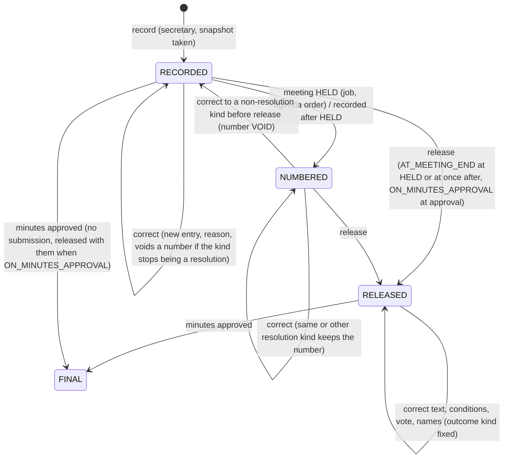
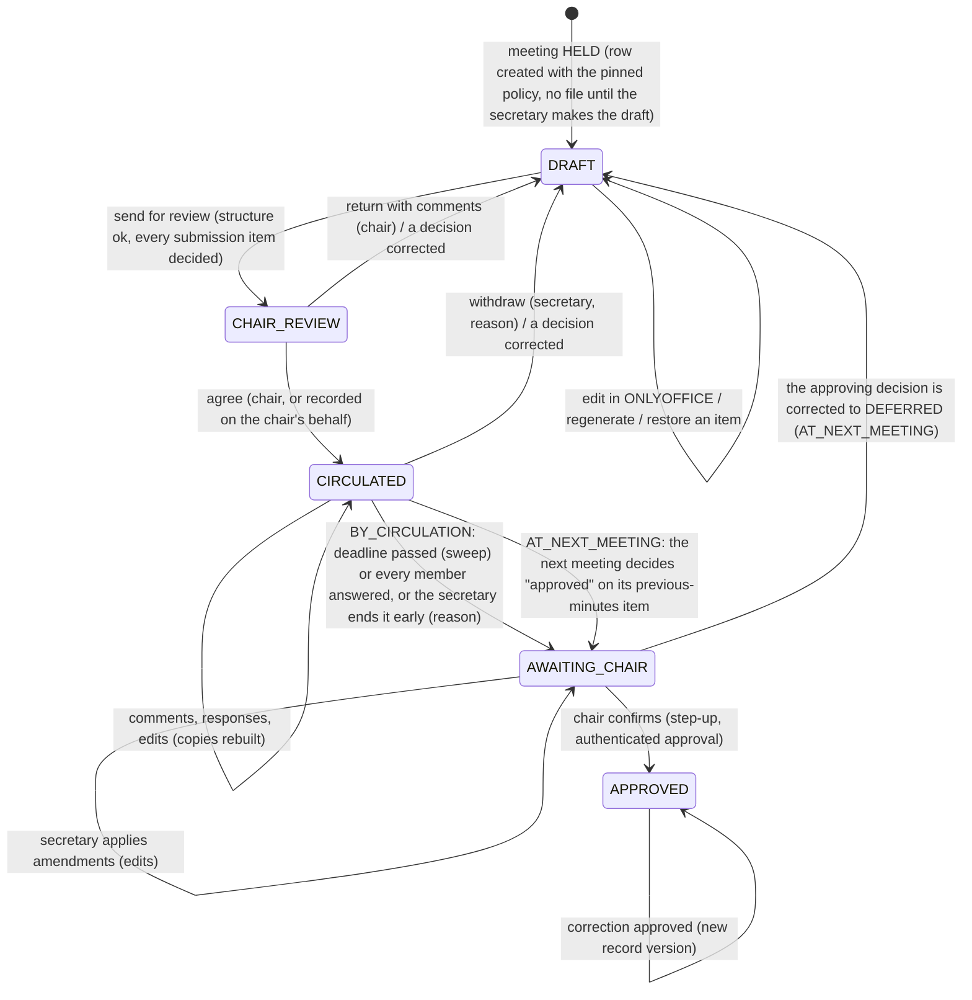
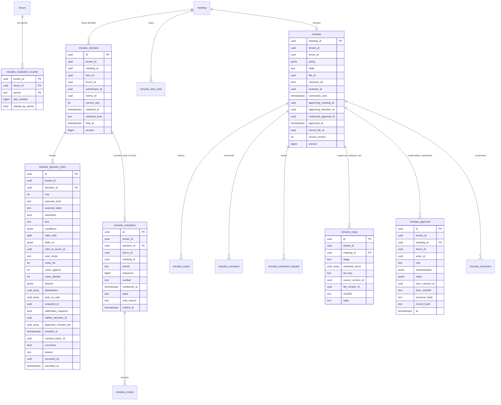

# E06 Minutes and resolutions — design

> Step 3 of `AGENTS.md §5`. Decisions: ADR-0065 (decisions and resolutions, numbering, back to the memo) and ADR-0066 (minutes: drafting, the approval path, the record). Builds on ADR-0044 (numbering), ADR-0047 (ONLYOFFICE), ADR-0048 (templates), ADR-0051 (authenticated approvals), ADR-0053 (PDF/A), ADR-0056 (committee types and outcomes), ADR-0058 and ADR-0059 (the waiting step and submissions), ADR-0060 and ADR-0061 (agenda, paper access), ADR-0062 (recusal) and ADR-0064 (attendance, quorum snapshots). Research: `research.md`. Screens: `ux-review.md` (flows AA–AI), **reviewed by the owner before any web task** (Phase 4 Q1).

## 1. Domain model

### 1.1 The decision (ADR-0065)
One decision per agenda item that needs one, kept as an append-only list of entries; the latest entry is the decision.

| Entity | Attributes |
|---|---|
| `minutes_decision` | `id`, `meetingId`, `itemId` (unique: one decision per item), `forumId`, `submissionId` and `memoId` (SUBMISSION items only), `currentSeq`, `releasedAt`, `releasedKind` (the outcome kind sent to the memo), `finalAt` (set when the minutes are approved), `version` |
| `minutes_decision_entry` | `decisionId`, `seq` (1, 2, …), `outcomeKind`, `outcomeLabel` (copied from the pinned type version), `resolution` (the kind's flag), `text` 0–4,000, `conditions` (0–20 lines of 1–1,000), `validUntil` (date, optional), `deferTo` (`{meetingId}` or `{date}` or `{next: true}`), `referToForumId` with `referReason`, `voteMode` CONSENSUS or VOTE, `votesFor`, `votesAgainst`, `votesAbstain` (each null or ≥ 0), `dissent` (`[{userId, reason 0–1,000}]`), `abstentions` (user ids), `tookNoPart` (user ids, derived), `snapshotId`, `ratificationRequired`, `ratifiesDecisionId`, `approvesMinutesIds` (on the "Minutes of the previous meeting" item), `decidedAt` (when the item was taken), `consentBatchId`, `correction`, `reason` 1–500 (corrections), `recordedBy`, `recordedAt` |

**Invariants** (checked in the recording transaction under `SELECT … FOR UPDATE` on `minutes_decision`, If-Match on its `version` for a correction):
- `ITEM_ON_AGENDA`: the item is on the latest published revision, or was tabled (E03); not removed. Sub-items may have their own decision; a parent's decision does not decide its sub-items.
- `OUTCOME_OF_TYPE`: the kind is one of the pinned type version's outcomes (422 `OUTCOME_NOT_OFFERED`).
- `TEXT_REQUIRED`: `text` is 1–4,000 characters when the kind is marked `resolution`; `conditions` has at least one line for APPROVED_WITH_CONDITIONS; DEFERRED and REFERRED carry their target; REFERRED's committee is active and not this one (422 `SAME_FORUM`).
- `PEOPLE_PRESENT`: every person named in `dissent` or `abstentions` is in the snapshot's presence map as present for the item, holds a voting seat (or stands in for one), and is not recused or stepped out (422 `NOT_PRESENT`, `NOT_VOTING`, `RECUSED_NAMED`); nobody is both dissenting and abstaining.
- `COUNTS`: with VOTE, `votesFor + votesAgainst + votesAbstain` ≤ the voting seats present and not recused in the snapshot (422 `TOO_MANY_VOTES`); named dissenters ≤ `votesAgainst` and named abstainers ≤ `votesAbstain` when counts are given. Counts are not required to agree with the outcome (a casting vote, a special majority); the screen warns when "For" is not more than "Against" for an approval.
- `TOOK_NO_PART` is computed from the snapshot (recused, stepped out), never sent by the client.
- `QUORUM`: the snapshot is taken in the same transaction (`QuorumSnapshots.take(meetingId, itemId, at = decidedAt, override?)`); 409 `NOT_QUORATE` passes E05's unmet conditions through. A correction keeps the earlier snapshot unless `decidedAt` changes or the secretary asks to "check the quorum again"; `QuorumSnapshots.drifted` is shown when attendance was corrected later.
- `RECORDER_NOT_RECUSED`: a recused secretary or manager answers 403 `RECUSED` (ADR-0062).
- **Windows** (409 `WRONG_STATE` or `FROZEN`): record while the meeting is IN_PROGRESS or HELD and the minutes are not APPROVED; a correction while the minutes are CHAIR_REVIEW, CIRCULATED or AWAITING_CHAIR returns them to DRAFT (§1.6), after a confirmation in the request (`returnMinutesToDraft: true`, else 409 `MINUTES_IN_REVIEW`); nothing after APPROVED.
- `RELEASED`: once released, a correction may not change the outcome kind (409 `RELEASED`); text, conditions, validity, vote and names may change, and the memo gets a system note.
- `decidedAt` lies between the meeting's start minus 1 hour and its end plus 6 hours (422 `TIME_OUT_OF_RANGE`); default: when the item was last started (`meeting_item_progress`), else now while IN_PROGRESS, else required.

- States are derived (resolution present, `releasedAt`, `finalAt`), not stored. Forbidden: any change after FINAL (409 `FROZEN`), an outcome-kind change after RELEASED (409 `RELEASED`), a record on a CANCELLED meeting or one not yet started (409 `WRONG_STATE`).
- **Items without a submission** (secretary items, procedural items) are decided the same way and are never released to anything.
- **Undecided submission items:** the minutes cannot leave DRAFT while a SUBMISSION item on the agenda has no decision (409 `UNDECIDED_ITEMS` with the items): its memo would wait for ever. The secretary records DEFERRED for an item not reached.

**Consent sections** (ADR-0060): `POST …/sections/{sid}/decision` decides every item still in the section of the latest revision (not lifted by a discussion request) with each item's default outcome (the first APPROVED kind for "For decision", NOTED for "For noting"), one entry per item with a shared `consentBatchId`, one snapshot per item (recusals differ per item), all in one transaction. A recused secretary cannot decide a section containing an item they are recused from. Items can then be corrected one by one.

**Ratification:** a decision taken under a quorum override (`ratificationRequired`) is listed on the forum's "to be ratified" list; a later quorate decision on any item may name it in `ratifiesDecisionId` (outcome APPROVED or NOTED), which clears it from the list. The minutes print "decided without a quorum, to be ratified" and, in the later minutes, "ratifying decision … of BRC 3/2026".

**As built (T3):**
- **Module:** `com.memo.minutes` (published: `Decisions` with `find`, `of(meetingId)`, `ofItem(itemId)`, `entry(decisionId, seq)`, `DecisionRef`/`DecisionEntryRef`/`DecisionState`, and the `DecisionRecorded(tenantId, meetingId, itemId, decisionId, seq)` event, published for every new entry: first records, corrections, and each item of a consent section; E07 design §11) and `com.memo.minutes.internal`. Migration `minutes/V1__decisions.sql`: `minutes_decision`, `minutes_decision_entry`, `minutes_item_note` (`approves_minutes_ids` waits for T6).
- **The meeting module publishes** `MeetingItems.agenda(meetingId)` (the latest revision's items without breaks, then tabled items not yet published, with consent and lifted flags), `MeetingViewers.of/find(meetingId)` (the actor's `MeetingView`: manages, officer, `forum.read`, each item's line by `PaperAccess`, and the recused lines) and `DecidedItems` with `NoDecidedItems` as the fallback when no bean exists. `MeetingProblems` now applies to every controller (its exceptions are the meeting module's own, thrown by its published API to E06).
- **Order of the checks** in `PUT …/decision`: 404 (meeting, item, an item not seen for lack of clearance) → 403 (not a secretary or `forums.manage`) → 403 `RECUSED` → lock the decision row → 428/412 (If-Match once it exists) → windows (409 `FROZEN`, `WRONG_STATE`, `MINUTES_IN_REVIEW`) → 422 content, reason, time, targets → 409 `RELEASED` → the snapshot (`QuorumSnapshots.take` locks the meeting row; 409 `NOT_QUORATE`, `OVERRIDE_NOT_ALLOWED`) → 422 people and ratification. The recusal comes before the meeting's state, so the leak suite's recusal columns hold on a scheduled meeting.
- **Lock order:** the decision row, then the meeting row (inside `take`). A first record has no row to lock: two concurrent first records serialise on the meeting row and the second fails on the unique key on the item (412). A consent section locks its items' decision rows in one statement, in id order.
- **"Took no part"** = holders present but recused from the item (the snapshot's presence) and roster members stepped out of it. A recused alternate standing in for a member is not named (the snapshot does not record their attendance); the minutes (T5) can add them from `MeetingAttendance`.
- **Problem codes added:** 422 `TIME_REQUIRED` (held, no time and no item start), `VOTE_MODE` (counts with a consensus), `DUPLICATE`, `BOTH`, `TOO_MANY_NAMED`, `RATIFY_NOT_QUORATE`, `OUTCOME` (a ratification approves or notes), `unknown` (`deferTo/meetingId`, `referToForumId`, `ratifiesDecisionId`); 409 `NOTHING_TO_DECIDE` (a consent section with nothing left).
- **The minutes' stage** is a port, `MinutesStages` (`stage`, `returnToDraft`), with `NoMinutesYet` until T5 creates the `minutes` row; the windows and the return to the draft are tested on the rule (`DecisionStateMachineTest`); the integration test with real minutes is T5's.
- **Drift** in the decisions list: for secretaries, only when the attendance register was corrected after the decision was recorded (`MeetingAttendance.lastCorrectedAt`), so the list does not re-evaluate every snapshot.
- **"To be ratified":** `GET /forums/{fid}/decisions/to-be-ratified` (secretaries and `forums.manage`): ids, meeting label, item number, outcome label and time only; each decision of `GET …/decisions` carries `toBeRatified`.
- **The recused view** is given only to someone the item is for: on a restricted item, a recused person not named on it (an alternate standing in for the member, recused with them) sees nothing of its decision (found by `PaperLeakIT`).
- **A ruling or a withdrawal on a decided item** is refused FROZEN only after E04's access checks (403 to someone who may not act), so the leak suite's answers stay 403/404.
- **Notes** answer 404 to everyone but the committee's secretaries and `forums.manage` (the leak table's "Notes: 404"), and 404 to a recused secretary reading, 403 `RECUSED` writing.
- **Consent defaults:** the item's purpose DECISION → APPROVED, otherwise NOTED; a resolution's text is the item's "resolution sought", else "Approved as presented." / "Noted.".

### 1.2 The secretary's notes per item
`minutes_item_note` (append-only versions: `meetingId`, `itemId`, `seq`, `text` 0–10,000 plain text, `savedBy`, `savedAt`); the latest version is the note. Saved from the decision screen while the meeting is IN_PROGRESS or HELD and the minutes are in DRAFT; autosaved every 10 seconds of typing as a new version only when the text changed. They fill the item's "key points discussed" when the draft is generated. Only the forum's secretaries and `forums.manage` holders who are not recused from the item read them; they are never in a member's view, a copy or the record (research §6.3). Frozen at approval, never deleted.

### 1.3 Resolutions (ADR-0065)
| Entity | Attributes |
|---|---|
| `minutes_resolution_counter` | `forumId`, `period` (`ALL`, `2026`, `FY2026-27`), `lastNumber`, `startedByAdmin`; PK `(tenant_id, forum_id, period)` |
| `minutes_resolution` | `id`, `decisionId`, `forumId`, `meetingId`, `period`, `sequence`, `number` (rendered, ≤ 100 characters), `numberedAt`, `state` IN_FORCE or VOID, `voidReason`, `voidedAt`, `voidedByEntrySeq` |

- **Format** (`forum_type_version.minutes.resolutionNumbering`, §1.8): parts TEXT, COMMITTEE_CODE, YEAR (2 or 4), FINANCIAL_YEAR (LONG `2026-27` or SHORT `FY27`), MEETING_NUMBER (the meeting's number in its series), SEQUENCE (1–9 minimum digits, exactly once); reset NEVER, YEARLY or FINANCIAL_YEAR with `fyStartMonth`. At most 12 parts, 100 characters rendered. Checked by the shared `common.numbering` code (§2) with the committee's code resolver.
- **Taking a number:** `ResolutionNumbers.assign(decision)` inside the transaction: the period from the meeting's local date and the format's reset; `INSERT … ON CONFLICT (tenant_id, forum_id, period) DO UPDATE SET last_number = last_number + 1 RETURNING last_number`; the row stays locked to commit; the rendered number is inserted with the unique keys `(tenant_id, forum_id, period, sequence)` and `(tenant_id, number)`; a collision (only possible after a format change makes two formats render the same text) answers 409 `NUMBER_TAKEN` and nothing commits; audited `minutes.resolution.numbered`.
- **At HELD:** the `minutes-release` job (§9) numbers the meeting's current resolution decisions without a number in the order of the latest revision's item numbers (tabled items after, in the order they were tabled), one transaction each.
- **After HELD:** a decision recorded or corrected into a resolution kind is numbered in its own transaction.
- **Void:** a correction (before release) to a kind not marked `resolution` sets the IN_FORCE resolution to VOID with the correction's reason (unique `(tenant_id, decision_id) WHERE state = 'IN_FORCE'`). If the decision later becomes a resolution again, it takes a new number. A void never frees a number.
- **Starting number:** `PUT /forums/{fid}/resolution-counters/{period}` `{next}` by `forums.manage` with a fresh step-up, only while no number exists for that committee and period (409 `ALREADY_STARTED`); writes the counter at `next - 1` with `startedByAdmin`; audited.
- **The register check:** for each committee and period, count of resolutions (IN_FORCE + VOID) = `lastNumber` − the starting offset; sequences 1..n without holes. On demand in the register (`GET …/resolutions/check`) and nightly on generated data.

**As built (T4):**
- **Migration `minutes/V2__resolutions.sql`:** `minutes_resolution_counter` (PK `(tenant_id, forum_id, period)`, `last_number`, `first_number` — 1, or the starting number — and `started_by_admin`; a trigger lets `last_number` only grow and never changes where a counter starts; column grant on `last_number`) and `minutes_resolution` (unique `(tenant_id, forum_id, period, sequence)` and `(tenant_id, number)`, one IN_FORCE per decision, composite foreign keys to the decision and to the counter, indexes on the decision and the meeting; a trigger keeps the number, period, sequence, decision, committee and meeting and allows only IN_FORCE → VOID once; column grant on the void's columns). RLS ENABLE + FORCE; no DELETE or TRUNCATE.
- **Taking a number** (`ResolutionNumbers.assign`): the committee type's format pinned on the meeting (`ForumPolicies.version(…).minutes.resolutionNumbering`), the committee's code, and the meeting's number (`MeetingRef.number`, added to the meeting module's published `MeetingRef`); a format with MEETING_NUMBER on a meeting never numbered is 409 `WRONG_STATE`. The register check counts from `first_number` (`ResolutionChecks`, pure: missing, duplicated and stray numbers).
- **Order at the end** (`ResolutionOrder`, pure): `MeetingItems.agenda` order (the latest revision, then tabled items), a decided item no longer on the agenda after them by the time it was taken. The job numbers in rounds until nothing is left, so a decision recorded while it runs is numbered too; one recorded after the end is numbered in its own transaction at once, so it can take a number between the end and the job (the batch stays in agenda order among itself).
- **Voids:** a correction to an outcome that is not a resolution voids the number in force (any time before the release; for an item without a submission until the minutes are final), with the correction's reason and entry; a later correction back into a resolution takes a new number after the meeting is held.
- **Published:** `Resolutions` (`find`, `inForce`, `ofDecision`, `ofMemo`, `check` — E08's ask), `ResolutionRef`, `ResolutionCheck`; events `ResolutionChanged(tenantId, decisionId, resolutionId, NUMBERED | VOIDED)` (E08's ask, one per write) and `DecisionReleased(tenantId, meetingId, decisionId)`. `DecisionState` gains NUMBERED; `DecisionRef` and the decision responses carry `resolutionNumber` and `resolutionId`.
- **API** (`p4-e06-resolutions.yaml`): `GET /forums/{fid}/resolutions?period=&state=&cursor=&limit=` (the latest number first, keyset on the sequence; default period the committee's latest; officers — secretary, chair, vice-chair —, `forums.manage` and `forum.read`; a member 403, others 404; a row in full only when its item's decision is seen in full, else number, state, meeting and item number with `restricted`), `GET /forums/{fid}/resolutions/check?period=`, `GET /resolutions/{rid}` (`full` for those who see the decision in full; the recused line and the memo's readers get outcome, number, text, conditions and validity; the void's reason for `full` only), `PUT /forums/{fid}/resolution-counters/{period}` (`forums.manage`: 404 and 403 come before the step-up; then 422 `FORMAT` for a period not of the committee's format, `RANGE`, 409 `ALREADY_STARTED`). The check is open to the register's readers (the chair too).

### 1.4 Back to the memo (ADR-0065)
`DecisionRelease.release(decisionId)` in one transaction, idempotent on `releasedAt`:
1. `SELECT … FOR UPDATE` the decision; skip when released or when the item has no submission;
2. `ForumDecisions` (forum module, published; it locks the submission first, as E03's lock order requires):
   - APPROVED, APPROVED_WITH_CONDITIONS, NOTED, REJECTED, RETURNED → `decide(submissionId, outcome, remark, reference)`;
   - WITHDRAWN → `decide(…, RETURNED, "Withdrawn at the meeting. " + text, reference)`;
   - DEFERRED → `deferAtMeeting(submissionId, reason, target)`: DEFERRED, placement cleared, target date or meeting;
   - REFERRED → `referAtMeeting(submissionId, forumId, reason)`: REFERRED with a new linked submission to the other committee (its memo keeps waiting; the workflow step's resolution names the new submission);
   - a pass-through submission (`waits = false`) → `decide(…, NOTED, …)` whatever the outcome;
3. `remark` = "{outcome label}. Resolution {number}: {text} Conditions: 1. … 2. …" (cut at 4,000 characters with "(see the resolution)"); `reference` = `{resolution: number?, decisionId, meetingLabel}` stored in the FORUM_DECIDED action's `details` by a new optional parameter of `WorkflowForums.decided`;
4. sets `releasedAt`, `releasedKind`; audits `minutes.decision.released`.
- **The memo side** (no memo migration): the note sheet's FORUM_DECIDED entry shows "Board Risk Committee — Approved with conditions — Resolution BRC/2026/014" with a link to the resolution page (readable by the memo's readers, §4); the final record (ADR-0053) prints the remark in the approval history and note sheet. A later correction of text or conditions adds a system note "The committee's decision was corrected on {date}: …" through `MemoNotes`' system-entry API.
- **The submitter** is told by E02's existing `SubmissionNotifier` (decided, deferred, referred).

**As built (T4):**
- **The mapping** is `ReleaseMapping` (pure): the table above; a deferral's reason "{label} at {meeting}. {text}" (cut at the forum's 2,000) and its target the named meeting's date, the date, or none for the next meeting; a referral's reason the decision's. The FORUM_DECIDED action's `details` gain `resolution`, `resolutionId`, `decisionId`, `meetingId`, `meetingLabel` and `outcomeLabel`.
- **Who acts:** `ForumDecisions` and `WorkflowForums` need a signed-in user, so the `minutes-release` job releases each decision as the recorder of its current entry (`minutes.decision.released` names them, with `trigger` HELD, APPROVED or AT_ONCE); the numbering in the job is the system actor's.
- **When:** `MeetingChanged(ENDED)` schedules `minutes-release` (`<meeting>:HELD`) in the ending transaction; under AT_MEETING_END it then releases every decision with a submission; under ON_MINUTES_APPROVAL only numbers. T6 calls `MinutesReleaseScheduler.approved(meetingId)` at the confirmation (`<meeting>:APPROVED`), which releases what is left whatever the policy. A decision recorded or corrected once the meeting is held is numbered and, under AT_MEETING_END, released in its own transaction.
- **Lock order:** recording now takes the decision row, then the item's submission row (`SubmissionPlacements.lock`), then the meeting row (`Meetings.locked`, published; its status is then current, so a meeting marked as held meanwhile numbers and releases the decision at once), then `QuorumSnapshots.take` (same meeting row), then the counter; a consent section the decision rows, the submissions in one statement, the meeting. The job: the decision row, then the counter (numbering) or the submission (release).
- **Failures:** a release failing is retried with the job (5 tries, ADR-0018's backoff); the other decisions are not held back and a retry skips what is done; after the last try each failure is audited `minutes.decision.release_failed` (the `DECISIONS_RELEASE_FAILED` notification waits for T6's notification kinds). A submission no longer QUEUED or ACCEPTED (withdrawn meanwhile) is skipped, not failed.
- **The memo side:** the note sheet's FORUM_DECIDED entry gains `resolution`, `resolutionId` and `meetingLabel`; a corrected wording, conditions or validity of a released decision writes "The committee's decision was corrected on {date}: {remark}" through the published `MemoSystemNotes.forumDecisionCorrected` (a COMMENT with `actionKind` FORUM_DECISION_CORRECTED, by the secretary, never correctable; no memo migration). The final record's approvals list each committee decision ("Board Risk Committee — Approved with conditions — Resolution BRC/2026/014", its meeting) beside the stamps, and its note sheet labels the remark "The committee's decision (remark)".

### 1.5 Minutes (ADR-0066)
| Entity | Attributes |
|---|---|
| `minutes` | `meetingId` (PK), `forumId`, `policy` (the pinned type version's `minutes` policy, copied at creation), `state`, `fileId` (the .docx, purpose `minutes.draft`), `structureOk`, `structureProblems`, `reviewerId` (chair or vice-chair chosen at send), `commentsUntil`, `approvingMeetingId`, `approvingDecisionId`, `confirmedApprovalId`, `approvedAt`, `recordFileId`, `recordVersion`, `version` |
| `minutes_event` | append-only: `kind` (GENERATED, ITEM_RESTORED, SENT_FOR_REVIEW, AGREED, RETURNED, CIRCULATED, COMMENTS_REQUESTED, WITHDRAWN, DEADLINE_PASSED, LINKED_TO_MEETING, APPROVED_AT_MEETING, CONFIRMED, CORRECTION_APPROVED), `actor`, `onBehalfBy`, `how`, `note` 0–1,000, `fileVersionId`, `sha256`, `at` |
| `minutes_comment` | `userId`, `itemId?`, `kind` NO_COMMENTS or SUGGESTION, `text` 1–2,000 (SUGGESTION), `at`; response set once: `response` ADOPTED or NOT_ADOPTED, `responseNote` 0–1,000, `respondedBy`, `respondedAt` |
| `minutes_comment_request` | `userId` (anyone in the tenant cleared for the meeting's classification, for example an executive), `askedBy`, `askedAt`, `itemIds` (the items they may read; others are redacted in their copy) |
| `minutes_copy` | `stage` DRAFT or APPROVED, `redactedItems` (sorted ids), `setKey` (SHA-256 of the sorted ids), `sourceVersionId` (the .docx version), `fileId`, `fileVersionId`, `sha256`, `state` PENDING, DONE or FAILED, `builtAt` |
| `minutes_approval` | ADR-0051's fields: `actorId`, `role` (CHAIR or VICE_CHAIR), authentication (method, second-factor time, step-up age, session hash), client (IP, user agent), `docxVersionId`, `docxSha256`, `previousHash` (the committee's previous minutes approval), `recordHash`, `at` |
| `minutes_correction` | `itemId?`, `text` 1–4,000, `reason` 1–500, `proposedBy`, `proposedAt`, `state` PROPOSED, APPROVED or DECLINED, `decidedBy`, `decidedAt`, `approvalId` (the chair's authenticated approval), `recordVersion` |
| `minutes_extract` | `resolutionId`, `issuedBy`, `issuedAt`, `minutesState` at issue (DRAFT or APPROVED), `certification` (ADR-0051 fields of the secretary's step-up), `fileId`, `fileVersionId`, `sha256` |

**Lifecycle:**

- **Forbidden** (409 `WRONG_STATE`): generating before HELD; sending with structure problems (409 `STRUCTURE`, with the items) or undecided submission items (409 `UNDECIDED_ITEMS`); circulating without the chair's agreement; confirming before AWAITING_CHAIR; any edit, comment or decision change after APPROVED (`FROZEN`); confirming by anyone but the confirmer (§1.6.4).
- **One minutes per meeting.** A CANCELLED meeting has none.

### 1.6 The approval path in detail

**1.6.1 Drafting.**
- `POST …/minutes/draft` (meeting HELD) schedules `minutes-draft`; the job builds `TemplateData` (§1.7) from the latest published revision (items with numbers, titles, purposes, presenters, papers with "circulated in advance" or "tabled", sections), `MeetingAttendance.of(meetingId)`, `Recusals.declarationsFor(meetingId)`, the decisions with their snapshots, and the notes; fills the pinned template (or the built-in one); wraps each item's block in a content control (`w:sdt`, block level, rich text, `w:tag w:val="memo-item:<itemId>"`, `w:lock w:val="sdtLocked"`, title "Item {n}"; T1: `TemplateData.control`, §1.7); stores version 1 of the file. Audited `minutes.draft.generated` with the SHA-256.
- **Regenerate one item** (`POST …/minutes/items/{itemId}/regenerate`): replaces only that control's content with the item freshly filled; **restore** does the same for a missing control and inserts it after the previous item's control. **Regenerate all** needs `{replaceEdits: true}`.
- **Edit:** ONLYOFFICE through `docedit` with purpose `minutes.draft`, an `EditableFilePurpose` whose `mayEdit` is: a secretary of the forum in office or a `forums.manage` holder, not recused from any minuted item, while the minutes are DRAFT, CIRCULATED or AWAITING_CHAIR. Co-editing by several secretaries (ADR-0047). The chair, in CHAIR_REVIEW and when not recused, opens it in **review mode** (`permissions.edit = false`, `permissions.review = true`): tracked changes the secretary accepts or rejects. T1 (ONLYOFFICE 10.0.0.1): the editor keeps every control's tag, title, id and lock through typing, refused deletions, undo, force save, the closing save and a reopen; a selection that spans a locked control, and select-all with Delete, delete nothing (also in review mode); Backspace at a control's start edits the previous control's text but never merges or removes a control. Review mode saves `w:ins`/`w:del` with the reviewer's name and an extra `oouserid` attribute, and leaves `w:trackRevisions` off in the settings (review is enforced by the permissions, not the file).
- **Structure check** (`MinutesStructure.check(version)`) on every saved version (the purpose's version callback) and before each transition: exactly one control per minuted item, no unknown or duplicated tags; the result is stored on the minutes row and shown as a banner. Before circulation, before copies are built and before confirmation, the document must also have no unresolved tracked changes or comments (409 `UNRESOLVED_CHANGES`: "Accept or reject the chair's suggested changes first"), and copies reset the document properties, so nothing of a redacted item survives in revisions, comments or metadata. The check reads the .docx with POI in file-backed mode with the template engine's limits (ADR-0048).

**1.6.2 Chair review.**
- `POST …/minutes/send-for-review` (secretary): picks the reviewer — the chair in office, or the vice-chair when there is no chair or the chair is recused from any minuted item; with neither able, 409 `NO_REVIEWER` and the secretary sends straight to circulation with a reason ("No chair able to review"), audited.
- `POST …/minutes/review` `{decision: AGREE | RETURN, comment?}` by the reviewer, or by a secretary on their behalf with `how` and a note (AGREE only). RETURN needs a comment.

**1.6.3 Circulation.**
- `POST …/minutes/circulate` (secretary): `commentsUntil` = the end of the working day `circulationWorkingDays` after today (business calendar, meeting's zone), editable later (never earlier than tomorrow). Readers (§4): members of the meeting's roster in office today, alternates who attended, the chair and secretaries, and people asked for comments. Each gets `MINUTES_CIRCULATED`. Copies are built for every distinct redaction set among them (`minutes-copies`).
- **Members** say "No comments" (once; can be followed by a suggestion) or "Suggest a correction" (any number, per item or general; a recused member may comment only generally or on items they see in full). They see their own comments and the responses to them.
- **Secretaries** adopt or decline each suggestion with an optional note; the member sees the response. Edits made while CIRCULATED rebuild the copies (debounced 2 minutes after the last save) and members see "Updated on {date}".
- **AT_NEXT_MEETING:** when the forum's next meeting's agenda has a PREVIOUS_MINUTES item, CIRCULATED minutes not yet approved are linked to it (`minutes_event LINKED_TO_MEETING`; shown on the item as "Minutes of BRC 3/2026 — read your copy"). The linked minutes are readable through the item by its readers (§4). Its decision (with `approvesMinutesIds`) of kind APPROVED or APPROVED_WITH_CONDITIONS moves them to AWAITING_CHAIR with `approvingMeetingId`; DEFERRED leaves them CIRCULATED.
- **BY_CIRCULATION:** the hourly sweep moves minutes whose `commentsUntil` has passed to AWAITING_CHAIR; so does the last member's answer, or the secretary early with a reason. The next meeting's PREVIOUS_MINUTES item lists them "approved by circulation on …, for noting".
- **Reminders:** `MINUTES_COMMENTS_CLOSING` on the last working day to members who have not answered; `MINUTES_DRAFT_OVERDUE` to the secretaries when the minutes are not circulated `draftWorkingDays` after the meeting.

**1.6.4 Confirmation.**
- **The confirmer:** AT_NEXT_MEETING: the chair in office of the approving meeting; BY_CIRCULATION: the chair in office today; in both, the vice-chair when the chair is recused from any minuted item or there is none. Shown on the minutes page ("Waiting for Dr F. Karim to approve").
- `POST …/minutes/confirm` (If-Match, fresh step-up per the forum's step-up window, Idempotency-Key): checks the structure, writes `minutes_approval` (ADR-0051 fields; the record hash chained per committee), moves the minutes to APPROVED and the meeting HELD → MINUTES_APPROVED (`MeetingMinutes.approved(meetingId)`, meeting module), sets `finalAt` on every decision, schedules `minutes-release` when the policy is ON_MINUTES_APPROVAL, and schedules `minutes-record`. Audited `minutes.confirmed`. Everyone who read the circulated minutes is told (`MINUTES_APPROVED`).
- **Freezing:** the meeting module freezes attendance and declarations on MINUTES_APPROVED (ADR-0064, ADR-0062); guests and item attendees lose access (E03).

**1.6.5 Corrections after approval** (CGI §6.2).
- `POST …/minutes/corrections` (secretary not recused from the item): `{itemId?, text, reason}`. `POST …/minutes/corrections/{cid}/decide` `{APPROVE | DECLINE, note?}` by the confirmer rule of §1.6.4 with a step-up; APPROVE writes a `minutes_approval` and schedules `minutes-record` for a new version (the original pages unchanged plus a "Corrections" annex page with each approved correction, its date and the approver's stamp). The earlier version stays locked and readable; the minutes page shows "Corrected on {date}". The next meeting's MATTERS_ARISING item lists approved corrections (E07 builds matters arising; E06 publishes `MinutesCorrections.since(forumId, date)`).

**1.6.6 Resolution extracts.**
- `POST /resolutions/{rid}/extracts` (a secretary of the forum not recused from the item, fresh step-up): available once the decision is released (or, for an item without a submission, once the meeting is HELD), refused for VOID resolutions (409). The `minutes-extract` job renders a one- or two-page PDF/A through `RecordPdfs`: the committee, meeting label and date, item number and heading, the resolution number, outcome, text, conditions and validity, the certification stamp (ADR-0051 fields of the secretary), and "The minutes of this meeting were approved on {date}" or "The minutes of this meeting have not yet been approved". Stored as purpose `minutes.extract` (record storage, locked); audited `minutes.extract.issued`.

### 1.7 The minutes template and vocabulary
**Engine change (`templating`):** `TemplateData` gains `blocks: Map<String, List<TemplateData>>`; a `{{?name}}…{{/name}}` section whose name is a block in the vocabulary repeats once per element, with value tags, nested sections (not nested blocks: one level) and table-row loops inside resolved against the element. `TagVocabulary` gains `blocks: Map<String, TagVocabulary>`. The scanner checks tags inside a block against the block's vocabulary (`UNKNOWN_TAG` with the closest known name otherwise). Memo vocabularies declare no blocks, so memo templates behave as today.

**Built in T1** (spike, kept as code): the filler side. `TemplateData.blocks` repeats a block per element (value tags, nested sections and table-row loops resolve against the element, then against the document's values); `TemplateData.control` (a `ControlMark` with the tag and title) on an element wraps its rendered block in a block-level, rich-text, `sdtLocked` content control. A block with controls must have its `{{?items}}` and `{{/items}}` each in a paragraph of the body (not in a table, not in the same paragraph); otherwise the fill fails with INVALID_TEMPLATE, so **T2's scanner must report it** (a new problem code for the minutes vocabulary). The wrap is a streaming pass over `document.xml` between two marker paragraphs the filler adds with a per-fill random token (moving nodes with XMLBeans was quadratic: 5 s for 60 items; the stream takes 0.4 s for 60 items of 1,700 words). `DocxControls` (published by `templating`) scans controls by StAX, replaces a control's content, and restores a missing control after the previous one from a fresh fill; restoring refuses content that refers to package parts (pictures, links). T2 adds `TagVocabulary.blocks` and the scanner.

**Minutes vocabulary** (dotted ASCII names; values pre-formatted text in the tenant's language and the meeting's zone):
| Group | Tags |
|---|---|
| Meeting | `meeting.committee`, `meeting.label` (BRC 3/2026), `meeting.kind`, `meeting.date`, `meeting.start`, `meeting.end`, `meeting.zone`, `meeting.place`, `meeting.mode`, `meeting.chair` (who chaired), `meeting.closedAt`, `minutes.status` ("DRAFT" until approved, then empty), `minutes.approvedOn`, `minutes.approvedBy` |
| Attendance loops (table rows) | `present` [`name`, `role`, `mode`, `from`, `until`, `note`], `alternates` [`name`, `forMember`, `mode`], `inAttendance` [`name`, `capacity`, `items`], `apologies` [`name`, `alternate`], `absent` [`name`] |
| Quorum | `quorum.opening` (sentence), `quorumChanges` [`at`, `item`, `text`] (lost, restored) |
| Items block `items` | `item.number`, `item.title`, `item.section`, `item.purpose`, `item.presenters`, `item.papers` (each "title — circulated in advance" or "— tabled at the meeting"), `item.late`, `item.declarations` (sentences: "Mr X declared an interest (nature) and left the meeting for this item"), `item.notes` (key points discussed), `item.outcome` (label in capitals), `item.resolutionNumber`, `item.resolutionText`, `item.conditions` (numbered lines), `item.validUntil`, `item.vote` ("For 5, against 1, abstaining 0"; empty for consensus), `item.dissent` ("Mr Z asked that his dissent be recorded: reason"), `item.abstentions`, `item.tookNoPart`, `item.quorum` ("The meeting remained quorate (4 of 7 voting members, 4 needed)"), `item.ratification` ("Decided without a quorum, to be ratified" / "Ratifies decision … of BRC 2/2026"), `item.arrivals` ("Ms Y joined the meeting during this item"), `item.departures`; sections `{{?item.notes}}`, `{{?item.conditions}}`, `{{?item.dissent}}` and so on show a block only when not blank |
| Resolutions loop (table rows) | `resolutions` [`number`, `item`, `outcome`, `text`] |

**The built-in default template** (shipped in the backend resources, scanned in a test like any upload): heading with the committee and meeting, DRAFT marker, present / in attendance / apologies tables, "Quorum", then per item: "{n}. {title}", papers, declarations, "Key points discussed included:", the outcome in bold capitals with "It was RESOLVED that …" for resolutions or "It was NOTED that …", conditions, vote, dissent, abstentions, took no part, quorum sentence; "There being no other business, the meeting closed at {time}"; a signature block "Chair" with "Approved on …". English with an Arabic variant for the right-to-left proof.

**Uploads:** on the committee type's Minutes tab (§1.8), scanned with the minutes vocabulary; refusals and problems as ADR-0048 (no macros, OLE, external links, field codes); stored as purpose `forum.minutes-template` (files module, owned by forum); a preview fills it with the demo meeting's data.

### 1.8 The committee type's minutes policy
`forum_type_version.minutes` (jsonb, null reads as the defaults), edited on the committee type's new **Minutes** tab and reviewed by a second administrator like every type change (ADR-0056):

| Field | Default | Rule |
|---|---|---|
| `approval` | AT_NEXT_MEETING | AT_NEXT_MEETING or BY_CIRCULATION |
| `circulationWorkingDays` | 5 | 1–20 working days for comments |
| `draftWorkingDays` | 10 | 1–30: the secretaries are reminded when the minutes are not circulated by then |
| `memoResumes` | AT_MEETING_END | AT_MEETING_END or ON_MINUTES_APPROVAL (ADR-0065) |
| `resolutionNumbering` | `{COMMITTEE_CODE}/{YEAR:4}/{SEQUENCE:3}`, YEARLY, `fyStartMonth` 7 | §1.3 |
| `templateFileId` | null (the built-in template) | a scanned `forum.minutes-template` file with no problems |

- Presets (E01): Board, Board Risk, Board Audit → AT_NEXT_MEETING; Management Credit Committee, ALCO, Executive Committee → BY_CIRCULATION; all AT_MEETING_END and the default numbering.
- The policy is pinned with the type version on each meeting (ADR-0060) and copied onto the `minutes` row at its creation, so later type changes do not alter a meeting's minutes.
- Publishing a type version is refused when its numbering could render the same numbers as another type's for a committee with the same code (impossible in practice: codes are unique per tenant) or when the template has problems (`TEMPLATE_PROBLEMS`).
- **As built (T2):** the numbering must contain the committee's code (`COMMITTEE_CODE_MISSING`), which is what makes the overlap check above unnecessary; problems are under `minutes/…`; an uploaded template becomes the draft's through the generic upload (owner = the version id), and a submit with template problems answers 422 `minutes/templateFileId:TEMPLATE_PROBLEMS`; the preview is `POST …/minutes-template/preview`; the live example is `POST /admin/forum-types/resolution-numbering/preview` (log, T2).

### 1.9 Who reads what (the one rule extended)
`MinutesAccess` builds on `PaperAccess` (ADR-0061) and `Recusals` (ADR-0062); it is the only class that selects from the minutes tables for readers (architecture test).
- **Decisions on the meeting page:** a person sees an item's decision when they see the item in full (`seeItem`): outcome, number, text, conditions, validity, vote, dissent and abstentions with names, took no part. A person recused from the item who sees its line (title not hidden) sees the outcome, number, text, conditions and validity, not the vote or names. Otherwise nothing.
- **Notes:** officers not recused from the item.
- **Draft minutes:** the reviewer from CHAIR_REVIEW; from CIRCULATED, the readers of §1.6.3; for AT_NEXT_MEETING, also the next meeting's audience members in office who read its PREVIOUS_MINUTES item; secretaries and `forums.manage` always (their own copy when recused).
- **Approved minutes:** members of the forum in office today, the forum's officers, `forum.read` holders cleared for the meeting's classification, each through their copy. Guests and item attendees never read minutes. Former members lose access (E03).
- **A reader's copy** is chosen by their redaction set (§1.5, ADR-0066): items they are recused from, items restricted to others, items in members-only sections they do not read, items above their clearance, and for people asked for comments every item not named in their request.
- **Resolutions:** the register for officers and `forum.read`; one resolution for whoever sees its item's decision, and for readers of its memo (outcome, number, text, conditions; no vote or names).
- **Extracts:** issued by secretaries; readable by officers and `forum.read`, and by the memo's readers for a resolution on their memo.

### 1.10 ERD

- `meeting_id`, `item_id`, `forum_id`, `submission_id`, `memo_id`, `snapshot_id`, `user_id`s and file ids refer to other modules' rows by id and are checked by the services; inside the module, foreign keys are composite `(tenant_id, …)`.
- `minutes_item_note`, `minutes_event`, `minutes_comment`, `minutes_comment_request`, `minutes_correction` and `minutes_extract` are not drawn (§1.2, §1.5).

## 2. Modules and events
- **`minutes`** (new code; packages `decision`, `resolution`, `release`, `draft`, `review`, `copies`, `record`, `extract`, `access`):
  - Depends on `meeting` (`Meetings`, `PaperAccess`, `Recusals`, `QuorumSnapshots`, `MeetingAttendance`, revisions, `MeetingMinutes`, the `DecidedItems` port), `forum` (`ForumDecisions`, `ForumPolicies`, `ForumDirectory`, `ForumCodes`), `memo` (`RecordPdfs`, `MemoNotes` system entries, `MemoReaders.canRead`), `templating`, `docedit`, `files`, `identity` (`StepUp`, `AuthenticationContext`), `notification`, `audit`, `org` (business calendar, `WorkingDays`), `common` (numbering).
  - Published API in `com.memo.minutes`: `Decisions.of(meetingId)` and `Decisions.of(itemId)` (E07 raises actions from them, E08 indexes them); `Resolutions` (find, register, by memo); `MinutesCorrections.since`; events `DecisionRecorded(tenantId, meetingId, itemId, decisionId)`, `DecisionReleased(tenantId, decisionId)`, `MinutesApproved(tenantId, meetingId)` for E07 and E08.
  - Listens to: `MeetingChanged(ENDED)` (synchronously: schedules `minutes-release` and creates the `minutes` row in DRAFT with no file yet), `AgendaPublished` (links CIRCULATED minutes to the next meeting's PREVIOUS_MINUTES item), `DeclarationChanged` and `AttendanceChanged` (refresh the decision screen's cache; mark copies stale).
- **`meeting`** (published additions, no migration):
  - `DecidedItems` port (`isDecided(itemId)`), default `NoDecidedItems` (as E03's `NoExclusions`); E04's declaration service consults it (E04 design §1.1).
  - `MeetingMinutes.approved(meetingId)`: HELD → MINUTES_APPROVED with a guarded update, audited `meeting.minutes_approved`, `MeetingChanged(MINUTES_APPROVED)` (a new `MeetingChange` value).
  - The PREVIOUS_MINUTES item gains a `links` list in the members' agenda view supplied by a `ItemLinks` port the minutes module implements ("Minutes of BRC 3/2026"), so the meeting page shows it without the meeting module knowing minutes.
- **`forum`** (published additions):
  - `ForumDecisions` (`decide`, `deferAtMeeting`, `referAtMeeting`), wrapping `ForumSubmissions.decide` and `SubmissionTriage`'s defer and refer with the meeting's placement cleared; the caller (minutes) has checked who may decide.
  - `ForumTypePolicy.minutes` (§1.8) with checks, presets, the changes view and maker-checker; `forum/V7`; the `forum.minutes-template` file purpose.
- **`workflow`** (published change): `WorkflowForums.decided(instance, step, outcome, remark, details: Map<String, Any?> = emptyMap())` adds `details` to the FORUM_DECIDED action (jsonb, existing column). No migration.
- **`memo`** (published additions): `RecordPdfs` (assemble generated pages and converted parts, normalise, PDF/A metadata, veraPDF validation; the machinery stays in `memo.internal.rendition`), as `ReportPages` already is; the note sheet renders `details.resolution` with a link. `MemoNotes.system(memoId, kind = FORUM_DECISION_CORRECTED, text)`.
- **`templating`:** block loops (§1.7).
- **`common`:** `com.memo.common.numbering` (built in T1): `NumberFormat` (parts, reset, `fyStartMonth`), `FormatPart` (`Text`, `Code(name, varies, maxLength)` for the caller's codes, `Year`, `FinancialYear`, `Sequence`), `NumberReset`, `FinancialYearStyle`, and `NumberFormats.period`, `render` with a code resolver, `skeleton` and `problems` under the caller's path (with the caller's own problems after the reset checks). `memo.internal.NumberFormats` maps memo's `Numbering` to it (TYPE_CODE a fixed code, UNIT_CODE a varying one) and keeps its API; memo's `NumberReset` and `FinancialYearStyle` are type aliases of the shared enums, so JSON, OpenAPI and stored numbers are unchanged. The resolution format maps COMMITTEE_CODE to a fixed code and MEETING_NUMBER to a varying one.
- **`notification`:** kinds (category WORKFLOW, subjects without parameters, bodies name the committee and the meeting's date, never an item title): `MINUTES_REVIEW_REQUESTED`, `MINUTES_RETURNED`, `MINUTES_CIRCULATED`, `MINUTES_COMMENTS_REQUESTED`, `MINUTES_COMMENTS_CLOSING`, `MINUTES_CONFIRMATION_REQUESTED`, `MINUTES_APPROVED`, `MINUTES_CORRECTION_PROPOSED` (email and in-app); `MINUTES_COMMENT_ADDED`, `MINUTES_DRAFT_OVERDUE`, `MINUTES_DRAFT_READY`, `DECISIONS_RELEASE_FAILED` (in-app).
- **`ApplicationModules.verify()`:** minutes → meeting, forum, memo, workflow (through forum only), templating, docedit, files, identity, notification, audit, org, common. Nothing depends on minutes except E07 and E08.

## 3. API
Conventions as E03: `/api/v1`, RFC 9457 errors, `Idempotency-Key` on every POST and PUT that creates rows, If-Match on the row's `version` where stated, cursor pagination on lists.

| Method and path | Access | Notes |
|---|---|---|
| `GET /meetings/{id}/decisions` | §1.9 | Per visible item: the current decision as the viewer may see it, its state (recorded, numbered, released, final), "to be ratified", drift warning (officers) |
| `PUT /meetings/{id}/items/{itemId}/decision` | Sec, Mgr (not recused) | §1.1 body; If-Match when a decision exists; `reason` for a correction; `override {reason}` passes to E05; `returnMinutesToDraft` when needed |
| `GET /meetings/{id}/items/{itemId}/decision/entries` | Sec, Chair, Mgr (not recused), Read (cleared) | The history of entries |
| `POST /meetings/{id}/sections/{sid}/decision` | Sec, Mgr | Consent section in one action; `{decidedAt?}` |
| `GET/PUT /meetings/{id}/items/{itemId}/notes` | Sec, Mgr (not recused) | Latest version; PUT appends a version (If-Match on `seq`) |
| `GET /forums/{fid}/resolutions?period=&state=&cursor=` | Sec, Chair, Mgr, Read (cleared) | The register in number order; items the viewer is recused from show number, meeting and "restricted" |
| `GET /forums/{fid}/resolutions/check?period=` | Sec, Mgr, Read | The count check |
| `GET /resolutions/{rid}` | §1.9 | One resolution with its links (meeting, item, memo, minutes, extracts) |
| `PUT /forums/{fid}/resolution-counters/{period}` | Mgr, step-up | `{next}`; 409 `ALREADY_STARTED` |
| `POST /resolutions/{rid}/extracts` | Sec (not recused), step-up | 202 with the extract id; the job renders it |
| `GET /resolutions/{rid}/extracts/{eid}/content` | Sec, Chair, Mgr, Read, memo readers | PDF, `Content-Disposition: attachment`, audited open |
| `GET /meetings/{id}/minutes` | §1.9 (any reader of the minutes at its stage) | State, dates, reviewer, confirmer, structure problems (officers), counts of comments, the viewer's available actions |
| `POST /meetings/{id}/minutes/draft` | Sec, Mgr (not recused from any item) | 202; `{replaceEdits?}` |
| `POST /meetings/{id}/minutes/items/{itemId}/regenerate` | as above | `{restore?}` |
| `GET /meetings/{id}/minutes/edit` | as above; the reviewer in review mode | The ONLYOFFICE editor configuration (docedit) |
| `GET /meetings/{id}/minutes/document` | readers | The viewer's copy (PDF) of the current stage; 202 with `Retry-After` while it is being built; audited open |
| `GET /meetings/{id}/minutes/preview?as={userId}` | Sec, Mgr | The copy a given reader would get (officers only; their own recusals still apply) |
| `POST /meetings/{id}/minutes/send-for-review` | Sec, Mgr | If-Match |
| `POST /meetings/{id}/minutes/review` | Reviewer; Sec on behalf (AGREE, with `how`) | `{decision, comment?}`; If-Match |
| `POST /meetings/{id}/minutes/circulate` | Sec, Mgr | `{commentsUntil?}`; If-Match |
| `POST /meetings/{id}/minutes/comment-requests` | Sec, Mgr | `{userIds, itemIds}` |
| `POST /meetings/{id}/minutes/comments` | circulation readers | `{kind, itemId?, text?}` |
| `GET /meetings/{id}/minutes/comments` | Sec, Chair, Mgr: all; others: their own | With responses |
| `POST /meetings/{id}/minutes/comments/{cid}/response` | Sec, Mgr | `{response, note?}`; once |
| `POST /meetings/{id}/minutes/withdraw` | Sec, Mgr | Back to DRAFT, `{reason}` |
| `POST /meetings/{id}/minutes/end-circulation` | Sec, Mgr (BY_CIRCULATION) | `{reason}` |
| `POST /meetings/{id}/minutes/confirm` | the confirmer (§1.6.4), step-up | If-Match |
| `GET /meetings/{id}/minutes/approvals` | approved-minutes readers | Stamps; `POST …/approvals/{aid}/check` re-computes hashes (audited) |
| `POST /meetings/{id}/minutes/corrections` | Sec (not recused from the item) | `{itemId?, text, reason}` |
| `POST /meetings/{id}/minutes/corrections/{cid}/decide` | the confirmer, step-up | `{decision, note?}` |
| `GET /meetings/{id}/minutes/record` | approved-minutes readers | The viewer's approved copy (PDF/A), current version or `?version=` |
| `GET /me/meetings` (E03) | signed in | Each meeting gains `minutes: {state, myAction}` (READ, COMMENT, REVIEW, CONFIRM, none) |
| `GET/PUT /forum-types/{id}/versions/{n}` (E01) | as E01 | The version gains `minutes` (§1.8); `POST …/minutes-template` uploads and scans a template; `GET …/minutes-template/preview` |

**Problems:**
- 409: `WRONG_STATE`, `FROZEN`, `NOT_QUORATE` (E05), `OVERRIDE_NOT_ALLOWED` (E05), `RELEASED`, `MINUTES_IN_REVIEW`, `UNDECIDED_ITEMS`, `STRUCTURE`, `NO_REVIEWER`, `ALREADY_STARTED`, `NUMBER_TAKEN`, `TOO_MANY_COPIES`, `UNRESOLVED_CHANGES`, `NOT_RELEASED` (extract), `VOID`;
- 422: `OUTCOME_NOT_OFFERED`, `TEXT_REQUIRED`, `CONDITIONS_REQUIRED`, `TARGET_REQUIRED`, `SAME_FORUM`, `NOT_PRESENT`, `NOT_VOTING`, `RECUSED_NAMED`, `TOO_MANY_VOTES`, `TIME_OUT_OF_RANGE`, `REASON_REQUIRED`, `LENGTH`, `RANGE`, `TEMPLATE_PROBLEMS`;
- 403 `RECUSED`, `STEP_UP_REQUIRED` (the existing step-up problem);
- 404 for an invisible meeting, item, resolution or minutes; 412 on a stale If-Match.

## 4. Authorisation matrix
Columns as E03 and E05 (Sec, Chair, Mgr, Member, Alt, Guest, Att, Read) plus **Memo**: a reader of the item's memo (ADR-0050). "(nr)" means not recused from the item (or, for the whole minutes, from any minuted item). A person recused from an item is covered by the last column of the E04 surfaces table (§7 of the test plan).

| Action | Sec | Chair | Mgr | Member | Alt | Guest | Att | Read | Memo |
|---|---|---|---|---|---|---|---|---|---|
| Record or correct a decision; consent section | ✓ (nr) | – | ✓ (nr) | – | – | – | – | – | – |
| Read and write notes | ✓ (nr) | – | ✓ (nr) | – | – | – | – | – | – |
| See an item's decision on the meeting page | ✓ | ✓ | ✓ | rule | rule | rule (until approved) | own item (until approved) | cleared, unrestricted items | – |
| See the vote and names | ✓ (nr) | ✓ (nr) | ✓ (nr) | rule (nr) | rule (nr) | rule (nr) | own item (nr) | cleared (nr) | – |
| The resolution register | ✓ | ✓ | ✓ | – | – | – | – | ✓ (cleared) | – |
| One resolution | ✓ | ✓ | ✓ | rule | rule | – | – | ✓ (cleared) | ✓ (outcome, text, conditions) |
| Set a starting number | – | – | ✓ (step-up) | – | – | – | – | – | – |
| Issue an extract | ✓ (nr, step-up) | – | – | – | – | – | – | – | – |
| Read an extract | ✓ | ✓ | ✓ | – | – | – | – | ✓ | ✓ |
| Generate, edit, regenerate the draft | ✓ (nr all) | – | ✓ (nr all) | – | – | – | – | – | – |
| Send for review, circulate, withdraw, end circulation, ask for comments, respond | ✓ | – | ✓ | – | – | – | – | – | – |
| Review (agree, return, suggest changes) | on behalf (agree) | ✓ (the reviewer) | – | – | – | – | – | – | – |
| Read the draft (own copy) | ✓ | from review | ✓ | from circulation (in office) | if they attended | – | – | – | – |
| Comment on the draft | – | ✓ | – | ✓ | ✓ | – | – | – | – |
| Confirm the minutes; approve a correction | – | ✓ (the confirmer, step-up) | – | – | – | – | – | – | – |
| Read approved minutes (own copy) and stamps | ✓ | ✓ | ✓ | ✓ (in office) | – | – | – | ✓ (cleared) | – |
| Propose a correction after approval | ✓ (nr) | – | ✓ (nr) | – | – | – | – | – | – |
| Edit the type's minutes policy and template | – | – | ✓ (`forum.types.manage`, maker-checker) | – | – | – | – | – | – |

- "rule" means ADR-0061's `seeItem` with E04's recusal; a recused person who sees the item's line sees its decision without the vote or names (§1.9).
- People asked for comments read their copy (named items only) and comment, until the minutes leave circulation.
- Invisible meetings, items and resolutions answer 404; visible but forbidden actions 403.

## 5. Audit events
In the business transaction (AGENTS §3.3); jobs audit as the system actor with the cause:
- **Decisions:** `minutes.decision.recorded` (decision, item, seq, kind, resolution flag, snapshot, override, vote counts, dissent and abstention user ids, `textSha256`, `conditionsSha256`), `minutes.decision.corrected` (+ before and after kinds, `reasonSha256`), `minutes.consent.decided` (batch, items), `minutes.decision.released` (decision, submission, kind sent, resolution), `minutes.notes.saved` (item, seq, `sha256`).
- **Resolutions:** `minutes.resolution.numbered` (number, period, sequence), `minutes.resolution.voided` (`reasonSha256`), `minutes.resolution.counter_started`, `minutes.extract.issued` (resolution, sha256), extract opens (`minutes.extract.opened`).
- **Minutes:** `minutes.draft.generated`, `.item_regenerated`, `.sent_for_review`, `.review.agreed` (with `onBehalfBy`, how), `.review.returned`, `.circulated`, `.comments_requested`, `.comment.added` (kind, item, `textSha256`), `.comment.responded`, `.withdrawn`, `.circulation_ended`, `.linked_to_meeting`, `.approved_at_meeting` (decision), `.confirmed` (approval id, record hash, docx sha256), `.copy.built` (set key, sha256), `.copy.opened` (document-open: stage, set key, version), `.record.created`, `.record.verified`, `.record.mismatch`, `.record.superseded`, `.correction.proposed`, `.correction.approved`, `.correction.declined`.
- **Meeting:** `meeting.minutes_approved` (meeting module).
- **Policy:** the committee type's existing version audit covers `minutes`; the template upload is audited as a file (ADR-0048).
- Free text (decision text, notes, comments, reasons) is never in the audit details, only its SHA-256 (as E04).
- `AuditActionCoverageTest` lists every event.

## 6. Tenancy and RLS
- New tables: `minutes_decision`, `minutes_decision_entry`, `minutes_item_note`, `minutes_resolution_counter`, `minutes_resolution`, `minutes`, `minutes_event`, `minutes_comment`, `minutes_comment_request`, `minutes_copy`, `minutes_approval`, `minutes_correction`, `minutes_extract`. Each has `tenant_id` first in every index and composite foreign keys inside the module, RLS ENABLED and FORCED with the standard policy `tenant_id = (select nullif(current_setting('app.tenant_id', true), '')::uuid)`.
- **No DELETE or TRUNCATE** for the app role on any of them.
- **No UPDATE** on `minutes_decision_entry`, `minutes_item_note`, `minutes_event`, `minutes_comment_request`, `minutes_approval`, `minutes_extract` (insert only).
- **Guarded updates** on `minutes_decision`, `minutes`, `minutes_copy` (version or state); triggers refuse: changing `item_id`, `meeting_id` or `submission_id` of a decision; clearing `released_at` or `final_at`; changing a resolution's `number`, `sequence`, `period` or `decision_id`, or VOID → IN_FORCE; a `minutes_comment` response set twice (column grant on the response columns only, null → value); a `minutes_correction` decided twice; decreasing a counter's `last_number`.
- File purposes: `minutes.draft` (ordinary storage, encrypted per tenant), `minutes.copy` (drafts: ordinary; approved: record storage, locked), `minutes.record` and `minutes.extract` (record storage, object-locked, ADR-0029), `forum.minutes-template` (ordinary). Each purpose's `mayRead` is `MinutesAccess` (or the forum's type admins for templates), so the generic files endpoints never serve them to anyone else.
- Jobs (`minutes-release`, `minutes-draft`, `minutes-copies`, `minutes-record`, `minutes-extract`, the sweep) carry `tenantId` and fail closed without it (ADR-0017); synchronous listeners run in the publisher's tenant transaction.
- `MinutesCrossTenantIT` covers every table, endpoint and job; `RlsMetaTest` picks up the tables.

## 7. Migrations
**Numbering:** master holds `forum/V6`, `meeting/V4`, `memo/V20`, `workflow/V16`. Open PRs hold `meeting/V5` (E04 T1, #181), `meeting/V6` (E03 T5, #185) and `meeting/V7` (E05 T2, #188); `meeting/V8` and `meeting/V9` are reserved for E05 T3 and T4. **E06 adds no meeting migration**, so it is unaffected by their order. If another PR takes `forum/V7` before E06 T2 merges, E06 takes the next forum number.
- **`forum/V7__minutes_policy.sql`** (T2): `forum_type_version.minutes jsonb` with a CHECK on type and size (≤ 8 KiB; null reads as the defaults).
- **`minutes/V1__decisions.sql`** (T3): the module's first migration (its folder registered like every module's, ADR-0006): `minutes_decision` (unique `(tenant_id, item_id)`; index `(tenant_id, meeting_id)`; index `(tenant_id, submission_id) WHERE submission_id IS NOT NULL`), `minutes_decision_entry` (PK `(tenant_id, decision_id, seq)`; index `(tenant_id, ratifies_decision_id)`), `minutes_item_note` (PK `(tenant_id, item_id, seq)`), the triggers and grants.
- **`minutes/V2__resolutions.sql`** (T4): `minutes_resolution_counter`, `minutes_resolution` (unique `(tenant_id, forum_id, period, sequence)`, unique `(tenant_id, number)`, unique `(tenant_id, decision_id) WHERE state = 'IN_FORCE'`, index `(tenant_id, forum_id, period, sequence)` for the register, index `(tenant_id, meeting_id)`).
- **`minutes/V3__minutes.sql`** (T5, T6): `minutes`, `minutes_event` (index `(tenant_id, meeting_id, at)`), `minutes_comment` (index `(tenant_id, meeting_id, user_id)`), `minutes_comment_request`, `minutes_copy` (unique `(tenant_id, meeting_id, stage, source_version_id, set_key)`), `minutes_approval` (index `(tenant_id, forum_id, at)` for the chain), index `minutes (tenant_id, state, comments_until)` for the sweep.
- **`minutes/V4__corrections_and_extracts.sql`** (T8): `minutes_correction`, `minutes_extract` (index `(tenant_id, resolution_id)`).
- All expand-only: new tables and one new nullable column. Old app versions ignore them. The `common.numbering` move is code only (memo JSON and tables unchanged). `MeetingChange.MINUTES_APPROVED` is a new enum value in an event, not a column.

## 8. Performance budget
| Endpoint or job | Target p95 | Volume | How |
|---|---|---|---|
| `PUT …/decision` | < 200 ms | 60 items, 50 people | One lock, E05's snapshot (< 50 ms), one entry insert, audit; no number before HELD |
| `PUT …/decision` after HELD (numbered and released at once) | < 400 ms | — | + counter row and `ForumDecisions` (one workflow command); the release itself is the job's when the policy is AT_MEETING_END and the meeting has just ended |
| `POST …/sections/{sid}/decision` | < 800 ms | 15 consent items | One transaction; snapshots in memory from one presence build |
| `GET …/decisions` | < 150 ms | 60 items | Current entries joined on `(tenant_id, meeting_id)`; `PaperAccess` visibility already computed for the agenda |
| `minutes-release` job | < 5 s per meeting | 60 decisions | One transaction per decision (≈ 50 ms: counter, submission, workflow command, note) |
| `GET /forums/{fid}/resolutions` | < 100 ms per page of 50 | 36,000 resolutions per tenant (30 committees × 10 years × 12 meetings × 10) | Keyset on `(tenant_id, forum_id, period, sequence)` |
| Register check | < 300 ms | 1,200 per committee and year | One aggregate on the same index |
| `minutes-draft` job | < 20 s | 60 items, 50 people | Fill in memory (POI file-backed for the result), one ONLYOFFICE-free step; content controls by POI |
| Structure check on save | < 2 s | 200-page .docx | Streaming read of `document.xml` for `w:sdt` tags with StAX (no full DOM) |
| `minutes-copies` job | < 10 s per copy | 60 items | Replace controls (POI), ONLYOFFICE conversion to PDF (ADR-0045 port), DRAFT stamp with PDFBox; copies built in parallel up to the rendition pool's limit |
| `minutes-record` job | < 90 s | 200 pages | ONLYOFFICE `pdfa`, cover and annex through `RecordPdfs`, veraPDF on the bounded pool (ADR-0053) |
| `GET …/minutes/document` | < 100 ms to first byte | 5 MB | Copy chosen by the viewer's set key (one query), streamed and decrypted (ADR-0005) |
| `GET /me/meetings` with minutes actions | < 100 ms (E03 budget) | 3,600 meetings | Left join on `minutes (tenant_id, meeting_id)` and the viewer's comment rows |
| Sweep pass | < 5 s per tenant | 3,600 minutes | `minutes (tenant_id, state, comments_until)` |

- **Volumes** (E03 T5's generator, extended in T9): 3,600 meetings, 54,000 decisions with 70,000 entries, 30,000 resolutions, 3,600 minutes with 7,000 copies, 20,000 comments.
- `EXPLAIN` is reviewed for the register, the decisions list, `/me/meetings` with minutes and the sweep.
- Resource limits: at most 50 copies per minutes (`TOO_MANY_COPIES`), jobs on the existing rendition pool (no new pool), POI and ONLYOFFICE limits as ADR-0048 and ADR-0047.

## 9. Background work
- **`minutes-release`** (one-time task, instance id = meeting id + trigger (HELD or APPROVED), `scheduleIfNotExists`, payload `{tenantId, meetingId, trigger}`): numbers the meeting's resolution decisions in agenda order and then, per the policy, releases decisions to their memos, one transaction per decision, idempotent (skips numbered and released ones). Failure on one decision is retried with backoff (ADR-0018); after the last retry the secretaries are told (`DECISIONS_RELEASE_FAILED`) and the decision screen shows "Not yet sent to the memo — retry"; the next decisions are not blocked.
- **`minutes-draft`** (instance id = meeting id + request seq): generation and regeneration (§1.6.1); `MINUTES_DRAFT_READY` to the requester.
- **`minutes-copies`** (instance id = meeting id + stage + source version): builds the copies for every distinct redaction set among the current readers; also scheduled on demand when a new reader's set has no copy (first read answers 202); debounced 2 minutes after saves while CIRCULATED.
- **`minutes-record`** (instance id = meeting id + record version): the record and the approved copies (§1.6.4, ADR-0066); a validation failure stores the record marked not compliant with an alert (ADR-0053).
- **`minutes-extract`** (instance id = extract id).
- **The weekly fixity job** (ADR-0053) gains the `minutes.record`, `minutes.copy` (approved) and `minutes.extract` purposes.
- **The hourly `meeting-sweep`** (E03 T5, per tenant) gains, idempotent through `minutes_event` and `meeting_reminder`-style keys:
  - (i) BY_CIRCULATION minutes past `commentsUntil` → AWAITING_CHAIR, and `MINUTES_CONFIRMATION_REQUESTED` to the confirmer;
  - (j) `MINUTES_COMMENTS_CLOSING` from 09:00 on the deadline day to circulation readers who have not answered;
  - (k) `MINUTES_DRAFT_OVERDUE` when a HELD meeting's minutes are not CIRCULATED `draftWorkingDays` after the meeting;
  - (l) a reminder to the confirmer after 3 working days in AWAITING_CHAIR;
  - (m) safety net: a HELD meeting without a scheduled or finished `minutes-release` is scheduled again.
- **Synchronous** in the change's transaction: recording and correcting decisions, numbering after HELD, notes, minutes transitions, comments, the confirmation and its approval row, links to the next meeting.

## 10. UX flows (`ux-review.md`)
- **AA, Recording decisions (secretary):** the decision panel beside the agenda during and after the meeting; outcome buttons in the committee's words; text, conditions, validity; "Record a vote"; dissent and abstentions from the people present; took no part shown; the quorum line and E05's override; notes per item; consent sections; corrections; "Mark the meeting as held" with what will happen to the memos.
- **AB, Decisions as members see them:** the meeting page after the meeting; the recused member's line.
- **AC, Resolutions:** the committee's register, one resolution, the extract.
- **AD, Drafting the minutes (secretary):** generate, open in the editor, the item blocks, the structure banner and "Restore item n", "See the copy for …", send to the chair.
- **AE, The chair's review:** read, suggest changes, agree or return.
- **AF, Circulation (members):** "Minutes to read", the copy, "No comments", "Suggest a correction"; the secretary's comments panel.
- **AG, Approval and confirmation:** at the next meeting (the previous-minutes item and its decision) or by circulation; the chair's "Approve the minutes" with step-up; the approved page, stamps and record.
- **AH, The memo side:** the note sheet entry with the resolution number, the forum panel, the corrected-decision note.
- **AI, The committee type's Minutes tab:** approval mode, comment days, when memos move on, resolution numbering with a live example, the template with preview; corrections after approval.
