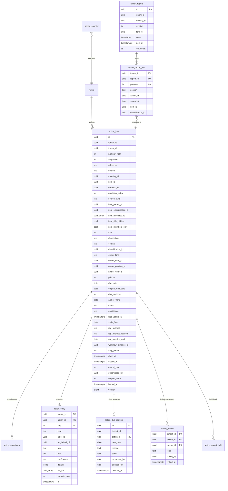

# E07 Action items — design

> Step 3 of `AGENTS.md §5`. Decisions:
> - **ADR-0067:** action items, their life on the workflow engine, RAG per committee type, closure verified by someone else, follow-up memos, the action taken report.
> - **ADR-0068:** four general additions to the workflow engine. It amends ADR-0038 and ADR-0041.
>
> Builds on:
> - the engine: ADR-0034 to ADR-0042;
> - memos: ADR-0043 (links), ADR-0046 (attachments), ADR-0048 (templates), ADR-0050 (memo access), ADR-0054 (search);
> - forums and meetings: ADR-0056 (committee types), ADR-0060 and ADR-0061 (agenda, the one item rule), ADR-0062 (recusal);
> - minutes: ADR-0065 and ADR-0066, which are not built past T2 (§11 lists what E07 needs from them).
>
> Research: `research.md`. Screens: `ux-review.md`, flows AJ–AR. They are **delegated** (Phase 4 Q1: only E01, E02/E03 and E06 go to the owner).

## 1. Domain model

### 1.1 The action item (ADR-0067)
| Attribute | Rule |
|---|---|
| `id` | UUIDv7 |
| `forumId` | The committee the action belongs to; immutable |
| `reference` | `{committee code} A{n}/{yyyy}`, for example **BRC A14/2026**: a counter per committee and calendar year (in the tenant's zone) taken **when the action is issued**, so discarded drafts use no number. Taken from `action_counter` with `INSERT … ON CONFLICT DO UPDATE … RETURNING` in the issuing transaction (AGENTS §4); immutable. Drafts show "Draft action" |
| `source` | `DECISION` (a decision of E06, optionally one of its condition lines), `ITEM` (an agenda item without a decision, such as one for discussion), `MEETING` (the meeting as a whole, such as any other business) or `DIRECT` (raised by the secretary between meetings, with a `sourceNote` 0–300 such as "Chair's instruction of 3 December"). It carries `meetingId`, `itemId`, `decisionId` and `conditionIndex` as applicable. Immutable |
| `sourceLabel` | Rendered at raise time and refreshed when the source changes: "BRC 3/2026, item 5 — Resolution BRC/2026/014, condition 2" |
| item columns | `itemParentId`, `itemClassificationId`, `itemRestrictedTo`, `itemTitleHidden`, `itemMembersOnly`. Copied from the latest published revision when the action is raised, and refreshed when that meeting publishes another revision. They exist so the item rule (ADR-0061) runs on the action's own row (§1.14) |
| `title` | 1–200: what is to be done, in a line ("Report the revised collateral valuation to the committee") |
| `description` | 0–4,000: details |
| `context` | 0–2,000: what the owner is told of the source. Chosen by the secretary: prefilled with the condition's text, or empty for a decision. The owner sees this, not the decision, unless they may see the decision anyway (§1.14) |
| `classificationId` | The item's level (or the meeting's, or the committee's for DIRECT); the secretary may raise it, never lower it (422 `CLASSIFICATION`) |
| `owner` | `PERSON` with `ownerUserId`, or `POSITION` with `ownerPositionId` (the holder at any time, through the engine). Exactly one; required to issue. The person, or each holder of the position, must be an active user cleared for `classificationId` (422 `OWNER_NOT_CLEARED`) |
| `holderUserId` | Denormalised: who holds the owner's task now. That is the person, the position's holder, or a substitute acting for them (ADR-0040). Null while the task waits for an administrator |
| `contributors` | 0–5 users (`action_contributor`): they read the action and post updates; they cannot mark it done. Each must be cleared, and may not be recused from the item (422 `RECUSED_NAMED`) |
| `priority` | NORMAL or HIGH. A CEL attribute: a tenant definition can add a step for HIGH (§1.8) |
| `dueDate` | Required to issue. A date, due at the end of that day in the tenant's zone. Quick picks: "By the next meeting" (that meeting's date, if one is scheduled) and the committee type's default (§1.13). Must be today or later when set (422 `DUE_IN_PAST`) |
| `originalDueDate` | Set at issue; never changes |
| `dueRevisions` | Count of agreed changes, shown "revised twice" |
| `amberFrom` | `dueDate` minus `amberWorkingDays` working days (`WorkingDays.before`). Recomputed when the due date changes |
| `status` | DRAFT, OPEN, IN_PROGRESS, DONE_PENDING (done, to be verified), CLOSED, CANCELLED (§1.4) |
| `confidence` | The owner's word with their latest update: ON_TRACK, AT_RISK, OFF_TRACK, or null |
| `lastUpdateAt`, `staleFrom` | The latest progress update, and that time plus `staleWorkingDays` working days (null when the type has no stale rule) |
| `ragOverride` | RED, AMBER or GREEN, with `ragOverrideReason` 1–500, `ragOverrideBy`, and `ragOverrideUntil` (a date, or null for "until the next update") |
| `workflowInstanceId` | The engine instance; null while DRAFT. A reopened action gets a new instance, and earlier instance ids stay in its entries |
| `stepName` | Denormalised name of the open step ("Verification by the secretary"), for lists |
| `doneAt`, `closedAt`, `closedBy` | Set by the engine's events |
| `cancelKind`, `cancelReason` | Cancellation: NO_LONGER_NEEDED, SUPERSEDED (with `supersededBy`, an action of the same committee), RISK_ACCEPTED (chair only), DISCARDED (a draft), DUPLICATE; reason 1–500 |
| `reopenCount` | Reopened after closing or cancelling (§1.10) |
| `createdBy`, `createdAt`, `issuedBy`, `issuedAt`, `version` | `version` is for optimistic locking (If-Match) |

**Invariants**, checked in the changing transaction under `SELECT … FOR UPDATE` on the action. `WorkflowSubject.lock` takes the same lock before the instance's:
- `SOURCE_VISIBLE`: the person raising sees the source in full (the item rule) and is not recused from it (403 `RECUSED`). A DECISION source exists (E06 `Decisions.find`), and its `conditionIndex` is within its conditions (422 `CONDITION`).
- `RAISE_WINDOW` (409 `WRONG_STATE`):
  - from an item or decision: while the meeting is IN_PROGRESS, HELD or MINUTES_APPROVED;
  - from the meeting: the same states;
  - DIRECT: at any time while the committee is active.
- `OWNER_REQUIRED`: owner and due date at issue (422 `REQUIRED`). Never two owners. The owner is not a contributor.
- `ONE_ACCOUNTABLE`: the verifier is never the owner, the current holder or a contributor (§1.9). The engine's SOD-2 agrees.
- Status changes only through the transitions of §1.4, as guarded updates (`… WHERE id = ? AND status = ? AND version = ?`; 0 rows → 409 `CONFLICT`).

### 1.2 Raising actions
- **From a decision** (E06 flow AA, the decision panel):
  - "Add an action" under the recorded decision. For APPROVED_WITH_CONDITIONS, each condition line has "Make this an action", which prefills the title and context with the condition's text.
  - Several actions may come from one decision or condition.
  - Raising does not change the decision.
- **From an item without a decision:**
  - The same, on the item in the panel or on the meeting page.
  - For example, "For discussion" items and items for noting. BoardPro users asked for "action items on review only items".
- **From the meeting:**
  - The meeting page's "Actions from this meeting".
  - For example, any other business.
- **Direct:**
  - The committee's action tracker, "New action", with a source note.
- **Drafts:**
  - Every raised action starts as a DRAFT, seen only by the committee's secretaries and `forums.manage` holders who are not recused from its item.
  - Drafts can be edited freely, and discarded (CANCELLED, DISCARDED; kept, never deleted).
- **Issuing** (`POST …/issue`, one action, or `POST /meetings/{id}/actions/issue` for every draft of the meeting):
  - The checks of §1.1 apply.
  - The reference is taken. The workflow instance is started on the committee type's action definition (§1.8), and the owner is told.
  - E06's "Mark the meeting as held" dialog gains "Send the {n} draft actions to their owners now", ticked by default (Manchester's "as early as possible", research §3.1).
  - After HELD, an action can be saved as a draft or issued at once.
- **The source changes:**
  - E06 publishes `DecisionRecorded` for corrections too (§11). When a decision with actions is corrected, each issued action gets a system entry, "The committee's decision on this item was corrected on {date}", and its `sourceLabel` is refreshed.
  - The secretaries are told in the app.
  - Nothing else changes: the secretary decides whether to edit, cancel (SUPERSEDED) or keep each action.
  - A condition line that no longer exists after the correction leaves `conditionIndex` pointing at the earlier entry, which `Decisions.entry(decisionId, seq)` still reads.

### 1.3 Owner, contributors and the holder
- **A position owner** ("Head of Treasury") follows its holder: the engine resolves the slot to the position and re-resolves the step when the holder changes (ADR-0040, `StaffChanges.reresolve`). The action shows "Head of Treasury (A. Karim)". CGI's convention is titles, not names (research §3.1).
- **Substitutes and out-of-office** (ADR-0040) are the engine's. The holder is shown "A. Karim, acting for B. Rahman", and both see the action.
- **Who may be an owner:**
  - any active user of the tenant cleared for the action's level, member of the committee or not (research §3.1: owners are often executives outside it);
  - a person recused from the item may own an action on it (the E04 placeholder allows it). The secretary is warned: "This person declared an interest in item 5. They will see this action, but not the item."
- **Changing the owner** (`POST …/owner`, secretary not recused, reason 1–500):
  - recorded as an entry;
  - the open owner's task moves (`Workflows.reassign`; a position owner re-resolves);
  - both people are told.
  - The owner cannot pass an action on (BoardPro: "forwarding leaves the original owner accountable"). The owner's step offers no FORWARD or DELEGATE, and the engine's substitutes cover absence.
- **A deactivated owner:** the engine blocks the task (`INACTIVE`) and the secretaries are told to choose a new owner (ADR-0040).

### 1.4 The lifecycle

```mermaid
stateDiagram-v2
  [*] --> DRAFT: raise (secretary)
  DRAFT --> DRAFT: edit
  DRAFT --> CANCELLED: discard (DISCARDED)
  DRAFT --> OPEN: issue (reference taken, instance started, owner told)
  OPEN --> IN_PROGRESS: first update (owner or contributor) or "I have started"
  OPEN --> DONE_PENDING: mark as done (owner's step: RECOMMEND)
  IN_PROGRESS --> DONE_PENDING: mark as done (owner's step: RECOMMEND)
  DONE_PENDING --> IN_PROGRESS: send back (verifier: SEND_BACK, remark required)
  DONE_PENDING --> CLOSED: verify (last step: APPROVE; instance APPROVED)
  OPEN --> CANCELLED: cancel (secretary or chair, kind and reason; instance cancelled)
  IN_PROGRESS --> CANCELLED: cancel
  DONE_PENDING --> CANCELLED: cancel
  CLOSED --> IN_PROGRESS: reopen within 90 days (secretary, reason; new instance)
  CANCELLED --> IN_PROGRESS: reopen within 90 days (not DISCARDED)
```

- **The status is stored on the action and changed only by the actions module**, in the transaction of the engine action that causes it, from `WorkflowActionTaken`, `WorkflowTaskCreated` and `WorkflowInstanceEnded`. This is how the memo keeps its own state (ADR-0035).
- **Overdue is not a status.** It is derived (`today > dueDate` and the status is OPEN or IN_PROGRESS) and drives RAG (§1.5). A DONE_PENDING action past its date is "Done, to be verified", not overdue.
- **Forbidden** (409 `WRONG_STATE`):
  - updating, re-dating or marking done a DRAFT, CLOSED or CANCELLED action;
  - verifying anything but DONE_PENDING;
  - issuing anything but a DRAFT;
  - reopening a DISCARDED draft, or after 90 days (409 `TOO_LATE`: "Raise a new action instead");
  - any change by a person recused from the item, except the owner's own actions (403 `RECUSED`).

### 1.5 Red, amber and green (ADR-0067)
Derived on read from stored columns and today's date in the tenant's zone. No sweep is needed, and lists filter and sort on it in SQL.

| Shown | When (first match wins) | Words and icon |
|---|---|---|
| — | DRAFT | "Draft" |
| Grey | CLOSED / CANCELLED | "Closed" ✓ / "Cancelled" ⨯ |
| Blue | DONE_PENDING | "Done, to be verified" ◐ |
| The override | `ragOverride` set and in force (until its date, or until the next update when it has none) | Its colour, with "set by {name}: {reason}" |
| Red | today > `dueDate`, or `confidence` = OFF_TRACK | "Overdue" ▲ / "Off track" ▲ |
| Amber | today ≥ `amberFrom`, or `confidence` = AT_RISK, or today ≥ `staleFrom` | "Due soon" ● / "At risk" ● / "No recent update" ● |
| Green | otherwise | "On track" ✓ |

- Colours come from the design tokens with contrast ≥ 4.5:1 for their text. **Colour is never alone**: the word and the icon always come with it (WCAG 1.4.1, research §7).
- The tracker and the report print the key with this committee type's numbers ("Amber: due within 10 working days, at risk, or no update for 20 working days").
- **Overrides:** by a secretary or the chair, not recused, with a reason. They are shown and audited, and cleared by the next update unless a date is given.
- `amberFrom` and `staleFrom` are computed with the business calendar when written. A later calendar change does not move them until the action's next update or date change, the same rule as ADR-0041's due times.

### 1.6 Progress updates and evidence
- `POST …/updates` by the owner (the holder), a contributor, or a secretary on the owner's behalf (`onBehalfOf` with `how`: PHONE, EMAIL, IN_PERSON, MEETING):
  - `text` 1–4,000;
  - `confidence` (owner and on-behalf only);
  - up to 10 files (purpose `action.evidence`: ClamAV, then type by content, ≤ 25 MiB each, ADR-0029; stored encrypted per tenant, readable by `ActionAccess`).
- Append-only `action_entry` of kind UPDATE. Its effects:
  - an OPEN action becomes IN_PROGRESS;
  - `lastUpdateAt` and `staleFrom` are reset;
  - an override with no end date is cleared.
- **Entries are never edited.** A correction is a new entry with `corrects` pointing at the earlier one ("Correction to the update of 3 December"), shown under it.
- **The timeline** (entries newest first) shows updates, date changes, owner changes, overrides, verification, memo events and source corrections. It is the action's history and is printed on the report's detail page.

### 1.7 Due-date changes
- The committee type's `dueChange` decides (§1.13):
  - `SECRETARY_AGREES` (default): the owner requests a new date with a reason (`POST …/due-requests`, `{newDate, reason 1–500}`). A secretary not recused agrees or declines with an optional note. Until then the action keeps its date and shows "New date requested: 20 January".
  - `CHAIR_AGREES`: the same, decided by the chair (the vice-chair when the chair is recused or absent from office).
  - `OWNER_WITH_REASON`: the owner moves the date with a reason, and the secretaries are told.
- A secretary not recused may always change the date directly, with a reason.
- At most one pending request per action (409 `PENDING_REQUEST`). It is withdrawn automatically when the action is marked as done or cancelled.
- **On a change:**
  - `dueDate`, `dueRevisions + 1` and `amberFrom` are updated;
  - an entry records the old date, the new date and the reason;
  - `Workflows.redue("action-item", actionId)` re-plans the open owner's task's timers in the same transaction (ADR-0068);
  - the owner and contributors are told.
- **Shown everywhere as** "Due 20 January 2027 (originally 15 December 2026, revised once)". The IIA asks for "missed dates and revised dates" (research §3.3).

### 1.8 Reminders and escalation (the engine's timers, ADR-0041 and ADR-0068)
- The committee type names a published definition with `"subject": "action-item"` (`actions.definitionKey`, default `action-item`).
- Every tenant gets the built-in **`action-item`** definition, seeded like `sequential-approval` and editable in the visual builder as a new version (ADR-0042):
```json
{ "schemaVersion": 2, "subject": "action-item", "start": "owner", "steps": [
  { "id": "owner", "type": "review", "name": "Owner",
    "assignee": { "kind": "subject", "slot": "owner" }, "actions": ["RECOMMEND"],
    "sla": { "from": "subject", "remind": { "before": "P5D", "after": ["P5D"] },
             "escalate": { "after": "P10D", "action": "notify" } },
    "next": "verify" },
  { "id": "verify", "type": "approve", "name": "Verification",
    "assignee": { "kind": "subject", "slot": "verifier" }, "actions": ["APPROVE", "SEND_BACK"],
    "remarks": ["SEND_BACK"],
    "sla": { "due": "P5D", "remind": { "after": ["P3D"] },
             "escalate": { "after": "P10D", "action": "notify", "to": { "kind": "subject", "slot": "chair" } } },
    "next": "end" } ] }
```
- **What this gives, with the defaults:**
  - 5 working days before the due date, the holder is reminded;
  - on the due date's end, the action is overdue. The holder is told, and so are the committee's secretaries, in the app (the actions module's reaction to `WorkflowTimerFired DUE`);
  - 5 working days after, a second reminder;
  - 10 working days after, an **escalation** to the holder's supervisor by the reporting line (`notify`: the holder keeps the action), and the secretaries are told;
  - at the next meeting the action is red in the action taken report (§1.12), which is the escalation to the committee.
  - The verifier is reminded after 3 working days, and the chair is told after 10.
- **Tenant variations by configuration** (AGENTS §3.5):
  - a branch on `action.priority == "HIGH"` adding a review by the owner's unit head before verification;
  - a chair's step for actions from resolutions (`action.fromResolution`);
  - other reminder times.
  - **The definition check** (ADR-0068's `WorkflowSubject.checkDefinition`) refuses an `action-item` definition that:
    - does not start with a human step on the `owner` slot with `sla.from: subject`;
    - offers REJECT or RETURN anywhere (an action is sent back, not rejected);
    - has no later human step (closure is always verified);
    - uses FORWARD or DELEGATE on the owner's step.
- **Attributes for CEL:** `action.priority` (string), `action.fromResolution` (bool), `action.source` (string), `action.committeeType` (string, the type's key), `action.dueRevisions` (int), `action.reopened` (bool).
- **Slots** (ADR-0068), resolved by the actions module when the engine asks:
  - `owner`: the person, or the position (resolved by the engine as a position).
  - `verifier`: per `verifiedBy` (§1.9).
  - `chair`: the chair in office, else the vice-chair, never the owner.
  - `secretaries`: the secretaries in office not recused from the item, for definitions that want them.
- **Emails are combined** (research §4.1 point 8, §7):
  - Reminders and overdue notices are in-app items, one per action, at once.
  - Their emails wait for the **daily digest**: one email per person at 09:00 in the tenant's zone on working days, listing counts and references only ("2 actions due within 5 working days, 1 overdue: BRC A14/2026, MCC A3/2026").
  - Escalations, new actions and send-backs are emailed at once.
  - Email subjects never carry parameters, and bodies never carry an action's text (§9).

### 1.9 Closure verified by someone else
- **Marking done** (`POST …/done`, the holder):
  - `note` 1–2,000 ("What was done"), and files as evidence: required when the type has `evidenceRequired` (422 `EVIDENCE_REQUIRED`).
  - It also runs the owner's step's RECOMMEND (`Workflows.approve` on the task) with the note as the remark.
  - An entry DONE is written, and the action becomes DONE_PENDING.
- **The verifier slot** (`verifiedBy`):
  - SECRETARY (default): the committee's secretaries in office who are not recused from the item and are not the owner, holder or a contributor. If none remain, the chair (else the vice-chair) is used, and failing that the `forums.manage` holders.
  - CHAIR: the chair, else the vice-chair, under the same exclusions. If neither can, the secretaries are used.
  - Several people form a pool: any one claims or acts (ADR-0040's claims).
  - The engine's SOD-2 also excludes whoever recommended in the round, so the owner never verifies even if a tenant edits the definition badly.
- **Verify** (`POST …/verify`, `{decision: CLOSE | SEND_BACK, remark}`):
  - CLOSE: APPROVE on the last step; the action becomes CLOSED; the owner and contributors are told. The remark is optional.
  - SEND_BACK: the engine's send-back to the owner's step with a required remark ("The valuation report is not attached"). The owner's step runs again with the same due date (its timers re-planned from it, so it may be overdue at once), and the action becomes IN_PROGRESS.
- **At the meeting:**
  - The action taken report's "Proposed to close" section has "Close the actions the committee agreed" (`POST /meetings/{id}/actions/close-agreed`, `{actionIds}`), for the verifier.
  - It claims and verifies each one with the remark "Agreed at BRC 4/2026, item 3", one transaction per action, and reports any it could not close.
  - This is the NHS and Belfast practice of approving closures at the meeting (research §3.2).
- **What the verifier sees:** the action, its timeline, the evidence, and the follow-up memos with their outcomes (§1.11).

### 1.10 Cancelling and reopening
- **Cancel** (`POST …/cancel`, `{kind, reason, supersededBy?}`): a secretary or the chair, not recused.
  - RISK_ACCEPTED is the chair's alone, or recorded by a secretary on the chair's behalf with `how` and a note. The chair is told at once. It is the IIA's "accepting the risk as it then stands" (research §3.3), and the report lists it under "Cancelled since the last meeting" with the words "risk accepted".
  - The workflow instance is cancelled (`Workflows.cancel`, reason). Its pending request is withdrawn. The owner and contributors are told.
- **Reopen** (`POST …/reopen`, `{reason, dueDate}`): a secretary not recused, within 90 days of closing or cancelling.
  - A new instance starts on the type's current definition, and the action becomes IN_PROGRESS with the new due date.
  - `reopenCount + 1`; the owner is told.
  - After 90 days the secretary raises a new action instead.

### 1.11 Follow-up memos (ADR-0067)
- **"Raise a memo"** (`POST …/memos`, the holder or a contributor holding `memo.create`, while OPEN or IN_PROGRESS):
  - `{typeId, subject?, classificationId?}` creates a **draft memo** through the memo module's new published `MemoDrafts.create(fields, origin)`, which uses the same path as `POST /memos`, including the type's template fill after commit;
  - the subject defaults to the action's title;
  - the classification defaults to the action's level and may not be lower without a confirmation ("This memo will be Internal; the action is Confidential");
  - the creator is the memo's initiator;
  - the link `action_memo (actionId, memoId, kind RAISED)` is written in the same transaction, and an entry MEMO_RAISED.
  - The memo is an ordinary draft from then on: the owner edits and submits it on its own route, and every memo rule applies.
- **Link an existing memo** (`kind LINKED`): any memo the holder or a secretary can read (`MemoReaders.canRead`). One memo may follow up several actions. Up to 10 memos per action.
- **Back-references:**
  - The memo shows "Raised from action BRC A14/2026 of the Board Risk Committee" through a new memo port `MemoOrigins`, which the actions module implements. Memo never depends on actions.
  - The reference links to the action only for viewers who see the action; others see the text without a link.
  - The note sheet gets a system entry at creation: "Raised from action BRC A14/2026 (Board Risk Committee)". It carries the reference, never the action's text.
- **The memo's state on the action:**
  - For viewers who may read the memo: its number, subject and status (`MemoReaders.readable` with a status added to `MemoBrief`).
  - For others: "A follow-up memo (you do not have access)" with its status only when the viewer is the action's verifier or a secretary. They need the outcome to verify, and the status reveals nothing of the memo's content.
- **When a linked memo is decided** (`WorkflowInstanceEnded` for subject `memo`: approved, rejected, withdrawn or cancelled, or the memo closed):
  - an entry MEMO_DECIDED ("Memo MEMO/2026/0412 was approved on 9 January");
  - the holder is told: "The follow-up memo was approved. You can now mark the action as done."
  - **The action is not closed automatically.** The loop closes when the owner marks it done and the verifier verifies it with the memo's outcome in view (overview E07).
- **The chain for the exit criterion:** memo → submission → item → decision and resolution → action → follow-up memo, with every link stored. The action reaches its decision through `decisionId` and E06's `Resolutions.ofDecision`; the follow-up memo reaches the action through `action_memo`. The `committee-cycle` IT walks it in both directions (test plan).
- **As built in T6** (2026-11-22):
  - **The memo module's published additions:**
    - `MemoDrafts.create(MemoDraftFields, DraftOrigin?)`, inside the caller's transaction, is `Memos.create`, the service behind `POST /memos`: `memo.create`, a type the actor may raise, the level rules, the actor as initiator, `memo.created` audited. The origin's line goes on the note sheet in the same transaction.
    - `MemoDrafts.fillTemplate(memoId)` runs after the caller's commit, outside any transaction, under the same condition as `POST /memos` (`FILL_FROM_TEMPLATE` offered).
    - The memo's refusals come back as `MemoDraftRejectedException` with the memo's field problems. The actions module answers them as its own 422.
  - **The note sheet line reuses E06 T4's system entry** (`MemoNotes.system`, ADR-0065): a comment marked with `actionKind` `RAISED_FROM_ACTION`, written by the person whose act wrote it, never corrected (409 `NOT_YOURS`). So there is **no memo migration**, as §7 planned. The note sheet labels it "Recorded by the system".
    - The text is "Raised from action BRC A1/2026 (Board Risk Committee)": the reference and the committee's name, never the action's text.
  - **The port is `MemoOrigins.labels(memoId)`**, a list for the signed-in reader, with no viewer argument. It answers `MemoOriginLabel` (`RAISED_FROM` or `LINKED_TO`, `recordType` `ACTION`, the reference, the committee, and `recordId` only for those who see the action). The memo view shows it as `followsUp`.
    - Without an implementation, the memo module falls back on `NoMemoOrigins`, the meeting module's `DecidedItems` pattern.
    - A **raised** memo names its action to every reader of the memo, as its note sheet does, with the link only for those who see the action.
    - A **linked** memo names the action only to those who see it, so linking never tells a memo's readers of an action they may not know of.
  - `MemoBrief` gained `status`, the memo's own status as a string. `MemoReaders.statuses(memoIds)` reads statuses without the read rule, for the verifier and secretaries; the caller decides who sees them.
  - **`actions/V3__memos.sql`:** `actions_memo` (PK `(tenant_id, action_id, memo_id)`, index `(tenant_id, memo_id)`), insert only. It needs T4's `actions/V2` before it.
  - **Who and when:**
    - Raising (`POST /actions/{id}/memos`, `{typeId, subject?, classificationId?, confirmLowerLevel?}`): the owner, meaning the holder, the person owner or the owner position's holder, or a contributor, with `memo.create`, while OPEN or IN_PROGRESS. It answers 201 with `{memoId, templateFilled, action}` and the memo's `Location`.
    - Linking (`POST /actions/{id}/memos/link`, `{memoId}`): also the secretaries and `forums.manage` not recused, while OPEN, IN_PROGRESS or DONE_PENDING (until verified).
    - Refusals: 404 for an unseen action; 403 `NOT_INVOLVED`; 409 `WRONG_STATE`; 409 `ALREADY_LINKED`; 422 `memos:TOO_MANY` (ten), `classificationId:LOWER_THAN_ACTION` (without the confirmation), `memoId:NOT_READABLE` (unknown or unreadable, the same answer) and `memoId:DISCARDED`. The memo's own 422s also come through (`typeId:unknown`, `NOT_ALLOWED_TO_RAISE`, `below-type-default`).
    - The subject defaults to the action's title. The level defaults to the action's.
    - Both endpoints take an `Idempotency-Key` and no If-Match: the action's row does not change, and each link is a row of its own.
  - **The action page:** `ActionResponse.memos` and `can.raiseMemo` / `can.linkMemo`. A memo the viewer does not read shows without its number and subject. Its status shows only to a secretary or `forums.manage` not recused, or to the verifier (the action is DONE_PENDING and its open task is the viewer's to hold or claim).
  - **A memo decided:** `WorkflowInstanceEnded` for subject `memo` (APPROVED, REJECTED, WITHDRAWN or CANCELLED). Each action it follows up, raised or linked, gets an entry MEMO_DECIDED (`{memoId, outcome}`), audited `actions.memo.decided`. The holder of an open action is told in the app (`ACTION_MEMO_DECIDED`); its email waits for T5's digest. A memo is closed only after its approval, so closing tells nothing new. The timeline's read (`GET /actions/{id}/entries`) is not part of T6.

### 1.12 Carry-forward: the action taken report on "Matters arising"
- **When** a revision of a meeting's agenda is published (`AgendaPublished`) and it has a MATTERS_ARISING standing item, the actions module builds an **action taken report** for that revision in the publishing transaction.
  - The report is frozen: the status "at agenda publication" (overview E07). A later revision gets a new report, and earlier ones stay.
- **Rows** (`action_report_row`), for the meeting's committee:
  1. **Proposed to close:** DONE_PENDING actions.
  2. **Overdue:** OPEN or IN_PROGRESS past their date.
  3. **Open:** the other OPEN or IN_PROGRESS actions, due date first.
  4. **Closed since the last meeting, for noting:** CLOSED after the previous meeting's start.
  5. **Cancelled since the last meeting, for noting:** with the kind, and "risk accepted" in words.
  6. **Corrections to earlier minutes:** E06's `MinutesCorrections.since(forumId, previousMeetingStart)`. There is one entry per approved correction.
  - Each row snapshots:
    - reference;
    - source ("BRC 3/2026, item 5");
    - title;
    - owner (title first);
    - due date with the original and revisions;
    - RAG with its words;
    - status;
    - the latest update (first 500 characters, with its date);
    - the follow-up memos' numbers and statuses.
  - Each row also keeps the action's item columns and classification, so each reader sees only their rows (§1.14).
  - The report leads with sections 1 and 2, the ones that need the meeting. That answers RBI's "compliance crowding" (research §3.3). At most 500 rows. Beyond that the report says "and {n} more open actions; see the committee's tracker".
- **Held back:** a secretary may exclude an action from the next revision's report (`POST …/report-hold`, reason). It stays open in the tracker. The report lists "1 action held back by the secretary" to officers, so curating is possible and visible. BoardPro's users could not curate (research §4.1 point 7).
- **On the agenda:**
  - The MATTERS_ARISING item shows "Action taken report: 2 to close, 3 overdue, 9 open, 4 closed since the last meeting — Open the report", through the meeting module's item-links port, which E06 adds for PREVIOUS_MINUTES (§11).
  - The meeting page and the report page open the reader's rows.
  - "Print" renders the reader's rows as a PDF through `ReportPages`. It is built on demand, not stored, and audited as a document open.
- **The minutes:** the matters arising item's decision (E06) is recorded as usual ("NOTED"). Closures agreed at the meeting are §1.9's "Close the actions the committee agreed".
- **Asking for updates before the pack:** the daily task (§9) asks the holders of open actions with no update since the previous meeting for one. It runs `updateRequestWorkingDays` before the next meeting's agenda deadline ("Please update BRC A14/2026 before 5 December, when the committee's papers are published"). A secretary can also press "Ask owners for an update" on the tracker, at most once a day per committee.
- **As built in T7** (2026-11-22):
  - **`actions/V4__reports.sql`:** `actions_report` (one per meeting and revision, unique; the MATTERS_ARISING item, the previous meeting and `since`, the rows shown, held and left out, and the content's SHA-256), `actions_report_row` (section, position, the action, the snapshot as JSON up to 16 KiB, and the action's item columns and level copied), `actions_report_hold` (one per meeting and action) and `actions_update_ask` (the key of "Ask owners for an update": committee and day). All insert only: no UPDATE, DELETE or TRUNCATE for the app role. T6 holds V3, so T6 merges first.
  - **Built in the publishing transaction** (`ActionReports`, called by `ActionSourceListener.onPublished` after the item columns are refreshed) for every published revision with a MATTERS_ARISING item, an empty committee included: the frozen record says nothing was open. Once per revision.
  - **The previous meeting** is the committee's latest meeting that took place (in progress, held, minutes approved or closed) and started before this one. Sections 4 and 5 count from its start (closed or cancelled after it). With no previous meeting, every closed or cancelled action is listed.
  - **The sections' order inside:** to close by when they were marked done; overdue and open by due date; closed and cancelled by when they ended. Section 6 (`CORRECTIONS`) is filled through the actions module's `ReportCorrections` port (corrections with the corrected item's columns and level, read by the same rule; listed in words with their approval date): `ActionReportCorrections` provides the port from E06 T8's `MinutesCorrections.since(forumId, since)`: one row per approved correction since the previous meeting's start, named by numbers only ("Minutes of BRC 3/2026, item 5: corrected", never the correction's text), with the corrected item's columns and level (the meeting's for a general correction). A correction of an item no longer on that agenda is left out. **Overdue is the tenant's day:** the sections take `OrgDirectory.today()` (the organisation's zone) and use the colour rule's own past-due test (`ReportSections`).
  - **The snapshot** is the reference, the source label (numbers only), the title, the owner (the position's title or the person's name) and the holder when it differs, the dates and revisions, the colour's word at publication, the status and confidence, the latest update or note of "done" (first 500 characters, with its date), and how it ended (kind and reason). **Follow-up memos are not in it yet:** `actions_memo` is T6's (#230), so the memos join the snapshot when T6 and T7 meet.
  - **Held back and left out are rows too** (`HELD_BACK`, `MORE`, without a snapshot), so their counts come from the same rule as the rows: "1 action held back by the secretary" to officers only, and "and 12 more actions" to each reader by their rows. The cap leaves out the latest-due open actions first, then the last rows.
  - **Who reads it:** the committee's officers, its members today and `forum.read` holders who see the MATTERS_ARISING item's line (in full or by title) in the latest revision; 404 to guests, item attendees, outsiders and former members. Each reader's rows are `ActionAccess.reportRows`: the rule on the row's copied columns, or the reader involved in the row's action now (so a recused owner sees their own row, as on the action). Every open, on screen or as the PDF, is audited `actions.report.opened` with the format.
  - **The PDF** (`GET …/action-report/pdf`) is the reader's rows drawn by `ReportPages` (English, ADR-0052), on demand, with the reader's name in the footer; served inline with `nosniff`, a sandboxing CSP and `no-store`.
  - **The item link:** through E06 T6's `ItemLinks` port (#229, a list of providers keyed by standing kind). T7 first carried the port word for word while #229 was open; #229 is merged and the port is its own. `ActionReportLinks` gives the MATTERS_ARISING item an `ACTION_REPORT` link with the reader's counts in words ("Action taken report: 2 to close, 3 overdue, 9 open, 4 closed since the last meeting").
  - **Holding back** (`POST /actions/{id}/report-hold`, `{reason, meetingId?}`): a secretary or `forums.manage` not recused, an issued action, for the committee's next meeting (drafted or scheduled) or the one named; 409 `NO_MEETING`, `ALREADY_HELD`, `WRONG_STATE` (a meeting that has started). It applies to every report of that meeting built afterwards. The timeline gets `HELD_BACK` with the reason; the audit `actions.report.held` its hash.
  - **Update requests** (`ActionUpdateRequests`): the holders of OPEN or IN_PROGRESS actions with no update since the previous meeting's start (none at all without one). The daily task (part (b), on the day's first run) asks from `updateRequestWorkingDays` before the next meeting's deadline (`AgendaDeadlines.of`, published by meeting: E03's paper deadline) to the deadline itself, so a missed day catches up, once per meeting and action (the timeline's `UPDATE_REQUESTED` marker with the meeting). "Ask owners for an update" (`POST /forums/{fid}/actions/ask-for-updates`, a secretary or `forums.manage`) asks at once for the actions the asker sees by the rule (a recused secretary's leave out the item's), once a day per committee (409 `ALREADY_ASKED`), whatever was asked before. Both audit `actions.update_requests.sent` with the count and the cause.
  - **`ACTION_UPDATE_REQUESTED`**, in the app and by email at once: the committee, the reference, the due date and, in the app, the deadline (`when` DEADLINE or NEXT). The subject has no parameter; neither carries the title.
- **As built in the E07 follow-up** (2026-11-23, closing what T7, T10 and T11 worked around):
  - **The item link's counts:** the meeting module's `ItemLink` gained `counts` (a map by key, null for a link without counts), separate from E06 T11's `meetingLabel`/`meetingStartsAt`. `ActionReportLinks` fills it with the reader's own counts per section (`TO_CLOSE` … `CORRECTIONS`, zeros included), the same counts the English `label` words. The web words the counts in the reader's language and never reads the label back.
  - **Follow-up memos on the rows, per reader, at read time.** The snapshot stays as built: no memo number or subject is frozen into it, since a reader may not read the memo. `ActionReportReads` joins each shown row's `actions_memo` links live through `ActionMemoViews.readableOf`, which keeps only the memos `MemoReaders.readable` gives the signed-in reader (the memo's own read rule, as the action page's `memoViews`), with number, subject and status now. A memo the reader may not read is left out entirely, not shown as "a memo you do not have access to": on a report that is the meeting's paper, even its existence is the memo's to reveal. The PDF draws the same per-reader rows ("Follow-up memo MEMO/2026/0412 (approved): …"). The lines are the memos as they stand now, said so on the screen ("Follow-up memos, as they stand now"), not at publication.
  - **The key's numbers:** `ActionReportResponse.key` (`amberWorkingDays`, `staleWorkingDays`) from the committee type's policy in force today, as the tracker's key.
  - **"Close the actions the committee agreed":** `can.closeAgreed` and each row's `canClose`, by `ActionClosure.verify`'s rule read set-based (`ActionAccess.verifiable`: seen, DONE_PENDING, its verification the reader's to hold or claim, not the owner, holder or a contributor, not recused), and only while the report's meeting runs, is held or has its minutes approved (`requireRaiseWindow`). The web offers only those rows.
  - **"Keep out of the next report":** `ActionAbilities.holdBack`, by `ActionReportHolds.hold`'s rule: a secretary or `forums.manage` not recused, an issued action, a meeting to come (`NO_MEETING` otherwise) whose reports do not yet leave it out (`ALREADY_HELD`).
  - **"Ask owners for an update":** `TrackerAbilities.askForUpdates` (a secretary or `forums.manage`, not yet asked today) and `askedToday`, by `ActionUpdateRequests.askNow`'s rule.

### 1.13 The committee type's actions policy
`forum_type_version.actions` (jsonb, `forum/V8`; null reads as the defaults). It is edited on the committee type's new **Actions** tab and reviewed by a second administrator like every type change (ADR-0056). It is pinned with the type version. Unlike the minutes policy, it is read from the version **in force today** for the committee, not the meeting's pinned version: an action lives across meetings, and its reminders must follow the committee's current rules.

| Field | Default | Rule |
|---|---|---|
| `amberWorkingDays` | 10 | 1–60 |
| `staleWorkingDays` | 20 | null (off) or 5–120 |
| `dueChange` | SECRETARY_AGREES | SECRETARY_AGREES, CHAIR_AGREES or OWNER_WITH_REASON |
| `verifiedBy` | SECRETARY | SECRETARY or CHAIR |
| `evidenceRequired` | false | |
| `defaultDue` | NEXT_MEETING | NEXT_MEETING or WORKING_DAYS, with `defaultDueWorkingDays` 1–120 (default 20). It is used when no next meeting is scheduled |
| `updateRequestWorkingDays` | 5 | null (off) or 1–20 before the next meeting's agenda deadline |
| `definitionKey` | `action-item` | A published definition whose `subject` is `action-item` (422 `UNKNOWN_DEFINITION`) |

- **Presets** (E01):
  - Board and Board Risk use the defaults.
  - Board Audit has `evidenceRequired` true (the IIA's evidence; research §3.3).
  - The management committees (credit, ALCO, ExCo) have `amberWorkingDays` 5, `defaultDue` WORKING_DAYS 10, and `dueChange` OWNER_WITH_REASON.
- **A change applies to existing open actions** from their next write (`amberFrom`, `staleFrom`) and, for `verifiedBy`, from the next verification step. The definition key applies to actions issued or reopened afterwards. Running instances keep their pinned definition version (ADR-0038).
- **As built in T2** (2026-11-21):
  - `ActionsPolicy` in `com.memo.forum`, with `DueChange`, `ActionVerifier` and `DefaultDue`. The API leaves null fields out (`default-property-inclusion: non_null`), so a null could not mean "off" through a round trip: **0 working days means off** for `staleWorkingDays` and `updateRequestWorkingDays`, as `replyDeadlineWorkingDays` 0 does in E05.
  - Checks under `actions/…` (`RANGE`; `LENGTH` for a key over 100 characters), at save, submit and publish. `UNKNOWN_DEFINITION` unless the key is a published definition **bound to `action-item`** (`WorkflowDefinitions.bound`): an unbound memo definition is refused too.
  - `ForumPolicies.current(forumId)`: the type's published version, whatever the meetings pinned; null for no committee or no published version.
  - **Presets:** there was no audit preset, so T2 adds `BOARD_AUDIT_COMMITTEE` (a board committee with `evidenceRequired`). Board and board committee keep the defaults. Management committees have amber 5, `OWNER_WITH_REASON` and `WORKING_DAYS` 10. The demo's BAC stays on the board-committee type; T12 may move it.
  - The rules a tenant cannot change stay out of the policy: reopening within 90 days and "risk accepted" for the chair alone (§1.10). Reminders and escalation are the definition's.
  - A definition a committee type names (published, draft or in review; the default counts) cannot be retired (`ForumTypeDefinitionUsage`, `IN_USE`).
  - `GET /admin/forum-types/action-definitions` lists the definitions bound to action items, for the Actions tab (T10).
  - **The built-in definition** is the body of §1.8. The subject declares it (`WorkflowSubject.seededDefinitions`), and `SubjectDefinitionSeeds` stores it as a published version 1 per tenant: at tenant creation and at start-up, beside `sequential-approval`, after the engine's and the subject's checks, with its compiled body. It is **not marked built in** (`built_in` false), because a built-in definition cannot get new versions. The tenant edits it in the builder as new versions with maker-checker.
  - The `action-item` subject is registered in `com.memo.actions.subject` with its slots (`owner`, `verifier`, `chair`, `secretaries`), `initiatorTakesPart`, the seed and `checkDefinition` (§1.8's four rules: `ACTION_START_WITH_OWNER`, `ACTION_NOT_REJECTED`, `ACTION_VERIFIED`, `ACTION_OWNER_KEEPS`). The rest of the subject (who each slot names, `dueAt`, attributes, eligibility, snapshot, lock) is T3's.
- **As built in the E07 follow-up** (2026-11-23):
  - **`defaultDue` is applied as a suggestion:** `GET /forums/{fid}/actions/suggested-due` (`ActionSuggestedDue`; secretaries and `forums.manage`, 403 for others, 404 for an unknown committee) answers `{defaultDue, basis, date, workingDays?, meetingId?}`. NEXT_MEETING with a meeting to come (drafted or scheduled) gives its date on its own clock, as the form's "By the next meeting"; WORKING_DAYS, and NEXT_MEETING without one, gives `defaultDueWorkingDays` after today on the tenant's business calendar (`WorkingDays.after`, the colours' calendar). It only suggests: issuing still needs a date, and the server does not fill one in. The action form offers a WORKING_DAYS date as its first quick pick ("In 10 working days (the committee's usual)") and, for such a type, starts on "On a date" rather than "By the next meeting".
  - **`evidenceRequired` on the action:** `ActionResponse.evidenceRequired`, the type's rule today, so "Mark as done" says "Evidence is required by this committee" and asks for a file before sending (the server's 422 `EVIDENCE_REQUIRED` stays).
  - **The key on "My actions":** `MyActionsResponse.keys`, one `CommitteeRagKey` per committee of the page's rows. The web states the number when they all agree and says it in words otherwise.
  - **Overdue by n working days:** `ActionResponse.overdueWorkingDays` for an OPEN or IN_PROGRESS action past its date (the colour rule's own past-due test, so an override leaves it overdue, §1.4): the working days after the due date up to today on the tenant's calendar (`WorkingDays.since` from the due date's start), 0 when none has passed yet (a weekend), null otherwise. The page says "Overdue by 3 working days"; with 0 it says "Overdue" only.

### 1.14 Who sees what (`ActionAccess`, the one rule)
`ActionAccess` is the only class that selects from the action tables for readers, and an architecture test checks it. It builds on `PaperAccess` (ADR-0061) and `Recusals` (ADR-0062).

```
involved(v, a)   := v = a.holder ∨ v holds a.ownerPosition ∨ v = a.ownerUser ∨ v ∈ a.contributors ∨ v holds or may claim a's open task
seeAction(v, a)  := a.status ≠ DRAFT ∧ involved(v, a)
                  ∨ cleared(v, a.classification) ∧ ¬recused(v, a.item) ∧
                    ( a.status = DRAFT ⇒ secretaryOrManager(v, a.forum) ) ∧
                    ( a.item = null ⇒ officer(v, a.forum) ∨ reader(v) ∨ memberToday(v, a.forum) ) ∧
                    ( a.item ≠ null ⇒ PaperAccess.itemCondition(viewerToday(v, a.forum), a.itemColumns)
                                      ∨ reader(v) ∧ a.itemRestrictedTo = null ∧ ¬a.itemTitleHidden )
seeSource(v, a)  := E06's rule for the decision (MinutesAccess), else the item rule
```
- **`viewerToday`** is the person's role in the committee today: an officer (a secretary, the chair, or the vice-chair when there is no chair, and `forums.manage`), a member in office, or a `forum.read` holder (`reader`). Guests and item attendees of a past meeting see no actions unless they are involved. Former members lose access unless involved (E03's rule).
- **Recusal** (the E04 placeholder): a person recused from the action's item does not see the action at all, nor is it counted for them, **unless they are involved**.
  - An involved recused person sees the action (title, description, context, timeline) and the source label with the item's number. They see the item's title only if `PaperAccess.titleCondition` allows it.
  - They never see the decision, the papers, or other actions of the item.
  - A recused officer cannot draft, issue, edit, re-date, override, verify, cancel or reopen actions of the item (403 `RECUSED`). Another secretary does.
  - The verifier slot already leaves recused people out.
- **What an owner outside the committee sees:** the action, its context, its timeline, its evidence and its memos. They see the decision only when E06's rule lets them, for example as a reader of the source memo, and no papers. The source label shows "Board Risk Committee, BRC 3/2026, item 5". The item title is shown only when the title rule allows it.
- **Counts** (badges, tracker totals, report sections) come from the same predicate in the same query, so nothing is revealed by a count.
- **Item columns** are copied onto the action and refreshed (§1.1). The rule therefore runs on the action's row with one `EXISTS` for the recusal (`PaperExclusions`), and lists stay set-based.
- **The report rows** carry the same columns, and each reader gets their rows from the same rule.
- **Evidence files** (`action.evidence`): the purpose's `mayRead` is `seeAction`. The generic files endpoints serve them to nobody else.
- **As built in T3** (2026-11-21):
  - `ActionAccess` writes the rule as one jOOQ condition on `action_item` and passes the action's copied columns to `PaperAccess.itemCondition` as an `ItemColumns` (no attendee reads an action). The recusal is the meeting module's published `PaperExclusions.excluded` on `item_id`/`item_parent_id`, one `EXISTS`.
  - **The reader clause also requires** `¬itemMembersOnly` and clearance for the item's level: a `forum.read` holder does not read an in-camera item's title (ADR-0061's title rule), so they do not read its actions either.
  - `viewerToday` (`ActionViewer`): roles from `ForumDirectory.rolesOf` today; officer = secretary, chair (vice-chair when there is no chair) or `forums.manage`; member = any seat in office, members-only for chair, vice-chair, member and secretary; never guest or attendee.
  - `involved` includes the open tasks the viewer holds or may claim (`WorkflowQueries.myTasks`, subject `action-item`).
  - The meeting's actions answer 404 for a meeting the viewer neither sees nor has an action of; an owner outside the committee gets their own.
  - The source label carries numbers only: "BRC 3/2026, item 5 — Resolution BRC/2026/014, condition 2", with "— decision" until the decision has its number (E06 T4's `Resolutions.inForce`; `ResolutionChanged` relabels the decision's actions when a number is given or voided). `itemTitle` is answered only when `itemCondition` or `titleCondition` allows it.
  - `AgendaItemRef` (meeting) gained `classificationId` and `membersOnly`, so the item columns are copied from the published revision (or the live row of a tabled item).
- **As built in T3, raising and issuing** (§1.1, §1.2):
  - **The tables are named `actions_item`, `actions_counter`, `actions_contributor` and `actions_entry`** (and T4–T7's `actions_*`): `RlsMetaTest` requires the module's identifier as every table's prefix. §1.15 and §7 keep the shorter names for reading.
  - An ITEM source whose item has a decision is raised from the decision (DECISION, its current entry), so the chain to the resolution is kept. `conditionIndex` counts from 0; the entry's `seq` is kept as `decision_seq`. A condition fills a missing title and context.
  - The level may not be lower than the source's (`CLASSIFICATION`), nor above the raising secretary's clearance (`CLASSIFICATION`).
  - Discarding is `POST /actions/{id}/discard` (`{reason?}`); editing a draft is `PATCH /actions/{id}` with the whole set of fields, as the other PATCH endpoints.
  - `action_contributor` has a surrogate id and a unique current row per person (a person removed and added again is a new row), instead of the PK `(tenant_id, action_id, user_id)`.
  - `action_item` has all of §1.15's columns from V1 (T4 adds tables only), plus `decision_seq` and `owner_step` (the owner's definition step, set by the instance's first task: later steps mean DONE_PENDING, the owner's step again after that IN_PROGRESS).
  - The CEL attributes are read as `item.priority`, `item.fromResolution`, … (the engine's prefix), and `committeeType` is the committee type's name (the type's code is not published).
  - The bulk issue stores the drafts it chose under the key, and each action's result under the key and its id, so a retry replays both.
  - **The minutes' port** (`MinutesItemActions`, E06 T5) is `ActionMinutes`: the meeting's issued actions not cancelled, in reference order (drafts are not agreed actions yet); the owner as the position's title or the person's name, the due date in words.

- **As built in T4, progress, dates, owners and endings** (§1.3–§1.7, §1.10, 2026-11-22):
  - **`actions/V2__progress.sql`:** `actions_due_request` (old and new date, reason, state PENDING → AGREED, DECLINED or WITHDRAWN once, under a trigger; one pending per action by a partial unique index) and `actions_digest` for T5. The action's own columns were all in V1.
  - **Red, amber and green** (`ActionRag.kt`): `RagRule.CASES` is the one definition, an ordered list of words with a test each. `RagTest.holds` reads it in Kotlin (the action's page) and `RagTest.condition` in SQL (`RagRule.field`, for the meeting's actions and "My actions"; `RagRule.shows(colour)` is T8's filter and totals). `RagRuleProperties` runs 4,000 random cases through PostgreSQL and Kotlin and compares them.
    - The cases use random Saturday–Sunday or Friday–Saturday weekends and holidays, with `amberFrom` and `staleFrom` counted on them.
    - The words are `DRAFT`, `CLOSED`, `CANCELLED`, `TO_VERIFY`, `OVERRIDE_RED`/`_AMBER`/`_GREEN`, `OVERDUE`, `OFF_TRACK`, `DUE_SOON`, `AT_RISK`, `NO_RECENT_UPDATE` and `ON_TRACK`, each with its colour.
    - Nothing about colour is stored. `amberFrom` and `staleFrom` are stored days, and overdue is `today > dueDate`.
  - **`staleFrom` is set at issue as well** (the issue day plus `staleWorkingDays`, by the new `WorkingDays.after`). Otherwise an action nobody updated would never show "No recent update". An update and a reopening reset it.
  - **Updates:** the owner is the person, the position's holder, or whoever holds the owner's task.
    - The owner, a contributor not recused, or a secretary of the committee not recused writing for the owner (`onBehalfOf` the owner, `how` required) may post. `forums.manage` alone may not, as in the matrix.
    - Only the owner, or the secretary for them, gives `confidence` (422 `CONFIDENCE`).
    - A correction points at an update the same person posted (422 `CORRECTS`).
    - Evidence files must be `action.evidence` files of this action uploaded by the person posting, at most 10 (`TOO_MANY`; otherwise `unknown`).
    - "I have started" is the owner's (or a secretary's for them), from OPEN only.
  - **Dates:**
    - The decision is `POST …/due-requests/{rid}/decide` with `AGREE`/`DECLINE`. The deciders are the secretaries in office not recused, or the chair not recused, else the vice-chair (`ActionDeciders`).
    - 409 `OWNER_CHANGES`: a request under OWNER_WITH_REASON.
    - 403 `ASK_FOR_IT`: the owner changing the date under the other modes.
    - 422 `SAME_DATE`.
    - A direct change by an officer withdraws a pending request. Asking and declining move the action's version, because its answer changed.
  - **The colour's override** is a secretary's or the chair's, not recused, on OPEN or IN_PROGRESS. `DELETE …/rag` clears it (409 `NO_OVERRIDE` when there is none). An update clears an override without a date, audited as `actions.rag.cleared` with the cause `UPDATE`.
  - **A new owner:**
    - It moves the open task through the new `WorkflowResolutions.reresolve` (ADR-0068 amendment), with the step resolving again from the slot, rather than `Workflows.reassign`. So a position owner keeps following its holder.
    - The holder column is set to the new person (or the position's holder) and then corrected by the engine's task event.
    - Both the previous and the new owner are told (`ACTION_OWNER_CHANGED`, in the app and by email, with a neutral text).
  - **Edits after issue** are the same `PATCH /actions/{id}` with a `reason`. The owner, the date and the source note have their own changes (422 `NOT_EDITABLE`), and the level only goes up (`CLASSIFICATION`). A change of contributors while the action waits for verification resolves the verifier pool again.
  - **Cancelling:**
    - It is the committee's secretary's or chair's (not `forums.manage` alone), not recused. `DISCARDED` is refused (`REQUIRED` at `kind`). `supersededBy` belongs to SUPERSEDED only (`SOURCE`).
    - The action is written CANCELLED before the instance is cancelled, so the engine's end leaves it as it is.
    - A secretary's "risk accepted" records the chair as `onBehalfOf` on the entry, with `how`. The chair is told at once by email (`ACTION_RISK_ACCEPTED`).
  - **Reopening** starts the item's next run on the definition the committee type names today (`WorkflowSubject.runsAgain`, `workflow/V17`; ADR-0068 amendment).
    - The new due date counts as a revision when it differs.
    - The confidence, the override, the cancellation and the closing are cleared. The entry keeps the previous instance's id.
    - The 90 days are calendar days in the tenant's zone from `closedAt`.
  - **The timeline** is `GET /actions/{id}/entries`, newest first, by the same rule (404). It carries the text, the person written for, `how`, the confidence and the evidence files' names. The hashes in the details are not shown.
  - `ActionResponse` gained the colour in words (with the override's reason and who set it), the confidence, the latest update, the committee type's `dueChange`, the pending request, the cancellation, `closedAt`, `reopenCount`, and the abilities of §4. List lines carry the colour and word from SQL.
  - **Notification kinds** (`notificationKinds`, en/ar):
    - in the app and by email: `ACTION_OWNER_CHANGED` and `ACTION_RISK_ACCEPTED`;
    - in the app only, with their emails waiting for T5's digest: `ACTION_CANCELLED`, `ACTION_REOPENED`, `ACTION_DUE_REQUESTED`, `ACTION_DUE_DECIDED` (with `decision`) and `ACTION_DUE_CHANGED`.

- **As built in T5, reminders, escalation, closure and the digest** (§1.8, §1.9, §9, 2026-11-22):
  - **No migration.** The digest uses T4's `actions_digest`; the notification module gains code only.
  - **The timers' reactions** (`ActionTimerListener`), for the action's current run only:
    - on the owner's step: `REMIND_BEFORE` → the holder, `ACTION_DUE_SOON`; `DUE` → the holder and the secretaries not recused, `ACTION_OVERDUE` (`stage` DUE); `REMIND_AFTER` → the holder, `ACTION_OVERDUE` (REMINDER); `ESCALATE` → the secretaries, `ACTION_OVERDUE` (ESCALATED);
    - on a later step (DONE_PENDING): each reminder and the due time → the task's holder, `ACTION_TO_VERIFY`;
    - `WorkflowEscalated` → the recipient (the holder's supervisor by the reporting line, or the definition's target such as the chair), `ACTION_ESCALATED` in the app and by email at once, with the holder's name and the position's title and the working days overdue. **The supervisor is told, not given access:** the link opens the action only for someone with a seat on the committee, and the inbox for the others (who would get 404).
    - When there is no supervisor the engine escalates to nobody; the secretaries are still told.
  - **Marking done** (`POST /actions/{id}/done`, `ActionClosure`): whoever holds the owner's task (403 `NOT_HOLDER` for an owner who does not, such as a position's holder with a substitute acting), from OPEN or IN_PROGRESS. Evidence files are checked as an update's; `EVIDENCE_REQUIRED` asks for files on this call. The DONE entry is written, a pending request withdrawn (cause `DONE`), and RECOMMEND runs with the note. The engine's next task makes the action DONE_PENDING and tells each candidate of the pool (`ACTION_TO_VERIFY`).
  - **Verifying** (`POST /actions/{id}/verify`): the actor's open task on the action, never the owner or a contributor (403 `NOT_VERIFIER`), not recused (403 `RECUSED`). The shared step is claimed first; 409 `CLAIMED` when another verifier has it. CLOSE approves, so the instance ends APPROVED and the listener writes CLOSED with `closedBy`; the owner and contributors get `ACTION_CLOSED`. SEND_BACK goes to the owner's step (the holder's), and the holder gets `ACTION_SENT_BACK` by email at once, without the remark. Remarks are 1–2,000 characters, required to send back.
  - **The verifier slot's CHAIR fallback** now goes to the vice-chair when the chair is excluded (for example the chair owns the action), as §1.9 says. T3 had stopped at the chair.
  - **Close the actions the committee agreed** (`POST /meetings/{id}/actions/close-agreed`, `{actionIds ≤ 100, remark?}`): the meeting must be seen by the actor and running, held or with its minutes approved (409 `WRONG_STATE`). The remark defaults to "Agreed at {meeting}, item {n}" (the published MATTERS_ARISING item, when there is one). Each action is verified in its own transaction as above, with results per action (`COMMITTEE` for another committee's) replayed by the key. `actions.closed` carries `closeAgreedAt`.
  - **"My actions"** has MINE, TO_VERIFY (DONE_PENDING actions whose open task the person holds or may claim) and CONTRIBUTING (open actions with a current contributor row), each counted from its own predicate. `ActionResponse.can` gained `markDone` and `verify`.
  - **The digest** (`ActionsDaily`, the `actions-daily` task):
    - An hourly platform task fans out one `actions-daily` per tenant and hour. Each run acts from 09:00 in the tenant's zone on its working days, until the day's digest is done.
    - The emails that wait are those of the in-app items of 11 kinds (`DIGEST_KINDS`), read through the notification module's new published `NotificationLog`.
    - A person's digest covers the items from their last digest day's 09:00 (at most 14 days back) to today's 09:00. Items written after 09:00 wait for the next working day.
    - One `ACTIONS_DIGEST` email per person and day (`actions_digest (user, day)`), the lines in the recipient's language (`actions/digest*.properties`), references only. At most 5,000 people a run; the rest go on the next hourly run.
    - The nil person keys mark the tenant's day: `COMPLETE` (nothing more to do that day) and `STARTED` (the first run, which runs the safety net). `ACTIONS_DIGEST` is email only: `NotificationKind.inApp` false.
    - **A person who has switched off in-app workflow items gets no digest**, since the digest is built from those items.
  - **The safety net** (`ActionSafetyNet`, the day's first run), on every issued action not finished:
    - no instance → its secretaries not recused get `ACTION_NOT_RUNNING`, once per run of the action (an entry `NOT_RUNNING` keyed by the instance), audited `actions.action.not_running`;
    - the engine's newest run ended, or is not the action's → the action follows it (CLOSED or CANCELLED as the listener would, or the newer run's id), with an entry `RECONCILED`, audited `actions.action.reconciled`;
    - the owner's open step is due at another time than the action's date → `Workflows.redue`, audited `actions.timers.replanned`. A step without a due time is left alone, so a past due time is not fired again daily.
  - **Audit:** `actions.done`, `actions.sent_back`, `actions.closed`, `actions.digest.sent` (people, complete), `actions.action.not_running`, `actions.action.reconciled`, `actions.timers.replanned`.
  - **Notification kinds** (en/ar):
    - in the app only, their emails in the digest: `ACTION_DUE_SOON`, `ACTION_OVERDUE` (`stage`), `ACTION_TO_VERIFY`, `ACTION_CLOSED`, `ACTION_NOT_RUNNING`;
    - in the app and by email at once: `ACTION_ESCALATED` and `ACTION_SENT_BACK`;
    - email only: `ACTIONS_DIGEST`.
    - `ACTIONS_NOT_SENT` (drafts at the meeting's end), `ACTION_MEMO_DECIDED` (T6) and `ACTION_UPDATE_REQUESTED` (T7) are not built here.

- **As built in T8, the tracker and its export** (§3, §8, flow AN, 2026-11-22):
  - **Rows:** the committee's issued actions and its **direct drafts**. A meeting's drafts stay on the meeting's page, and a discarded draft is listed nowhere. Drafts are seen by the committee's secretaries and `forums.manage` (the one rule's draft clause).
  - **Filters**, each optional:
    - `status` (repeatable, any of them);
    - `rag` (a colour, by `RagRule.shows`);
    - `overdue` (OPEN or IN_PROGRESS past the date, §1.4; an overridden colour does not hide it);
    - `owner` (a person, a position, or whoever holds the owner's task);
    - `dueFrom` and `dueTo`, both included (instead of the sketch's `dueAfter`/`dueBefore`); 422 `RANGE` at `dueTo` when it is before `dueFrom`;
    - `meetingId`, `itemId`, `source`;
    - `text`, 1–200 characters (422 `LENGTH`). It matches the title and the description through `websearch_to_tsquery`, read twice (English stems, and `simple` for every other language), or the reference containing it. Blank is no filter.
  - **Sorts:** `DUE` (soonest first; undated drafts last), `UPDATED` (the latest update, else the creation, newest first), `REFERENCE` (by year and number; drafts last). Keyset on the sort key and the id, 50 a page (at most 100). The cursor names its sort: a cursor that is not one, or of another sort, is 422 `cursor INVALID`.
  - **Totals** per colour come from the same predicate and `RagRule.shows`, in one aggregate over the committee's rows: red, amber, green, `toVerify` (blue), `closed` (grey) and `drafts`. They take every filter but the colour ones (`rag`, `overdue`), so the key's counts stay put while the viewer moves between colours. `matching` is the count under every filter. The answer also carries the key's numbers (`amberWorkingDays`, `staleWorkingDays`) and `can` (raise, export).
  - **Who has a tracker:** the committee's officers, its members in office, `forum.read`, and anyone involved in one of its issued actions (an owner outside the committee sees their own rows). Everyone else, and an unknown committee, get 404.
  - **The export** (`GET …/actions/export`, the same filters and sort) is for the secretaries, the chair, `forums.manage` and `forum.read`; 403 to the others who have a tracker.
    - The right and the filter are checked before the limit is counted (`ACTION_EXPORT_PER_USER`, 10 an hour).
    - It writes one sheet through SXSSF with its temporary data encrypted, every value a string cell through `SheetCells` (a title beginning with `=` is written `'=…`), at most 5,000 rows, with a closing line when cut.
    - It is audited as `actions.tracker.exported` on the committee, with the filter (the text as `textSha256`), the sort, the count and whether it was cut.
  - **The reads** are `ActionTrackerReads`, the one other reader of `actions_item` that `ActionAccessArchTest` allows. Every query it runs is on `ActionAccess.seen`.
  - **E08's ask:** the published `ActionStats` (`overdue(forumIds, today)` by committee and owner with the ageing bands and the revised count; `closedOnTime(forumIds, from, to)` with the original and the agreed date) is built here on the same rule, one query each. **The viewer is the signed-in person**, not a parameter: `ActionAccess`'s viewer is built from the security context (permissions, clearance), so nobody can count for someone else. Nobody signed in counts nothing. The viewer-less `ActionCounts.overdue(forumId)` of §2.1 was never built and is not.
  - **No index or migration:** `EXPLAIN` of the page and the totals, with and without text, on 3,000 other actions of the tenant, uses `actions_item_forum_idx` (`ActionTrackerIT`). T9 measures the budgets at the design's volumes.

### 1.15 ERD

- Not drawn:
  - `action_counter`: `forum_id`, `year`, `last_number`; PK `(tenant_id, forum_id, year)`.
  - `action_contributor`: `action_id`, `user_id`, `added_by`, `added_at`, `removed_at`.
  - `action_report_hold`: `action_id`, `held_by`, `reason`, `for_meeting_id`, `at`.
  - `action_digest`: `user_id`, `day`, `sent_at`; PK `(tenant_id, user_id, day)`, the digest's idempotency key.
- `forum_id`, `meeting_id`, `item_id`, `decision_id`, `memo_id`, user, position and file ids refer to other modules' rows by id and are checked by the services. Inside the module, foreign keys are composite `(tenant_id, …)`.

## 2. Modules and events

### 2.1 The `actions` module
Packages `raise`, `progress`, `closure`, `followup`, `report`, `access`, `subject`, `digest`.
- **Depends on:**
  - `meeting`: `Meetings`, `PaperAccess`, `Recusals`, the revision items, the item-links port;
  - `forum`: `ForumDirectory` for officers, members and terms, `ForumPolicies` for `actions`, `ForumCodes`;
  - `minutes`: `Decisions`, `Resolutions`, `MinutesCorrections`, events;
  - `workflow`: `Workflows`, `WorkflowHandOns`, `WorkflowQueries`, `WorkingDays`, `WorkflowSubject`, events;
  - `memo`: `MemoDrafts`, `MemoReaders`, `MemoOrigins` port, `ReportPages`;
  - `files`, `identity` (users, `RecipientLookup`), `org` (positions, holders), `notification`, `audit`, `common`.
- **Published API** in `com.memo.actions`:
  - `ActionItems.ofDecision(decisionId)` and `ofItem(itemId)`, for E06's minutes loop through its port (§11) and for E08;
  - `ActionStats.overdue` and `.closedOnTime` for the signed-in viewer (T8, on `ActionAccess`; the planned viewer-less `ActionCounts.overdue(forumId)` is not built), for E08's analytics;
  - the event `ActionChanged(tenantId, actionId, forumId, kind)` (kinds ISSUED, UPDATED, DUE_CHANGED, DONE, CLOSED, CANCELLED, REOPENED) for E08's indexing. Ids only.
- **Listens to:**
  - `WorkflowActionTaken`, `WorkflowTaskCreated`, `WorkflowTaskClosed`, `WorkflowInstanceEnded`, `WorkflowTimerFired`, `WorkflowEscalated` for subject `action-item`: status, holder, step name, notifications. These are synchronous, in the engine's transaction.
  - `WorkflowInstanceEnded` for subject `memo`: follow-up memos decided.
  - `AgendaPublished`: the action taken report, and refreshing item columns of actions from that meeting.
  - `DecisionRecorded`: source corrected (§1.2).
  - `MeetingChanged(ENDED)`: drafts are listed to the secretary ("5 draft actions not sent").

### 2.2 `workflow` (ADR-0068: published, additive, no migration)
1. **Assignee kind `subject` with a `slot`** (`^[a-z][a-z0-9-]{0,39}$`).
   - It is resolved by `WorkflowSubject.slot(subjectId, slot): List<SlotHolder>`, where `SlotHolder` is `Person(userId)` or `Position(positionId)`. A position is resolved and re-resolved like a POSITION assignee. Several people make a pool, as a role does.
   - It is recorded in the step's resolution record.
   - `WorkflowSubject.slots: Set<String>` declares the names. The validator refuses an unknown slot (`UNKNOWN_SLOT`) and a `subject` assignee in a definition without `subject`.
2. **`sla.from: "subject"`** in place of `due`: the task's due time is `WorkflowSubject.dueAt(subjectId, nodeId): Instant?`, and reminders and escalation are counted from it as today.
   - `Workflows.redue(subjectType, subjectId)` re-reads it for the subject's open tasks, cancels their pending timers and plans new ones in the caller's transaction. A timer already in the past is skipped, except DUE, which fires at once.
   - It writes no engine action. The subject audits the change.
3. **A definition's optional top-level `subject`** (a subject type key). Such a definition starts only for that subject (refused otherwise: `WRONG_SUBJECT`). Its slots and attributes come from that subject. `WorkflowSubject.checkDefinition(definition): List<DefinitionProblem>` (default none) adds the subject's own rules at submit and publish. Memo definitions have no `subject` and behave as today.
4. **`WorkflowSubject.initiatorTakesPart: Boolean`** (default false): SOD-1 does not exclude the initiator from this subject's steps.
   - The secretary who issues an action may own it ("Secretary to circulate the revised policy") or verify others'.
   - Independence comes from the verifier slot and SOD-2, not SOD-1.
- Also: `WorkflowTaskCreated` gains `nodeId` (nullable, additive), so subjects know which step a task is on without a query.
- The builder's catalogue lists subject types with their slots and attributes. The `subject` assignee appears in the picker only for a definition with `subject`.
- The engine's property tests (TESTING_STRATEGY §4) and Phase 2's suites run unchanged.
- **As built in T1** (2026-11-21):
  - `checkDefinition` takes a published read model, `SubjectDefinition` (steps in authored order with type, slot, `dueFromSubject`, offered actions and targets), because the definition classes are internal to the workflow module. `DefinitionProblem` moved to `com.memo.workflow` for the same reason.
  - A slot's positions are recorded on the step as `positionIds` (and `vacant`), and the staff-change listener finds steps by them as it finds `positionId`. A slot of vacant positions only resolves as VACANT, an empty slot as NOBODY.
  - **A slot of several people is a pool exactly as a role is** (confirmed, `SubjectSlotsTest`, `SubjectSlotIT`): the step needs one decision, any candidate claims or releases it, and the exclusions run per person.
  - An unknown `subject` key is refused as `UNKNOWN_SUBJECT`. A fragment bound to another subject type is refused as `WRONG_SUBJECT`. A bound definition's attributes are checked against its own subject's catalogue.
  - `remind.before` on a step due from the subject is counted in working days (same time of day) when the step is in working time, so "5 working days before" means that. Steps with `sla.due` keep ADR-0041's plain subtraction.
  - On a step due from the subject, a past reminder or escalation is skipped and a past due time fires at once, at activation as on `redue`. Steps with `sla.due` plan as before.
  - `initiatorTakesPart` lifts SOD-1 wherever it applied: candidates, route entries, reassignment, forward and delegate, escalation targets, and the initiator part of SOD-3 (the initiator as a substitute). SOD-2, SOD-4 and the rest of SOD-3 stay.
  - `Workflows.redue` returns the number of tasks re-planned. It needs no signed-in user.
  - `WorkflowDefinitions.published(subjectType)` and `choice(key, subjectType)` leave out definitions bound to another subject type. Memo types pass `memo`, so a bound definition is never offered to a memo type.
  - The simulation refuses a definition bound to another type (`WRONG_SUBJECT`); a slot names nobody in a simulation (no item), so its step shows as blocked (ADR-0068 follow-up).
  - **No workflow CHECK constraint lists assignee kinds** (the kinds live in the definition's JSON and the step's `resolution` record), so there is no `workflow/V17`.

### 2.3 The other modules
- **`memo`** (published additions, no migration):
  - `MemoDrafts.create(MemoFields, origin: MemoOrigin)`: the same service as `POST /memos`, then the template fill after commit (ADR-0048). It returns the memo id. It requires the actor to hold `memo.create` and the type to be offered to them.
  - The `MemoOrigins` port (`label(memoId, viewer): OriginLabel?`, default none) for "Raised from action …" on the memo view.
  - `MemoBrief` gains `status`.
  - `MemoNotes.system(memoId, kind = RAISED_FROM_ACTION, text)`.
- **`forum`:** `ForumTypePolicy.actions` (§1.13) with checks, presets, the changes view and maker-checker; `forum/V8`.
- **`meeting`:** none beyond the item-links port E06 adds, which must accept several implementations: minutes for PREVIOUS_MINUTES, actions for MATTERS_ARISING.
- **`minutes`** (from E06's plan, §11): `Decisions`, `Resolutions.ofDecision`, `MinutesCorrections.since`, `DecisionRecorded` with corrections, and the `MinutesItemActions` port for the template loop.
- **`notification`:** kinds in category WORKFLOW. Subjects carry no parameters. Bodies name the committee, the action's reference and its due date, never its text, title or the item:
  - email and in-app: `ACTION_ASSIGNED`, `ACTION_SENT_BACK`, `ACTION_ESCALATED`, `ACTION_OWNER_CHANGED`, `ACTION_UPDATE_REQUESTED`, `ACTION_RISK_ACCEPTED` (to the chair), `ACTIONS_DIGEST` (email only);
  - in-app, with their emails in the digest: `ACTION_DUE_SOON`, `ACTION_OVERDUE`, `ACTION_TO_VERIFY`, `ACTION_CLOSED`, `ACTION_CANCELLED`, `ACTION_REOPENED`, `ACTION_DUE_REQUESTED`, `ACTION_DUE_DECIDED`, `ACTION_DUE_CHANGED`, `ACTION_MEMO_DECIDED`, `ACTION_SOURCE_CORRECTED`, `ACTIONS_NOT_SENT`.
- **`ApplicationModules.verify()`:** actions → meeting, forum, minutes, workflow, memo, files, identity, org, notification, audit, common. Nothing depends on actions except E08, and minutes, meeting and memo reach it through their own ports only.

## 3. API
Conventions as E03 and E06:
- `/api/v1`, RFC 9457 errors, cursor pagination on lists;
- `Idempotency-Key` on every POST that creates rows or acts;
- If-Match on the action's `version` for every change of an action.

| Method and path | Access (§4) | Notes |
|---|---|---|
| `POST /meetings/{id}/actions` | Sec, Mgr (nr) | Raise a draft: `{source: DECISION\|ITEM\|MEETING, itemId?, decisionId?, conditionIndex?, title, description?, context?, owner?, contributors?, dueDate?, priority?, classificationId?}` |
| `GET /meetings/{id}/actions` | seeAction | The meeting's actions, drafts for Sec and Mgr. The meeting page's and the decision panel's list |
| `POST /meetings/{id}/actions/issue` | Sec, Mgr | Issues every draft the actor may issue; per-action results |
| `POST /meetings/{id}/actions/close-agreed` | the verifier | `{actionIds, remark?}`; per-action results |
| `POST /forums/{fid}/actions` | Sec, Mgr | A DIRECT draft: `{sourceNote, …}` |
| `GET /forums/{fid}/actions` | seeAction | The tracker: `status`, `rag`, `owner`, `overdue`, `dueBefore`, `dueAfter`, `meetingId`, `text` (title and description, `websearch_to_tsquery`), `sort` (due, updated, reference), `cursor`. Answers rows plus totals per RAG from the same predicate |
| `GET /forums/{fid}/actions/export` | Sec, Chair, Mgr, Read | XLSX of the filtered tracker, streamed; rate-limited (`EXPORT`), audited |
| `POST /forums/{fid}/actions/ask-for-updates` | Sec, Mgr | Once a day per committee (409 `ALREADY_ASKED`) |
| `GET /actions/{id}` | seeAction | The action with its people, RAG and words, source (as §1.14 allows), memos, pending request, the viewer's available actions |
| `GET /actions/{id}/entries` | seeAction | The timeline, newest first |
| `PATCH /actions/{id}` | Sec, Mgr (nr) | Draft: any field. Issued: `title`, `description`, `context`, `priority`, `classificationId` (up only), `contributors`, with `reason` (entry EDITED with hashes) |
| `POST /actions/{id}/issue` | Sec, Mgr (nr) | |
| `POST /actions/{id}/owner` | Sec, Mgr (nr) | `{owner, reason}` |
| `POST /actions/{id}/updates` | Holder, Contrib, Sec on behalf | `{text, confidence?, fileIds?, onBehalfOf?, how?, corrects?}` |
| `POST /actions/{id}/started` | Holder | OPEN → IN_PROGRESS without text |
| `POST /actions/{id}/due-requests` | Holder | `{newDate, reason}` (SECRETARY_AGREES, CHAIR_AGREES) |
| `POST /actions/{id}/due-requests/{rid}/decide` | Sec (or Chair per type), nr | `{decision: AGREE\|DECLINE, note?}` |
| `POST /actions/{id}/due` | Sec, Mgr (nr); Holder when OWNER_WITH_REASON | `{newDate, reason}` |
| `POST /actions/{id}/rag` | Sec, Chair (nr) | `{rag, reason, until?}`; `DELETE` clears |
| `POST /actions/{id}/done` | Holder | `{note, fileIds?}` |
| `POST /actions/{id}/verify` | the verifier (pool member) | `{decision: CLOSE\|SEND_BACK, remark}`; claims the task if needed |
| `POST /actions/{id}/cancel` | Sec, Chair (nr); RISK_ACCEPTED: Chair, or Sec on behalf with `how` | `{kind, reason, supersededBy?}` |
| `POST /actions/{id}/reopen` | Sec, Mgr (nr) | `{reason, dueDate}` |
| `POST /actions/{id}/memos` | Holder, Contrib (with `memo.create`) | `{typeId, subject?, classificationId?}` → 201 with the memo id |
| `POST /actions/{id}/memos/link` | Holder, Sec | `{memoId}` (a memo they may read) |
| `POST /actions/{id}/report-hold` | Sec, Mgr (nr) | `{reason}`; for the next revision's report |
| `GET /me/actions` | signed in | `tab`: MINE (holder or owner), TO_VERIFY (verify tasks held or claimable), CONTRIBUTING; `rag`, `forumId`, `cursor`; counts per tab for the inbox badge |
| `GET /meetings/{id}/action-report` | the MATTERS_ARISING item's readers | The latest report of the latest revision, or `?revision=`; rows by seeAction on the snapshot; officers also see held-back counts |
| `GET /meetings/{id}/action-report/pdf` | as above | The reader's rows as PDF (ReportPages); audited open |
| `GET/PUT /admin/forum-types/{id}/versions/{n}` (E01) | as E01 | The version gains `actions` (§1.13) |

**Problems:**
- 409: `WRONG_STATE`, `CONFLICT`, `PENDING_REQUEST`, `TOO_LATE`, `ALREADY_ASKED`, `NOT_VERIFIER`.
- 422:
  - `REQUIRED`, `LENGTH`, `RANGE`, `DUE_IN_PAST`;
  - `CLASSIFICATION`, `OWNER_NOT_CLEARED`, `RECUSED_NAMED`, `CONDITION`;
  - `EVIDENCE_REQUIRED`, `TOO_MANY` (contributors, files, memos);
  - `UNKNOWN_DEFINITION`, `SAME_PERSON` (a contributor who is the owner), `SUPERSEDED_BY`.
- 403 `RECUSED`.
- 404 for an action the viewer may not see (never 403, so existence is not revealed); 412 on a stale If-Match.
- The engine's refusals map as in Phase 2 (`WorkflowProblems`).

## 4. Authorisation matrix
**Columns:**
- the E06 set: **Sec** (a secretary of the committee in office), **Chair** (chair or vice-chair), **Mgr** (`forums.manage`), **Member** (in office today), **Read** (`forum.read`, cleared), **Guest/Att** (guest or item attendee of the source meeting), **Former** (a former member);
- **Owner**: the holder of the owner's task, or the person or position holder;
- **Contrib**;
- **Verifier**: a member of the verify step's pool;
- **Recused**: a person recused from the item who is not involved.
"(nr)" means not recused from the action's item.

| Action | Sec | Chair | Mgr | Member | Read | Guest/Att | Former | Owner | Contrib | Verifier | Recused |
|---|---|---|---|---|---|---|---|---|---|---|---|
| Raise, edit or discard a draft; issue | ✓ (nr) | – | ✓ (nr) | – | – | – | – | – | – | – | 403 |
| See a draft | ✓ (nr) | – | ✓ (nr) | 404 | 404 | 404 | 404 | 404 | 404 | – | 404 |
| See an issued action | ✓ (nr) | ✓ (nr) | ✓ (nr) | rule | rule (unrestricted) | 404 | 404 | ✓ | ✓ | ✓ | 404 |
| See the source decision | E06 | E06 | E06 | E06 | E06 | – | – | E06 | E06 | E06 | – |
| Edit an issued action; change owner or contributors | ✓ (nr) | – | ✓ (nr) | – | – | – | – | – | – | – | 403 |
| Post an update | on behalf (nr) | – | – | – | – | – | – | ✓ | ✓ | – | – |
| Set confidence; "I have started" | on behalf | – | – | – | – | – | – | ✓ | – | – | – |
| Request a new date | – | – | – | – | – | – | – | ✓ | – | – | – |
| Agree or decline a request | ✓ (nr, SECRETARY_AGREES) | ✓ (nr, CHAIR_AGREES) | – | – | – | – | – | – | – | – | 403 |
| Change the date directly | ✓ (nr) | – | ✓ (nr) | – | – | – | – | OWNER_WITH_REASON | – | – | 403 |
| Override RAG | ✓ (nr) | ✓ (nr) | – | – | – | – | – | – | – | – | 403 |
| Mark as done | – | – | – | – | – | – | – | ✓ | – | – | – |
| Verify or send back | pool | pool | fallback | – | – | – | – | 403 | 403 | ✓ | – |
| Close agreed at the meeting | pool | pool | – | – | – | – | – | – | – | ✓ | – |
| Cancel (not RISK_ACCEPTED) | ✓ (nr) | ✓ (nr) | – | – | – | – | – | – | – | – | 403 |
| Cancel, risk accepted | on behalf (`how`) | ✓ (nr) | – | – | – | – | – | – | – | – | 403 |
| Reopen | ✓ (nr) | – | ✓ (nr) | – | – | – | – | – | – | – | 403 |
| Raise or link a follow-up memo | link | – | – | – | – | – | – | ✓ (`memo.create`) | ✓ (`memo.create`) | – | – |
| Hold back from the report; ask for updates | ✓ | – | ✓ | – | – | – | – | – | – | – | – |
| The tracker | ✓ | ✓ | ✓ | rows by rule | rows by rule | – | – | own rows | own rows | own rows | rows without the item's |
| Export the tracker | ✓ | ✓ | ✓ | – | ✓ | – | – | – | – | – | – |
| "My actions" | own | own | own | own | own | own | own | ✓ | ✓ | ✓ | own |
| The action taken report | ✓ | ✓ | ✓ | rows by rule | rows by rule | – | – | – | – | – | rows without the item's |
| The committee type's Actions tab | – | – | `forum.types.manage` (maker-checker) | – | – | – | – | – | – | – | – |

- "rule" is §1.14's `seeAction`. A recused secretary or chair is the Recused column for that item's actions and an ordinary officer for the others.
- "fallback" means the slot resolves to `forums.manage` holders only when no secretary or chair can verify.
- Invisible actions answer 404. Visible but forbidden actions answer 403.
- **The page's offers (`ActionResponse.can`, Phase 4 close):** "Post an update" (own or on behalf), "How is it going" and "Ask for a new date" are offered while the action is OPEN or IN_PROGRESS. Once it is DONE_PENDING the owner's step is over and none is offered; the API's state rules of §1.4 are unchanged.
- `AuthzMatrixCoverageTest` requires a row for every endpoint. The matrix file is `p4-e07-actions.yaml`.

## 5. Audit events
These are written in the business transaction (AGENTS §3.3). Jobs audit as the system actor with the cause. Free text (title, description, context, updates, reasons, notes, remarks) is never in the details, only its SHA-256, as in E04 and E06.
- **Life:**
  - `actions.action.drafted` (source, item, decision, condition, owner, due, classification, `titleSha256`);
  - `actions.action.edited` (fields changed, before and after hashes, `reasonSha256`);
  - `.discarded`;
  - `.issued` (reference, instance, definition version);
  - `.owner_changed`, `.contributor_added`, `.contributor_removed`;
  - `.cancelled` (kind, `supersededBy`, `onBehalfOf`, how);
  - `.reopened`;
  - `.source_corrected`.
- **Progress:**
  - `actions.update.posted` (seq, confidence, file ids, `onBehalfOf`, how, `corrects`);
  - `actions.started`;
  - `actions.due_request.made`, `.agreed`, `.declined`, `.withdrawn`;
  - `actions.due.changed` (old, new, revisions);
  - `actions.rag.overridden`, `actions.rag.cleared`.
- **Closure:**
  - `actions.done` (`noteSha256`, files);
  - `actions.sent_back`;
  - `actions.closed` (`closeAgreedAt` meeting when bulk).
  - The engine's own RECOMMEND, APPROVE, SEND_BACK, CANCEL and ESCALATE actions are audited by the workflow module as today.
- **Memos:** `actions.memo.raised`, `actions.memo.linked`, `actions.memo.decided`.
- **Report:**
  - `actions.report.built` (meeting, revision, rows per section, held back, `contentSha256`);
  - `actions.report.opened` (document-open, with PDF or screen);
  - `actions.report.held`.
- **Tracker:** `actions.tracker.exported` (filters, rows); `actions.update_requests.sent` (count).
- **Policy:** the committee type's version audit covers `actions`.
- `AuditActionCoverageTest` lists every event.

## 6. Tenancy and RLS
- **New tables:** `action_item`, `action_counter`, `action_contributor`, `action_entry`, `action_due_request`, `action_memo`, `action_report`, `action_report_row`, `action_report_hold`, `action_digest`.
  - Each has `tenant_id` first in every index and composite foreign keys inside the module.
  - RLS is ENABLED and FORCED with the standard policy `tenant_id = (select nullif(current_setting('app.tenant_id', true), '')::uuid)`.
- **No DELETE or TRUNCATE** for the app role on any of them.
- **No UPDATE** on `action_entry`, `action_report`, `action_report_row` or `action_report_hold`: insert only.
- **Guarded updates** on `action_item` (version and status), `action_due_request` (state PENDING → once), `action_counter` and `action_contributor` (`removed_at` null → value, once).
- **Triggers refuse:**
  - changing `forum_id`, `source`, `meeting_id`, `item_id`, `decision_id`, `reference`, `sequence`, `original_due_date` or `issued_at` once set;
  - decreasing a counter.
- Lowering an action's level is refused by the service (422 `CLASSIFICATION`), since levels and their ranks are tenant data; a test covers it.
- **File purpose:** `action.evidence` (ordinary storage, encrypted per tenant, owner = the action), `mayRead` = `ActionAccess`.
- **Jobs and listeners:**
  - The jobs (the daily task, the update requests) carry `tenantId` and fail closed without it (ADR-0017).
  - The engine's events and `AgendaPublished` run synchronously in the publisher's tenant transaction.
- **Tests:** `ActionsCrossTenantIT` covers every table, endpoint and job, the joins to meeting items through `PaperAccess`, and the workflow instance of another tenant's action. `RlsMetaTest` picks up the tables.

## 7. Migrations
**Numbering, checked on 2026-11-21:**
- `master` holds `forum/V7`, `meeting/V9`, `memo/V20`, `workflow/V16` and `notification/V4`.
- Open #203 (E05 T5) holds `meeting/V10`.
- E06 plans `minutes/V1`–`V4` and no forum migration after V7.
- **E07 takes `forum/V8` and `actions/V1`–`V4`** (and, as built, `actions/V5` in T9 for two indexes of the daily task). If another PR takes `forum/V8` first, E07 takes the next forum number.
- E07 adds **no meeting, memo, workflow or notification migration**:
  - notification kinds are an enum in code;
  - the link check already allows `/actions/…`;
  - the engine's additions are JSON and code;
  - T1 confirms that no workflow CHECK constraint lists assignee kinds. If one does, it takes `workflow/V17`.

**The migrations:**
- **`forum/V8__actions_policy.sql`** (T2): `forum_type_version.actions jsonb`, with a CHECK on type and size (≤ 4 KiB; null reads as the defaults).
- **`actions/V1__actions.sql`** (T3): the module's first migration, with its folder registered like every module's (ADR-0006).
  - `action_counter`.
  - `action_item`:
    - unique `(tenant_id, reference)`;
    - index `(tenant_id, forum_id, status, due_date, id)` for the tracker;
    - index `(tenant_id, holder_user_id, status, due_date)` for "My actions";
    - index `(tenant_id, owner_position_id) WHERE owner_position_id IS NOT NULL`;
    - index `(tenant_id, meeting_id)`;
    - index `(tenant_id, decision_id) WHERE decision_id IS NOT NULL`;
    - index `(tenant_id, workflow_instance_id)`.
  - `action_contributor`: PK `(tenant_id, action_id, user_id)`, index `(tenant_id, user_id) WHERE removed_at IS NULL`.
  - `action_entry`: PK `(tenant_id, action_id, seq)`.
  - Triggers and grants.
- **`actions/V2__progress.sql`** (T4): `action_due_request` (unique `(tenant_id, action_id) WHERE state = 'PENDING'`); `action_digest`.
- **`actions/V3__memos.sql`** (T6): `action_memo` (index `(tenant_id, memo_id)`).
- **`actions/V4__reports.sql`** (T7): `action_report` (unique `(tenant_id, meeting_id, revision)`), `action_report_row`, `action_report_hold` (index `(tenant_id, action_id)`).
- **All expand-only:** new tables and one new nullable column. Old app versions ignore them. The engine's schema additions are optional keys, so definitions stored today validate and run unchanged.

## 8. Performance budget
| Endpoint or job | Target p95 | Volume | How |
|---|---|---|---|
| `POST /meetings/{id}/actions` (draft) | < 150 ms | 60 items | One insert; the source checked through `Decisions.find` and `PaperAccess` (already cached per request) |
| `POST …/issue` (one) | < 300 ms | — | Counter row, `Workflows.start` (one instance, one task, timers planned), audit, one notification |
| `POST /meetings/{id}/actions/issue` | < 3 s | 30 drafts | One transaction per action, so a failure stops nothing else |
| `GET /me/actions` | < 150 ms | 200 open per person; 30,000 actions per tenant | `(tenant_id, holder_user_id, status, due_date)`, plus contributors and claimable verify tasks from `WorkflowQueries.myTasks` (subject `action-item`) in one query each, merged |
| `GET /forums/{fid}/actions` | < 200 ms per page of 50 | 1,000 actions per committee (10 years) | `(tenant_id, forum_id, status, due_date, id)` keyset; RAG in SQL from the stored dates and today; the access predicate on the row's columns plus one `EXISTS` for the recusal; totals in the same scan |
| Tracker with `text` | < 300 ms | 1,000 per committee | `to_tsvector` on title and description evaluated within the committee's index range (no full-text index needed at this size; ADR-0054's tables stay for memos) |
| Tracker export | < 3 s | 1,000 rows | SXSSF streaming |
| `GET /actions/{id}` with timeline | < 120 ms | 100 entries | PK reads; memos through `MemoReaders.readable` (one query) |
| `POST …/updates`, `…/done`, `…/verify` | < 250 ms | — | One lock, one entry, the engine command where there is one, audit |
| Action taken report build (in `AgendaPublished`) | < 400 ms added to publishing | 300 rows | One set-based `INSERT … SELECT` for rows, the snapshot JSON built in SQL; at most 500 rows |
| `GET /meetings/{id}/action-report` | < 150 ms | 300 rows | `(tenant_id, report_id, position)` and the rule on the row's columns |
| Report PDF | < 2 s | 300 rows | `ReportPages`, on demand |
| Daily task per tenant | < 30 s | 5,000 people, 3,000 open actions | One pass over open actions joined to pending in-app items of the day; one email per person; `action_digest` key |

- **Volumes** (the E03 and E06 generator, extended in T9): 30 committees × 10 years × 12 meetings × 8 actions ≈ 28,800 actions; 150,000 entries; 3,000 open; 1,000 follow-up memo links; 3,600 reports with 200,000 rows.
- `EXPLAIN` is reviewed for "My actions", the tracker (with and without text), the report, and the daily task.
- **As built in T9, volumes and plans** (2026-11-22; `ActionsVolume`, `ActionsVolumeIT`, weekly `load` job `actions-volume` on `ACTIONS_VOLUME`):
  - **The volume**, written over `MeetingVolume` at 3,600 meetings (whose agendas now open with a "Matters arising" item, an opt-in of the generator) in a tenant of its own, committed and analysed stage by stage, then vacuumed:
    - 29,162 actions: 9 per held meeting (seven from items of three sections, their columns copied; one from the meeting; one direct), about 970 per committee; one in ten owned through a position; contributors on about half;
    - 3,414 open, each with a running workflow copied from two actions issued through the services (the owner's step, or verification by the secretaries), due times and timers moved with its date; one in nine done and to be verified; the director holds 202 and contributes to 50, the secretary has 386 to verify;
    - 154,522 timeline entries, 16,226 contributors, 3,451 date requests, 30,120 digest keys, 5,000 people with 22,500 action notices for the next digest;
    - 3,240 action taken reports with 219,240 rows, and the focal meeting's report built at 284 rows;
    - 988 follow-up memo links (`actions_memo`, T6, on the base once #230 merged; the memos themselves are not written).
  - **Plans:** every statement of "My actions" (each tab with its counts), the tracker (with and without text, overdue, with its totals), the export, an action with its timeline, the report (built and read) and the daily task is `EXPLAIN ANALYZE`d at volume; none scans an action table sequentially. The daily task's first plans scanned three times; fixed by:
    - **`actions/V5__daily_indexes.sql`**: `actions_item_open_idx (tenant_id, created_at, id) INCLUDE (forum_id, status, reference) WHERE status IN (OPEN, IN_PROGRESS, DONE_PENDING)` and `actions_digest_day_idx (tenant_id, day, user_id)` (V3 is #230 and V4 #238, so V5);
    - the safety net reads the open actions a batch of 500 at a time by keyset, with their workflows in one query each (the new published `WorkflowRuns.of`: newest run, status and due time), instead of `viewOf` and `dueOf` per action (about 17,000 statements a run);
    - a person's last digest is read within the digest's 14-day lookback only (an earlier one changes nothing);
    - the digest keys are written 1,000 a statement and the recipients read in one query per 1,000 (`RecipientLookup.recipients`, a default method that `identity` answers with one query per 1,000), and the organisation once a run.
  - **Measured** (dev machine, Windows with PostgreSQL in Docker, shared with other work; best of three rounds of 20 calls, `Latency`): see the T9 entry of `log.md`.

## 9. Background work
- **The engine's timers** (ADR-0041), which already exist: reminders, overdue and escalation per task. The actions module reacts to `WorkflowTimerFired` and `WorkflowEscalated` for its subject inside the timer's transaction:
  - it writes the in-app items;
  - it queues emails for the digest, except escalations, which are emailed at once;
  - it tells the secretaries on DUE.
- **`actions-daily`** (a recurring platform task at 09:00 in each tenant's zone, fanning out to one `actions-daily` task per active tenant, the pattern of `meeting-sweep` and the watch digest). It runs in a tenant transaction as the system, only on the tenant's working days, and does three things:
  - (a) **the digest:** for each person with action notices since the last digest, one `ACTIONS_DIGEST` email with counts and references. It is idempotent on `action_digest (user_id, day)`. At most 5,000 people a run; more go on the next run.
  - (b) **update requests:** for each committee with `updateRequestWorkingDays` and a next meeting whose agenda deadline (E03's `AgendaLateness.deadline`, published by the meeting module if it is not already) is that many working days away, holders of open actions without an update since the previous meeting are asked (`ACTION_UPDATE_REQUESTED`). It is idempotent per meeting through a marker entry kind UPDATE_REQUESTED.
  - (c) **the safety net:** an issued action that is OPEN, IN_PROGRESS or DONE_PENDING but has no running instance (for example after a failed start) is reported to the secretaries.
- **Synchronous** in the change's transaction: raising, issuing (instance start), updates, date changes and `redue`, verification, cancel and reopen (engine commands), memo creation (`MemoDrafts.create`; the template fill runs after commit as for memos), the report at agenda publication, and every listener of engine events.
- **Retry and idempotency:**
  - Every mutating endpoint takes an `Idempotency-Key`.
  - The bulk endpoints (`issue`, `close-agreed`) run one transaction per action and answer per-action results, so a retry with the same key replays them.
  - The daily task's keys make it safe to run twice.

## 10. UX flows (`ux-review.md`, delegated)
- **AJ, Raising actions (secretary):** on the decision panel (E06 flow AA) and the meeting page; "Make this condition an action"; the action form; drafts; "Send the drafts to their owners" and the held-meeting dialog.
- **AK, "My actions" (everyone):** the inbox tab with To do, To verify and Contributing; RAG in words; empty states.
- **AL, The action page (owner):** source and context, "Post an update" with "How is it going?", evidence, "Ask for a new date", "Mark as done", the timeline.
- **AM, Verification (secretary or chair):** what was done, evidence, memos, "Close the action" or "Send it back"; closing at the meeting.
- **AN, The committee's action tracker (secretary, chair, members):** filters, the RAG key, totals, overdue first, changing date, owner and RAG, cancel and reopen, "Ask owners for an update", export.
- **AO, Matters arising (members):** the action taken report on the next meeting's item, sections first that need the meeting, print.
- **AP, Follow-up memo (owner):** "Raise a memo" with the type chooser, the memo's "Raised from action", the memo's state on the action.
- **AQ, The committee type's Actions tab (administrators).**
- **AR, Notifications and emails:** the new-action email, the daily digest, the escalation email, in-app items.

## 11. What E07 needs from E06 (and from the other modules)
E06 is built to T2; T3–T12 are planned. E07 is designed against E06's published plan (design §1.1, §2, §3). These are the points E06's tasks must deliver, or E07 adds them itself in the named task:

| Need | E06 plan | E07 use | If E06 has not delivered by E07's task |
|---|---|---|---|
| `Decisions.find(decisionId)`, `Decisions.of(itemId)`, `Decisions.entry(decisionId, seq)`: the current entry's outcome kind and label, `resolution` flag, text, conditions, item, meeting, forum and state | `Decisions.of(meetingId/itemId)` (§2) | Raise from a decision or condition; the source label | E07 T3 raises from ITEM, MEETING and DIRECT first and adds DECISION behind a small `DecisionSource` adapter when E06 T3 merges |
| `Resolutions.ofDecision(decisionId)` | `Resolutions` (find, register, by memo) | The resolution number in the source label | Label without the number until E06 T4 |
| `DecisionRecorded(tenantId, meetingId, itemId, decisionId)` published **for corrections too** | Published at record (§2); corrections not stated | §1.2 source corrected | **Ask E06 T3** to publish it for every new entry, with `seq` |
| `MinutesCorrections.since(forumId, since)` | §1.6.5 | Report section 6 | Section 6 left empty until E06 T8 |
| The item-links port on the meeting module, accepting several implementations | `ItemLinks` for PREVIOUS_MINUTES (§2) | The MATTERS_ARISING item's link to the report | **Ask E06 T6** to make it a list of beans keyed by standing kind; E07 T7 adds the port itself if E06 T6 is not merged |
| The minutes template's actions: `item.actions` row loop [`reference`, `action`, `owner`, `due`] and a meeting-level `actions` loop, filled through a `MinutesItemActions` port the actions module implements (minutes must not depend on actions) | Not in E06's vocabulary | "Actions in the minutes" (overview) | **Ask E06 T5** to add the two loops and the port with an empty default; E07 T3 implements the port |
| The decision panel (flow AA) has room for "Actions" under each decision and condition, and the "Mark as held" dialog has room for the drafts line | Flow AA | Flow AJ | E07 T10 adds both to the panel E06 T10 builds |
| `MeetingChanged(ENDED)` and `AgendaPublished` | E03, built | Drafts reminder; report | Built |
| `MemoDrafts`, `MemoOrigins`, `MemoBrief.status`, `RAISED_FROM_ACTION` note kind (memo) | — | §1.11 | E07 T6 |
| Engine additions (workflow) | — | §1.8, ADR-0068 | E07 T1 |
| `AgendaLateness.deadline` published (meeting) | Internal today | §9 (b) | E07 T7 publishes a read-only `AgendaDeadlines.of(meetingId)` |
