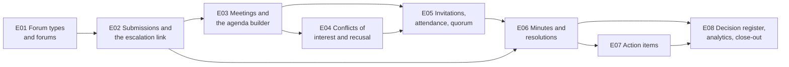

# Phase 4 — Forums, meetings, minutes, resolutions, actions: overview

> Level-1 plan (see `AGENTS.md §5`). It splits the phase into epics, fixes their order and dependencies, lists the phase-level research and ADRs, and maps the exit criteria to epics. Each epic gets its own detailed plan (`epic-<NN>-<slug>/`: research, ADRs, design, threat model, tasks, test plan) just before it starts.
>
> **Status:** approved 2026-11-18, every question answered as recommended (see §10). Written 2026-11-17.
>
> **Where Phase 4 sits:** the owner asked on 2026-11-17 to start Phase 4 now. That is ahead of the agreed order (Phase 3 E01–E06 → Phase 1b → Phase 3 E07, Phase 3 Q4). Phase 3 E01–E06 are built and merged. The Phase 1b overview (#141) is written but not approved, and Phase 3 E07 (the M1 security gate) has not started. Phase 4 needs the memo, workflow, document and search APIs, all of which exist; it does not need anything from 1b. §9 Q2 asks where 1b and E07 go now.

---

## 1. Phase goal (from `MASTER_PLAN.md`)

Management committees and board committees run their meetings on the platform, fed by escalated memos. The phase ends at **milestone M2, committee meetings live**. A memo escalated to a committee becomes an agenda item. The meeting decides it, and the decision becomes a numbered resolution. The resolution produces action items, and those can raise follow-up memos. Every step is linked and audited.

### What Phases 1a, 2 and 3 left us
- **Module stubs:** `forum`, `meeting`, `minutes`, `actions`, `voting`, `book` and `signature` exist as empty Spring Modulith modules (`backend/src/main/java/com/memo/<module>/package-info.java`). Phase 4 fills `forum`, `meeting`, `minutes` and `actions`. `voting`, `book` and `signature` stay for Phase 5.
- **Escalation hook (Phase 2 E03):**
  - The definition schema has an `escalate-to-forum` step with a `forum` key (`^[a-z][a-z0-9-]{0,99}$`, `workflow/definition-schema-v2.json`).
  - The step does not wait. It records an `ESCALATE_TO_FORUM` action, publishes `WorkflowEscalatedToForum(tenant, instance, subjectType, subjectId, nodeId, forum)` and moves on (`workflow/internal/ActionEffects.kt`).
  - Nothing consumes the event, and the forum key is not checked against anything.
- **Workflow engine:**
  - Versioned definitions with CEL conditions (ADR-0039), parallel steps, queues, DoA, substitution and acting-for, separation of duties (SOD-1 to SOD-4), timers, SLAs, business calendars and escalation (ADR-0041).
  - Any module can route its own items through the engine by implementing `WorkflowSubject` (`workflow/WorkflowSubject.kt`): eligibility, snapshot, attributes, interested parties, summaries and lock. Today only `memo` does. Minutes approval and action-item closure become new subjects.
- **Recusal (workflow side):** an approver can declare an interest and stand aside (`POST /api/v1/tasks/{taskId}/recuse`, `RECUSE` action). `WorkflowSubject.interested()` keeps interested people out of a memo's steps (SOD-4). There is no recusal for meeting items yet: no hiding of papers and no exclusion from quorum.
- **Memo (Phase 3):**
  - Types with metadata and maker-checker versions (ADR-0043).
  - Gapless numbering. The format parts, counter rows and assignment moment live in the memo type and the `memo_number_counter` table (ADR-0044). Resolution numbering needs the same machinery outside the memo module.
  - Documents with PDF renditions and extracted text produced at upload (ADR-0045), attachments (ADR-0046) and ONLYOFFICE co-editing (ADR-0047).
  - Templates filled with poi-tl (ADR-0048), the note sheet (ADR-0049) and the access model with copy-to (ADR-0050, one `MemoReadable` predicate).
  - Authenticated approvals and stamps (ADR-0051) and the PDF/A final record (ADR-0052, ADR-0053).
  - Search through a `SECURITY DEFINER` function (ADR-0054), the inbox, the team view and dashboards (E05), and the legacy import (ADR-0055).
- **Kernel:**
  - Tenant context and RLS everywhere, and the hash-chained audit written in the business transaction.
  - Idempotency keys, the authorisation matrix with its endpoint-coverage meta-test, step-up and rate limits.
  - Notifications: in-app and email through the tenant's relay, with no parameters in subjects (ADR-0030).
  - Terminology overrides, and the maker-checker states (`common/review`).
- **Dev:** mail goes to Mailpit on the VM, so no real mail client receives anything from dev today.

### What Phase 4 deliberately does *not* do
- **Board books** (compiled, personalised, watermarked), the **secure viewer with annotations**, **electronic voting** (in-meeting, circular and written resolutions, secret ballot), **PAdES signatures**, **live meeting mode**, **director mode** and **review rooms** are Phase 5. In Phase 4, meeting papers are each item's documents, viewed through the existing renditions. Decisions are recorded by the secretary and confirmed through the minutes (§9 A3).
- **The director app** is Phase 6b.
- **Calendar sync through Exchange, Microsoft Graph or Google APIs.** Invites go by email with an iCalendar file (§9 A5). An API connector would be an optional, tenant-enabled connector later (AGENTS §3.1).
- **Video-conference integration.** The meeting has a plain link field, as the master plan says.
- **AI minutes or summaries** are Phase 8.
- **New languages.** English only, with Arabic kept as the right-to-left proof (Phase 1a Q8, Phase 3 Q3).

---

## 2. Epics

Eight epics. Estimates are in team-weeks and size the scope. Phases 0–3 ran faster than their estimates with the agent working alone, so the quality gates set the pace, not these numbers. Each epic builds its own screens.

| # | Epic | Purpose | Est. | Depends on |
|---|---|---|---|---|
| E01 | **Forum types and forums** | Forum types as versioned, reviewed policy templates: quorum rule, decision outcomes, who may submit, submission deadline, minutes approval workflow, classification, retention, resolution numbering. Forums with members, roles (chair, vice-chair, secretary, member, invitee, observer), terms of office and alternates. Forum membership as an authorisation attribute. Admin screens. Representative committees in the demo tenant | 3–4 wks | — |
| E02 | **Submissions and the escalation link** | The consumer of `WorkflowEscalatedToForum`: an escalated memo becomes a submission in the forum's queue, and the memo waits at the forum step until the forum decides (§9 Q3). Direct submissions as memos of a submission type (§9 Q4). Secretary triage: accept for a meeting, defer, return for more information, decline. Deadline rules on the business calendar. The forum's queue and the submitter's view | 3–4 wks | E01 |
| E03 | **Meetings and the agenda builder** | Meetings (physical, virtual or hybrid, with the link as a plain field, and an explicit time zone). The agenda builder: sections, items, presenters, time allocations, consent agenda, standard items (apologies, previous minutes, matters arising, any other business), drag and drop with dnd-kit with a full keyboard alternative, cloning from earlier meetings and agenda templates. Item-level and document-level access. Agenda drafts, publishing and late changes. The meeting page members read | 4–5 wks | E02 |
| E04 | **Conflicts of interest and recusal** | Declarations per item (by the member, or recorded by the secretary or chair) and a pre-meeting declaration prompt. Recusal hides restricted papers from the conflicted member and excludes them from the item's quorum and decision. One recusal rule enforced in the API, lists, search, notifications, exports, invites and the minutes. A leak-test suite over every surface | 2–3 wks | E03 |
| E05 | **Invitations, attendance and quorum** | iCalendar invites, updates and cancellations by email (RFC 5545 and 5546, `UID` and `SEQUENCE`, `VTIMEZONE`). RSVP in the app. Attendance capture (present, remote, apologies, absent, joined late, left early). The quorum rule evaluated live per meeting and per item, and the result recorded with each decision | 3–4 wks | E03 (E04 for quorum per item) |
| E06 | **Minutes and resolutions** | The decision per item, recorded by the secretary: outcome, conditions, optional vote counts and named dissent. Resolutions numbered per forum and year, with the gapless counter reused from ADR-0044. Minutes drafted from a tenant .docx template filled from the agenda and decisions, edited in ONLYOFFICE, approved through a workflow (chair review, member confirmation), then locked and kept as a PDF/A record. The approved decision flows back to the waiting memo | 4–5 wks | E02, E05 |
| E07 | **Action items** | Action items raised from a decision or a minutes entry: owner, due date, status with red, amber and green, progress updates, reminders and escalations on the workflow timers, closure verified by the secretary or chair through a workflow, a follow-up memo raised from an action and linked back to it, carry-forward to the next meeting's matters arising. An actions inbox and the forum's action tracker | 3–4 wks | E06 |
| E08 | **Decision register, analytics and close-out** | A cross-forum decision register: resolutions and decisions searchable through the search function's pattern (ADR-0054), filterable by date, forum, type and outcome, and exportable for auditors. Meeting analytics: attendance rates, actions overdue, time from submission to decision. The phase exit journey, volumes and load test, demo script, runbooks, ASVS rows, threat models reviewed, retrospective | 2–3 wks | E06, E07 |

### Order and parallelism

- **Critical path:** E01 → E02 → E03 → E04 → E05 → E06 → E07 → E08, about 24–32 team-weeks.
- **Parallel work:**
  - E05's invitations, RSVP and attendance can start once E03's meetings are merged, beside E04. Only quorum per item waits for recusal.
  - E07's model and its actions inbox can start once E06's decisions are merged, before the minutes are finished.
- **Recusal is not left to E04 alone.** E01 and E03 design every new read path with a place for the recusal check, and E04 fills it in and proves it across every surface. Every later epic adds its surfaces (minutes, actions, the register) to the E04 leak suite.
- **Every epic extends what exists.** Nothing replaces Phase 2 or 3 tables. Changes to existing tables, such as the workflow's forum step and the generalised numbering counter, follow expand → migrate → contract.

---

## 3. Epic scope

### E01 — Forum types and forums
- **Forum types** are tenant data, versioned and published through the maker-checker review used for memo types (ADR-0043). Each holds:
  - the **quorum rule** (ADR-QUORUM): for example "a majority of voting members", "at least 3, including the chair or vice-chair", or "two-thirds, with a majority of independent members";
  - the **decision outcomes** the forum uses, for example approved, approved with conditions, rejected, deferred, returned for more information, noted. Each outcome is mapped to how it resumes a waiting memo (E02);
  - **who may submit** (units, roles, positions), the **submission deadline** (business days before the meeting), and the **workflow definition for minutes approval**;
  - the default **classification**, the **retention policy** (stored only; Phase 7 executes it), and the **resolution numbering format** (E06).
- **Forums:**
  - Each forum is a concrete committee or board of one forum type, with a code that matches the `forum` key in workflow definitions. A definition that names an unknown forum is refused at publish.
  - **Members** are people, and optionally positions, so a forum can say "the Head of Risk" and follow the holder. Each member has a role (chair, vice-chair, secretary, member, invitee, observer), whether they vote, whether they are independent, a term of office with dates, and an alternate who stands in when the member sends apologies.
  - Membership changes are effective-dated and audited.
- **Authorisation:**
  - Forum membership and role become attributes in ADR-0027's policy service: "member of forum F", "secretary of F" and so on.
  - New permissions: `forum.type.manage`, `forum.manage`, and `forum.read` for oversight roles such as an auditor. Secretaries manage their own forum's membership only when the forum type allows it.
- **Screens:** forum-type admin with a quorum-rule editor and its preview; forum admin with members, terms and alternates; "My forums" for members.
- **Demo:** representative bank committees in the demo tenant, for example the Board, Board Risk Committee, Board Audit Committee, Management Credit Committee, ALCO and the Executive Committee, with members drawn from the existing demo users and named staff. A workflow on the credit memo type escalates large amounts to the Management Credit Committee.

### E02 — Submissions and the escalation link
- **The forum step waits** (ADR-ESCALATE, §9 Q3):
  - The engine gains a wait state. The memo stays "with the forum" at that step, with no task, until the forum's decision resumes it.
  - The outcome is recorded as an action, becomes an attribute the definition can branch on (CEL), and continues the route. Typical routes: approved → end; rejected → reject; returned for more information → back to the initiator as a return.
  - A step marked "for information" keeps today's behaviour: the memo is placed before the forum and its route continues at once. Instances already running keep the version they are pinned to.
- **Submissions:**
  - The consumer of `WorkflowEscalatedToForum` creates a **submission** in the forum's queue, linked to the memo, in the same transaction as the step. It checks that the forum exists and is active. The event already carries `tenantId` and runs in the tenant context.
  - **Direct submissions** are memos of a tenant-configured "committee paper" type whose workflow escalates to the forum (§9 Q4). They get numbering, documents, the note sheet, access and search with no second model.
- **Secretary triage:** accept for a named meeting (or "next meeting"), defer, return for more information (the memo goes back to the submitter as a return), or decline with a reason.
  - Late submissions after the deadline are accepted only by the secretary, and are recorded as late.
  - Every triage action is audited and shown on the memo's note sheet.
- **Who sees what:**
  - The secretary and chair see the queue. Members see an item only once it is on a published agenda (E03).
  - The submitter sees where their memo is: queued, accepted for a meeting, decided.
  - A memo placed before a forum becomes readable to the forum's members through ADR-0050's reader table (a new participant kind), still subject to clearance and recusal.
- **Screens:** the forum queue for secretaries; the forum panel on the memo page; the inbox shows "with the Credit Committee" for waiting memos.

### E03 — Meetings and the agenda builder
- **Meetings:**
  - Each meeting belongs to a forum, with a number in the forum's series (for example "ALCO 11/2026") and a start and end time with an explicit IANA time zone (AGENTS §3.6).
  - It has a mode (physical, virtual or hybrid), a location, the video link as a plain field, a classification, and a status: draft → scheduled → in progress → held → minutes approved → closed, or cancelled.
  - Rescheduling and cancelling are audited and notify the invitees (E05).
- **The agenda:**
  - Sections and items, with a presenter, time allocation, purpose (for decision, for discussion, for information), linked submission or standing item, and papers.
  - Standing items come from the forum type's agenda template: apologies, declarations of interest, minutes of the previous meeting, matters arising (E07), any other business.
  - The **consent agenda** is a section of items taken together without discussion. Any member can ask before the meeting to move an item out of it. The research (R2) settles the exact rules.
  - Item papers are the submission memo's documents: the approved document, attachments and final record, read through the existing renditions. Secretaries can add further papers.
- **Item-level and document-level access:**
  - An item or a paper can be restricted to named members. A restricted paper is hidden, not just greyed out, and its title is hidden too when the item says so.
  - One rule (ADR-PAPERS) is shared by the meeting page, downloads, search, notifications and, later, the Phase 5 book.
- **Publishing:**
  - The agenda goes from draft to published, and members are notified when it is published.
  - Later changes create a new agenda revision with change flags ("added", "moved", "paper replaced"). Earlier revisions are kept.
  - Phase 5's book versions build on these revisions.
- **Builder UX:**
  - Drag and drop with dnd-kit, plus a keyboard path for every move: move up, move down, move to section (WCAG 2.2 AA, AGENTS §3.7).
  - Clone the agenda from an earlier meeting, or start from the forum type's agenda template.
  - Time totals per section, with an overrun warning.
- **The meeting page (members):**
  - The agenda with papers per item, the member's own declarations, RSVP (E05) and, later, decisions.
  - Large targets and minimal chrome for older readers (AGENTS §3.7). Phase 5's director mode builds on this page.

### E04 — Conflicts of interest and recusal
- **Declarations:**
  - A member declares an interest in an item: its nature (free text), whether they recuse, and when declared.
  - The secretary or chair can record a declaration on a member's behalf, with that recorded as such.
  - When the agenda is published, each member is prompted to declare against its items. Declarations are append-only; a withdrawal is a new entry.
  - Interests already recorded on the source memo (SOD-4, the workflow's `RECUSE`) carry over as declarations on the item.
- **Effects of a recusal (ADR-COI):**
  - The member does not see the item's restricted papers, nor its discussion text in draft minutes.
  - They are excluded from the item's quorum count and decision (E05, E06), and get no notifications about the item.
  - The item's title stays visible unless the item is marked as sensitive, so the member knows to leave the room.
  - Recusal is enforced server-side, in the SQL filters the read paths share, never by the UI.
- **Surfaces covered:** meeting page, item and paper reads and downloads, search (the search function gains the recusal predicate), notifications and email, invite attachments, agenda exports, draft and approved minutes, the decision register, analytics and audit-viewer exports. Each surface gets a leak test: a recused member sees no title (for sensitive items), paper, snippet, count or facet of the item.
- **Register view:** for the secretary and chair, every declaration per meeting. For auditors, the declarations across forums.

### E05 — Invitations, attendance and quorum
- **Invitations:**
  - An iCalendar `VEVENT` is sent by email through the tenant's relay (ADR-0030) when the meeting is scheduled, an update with `SEQUENCE` + 1 when it changes, and a `METHOD:CANCEL` when it is cancelled. Each meeting has one stable `UID`.
  - `VTIMEZONE` is taken from the meeting's zone. The organiser is the forum's secretary or the tenant's sending address (R3).
  - **No sensitive content in the invite:** the forum name, time, place, the video link and a link to the meeting page. No agenda, papers or item titles. The event title can be set per forum type to a neutral text for sensitive forums.
  - The library comes from research (R3: ical4j or biweekly).
- **RSVP** happens in the app: attending, attending remotely, apologies (with an optional alternate), or no answer.
  - Replies sent from mail clients (`METHOD:REPLY`) are not processed in Phase 4, because that needs an inbound mailbox (R3). The invite asks for the RSVP in the app instead.
- **Attendance:**
  - The secretary captures who is present, remote, sent apologies or is absent, and late arrivals and early departures, per item when it matters.
  - Attendance is append-only, with corrections as entries.
- **Quorum (ADR-QUORUM):**
  - The forum type's rule is evaluated live on the meeting page as attendance changes.
  - Per item, recused members and those who have left are excluded.
  - The result and the members it counted are recorded with each decision (E06). An item cannot be decided without quorum unless the secretary records an override with a reason. That override is a tenant setting and off by default.
- **Notifications:** reminders before the meeting and before the RSVP deadline, through the notification module, with nothing sensitive in subjects.

### E06 — Minutes and resolutions
- **Decisions per item:**
  - The secretary records the outcome (from the forum type's list), its text and conditions, the quorum snapshot, and optionally the vote counts (for, against, abstain) and named dissent or abstentions.
  - A decision is final once the minutes are approved. Until then it can be corrected, and each correction is a new entry referencing the old one (AGENTS §3.3).
  - Electronic voting by members is Phase 5 (§9 A3).
- **Resolutions:**
  - A decision with an outcome marked "resolution" gets a number from the forum's series, for example `BRC/2026/014`, reset per year or financial year. The number is gapless, taken in the business transaction, and voids are recorded.
  - The format and counter come from ADR-0044, generalised out of the memo module into one numbering service (ADR-RESOLUTION, expand → migrate → contract).
  - The resolution text is linked to its agenda item, the source memo, the meeting and the minutes.
- **Back to the memo:**
  - When the decision is recorded (or when the minutes are approved, per the forum type, R5), the waiting memo resumes with the outcome (E02).
  - The resolution number and a link appear on the memo's note sheet and in its final record.
- **Minutes:**
  - The draft comes from the forum type's .docx template (ADR-0048 engine and tags extended for meetings: attendance, apologies, declarations, items, decisions, resolution numbers), filled from the agenda, attendance and decisions, and edited in ONLYOFFICE (ADR-0047).
  - Approval goes through the workflow engine as a new `minutes` subject: chair review, then member confirmation, or approval at the next meeting as a standing item, per the forum type (R5).
  - Once approved, the minutes are locked. A PDF/A record is built with the ADR-0053 machinery and kept in the object-locked record bucket, with its checksum in the audit log.
  - Recused members get a version without the items they were recused from (ADR-COI).
- **Signatures:** none in Phase 4. Minutes and resolutions carry approval stamps (ADR-0051). PAdES signing is Phase 5.

### E07 — Action items
- **Model:**
  - An action item comes from a decision or a minutes entry (or is added by the secretary). It has an owner (a person, or a position that follows its holder), a due date, a description, a status (open, in progress, done pending verification, closed, cancelled), and red, amber and green.
  - RAG is derived from the due date and progress by a tenant rule, and can be overridden with a reason.
- **Progress:** updates with remarks and attachments, append-only; a due-date change needs a reason and, per forum type, the secretary's agreement.
- **Reminders and escalation:**
  - Reminders before the due date and escalation when overdue run on the workflow timers and business calendar (ADR-0041).
  - Closure goes through a workflow on the new `action-item` subject: the owner marks it done, and the secretary or chair verifies it or sends it back.
- **Follow-up memos:**
  - "Raise a memo" from an action creates a draft memo linked to the action ("follows up" link, ADR-0043 links). The action shows the memo's state.
  - The loop closes when the memo is decided, and the action can then be verified.
- **Matters arising:** open actions carry forward to the next meeting of the forum as the standing "matters arising" item, with their status at agenda publication.
- **Screens:** "My actions" in the inbox; the forum's action tracker (filters, RAG, overdue) for the secretary and chair; actions on the meeting page and in the minutes.

### E08 — Decision register, analytics and close-out
- **Decision register:**
  - Resolutions and recorded decisions across every forum the viewer may see, filtered by date, forum, forum type, outcome, memo type and text.
  - Search goes through a `search_decision` table behind the search function (ADR-0054 pattern), with the recusal and forum-access predicates.
  - Export to XLSX and PDF for auditors, rate-limited and audited.
- **Meeting analytics:**
  - Attendance rate per member and per forum, actions overdue per forum and owner, time from submission to decision, and items deferred.
  - Scoped by the viewer's rights and recusals, in the style of E05's dashboards in Phase 3.
- **Volumes:** the synthetic generator adds forums, meetings, agenda items, decisions and actions (for example 10 years of 30 forums meeting monthly). `EXPLAIN` is reviewed for every new list query, and the register and actions inbox are load-tested against NFR P1.
- **Close-out:**
  - The exit journey `committee-cycle.spec` (§5) and the demo cycle seeded on dev.
  - The demo script `demo.md`, runbooks (forum setup, meeting administration, minutes), the ASVS rows, the threat models reviewed, and the retrospective.

---

## 4. Scope coverage (master plan scope → epic)

| Master plan Phase 4 scope item | Epic |
|---|---|
| Forum types and forums: policy templates (quorum, voting rules, who may submit, minutes approval workflow, classification, retention); members, roles, terms of office, alternates | **E01** (voting rules: the decision outcomes and recorded counts of E06; electronic voting is Phase 5) |
| Agenda submissions: memos escalated by workflow, direct submissions through a submission workflow, secretary triage, deadline rules | **E02** |
| Meetings: scheduling (physical, virtual, hybrid; video link as a plain field) | **E03** |
| Meetings: iCalendar invites and updates, RSVP, attendance capture, quorum check (live and recorded) | **E05** |
| Agenda builder: sections, items, presenters, time allocations, consent agenda, drag and drop, item-level and document-level permissions, cloning and templates | **E03** |
| Conflict of interest: declarations per item; recusal hides materials and excludes from voting and quorum | **E04** (quorum E05, decisions E06) |
| Minutes: tenant .docx templates pre-filled from the agenda, secretary drafting, approval workflow, locked once approved | **E06** |
| Resolutions: numbering per forum and year, text linked to item and minutes, resolution register | **E06** (register in E08) |
| Decision register: cross-forum search and filters, exportable for auditors | **E08** |
| Action items: owner, due date, RAG, reminders and escalations, progress, closure verification, follow-up memos, carry-forward to matters arising | **E07** |
| Basic meeting analytics | **E08** |

## 5. Exit criteria → epics

| Exit criterion (`MASTER_PLAN.md`) | Delivered by | Evidence |
|---|---|---|
| An escalated memo becomes an agenda item, then a resolution with a number, then action items, then a follow-up memo, all linked and auditable | E02, E03, E06, **E07**, E08 | The Playwright journey `committee-cycle.spec` through the UI only, on CI and against dev. An IT walks the links in both directions and checks every step's audit entry and the tenant chain |
| Recusal is enforced server-side (proved by authorisation tests), including in search and notifications | **E04**, then every later epic | Matrix tests with a recused-member column; the recusal leak suite over API, lists, search, notifications, invites, exports and minutes (TESTING_STRATEGY §12) |
| The pilot runs at least one real committee cycle on the platform | **E08** | No pilot (Phase 3 Q2, §9 A1): a representative committee cycle on dev with the demo committees, walked through by the owner. A customer's real cycle is carried until there is one |

**Phase-4 special tests** (`TESTING_STRATEGY.md §12`):

| Special test | Epic |
|---|---|
| Recusal enforced across API, search, notifications and exports | E04 (and each later epic's surfaces) |
| Quorum rules (property tests over rule × attendance × recusal; live and recorded agree) | E05 |
| iCalendar invites accepted by common clients | E05: RFC 5545 validation of every generated file in CI, golden files for request, update and cancel, and a recorded run in Outlook, Gmail and Apple Calendar (§9 Q5) |
| Resolution numbering under concurrency (parallel decisions, rollbacks leave no gap, voids recorded) | E06 |

Also from `TESTING_STRATEGY.md`: state-machine tests for meetings, submissions, agendas, minutes and action items (every allowed and every forbidden transition); Jazzer fuzzing nightly on the quorum-rule parser and the iCalendar writer's input; PIT on quorum evaluation and resolution numbering.

**Generic phase-exit items** (`AGENTS.md §5`):

| Item | Where |
|---|---|
| Demo script | `demo.md` in E08 |
| `retrospective.md` | At phase close |
| STATUS | Every session |
| Usability check | Screen flows reviewed by the owner before build (§9 Q1). A moderated walkthrough of the committee cycle in E08 |
| ASVS | Rows per epic, closed in E08. The external pen test of Phase 4 joins the next one booked (§9 Q2) |
| Manual accessibility | Keyboard and screen-reader pass over the agenda builder (drag and drop's keyboard path), the meeting page, attendance capture and the action tracker |

---

## 6. Phase-level research list

Each item is answered in the `research.md` of the epic shown, with sources and access dates. Versions are re-verified from official sources, never taken from this plan or from memory.

| # | Question | Epic |
|---|---|---|
| R1 | Current stable versions, licences and maintenance status of everything each epic adds: dnd-kit (and its accessibility story), the iCalendar library (R3), any date-time zone data, Spring Boot 4.2 status | Every epic |
| R2 | **Agenda and meeting practice in board portals and committee tools** (Diligent, Nasdaq Boardvantage, OnBoard, Azeus Convene, iBabs, BoardEffect, Admincontrol): consent agendas, multi-tier agendas, late additions, standing items, secretary triage and submission deadlines; what users criticise and what to do better | E02, E03 |
| R3 | **iCalendar:** ical4j vs biweekly (licence, maintenance, RFC coverage); iTIP and iMIP (RFC 5546, RFC 6047) request, update and cancel semantics; `UID`, `SEQUENCE`, `ORGANIZER`, `VTIMEZONE`; how Outlook, Gmail and Apple Calendar treat updates, cancellations and an organiser that is a no-reply address; whether processing `METHOD:REPLY` is worth an inbound mailbox | E05 |
| R4 | **Quorum rules across sectors:** majority of members, minimum counts, required roles (chair or vice-chair), independent members, alternates, members who left, recusals; whether CEL (ADR-0039) over a fixed set of counts expresses them, or a structured rule builder is needed | E01, E05 |
| R5 | **Minutes practice in banks and listed companies:** action minutes vs narrative minutes, recording dissent, approval by chair circulation vs at the next meeting, when a decision takes effect (at the meeting or when the minutes are approved), resolution numbering conventions, extracts of minutes | E06 |
| R6 | **Conflict-of-interest practice:** per-item declarations vs a standing register of interests, what supervisors expect of bank boards (for example the Basel Committee's corporate governance principles), and how portals hide materials and record leaving the room | E04 |
| R7 | **Action tracking:** RAG rules, closure verification, matters arising, follow-up of overdue actions in committee practice | E07 |
| R8 | **Engine wait state:** a step that waits for an external decision; resuming with an outcome attribute; timers on a waiting step; migration of pinned instances; how the visual builder shows it | E02 |
| R9 | **Generalising numbering:** moving ADR-0044's format and counters into a service shared by memos and resolutions without changing any existing memo number | E06 |

## 7. Planned ADRs

Numbers are assigned when written, starting at ADR-0056. Each one uses MADR.

| ADR | Decision | Epic |
|---|---|---|
| ADR-FORUM | Forum types and forums: policy fields, versioning and review, membership with roles, terms and alternates, forum membership as an authorisation attribute | E01 |
| ADR-QUORUM | The quorum rule language, live and recorded evaluation, overrides | E01, E05 |
| ADR-ESCALATE | The waiting forum step: wait state, outcomes as attributes, "for information" steps, migration (amends ADR-0034 and ADR-0038) | E02 |
| ADR-SUBMISSION | Submissions and triage; direct submissions as memos of a submission type; members as memo readers (amends ADR-0050) | E02 |
| ADR-AGENDA | The agenda model: sections, items, consent agenda, standing items, revisions and publishing | E03 |
| ADR-PAPERS | Item-level and document-level access to meeting papers, and the one rule every read path shares | E03 |
| ADR-COI | Declarations, recusal effects and the enforcement points | E04 |
| ADR-ICAL | Invitations: library, iTIP methods, content rules, RSVP in the app | E05 |
| ADR-MINUTES | Minutes drafting, template tags, the approval subject, locking and the record | E06 |
| ADR-RESOLUTION | Decisions and resolutions, the shared numbering service, back to the memo | E06 |
| ADR-ACTIONS | Action items, RAG rules, closure workflow, follow-up memos, carry-forward | E07 |

## 8. Risks

| # | Risk | Mitigation |
|---|---|---|
| R1 | **Recusal leaks** through one of many surfaces (search snippets, counts, notifications, invite files, exports, minutes) | One predicate shared by every read path (ADR-COI); the leak suite grows with each epic; matrix tests with a recused-member column; the M2 pen test scope names it |
| R2 | The **waiting forum step** changes the engine Phase 2 proved, and running instances are pinned to old definitions | The wait is a new step behaviour, not a change to existing ones; existing instances keep their versions; property tests on the engine's invariants rerun; an R8 spike early in E02 |
| R3 | **Calendar clients differ** in how they treat updates and cancellations, and dev sends mail only to Mailpit | Golden files and RFC validation in CI; a recorded run in real clients (§9 Q5); RSVP in the app, so nothing depends on client replies |
| R4 | **Scope creep into Phase 5** (voting, books, signatures, live mode) | §1 lists what is not done; decisions are recorded by the secretary; the agenda revisions and the meeting page are designed as what Phase 5 builds on |
| R5 | **No pilot**, so no real committee shapes the design | R2, R5, R6 and R7 research on public practice; representative committees in the demo; owner review of the key screens before build; a customer's cycle carried |
| R6 | **Phase 1b and the M1 security gate slip** further while Phase 4 runs | §9 Q2 records the new order; ASVS rows kept current per epic so one pen test can cover Phases 0–4 and 1b |
| R7 | **The agenda builder is not accessible** (drag and drop only) | A keyboard path for every move from the first slice; dnd-kit's keyboard sensor and announcements; axe and a manual screen-reader pass |
| R8 | **Generalising numbering** breaks memo numbers | Expand → migrate → contract; Phase 3's numbering tests and the concurrency suite run unchanged against the shared service |
| R9 | **The dev VM (16 GB)** is already full with ONLYOFFICE, Tika and ClamAV | Phase 4 adds no new service; measured at each epic's close |

## 9. Open questions for the human

**Assumptions** (safe defaults; say so if any is wrong):
- **A1 — No pilot.** As in Phase 3 (Q2), representative bank committees in the demo tenant stand in for the pilot's. The exit criterion "the pilot runs a real committee cycle" becomes a representative cycle on dev walked through by you; a customer's real cycle is carried.
- **A2 — English only**, Arabic kept as the right-to-left proof.
- **A3 — No electronic voting in Phase 4.** The secretary records each decision (outcome, optional vote counts and named dissent), and the minutes approval confirms it. Members vote electronically from Phase 5.
- **A4 — No board book in Phase 4.** Members read each item's papers through the existing PDF renditions on the meeting page. The compiled, watermarked book, the secure viewer and annotations are Phase 5.
- **A5 — Invites by email with an iCalendar file** through the tenant's own relay, with no calendar API. Invites carry no agenda, item titles or papers; RSVP is in the app.
- **A6 — Minutes are not signed in Phase 4.** They carry approval stamps (ADR-0051); PAdES comes in Phase 5.

1. **Q1 — Approval and gate delegation.** Do you approve this overview? In Phases 0, 1a, 2 and 3 you delegated the per-epic review gate (the agent writes each epic plan, then implements it without waiting) and asked to be asked again for each new phase. Recommendation: keep the delegation, except these screen flows, which go to you before build: forum-type and forum admin (E01), the secretary's queue and the agenda builder with the meeting page (E02, E03), and minutes with resolutions (E06).
2. **Q2 — Where Phase 1b and Phase 3 E07 go now.** You asked to start Phase 4 before 1b and E07. Options:
   - (a) Phase 4 now, then Phase 1b, then Phase 3 E07, with one pen test covering Phases 0–4 and 1b. M1 and the M2 security review merge.
   - (b) Phase 4 now, with 1b's epics interleaved.
   - (c) Pause Phase 4 after the plan; 1b and E07 first, as agreed on 2026-11-14.

   Recommendation: **(a)**. With no customer, M1 has no go-live date to protect. The agent works one epic at a time, so interleaving only adds switching. One pen test over a larger product costs less than two. The 1b overview (#141) stays as written until you take it up.
3. **Q3 — Does a memo wait for the forum's decision?** Today the `escalate-to-forum` step only records and moves on. Options:
   - (a) The step **waits**: the memo stays "with the forum" until the decision. The outcome (approved, rejected, deferred, returned for information, ...) resumes the route, and the definition can branch on it. A step marked "for information" keeps today's behaviour.
   - (b) The step stays as it is: the agenda item is a separate, linked record, and the memo's route finishes on its own.

   Recommendation: **(a)**. In a bank, a credit memo above the DoA limit is approved by the committee's resolution. Its route cannot end before the committee decides, and the exit criterion's chain (memo → item → resolution) needs the link to carry the decision back.
4. **Q4 — Direct submissions to a forum.** Options:
   - (a) A direct submission is a **memo** of a tenant-configured "committee paper" type whose workflow escalates to the forum. It gets numbering, documents, the note sheet, access and search with no second model.
   - (b) A separate submission form and record, with its own workflow.

   Recommendation: **(a)**: one model, fewer moving parts. Procedural items (apologies, previous minutes, any other business) are added by the secretary without a memo.
5. **Q5 — Real calendar clients for the invite test.** Dev sends mail only to Mailpit. Options:
   - (a) At E05, you name an Outlook mailbox (Microsoft 365 or Outlook.com) and a Gmail mailbox, plus an SMTP relay dev may use for one recorded run (for example your domain's mail). The agent sends a request, an update and a cancellation, and you report what each client shows.
   - (b) Automated validation and golden files only; the real-client check is carried to the first customer.

   Recommendation: **(a)**. It is the only way to prove "accepted by common clients", and it needs about 15 minutes of your time. Nothing is needed until E05.
6. **Q6 — Conflict-of-interest declarations.** Options:
   - (a) Declarations **per item** (by the member, or recorded by the secretary or chair), with a declaration prompt when the agenda is published.
   - (b) (a) plus a **standing register of interests** per member (directorships, related parties) that flags items automatically.

   Recommendation: **(a)** in Phase 4. Automatic flagging needs reliable counterparty data on memos, which no customer has given us; the register can be added when one does. Recusal always applies only to the item it is declared on.

---

## 10. Approval

| Item | By | Date | Notes |
|---|---|---|---|
| Phase 4 overview | Product owner (aradnazihar) | 2026-11-18 | Approved, with every question answered as recommended: "I'm relying on you on the questions. I hope your recommendations are based on industry best practices and also user friendliness." The owner **kept the per-epic gate delegation**. Because the recommendations rest on the agent's reading, each epic's research checks them against sourced industry practice and usability. A finding that contradicts one is recorded in an ADR and reported to the owner. |

### Answers to open questions
| Q | Date | Answer |
|---|---|---|
| Q1 | 2026-11-18 | **Approved as recommended; delegation kept.** The screen flows for forum-type and forum admin (E01), the secretary's queue, the agenda builder and the meeting page (E02, E03), and minutes with resolutions (E06) go to the owner before build. |
| Q2 | 2026-11-18 | **(a):** Phase 4 now, then Phase 1b, then Phase 3 E07, with one pen test over Phases 0–4 and 1b. The 1b overview (#141) waits as written. |
| Q3 | 2026-11-18 | **(a):** the forum step waits for the decision, and the outcome resumes the route. A step marked "for information" keeps today's behaviour. |
| Q4 | 2026-11-18 | **(a):** direct submissions are memos of a "committee paper" type. The secretary adds procedural items without a memo. |
| Q5 | 2026-11-18 | **(a):** at E05 the agent asks for an Outlook and a Gmail mailbox and a relay for one recorded run. If none is available then, the real-client check is carried. |
| Q6 | 2026-11-18 | **(a):** declarations per item, with a prompt when the agenda is published. A standing register waits for a customer with the data. |
