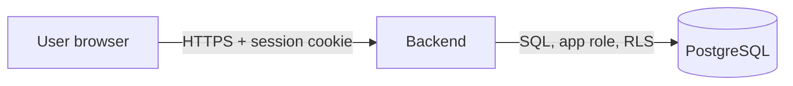

# <Epic or feature> — threat model (STRIDE)

> Required by `AGENTS.md §5 Step 4`. Copy this template into the epic folder as `threat-model.md`. Every mitigation that can be tested gets a test listed in the epic's `test-plan.md` (TESTING_STRATEGY §6).

## Scope
<What is new: components, endpoints, jobs, files, data classes. Link to design.md.>

## Data flows
1. <actor> → <component>: <data, protocol, trust boundary crossed?>

## Assets and trust boundaries
| Asset | Classification | Where it lives | Boundary crossings |
|---|---|---|---|

## STRIDE

| # | Category | Threat | Flow | Mitigation | ASVS 5.0 / MASVS ID | Test |
|---|---|---|---|---|---|---|
| S1 | Spoofing | | | | | |
| T1 | Tampering | | | | | |
| R1 | Repudiation | | | | | |
| I1 | Information disclosure | | | | | |
| D1 | Denial of service | | | | | |
| E1 | Elevation of privilege | | | | | |

Always consider:
- **Cross-tenant access**: RLS, joins, views, functions, caches, jobs, events.
- **Delegation and acting-as**: whose authority is used, and is it audited?
- **Files**: hostile inputs, conversion service egress, URLs leaking content.
- **Audit**: can the action happen without its audit record?
- **Offline / mobile clients**: replay, idempotency, stale permissions.

## Residual risks and follow-ups
- <risk>: <owner, target phase>
